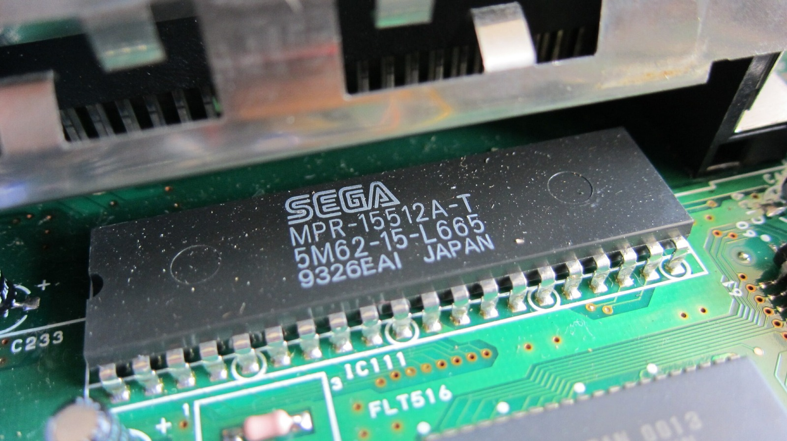

*A Sega chip to kick off a new retro-computing blog. Plenty more old hardware to pull apart once I get this place looking respectable!*
{: .media-caption }

Welcome, it's a bright and chipper day outside. It's just past 8am, and we have quite a task ahead of us this week: getting this blog operational. As the weeks go by I'll be adding photos, but first I need to work out what menus I want and find a nice theme. Stand by for more! :)
