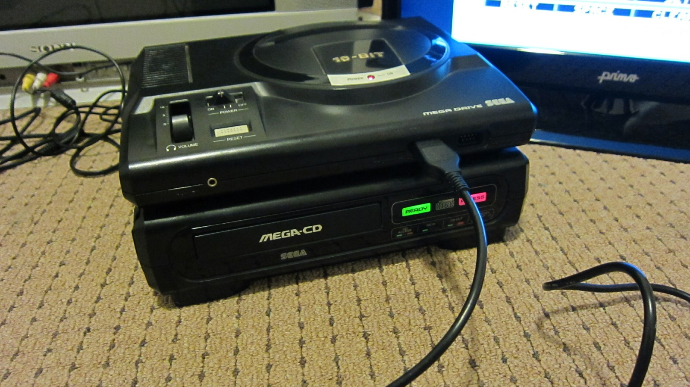

*The Mega-CD Model 1 that arrived from Germany, paired with a Mega Drive. Naturally, it wasn't long before I had the lid off.*
{: .media-caption }

It only arrived yesterday, and inside was one of the dreaded JVC Optima-5 optical pickups. Replacement Optima-5 units were difficult to source compared with the more common Sony KSS-240A.

### Sources

- [Sega-16 Forums: Sega CD Systems Repair (JVC Optima-5 and Sony KSS-240A)](https://www.sega-16forums.com/forum/general-discussion/tech-aid/21805-sega-cd-systems-repair-thread)
