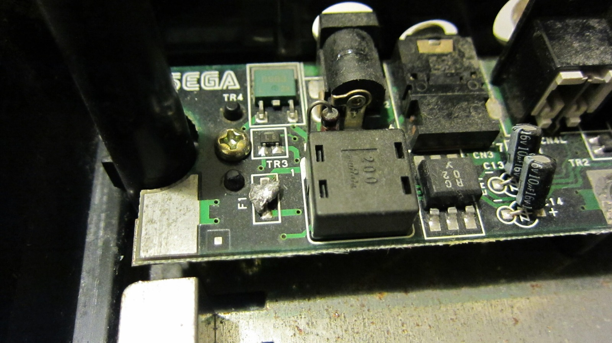
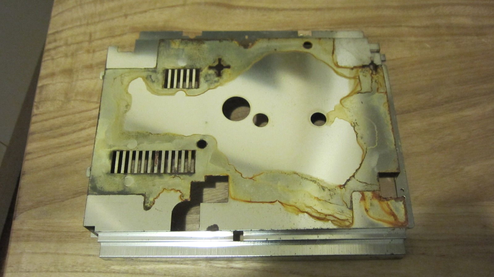

*That should be a fuse at F1, not a suspicious lump of solder. I don't think that's quite what Sega had in mind!*
{: .media-caption }

Received another Sega Mega-CD Model 1 today, this time with a Sega Mega Drive Model 1 sitting on top. It's in pretty rough shape, but it does function. Once I pulled it apart I found rust and liquid residue. Someone had bypassed the fuse with a blob of solder, possibly after it blew. Given the corrosion around it, the liquid damage may have played a part.

*The Mega-CD's metal shielding had seen rather better days. Rust and residue all over the place, just what I wanted to find inside!*
{: .media-caption }

I'll replace the fuse once I've cleaned everything up as best I can. It also seems a little slow to recognise music CDs, although once it finds them it plays through the disc fine.

Both of my Mega-CD Model 1 units have JVC optical pickups so far. Sony KSS-240A-equipped units also exist, and those pickups are generally easier to source. The JVC and Sony pickups are not direct drop-in replacements, although complete drive mechanisms can be swapped with compatibility caveats.

I also received two Sega Saturn Model 1s in the mail. One apparently had a dead laser and the other a dead PSU. The guy I bought them from had planned to combine them into one working unit but thought they were incompatible... but they weren't! At least in this particular pair, the PSUs were interchangeable. I swapped them over and one Saturn works fine now. The next job is putting the PSU back into the other Saturn and checking whether its laser is actually dead.

The two Saturns have different mainboards. One uses the later 64-pin CD-board arrangement also found in some Model 2 Saturns. More spares for one day in the distant future. Long live '90s gaming!

### Sources

- [Sega-16 Forums: Sega CD Systems Repair (JVC Optima-5 and Sony KSS-240A)](https://www.sega-16forums.com/forum/general-discussion/tech-aid/21805-sega-cd-systems-repair-thread)
- [Sega-16 Forums: Sega Saturn Revisions and Models Guide](https://www.sega-16forums.com/forum/general-discussion/tech-aid/24084-sega-saturn-revisions-and-models-guide/page4)

### Related Posts

- [Sega Mega-CD Model 1 Acquired](/sega-mega-cd-model-1-acquired/)
- [Fuse Replacement on the Sega Mega-CD Model 1](/fuse-replacement-on-the-sega-mega-cd-model-1/)
