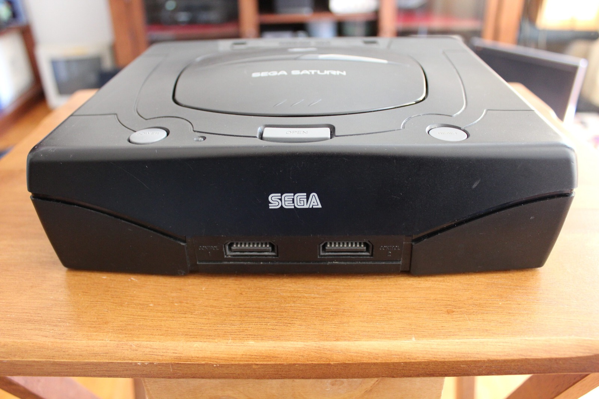
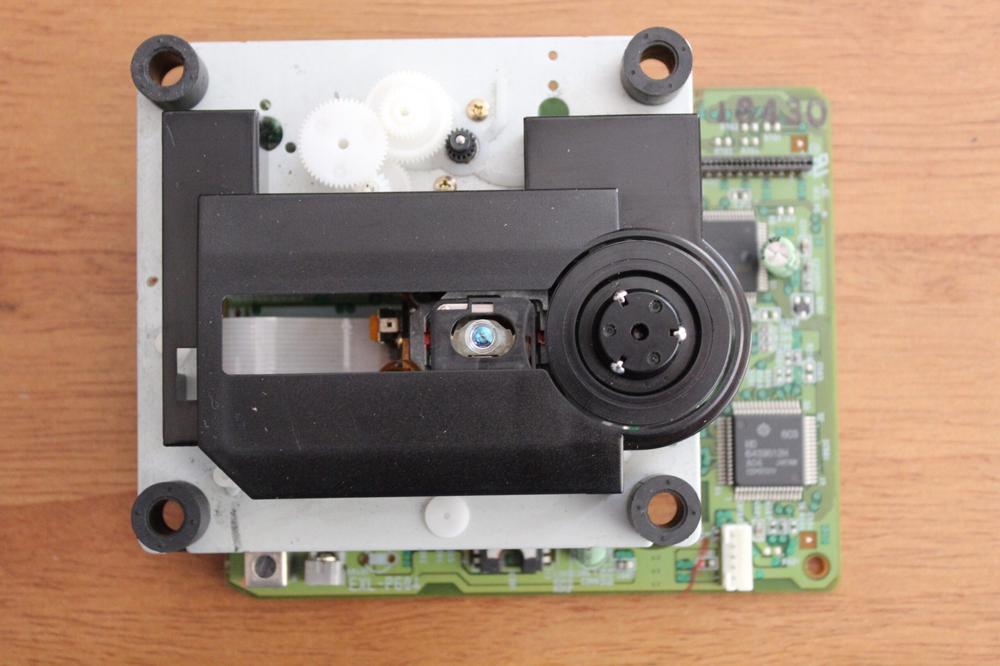
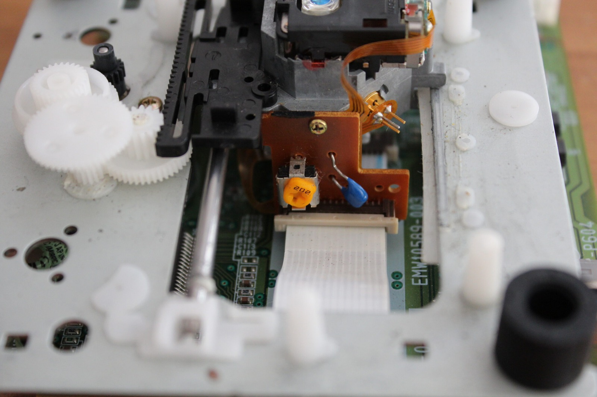

*The Saturn that had supposedly given up reading discs. A tiny laser adjustment got it playing again, although that's not a permanent fix for a tired pickup.*
{: .media-caption }

With a known-good power supply installed, I turned the laser-power trimpot slightly and the Saturn started reading commercially pressed games again. It still had trouble with a Taiyo Yuden CD-R containing CD audio, but another tiny adjustment got that playing as well.

*The Saturn's optical drive out on the table. Only a small adjustment brought it back to life, but it wasn't a proper substitute for a healthy laser.*
{: .media-caption }

It's amazing how much difference one or two degrees on a trimpot can make.

This isn't a proper cure for a worn optical pickup, though. Sega's service manual is clear that this control is factory-adjusted and warns that changing it can damage the laser diode. If the RF output has fallen below specification, Sega's repair procedure is to replace the pickup rather than compensate by increasing laser power.

Still, this drive had been assumed completely dead, and it certainly wasn't dead anymore!

*The tiny yellow-orange adjustment trimpot beside the Saturn's optical drive gears. Amazing what a fraction of a turn changed, even if it comes with risks.*
{: .media-caption }

I was also trying to work out why the power supply in the other Saturn was dead. With the known-good PSU installed, that Saturn works fine. Put the dead PSU into the working Saturn and it stops working, so the fault definitely follows the power supply.

Nothing looked visibly blown. The blue-capped varistors didn't appear shorted on a basic continuity test, and the capacitors showed resistance or charging behaviour. Those simple checks aren't enough to prove the components are healthy, but at least nothing obvious jumped out.

I was also considering hacking apart a PC power supply to see if I could run the Saturn from +3.3 V, +5 V and +9 V. The awkward part is the +9 V rail: these early Saturn PSU arrangements use +3.3 V, +5 V and +9 V, while a normal ATX supply gives +3.3 V, +5 V and +12 V. So it isn't a straight substitute.

I also need to get image uploads working so I can actually show pictures of all these things I'm working on.

**Update 2016:** Lightbox works now on pictures! Also pictures are now showing.

**Update 2018:** Fixed those pictures again, bad Google breaking all my image links.

### Sources

- [Sega Saturn Service Manual (Laser Adjustment)](https://www.manualshelf.com/manual/sega/saturn/service-manual.html)
- [Sega-16 Forums: Sega Saturn Revisions and Models Guide](https://www.sega-16forums.com/forum/general-discussion/tech-aid/24084-sega-saturn-revisions-and-models-guide/page4)
- [Fluke: How to Measure Resistance](https://www.fluke.com/en-au/learn/blog/digital-multimeters/how-to-measure-resistance)
