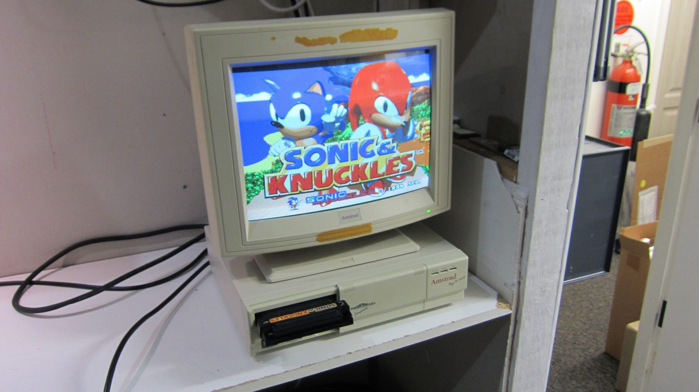
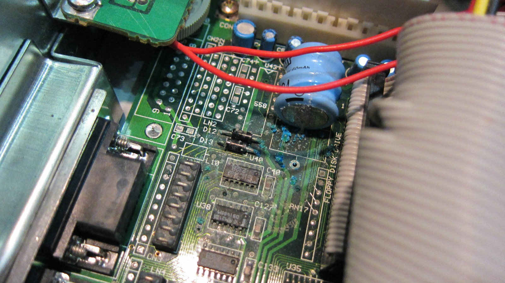
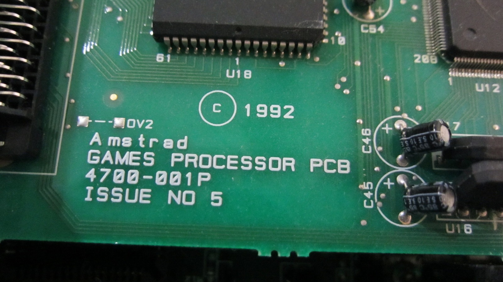
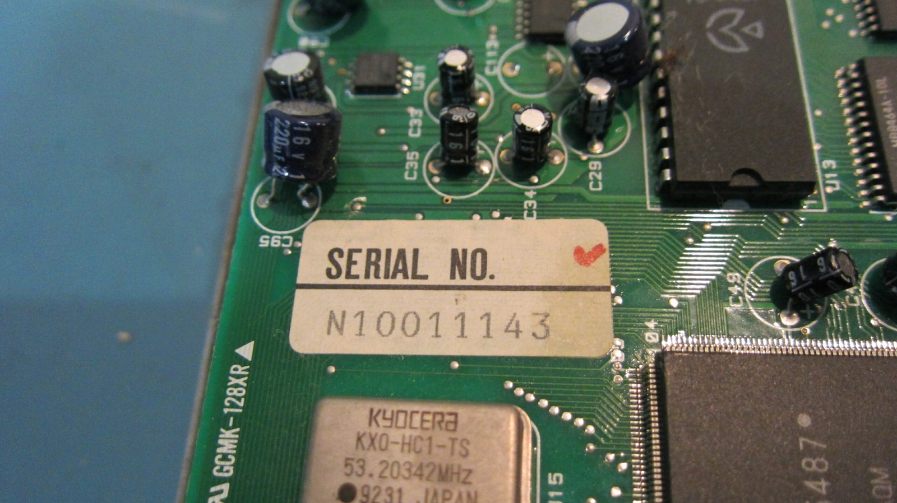
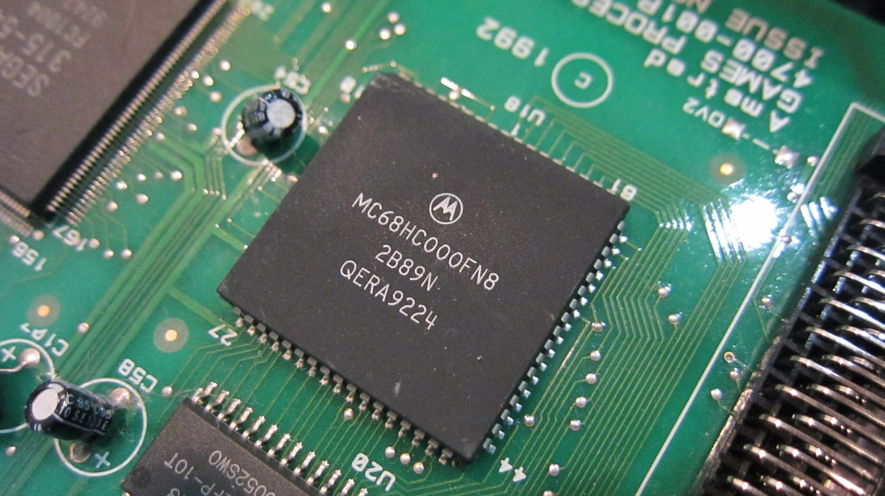
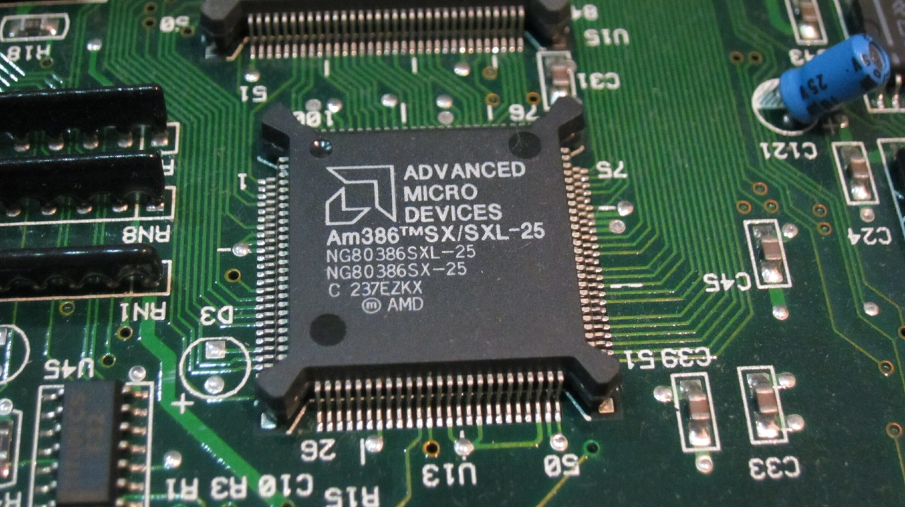

It has arrived. My Amstrad Mega PC. A 386SX combined with a Sega Mega Drive. Amazing!

Sadly after having a look inside it, I discovered the rechargeable NiCad date/time backup battery has leaked delicious NiCad goodness all over the motherboard.

And the CPU in this particular machine is AMD, my favourite underdog! Published Mega PC specifications normally list an Intel 80386SX at 25 MHz, so this unit appears to have an AMD-compatible 386SX instead. I'll have to get this cleaned up ASAP so that it may shine once more.

### Sources

- [Centre for Computing History: Amstrad Mega PC 386SX](https://www.computinghistory.org.uk/det/2534/amstrad-mega-pc-386sx/)
- [AMD: Am386SX Datasheet](https://www.alldatasheet.com/html-pdf/122244/AMD/AM386SX/114/2/AM386SX.html)
