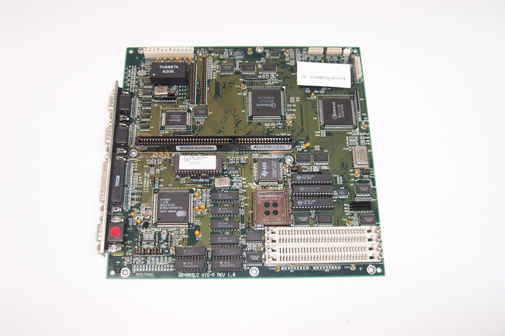
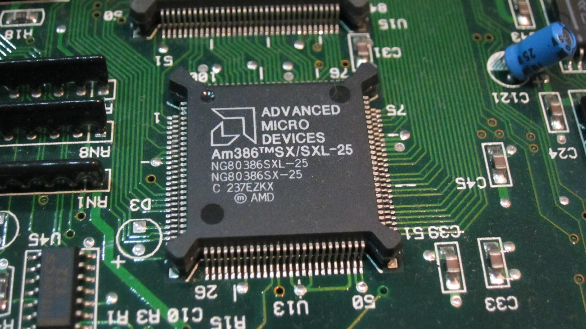
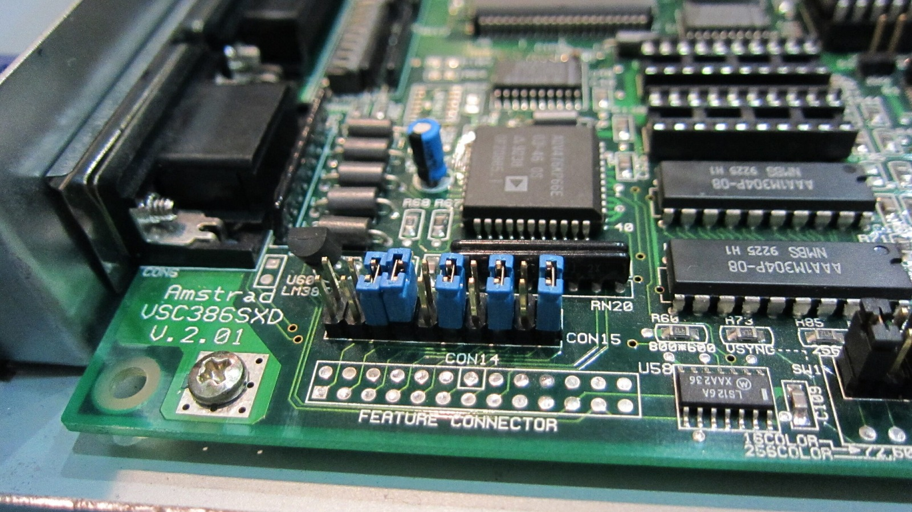
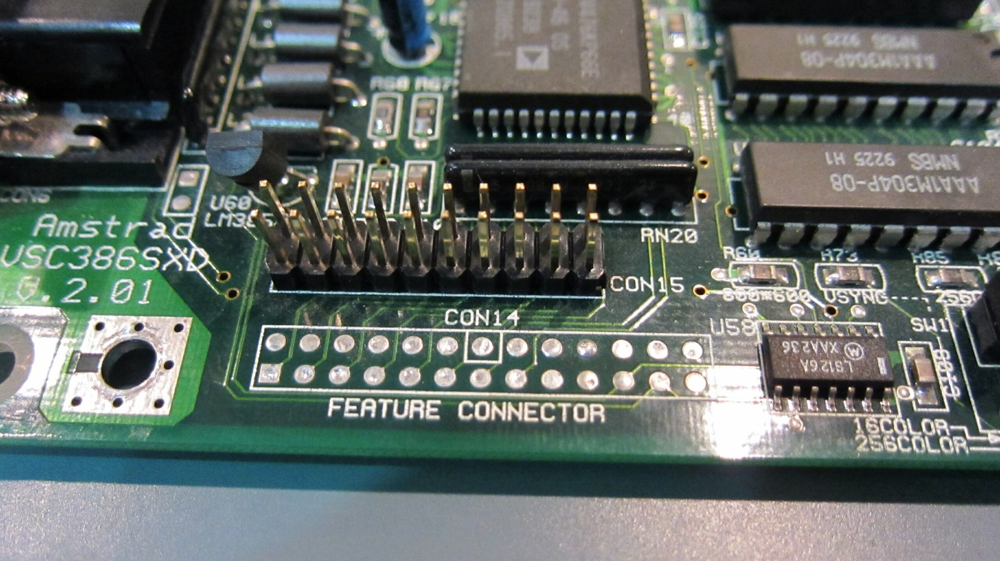
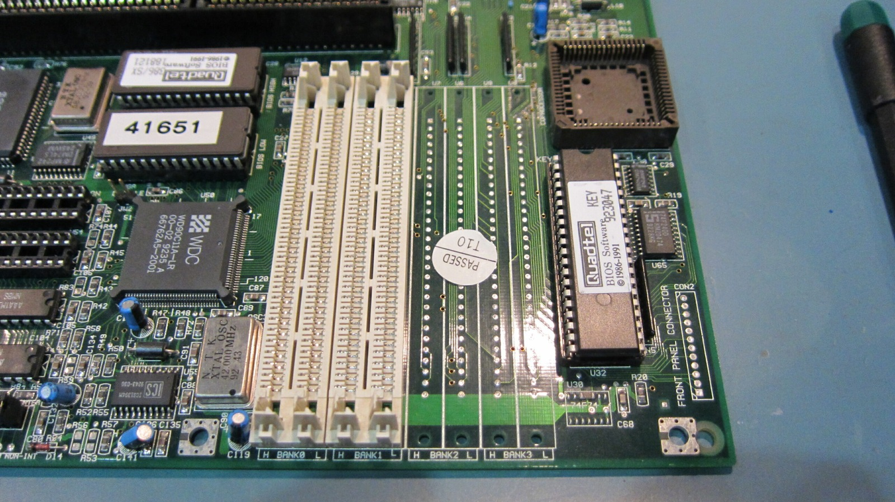

*This PC7486SLC motherboard looked suspiciously similar to the one in my Mega PC. Naturally, I had to investigate.*
{: .media-caption }

Browsing the internet, I came across an Amstrad PC7486SLC motherboard. I couldn't help noticing how similar it looked to the Mega PC motherboard. Since my Mega PC was already giving me grief with its hard-drive controller, having another related Amstrad motherboard around for spare parts seemed like a pretty good idea.

*Here's the 25 MHz AMD 386SX that started this whole upgrade idea.*
{: .media-caption }

#### Why the 486SLC?

My Mega PC is fitted with an AMD-compatible 386SX running at 25 MHz. Amstrad's published Mega PC specification calls for a 25 MHz 80386SX, so the AMD chip is simply what happens to be fitted in my particular machine.

The PC7486SLC-33 uses a Texas Instruments TI486SLC running at 33 MHz. It's an interesting bridge between generations: the processor keeps a 386SX-compatible external interface while adding a 486-compatible instruction set and 1 KB of on-chip cache. In other words, exactly the sort of strange transitional CPU I find interesting.

*Beige case, hardly the most exciting-looking computer in the world. The motherboard was another matter.*
{: .media-caption }

*With the cover open, the interesting part becomes a bit easier to see - similar to the Amstrad Mega PC design.*
{: .media-caption }

*Another look under the lid. The motherboard and riser card is the reason I'm interested, not the beige box.*
{: .media-caption }

#### The Amstrad Mega PC Plus question

The PC7486SLC-33 board I bought appears to have come from a beige Amstrad PC rather than a Mega PC, but it looks extremely similar to the sort of 486SLC platform associated with the elusive Amstrad Mega PC Plus. I can find so little information about the Amstrad Mega PC Plus that it's starting to feel like an urban legend.

Period listings do advertise an Amstrad Mega PC Plus with a 486SLC-33, although they don't tell me whether my particular motherboard was ever factory Amstrad Mega PC Plus hardware. For now, this is an experiment inspired by the Amstrad Mega PC Plus rather than a confirmed conversion using genuine Amstrad Mega PC Plus parts.

*Five blue jumpers next to the feature connector. Rather important for such tiny bits of plastic coated metal.*
{: .media-caption }

*And here's the same header without those jumpers. The arrangement turned out to be very important for video output.*
{: .media-caption }

#### Video passthrough

Video normally passes through the Mega Drive card when the front switch moves between PC and Mega Drive mode. Without the Mega Drive card installed there is no video because nothing is bridging the relevant passthrough pins on the motherboard.

We copied the jumper settings from the PC7486SLC board onto my PC7386SX Mega PC motherboard and got internal video without the Mega Drive card attached. That suggests removing those jumpers and installing the Mega Drive card into the PC7486SLC board may let it work the way I want. Time to experiment.



Here's a little demonstration of those jumper settings on the original 386SX board. The camera doesn't seem particularly interested in focusing on the jumpers, but once everything is configured, switch the machine on and there's your PC video! No Mega Drive card required.

*Four SIMM sockets and a 16 MB ceiling. Borrowing extra slots wasn't going to solve that one.*
{: .media-caption }

#### Memory

The board has four SIMM positions and I couldn't get it beyond 16 MB. I even considered "borrowing" a few RAM slots from another motherboard, although that sounded like an awful lot of effort for very little payoff.

That limit makes more sense when you look at the TI486SLC. The processor can directly address up to 16 MB of physical memory, so borrowing extra sockets wasn't going to get me to 32 MB anyway.

The two biggest attractions of the replacement board are simple: it doesn't appear to have NiCad leakage all over it, and it gives me a 33 MHz 486SLC instead of the 25 MHz 386SX. Let's see whether the Mega Drive card agrees.

### Sources

- [Amstrad Mega PC Instruction Manual (PC7386SX, 16 MB RAM)](https://manualzz.com/doc/68157046/amstrad-megapc-instruction-manual)
- [Texas Instruments: TI486 Microprocessor Reference Guide](https://studylib.net/doc/25873245/1993-ti486-microprocessor-reference-guide)
- [DOS Days: Typical PCs in 1993 (Amstrad Mega Plus 486SLC-33)](https://www.dosdays.co.uk/topics/1993.php)
- [Retro Isle: Amstrad PC (Mega PC and Mega Plus)](https://www.retroisle.com/amstrad/pcs/general.php)
