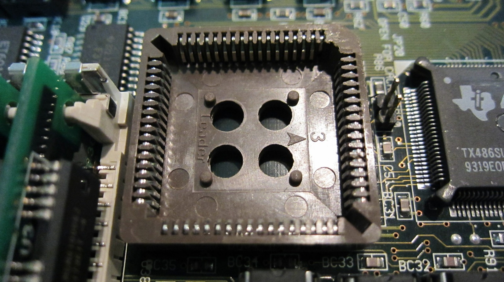
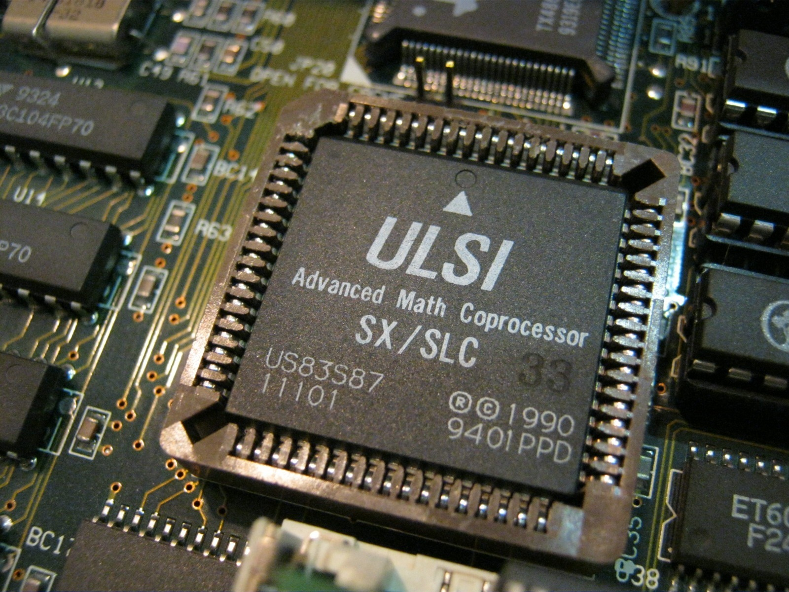
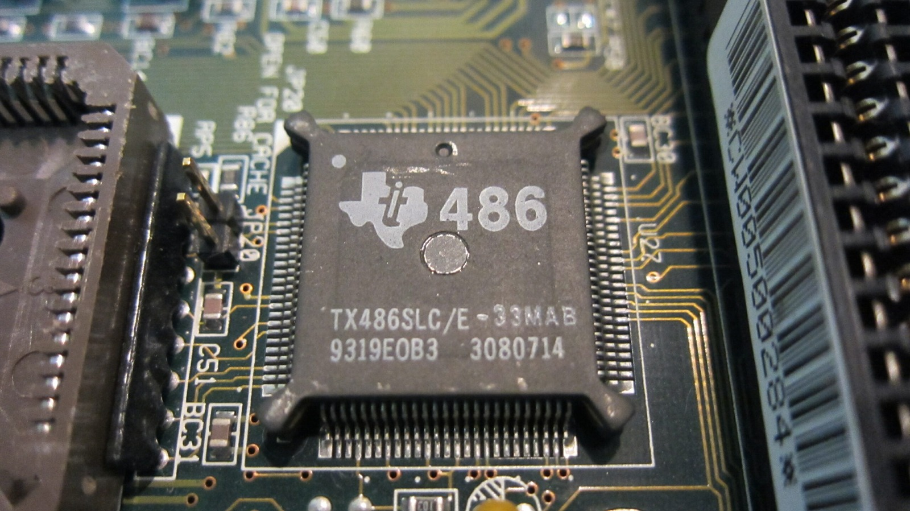

*There was an empty socket, which was reason enough for me to go hunting for a coprocessor.*
{: .media-caption }

Or, more specifically, math coprocessors for the Amstrad Mega PC and my 486SLC upgrade.

*The ULSI US83S87 is right where that empty socket used to be. Mathematical!*
{: .media-caption }

The ULSI US83S87 Advanced Math Coprocessor is intended for 33 MHz SX/SLC systems. This one has a 9401 date code and comes in a 68-pin PLCC package.

387SX-compatible math coprocessors use the sort of external interface expected by 386SX-class systems, and compatible parts were also used with 486SLC machines. Epson's documentation for a 486SLC-33 system, for example, specifies an 83S87-33 coprocessor. A 387DX-type coprocessor is not a drop-in replacement for a 387SX-compatible part because the interfaces and packages differ.

*The 486SLC was a curious halfway house: 486 instructions, 386SX-style connections.*
{: .media-caption }

For the original 386SX-based motherboard I went with a ULSI Math Co SX Advanced Math Coprocessor rated at 25 MHz, and it seems to work well. A lower-rated coprocessor may physically fit, but running it in a faster system can clock the part beyond its specified rating. Matching the coprocessor rating to the system clock is the safer approach.

In summary, get one if you can. They are getting rarer as the days tick on by. They were most useful in software that actually performed substantial floating-point work, but I mostly wanted to fill the empty socket anyway!

### Sources

- [Norbert Juffa: Math Coprocessors (ULSI 83S87)](https://dougx.net/gaming/coproc.html)
- [Epson: ActionTower 2000 User Manual (486SLC and 83S87)](https://files.support.epson.com/pdf/at2k__/at2k__u1.pdf)
- [DOS Days: Math Coprocessors](https://www.dosdays.co.uk/topics/math_coprocessors.php)

### Related Posts

- [Amstrad Sega Mega PC 486SLC Upgrade Experiment](/amstrad-sega-mega-pc-486slc-upgrade-experiment/)
