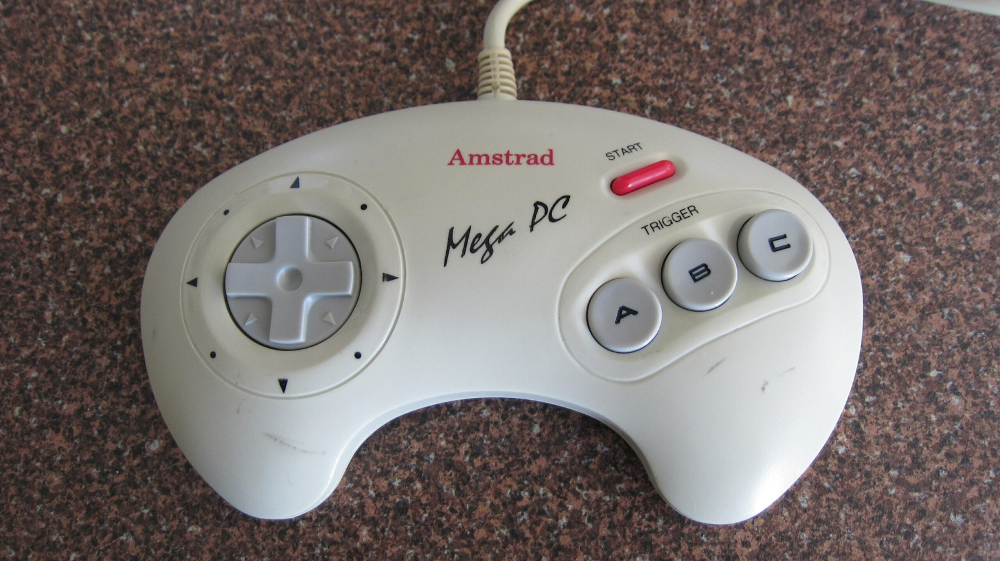
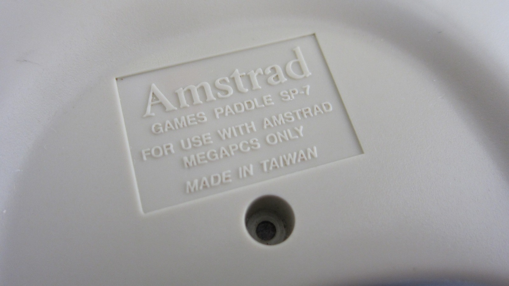

*A lovely beige Mega PC pad. Shame the D-pad wasn't nearly as good as the colour.*
{: .media-caption }

Picked this up on eBay from the UK and gave it a bit of a clean. It has become my favourite Mega Drive controller. Internally it is much the same as another Mega Drive controller I cleaned yesterday, although that one sadly had some tabs snapped off the D-pad. Amstrad's service documentation identifies this one as the Paddle SP-7, part number 273991.

*There it is in the plastic: Games Paddle SP-7, for Mega PCs only.*
{: .media-caption }

It should go nicely with the Amstrad Mega PC. I still need to track down an Amstrad mouse, keyboard and joystick though.

Unfortunately, in my eyes at least, it is also one of the worst Sega controller designs. The D-pad isn't very responsive at all. At least it is a great beige-cream colour!

### Sources

- [Amstrad Mega PC Service Manual (Paddle SP-7)](https://consolemods.org/wiki/images/a/a4/Amstrad_Mega_PC_Service_Manual.pdf)
