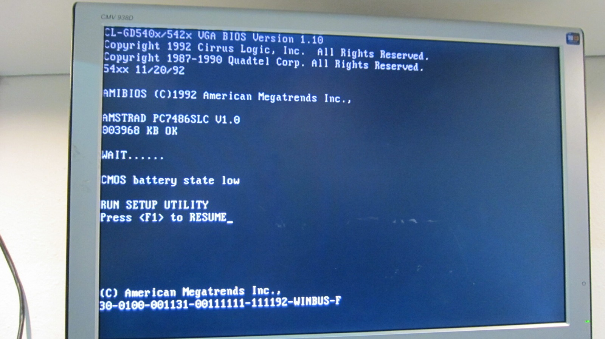

*The replacement board passes POST! Unfortunately, the CMOS battery warning has other ideas about making life easy.*
{: .media-caption }

The replacement PC7486SLC motherboard is in. It passes POST and, unlike the original 386 board, recognises the hard drives perfectly. That strongly points to a fault somewhere in the original motherboard's storage subsystem or related circuitry rather than the drives themselves. The old board will still make a useful spare.

I want to see how large a hard drive this machine will recognise and then try a Disk on Module. A PATA DOM is flash storage that plugs directly into the IDE/PATA interface and presents itself to the computer much like a conventional hard disk.

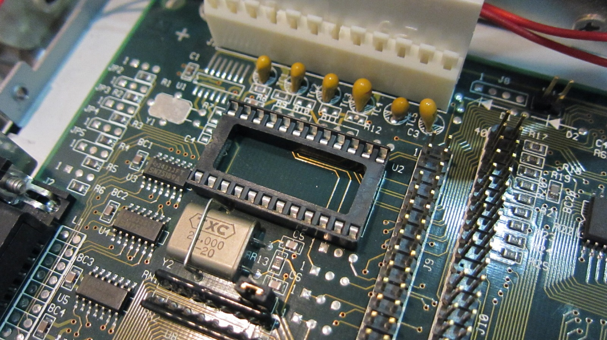

*With the TH6887A removed, here's the empty socket. The trouble with these modules is that the battery is sealed inside.*
{: .media-caption }

#### The RTC problem

I did hit one show-stopper: the TH6887A real-time clock module has a flat internal battery. On this board the machine wasn't retaining its setup properly on reboot. Yes, even with the power still connected! Dammit!

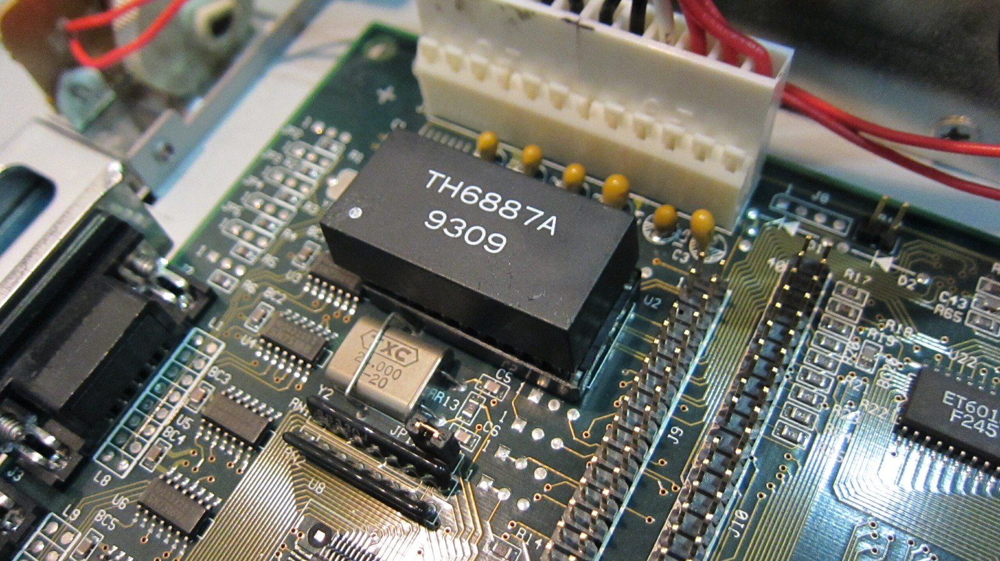

*The TH6887A clock module. One sealed package containing the clock, CMOS memory and, naturally, the battery that's gone flat.*
{: .media-caption }

The module is marked TH6887A 9309. It is more than a battery. It contains the clock and calendar circuitry, battery-backed CMOS RAM, crystal and internal power source, all sealed into one package. So simply removing it does not solve the problem.

I found reports suggesting that Dallas DS1287-family RTC modules were compatible, so I ordered both a DS1287 and DS1287A to test rather than assuming either one would definitely work. Lead time: two to three weeks. Bummer. The wait begins again.

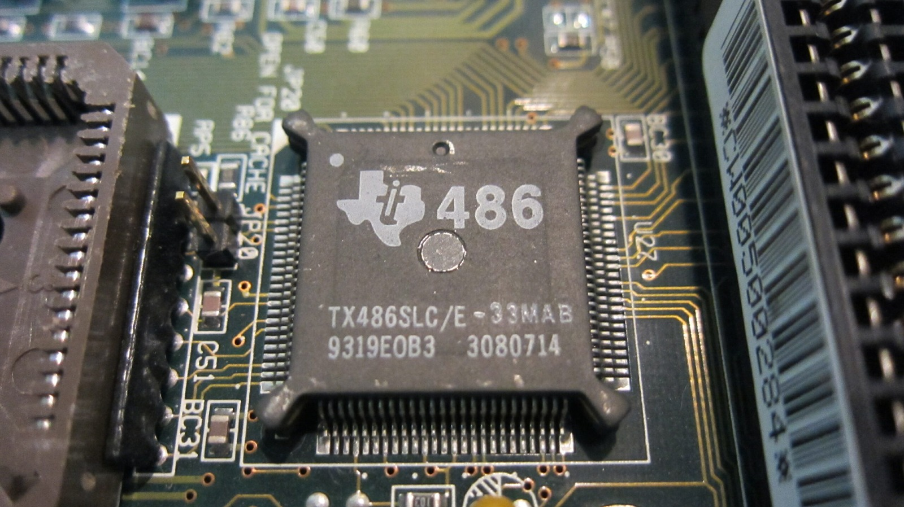

*Here's the Texas Instruments 486SLC at 33 MHz. A rather nice step up from the original 386SX board.*
{: .media-caption }

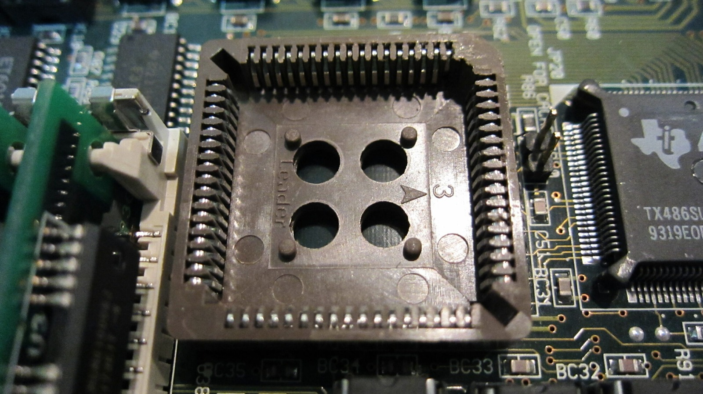

*An empty coprocessor socket. Obviously I couldn't be expected to leave that empty.*
{: .media-caption }

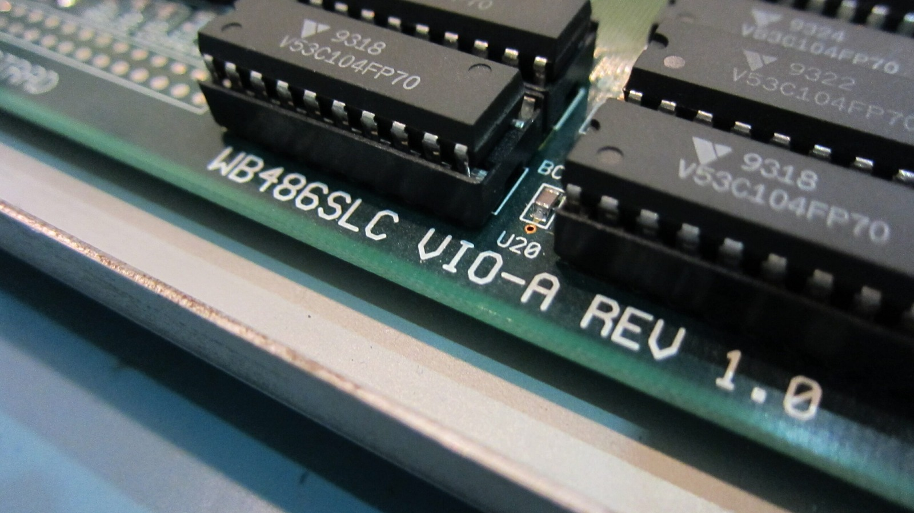

*The board identifies itself as WB486SLC VIO-A, revision 1.0.*
{: .media-caption }

#### Math coprocessor

While I was on eBay I picked up a coprocessor for the 486 board as well. It is a ULSI US83S87 SX/SLC33 in a 68-pin PLCC package, rated at 33 MHz to match the 33 MHz 486SLC system. Period documentation for other 486SLC-33 machines specifies an 83S87-33 coprocessor as well, so this is exactly the sort of part I want here. Not that coprocessors are going to be heavily utilised for what I'll be doing with it. Mostly, there was an empty socket and this situation clearly had to be corrected.

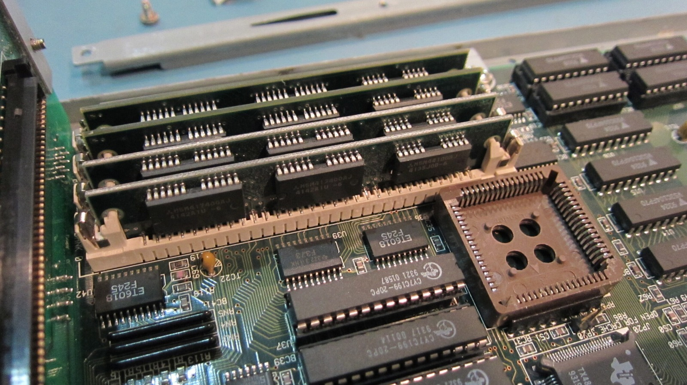

*Here's the memory bank and that still-empty coprocessor socket. I'm waiting on four 4 MB SIMMs from overseas.*
{: .media-caption }

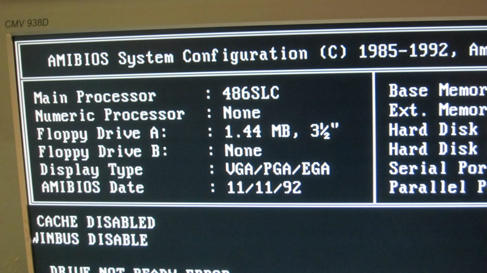

*AMIBIOS confirms the 486SLC and, for now, no numeric coprocessor.*
{: .media-caption }

#### Memory, video and jumpers

I am also still waiting on my four 4 MB SIMMs to arrive from overseas. Very exciting times. The video RAM on this motherboard already appears to be maxed out, which is great news. Scorched Earth!

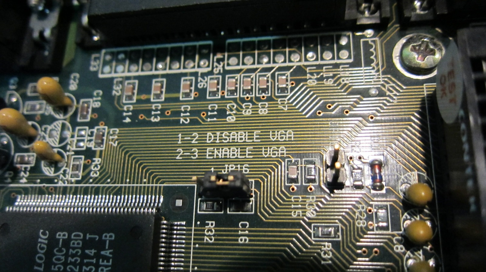

*The motherboard even provides a jumper to disable its VGA. I wonder how nicely an ISA video card would play with the Mega Drive side.*
{: .media-caption }

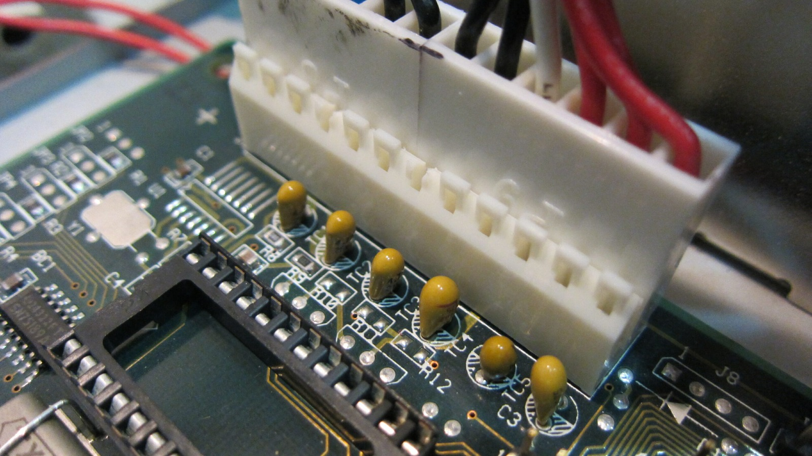

*Tantalum capacitors. I have ordered replacements, but apparently the waiting game is part of this upgrade.*
{: .media-caption }

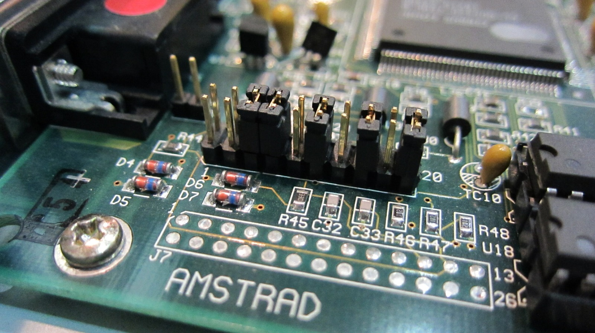

*And here are the jumpers for running the machine in PC-only mode.*
{: .media-caption }

It also looks like the onboard VGA can be disabled and an ISA video card used, although I do not know how happily that would coexist with the Mega Drive card.

The photographs above also show the jumper settings for bypassing the Mega Drive card and running the machine in PC-only mode, along with the BIOS auto-detected hard-drive settings.

Thanks American Megatrends!

### Sources

- [Transcend: PATA PTM820 Flash Module](https://au.transcend-info.com/embedded/product/embedded-flash-solutions/ptm820)
- [Analog Devices: DS12887 Real-Time Clock (DS1287 Family)](https://www.analog.com/en/products/ds12887.html)
- [Epson: ActionTower 2000 User Manual (83S87 and 486SLC)](https://files.support.epson.com/pdf/at2k__/at2k__u1.pdf)

### Related Posts

- [Amstrad Sega Mega PC 486SLC Upgrade Experiment](/amstrad-sega-mega-pc-486slc-upgrade-experiment/)
- [Math Coprocessors and You](/math-coprocessors-and-you/)
