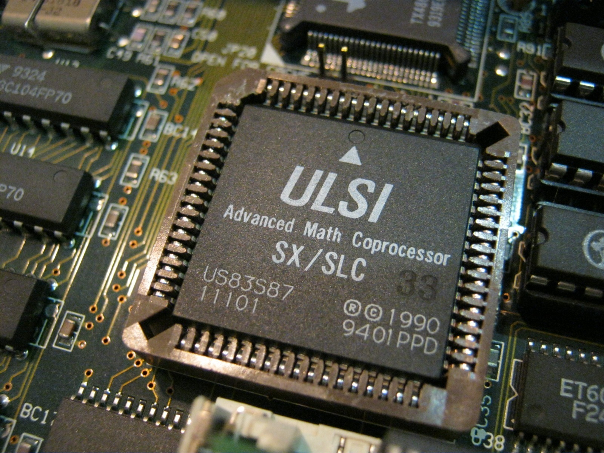
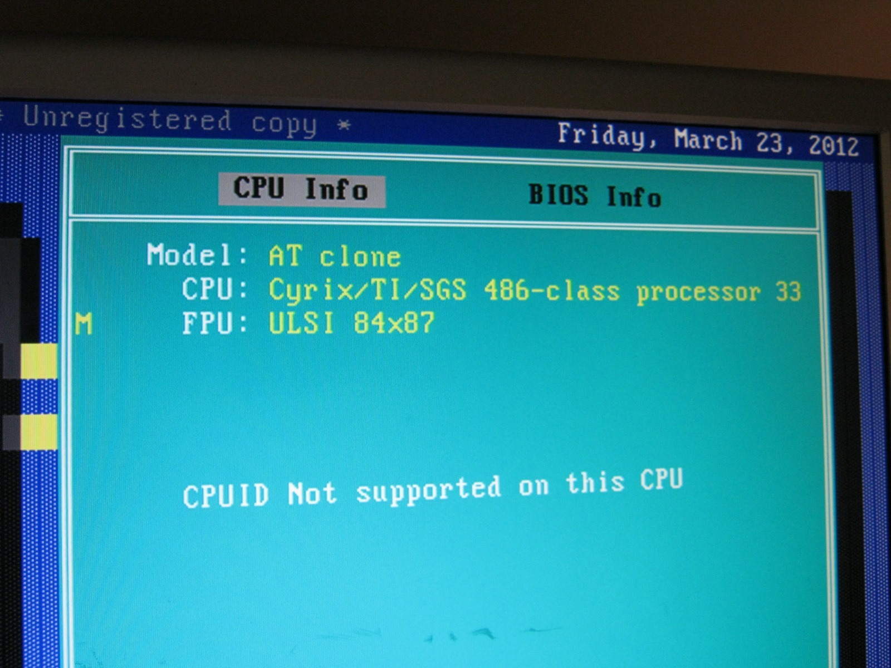
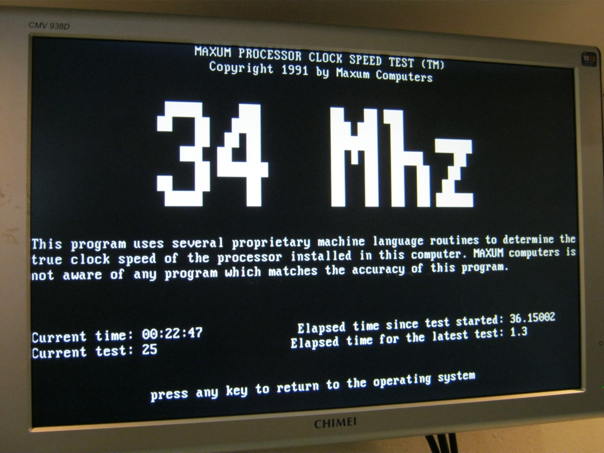
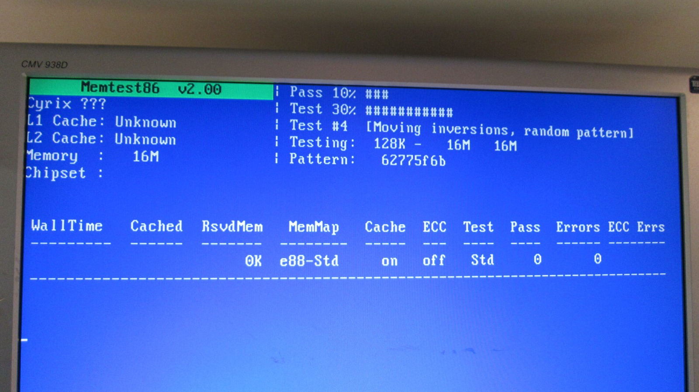
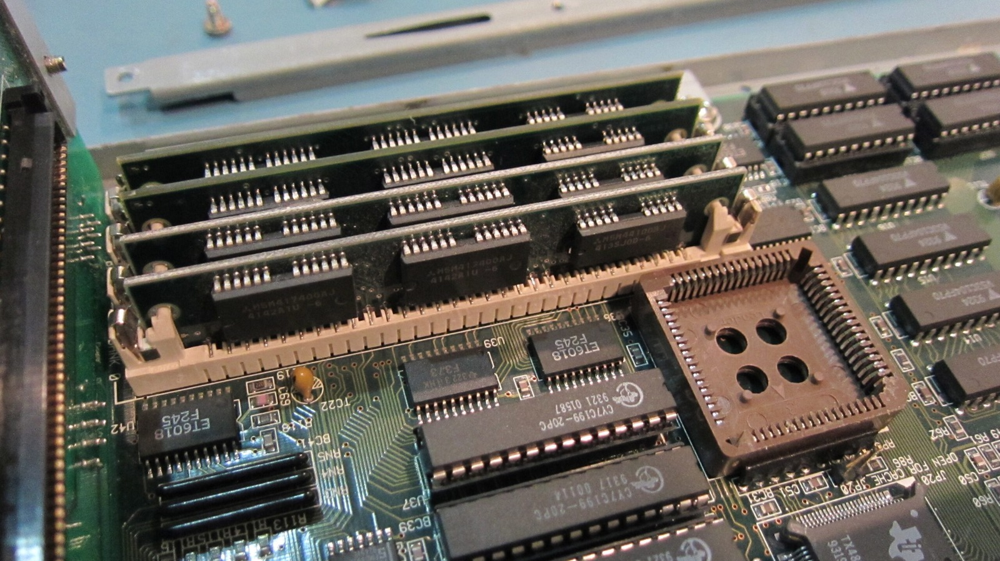
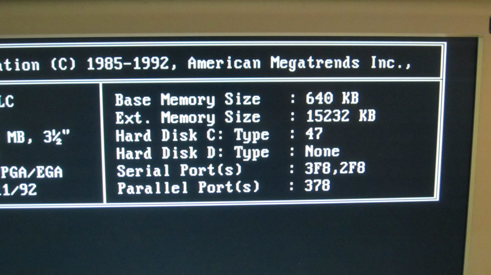

*Finally, the empty coprocessor socket has company. And it's even recognised correctly!*
{: .media-caption }

*Diagnostic software picks up the ULSI as an 84x87. Good enough for me!*
{: .media-caption }

*MAXUM reckons 34 MHz. Close enough to the 33 MHz it is supposed to be running at!*
{: .media-caption }

The PC7486SLC-based Amstrad Mega PC Plus upgrade really is running at 33 MHz. Great news: the math coprocessor for the 486SLC has arrived and is recognised perfectly. It is a ULSI Advanced Math Coprocessor SX/SLC rated at 33 MHz, part US83S87. The diagnostic software also identifies it as a ULSI 84x87.

*Sixteen whole megabytes! Memtest has plenty to chew through, and I eventually got a clean pass.*
{: .media-caption }

*Four SIMM modules in their slots, and the coprocessor socket still empty in this earlier photo. The full 16 MB upgrade is now working.*
{: .media-caption }

*AMIBIOS reports 640 KB base memory and 15,232 KB extended. Not a bad amount of RAM for this little machine!*
{: .media-caption }

I've also been able to run MEMTEST 4.10 across the full 16 MB of RAM I installed, and it passed with no errors. MEMTEST 4.20 does not run though. It simply restarts when I try to boot it from the floppy.

The 16 MB ceiling makes sense, too. The TI486SLC has a 24-bit address bus and can directly address 16 MB of physical memory. No point expecting to squeeze 32 MB out of that CPU!

For now I am still waiting on the replacement RTC module to arrive from Hong Kong. A couple more weeks to go. I've also ordered a 4 GB Disk on Module using SLC flash rather than MLC. Hopefully the BIOS will recognise it and I can boot DOS and Windows from it without too much drama. Time will tell! :D

### Sources

- [Texas Instruments: TI486 Microprocessor Reference Guide](https://studylib.net/doc/25873245/1993-ti486-microprocessor-reference-guide)
- [Epson: ActionTower 2000 User Manual (83S87-33 and 486SLC-33)](https://files.support.epson.com/pdf/at2k__/at2k__u1.pdf)

### Related Posts

- [Amstrad Sega Mega PC Boot Failure: DOM and Hard Drive Troubleshooting](/amstrad-sega-mega-pc-boot-failure-dom-and-hard-drive-troubleshooting/)
