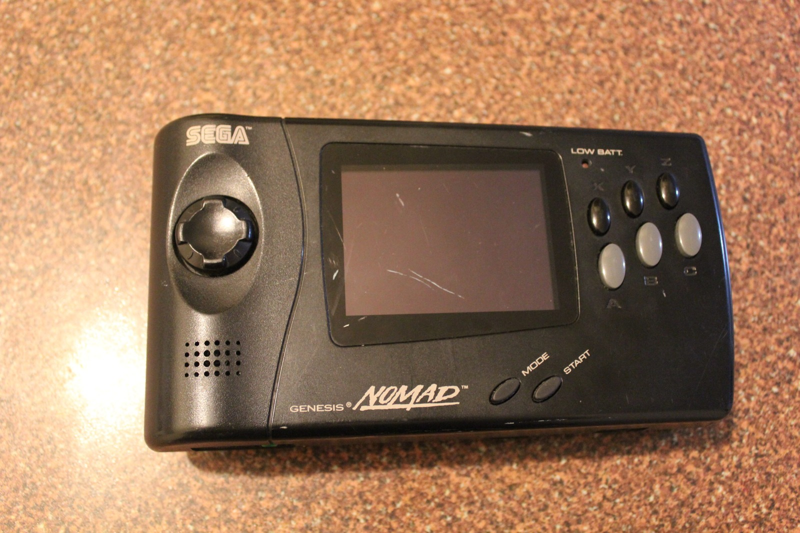
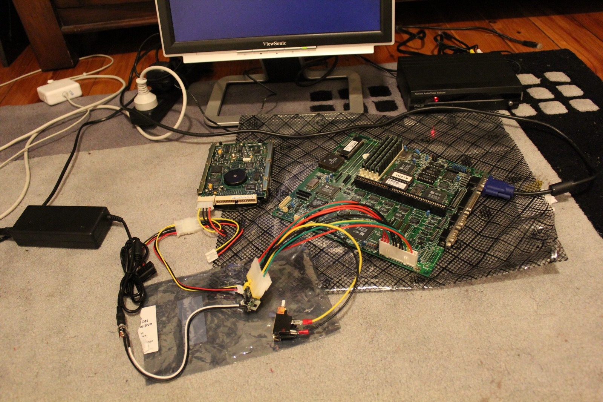
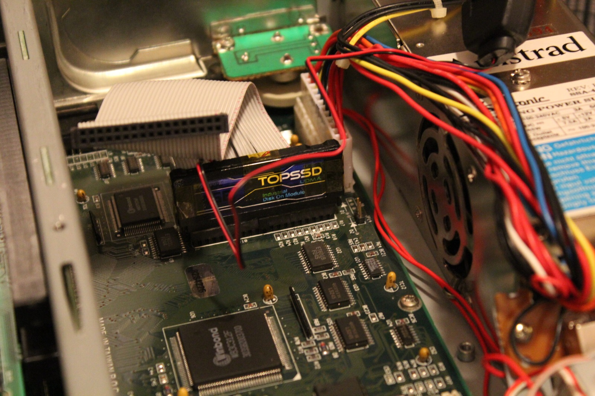
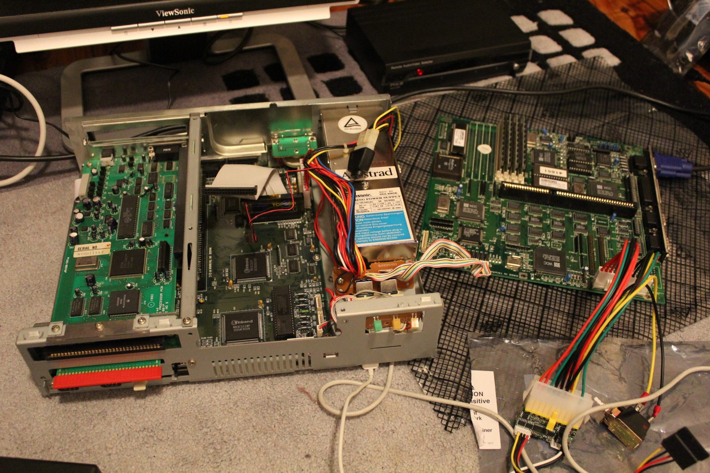

*A Genesis Nomad is on its way. Basically a portable Mega Drive, and hopefully a little less scratched once those replacement screen fronts arrive.*
{: .media-caption }

Dialled things back a little while waiting for all of last week's purchases to arrive. Yet there are still some awesome things on the way.

First up we have the Sega Genesis Nomad. Essentially a handheld Mega Drive. I've also ordered a battery pack to go with it. Sega's original Nomad manual says the detachable battery compartment takes six AA batteries and confirms that the Genesis 2 AC Adapter and Game Gear AC Adapter can both power the system. I also picked up two replacement screen fronts because the Nomad I'm getting is quite scuffed and scratched.

Other purchases include a boxed Dreamcast Mouse, although I'm not sure whether it is a PAL version, a few ISA Ethernet cards for the Amstrad Mega PC, a 3.6 V 60 mAh NiCad battery for the Mega PC's 386SX motherboard, and a bunch of DC-DC step-down converters for the Saturn external PSU project.

*Meanwhile, the Mega PC experiments have taken over the floor.*
{: .media-caption }

*A TOPSSD Disk on Module among a heroic number of cables. Fewer spinning parts to worry about, at least!*
{: .media-caption }

*One Mega PC in pieces, a second board alongside it and enough wires to keep me busy for a while.*
{: .media-caption }

Then there is the PicoPSU-80. These are interesting. It takes a regulated 12 V input and generates standard ATX power rails for lower-power PCs, which is broadly the same DC-DC conversion idea I've been exploring for the Saturn external PSU. I'll be running it through an adapter cable to convert it to the AT-style power connection used by the Mega PC and testing it as a spare PSU. AT power supplies are really hard to find these days, especially weird non-standard ones!

I am still waiting and hoping to receive the DS1287 RTC chips and the 4 GB DOM ordered for the Mega PC. Hopefully this week is their week.

Interestingly, one of the faulty Saturns that arrived late last week appears to be a VA0, the first Saturn motherboard revision. At first glance it seems to have a worn optical pickup while the PSU appears healthy.

More testing required!

### Sources

- [Sega Genesis Nomad Instruction Manual](https://manualzilla.com/doc/6982054/sega-genesis-nomad-instruction-manual)
- [Mini-Box: picoPSU-80 Specifications (80 W, 12 V Input)](https://www.mini-box.com/picoPSU-80)
- [Sega-16 Forums: Sega Saturn Revisions and Models Guide](https://www.sega-16forums.com/forum/general-discussion/tech-aid/24084-sega-saturn-revisions-and-models-guide/page4)
