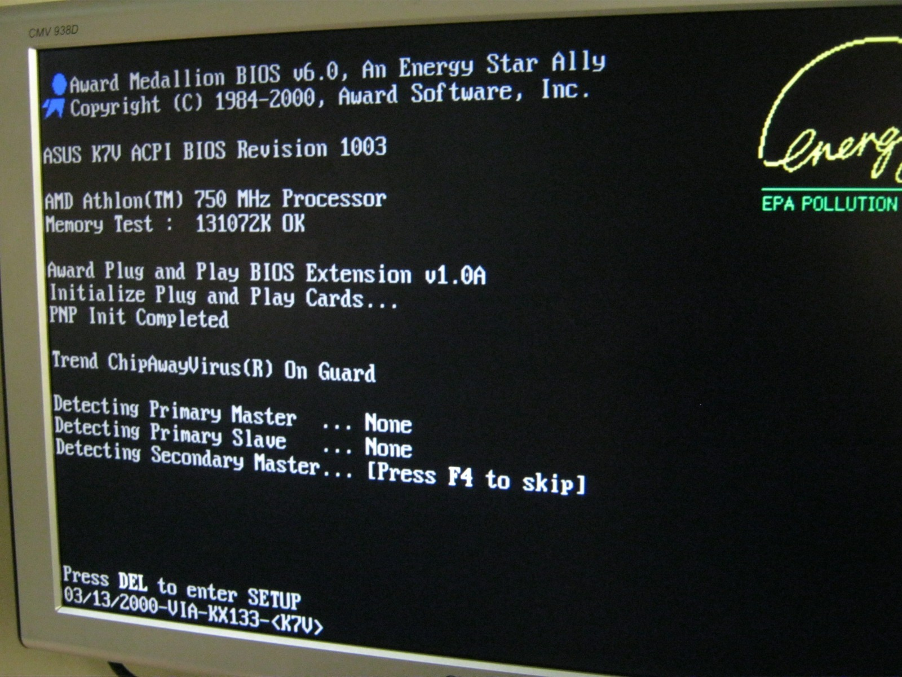
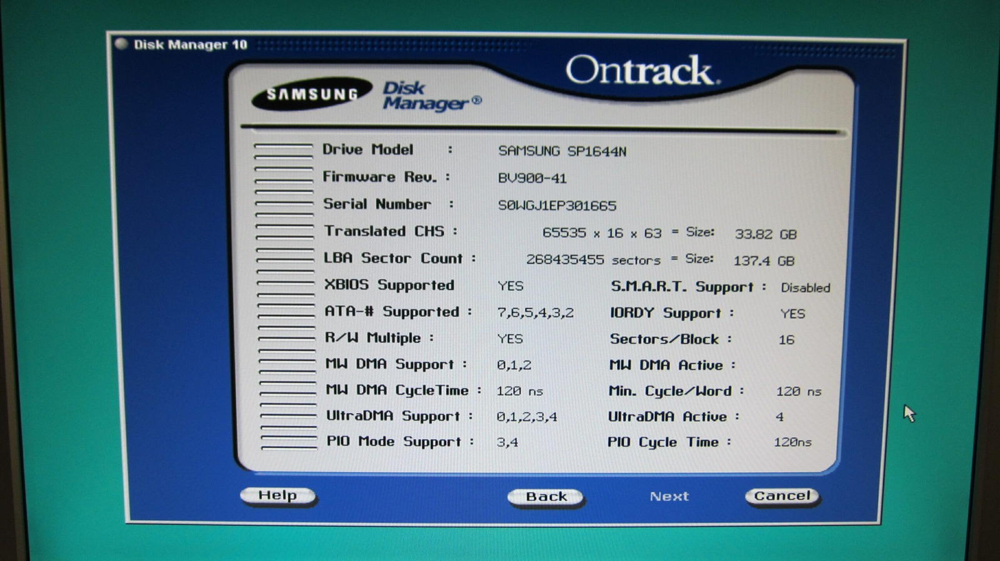
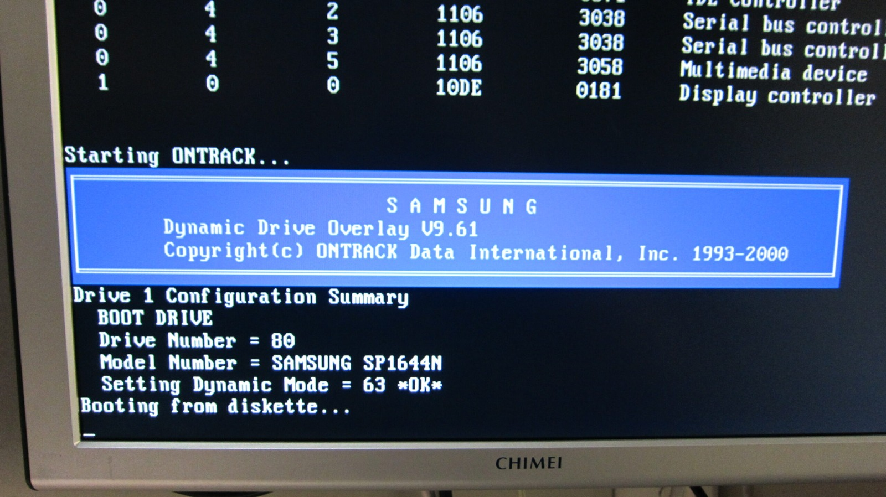
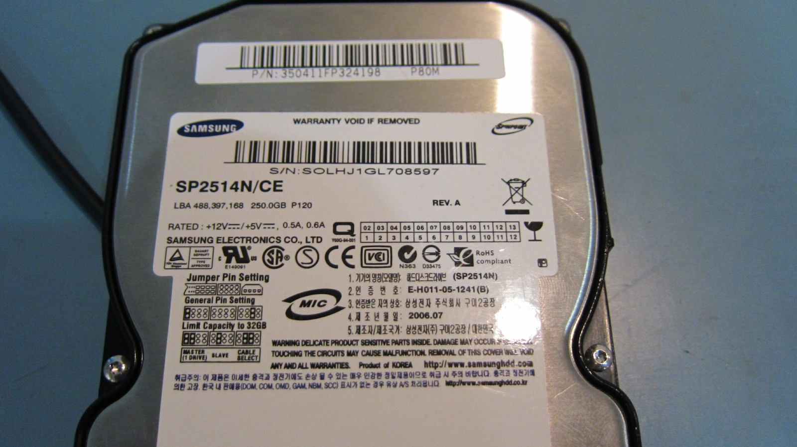

After loading Windows 95 onto the Amstrad Mega PC, it became quite clear that leaving it running like a broken-down horse-drawn buggy was not the best idea. Poking around the internet, Windows 3.11 looks like a much better fit. Lightweight, but still capable of being dressed up to behave more like a modern Windows environment. Enter [Calmira](http://www.calmira.de/).

I also found Counterpoint while hunting around for the original Amstrad software. Counterpoint is not really an operating system of its own. It is Amstrad's graphical DOS front end, and the Mega PC originally shipped with MS-DOS 5.0 underneath it.

Have a look at this [Internet Archive capture](https://web.archive.org/web/20080630223212/http://web.ukonline.co.uk/joe.gentile/Text/amstradCP.htm). Interestingly, the download links were archived too. Looks like I'll be running Counterpoint 2.5 soon with MS-DOS 5.0 underneath it.

#### The Athlon 500 MHz project

In other news, my side project, the Athlon 500 MHz Project, came to life today. It can be seen here with a bonus 750 MHz CPU included with the motherboard running. I managed to get the Athlon coupled with an ASUS K7V Rev 1.01 and install Windows XP. Very happy with that result. Now I just need a rockin' case for it, with some horns if possible.

This 500 MHz Athlon CPU has significant sentimental value. The 750 MHz, not so much. It was used in the first PC I put together as a teenager back in 2000. According to the warranty sticker, February 2000. I remember that day well. We were looking for a faster CPU but the entry-level 500 MHz was all they had. I was not leaving empty handed.

Years ago I removed the casing and markings inside this particular 500 MHz Athlon identified a 650 MHz-rated core! There were reports of some early Slot A 500 MHz Athlons containing higher-marked cores, no guarantee they'd run at those speeds, but maybe the market was in the entry-level - especially against Intel in the early days!

#### Hard-drive limits

I ran into some trouble with the BIOS and one of the many old-PC hard-drive size barriers. I ended up using a drive-overlay program, much like I had on the Mega PC, and managed to recover most of the 160 GB drive.

There is still the familiar 28-bit LBA ceiling at roughly 128 GiB, or 137 GB in decimal terms. Creating another partition does not get around that limit. Access beyond it requires 48-bit LBA support somewhere through the relevant hardware, BIOS or driver path and operating system. That is still well beyond the roughly 33 GB limit I was hitting through the BIOS itself.

Another oddity was a Samsung 250 GB drive pulled from an el cheapo PVR. It only identified as 160 GB instead of the 250 GB printed on the label. I never established why. It could have involved firmware, capacity limiting or configuration, but I didn't investigate it far enough to know. Who cares! It works, and it runs much quieter than my other PATA drives.

#### picoPSU

I also tested the [picoPSU-80](https://www.mini-box.com/picoPSU-80) that arrived from the US a few days ago, and it seems to work a charm. I'm not sure what I'll ultimately use it for, although I'm toying with the idea of getting the old Mega PC 386SX motherboard powered up and functional as a spare old PC.

I'd just need a small Disk on Module, a replacement for the original rechargeable NiCad backup battery and the picoPSU... perhaps! The battery side needs a bit of thought, though. If I use an ordinary non-rechargeable AA or AAA cell, I'll have to isolate it from the charging circuit so the motherboard doesn't try to charge it, or use a suitable rechargeable arrangement instead.

### Sources

- [Amstrad Mega PC Manual (MS-DOS and Counterpoint)](https://acpc.me/ACME/AMSTRAD_PRO/AMSTRAD_PC/LITTERATURE/MANUELS/MEGA_PC_Manual%5BENG%5D.pdf)
- [ASUS: K7V Motherboard Manual (Slot A Athlon up to 1 GHz)](https://dlcdnet.asus.com/pub/ASUS/mb/slota/k7v/k7v-101.pdf)
- [Seagate: 137 GB Capacity Barrier (28-bit/48-bit LBA)](https://www.seagate.com/support/kb/disc/tp/137gb.pdf)
- [Mini-Box: picoPSU-80 (12 V Input)](https://www.mini-box.com/picoPSU-80)
- [Duracell: Battery FAQ (Non-rechargeable Battery Safety)](https://duracell.com/faq)

### Related Posts

- [Amstrad Sega Mega PC with picoPSU and a Dual-Screen Setup](/amstrad-sega-mega-pc-with-picopsu-and-a-dual-screen-setup/)
