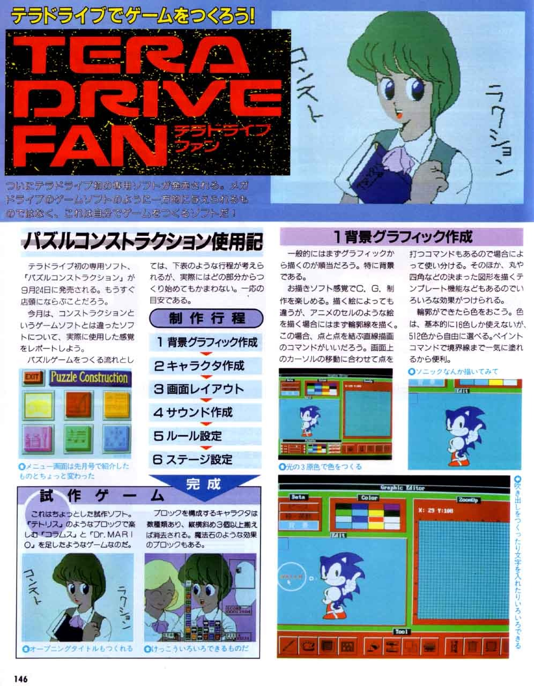
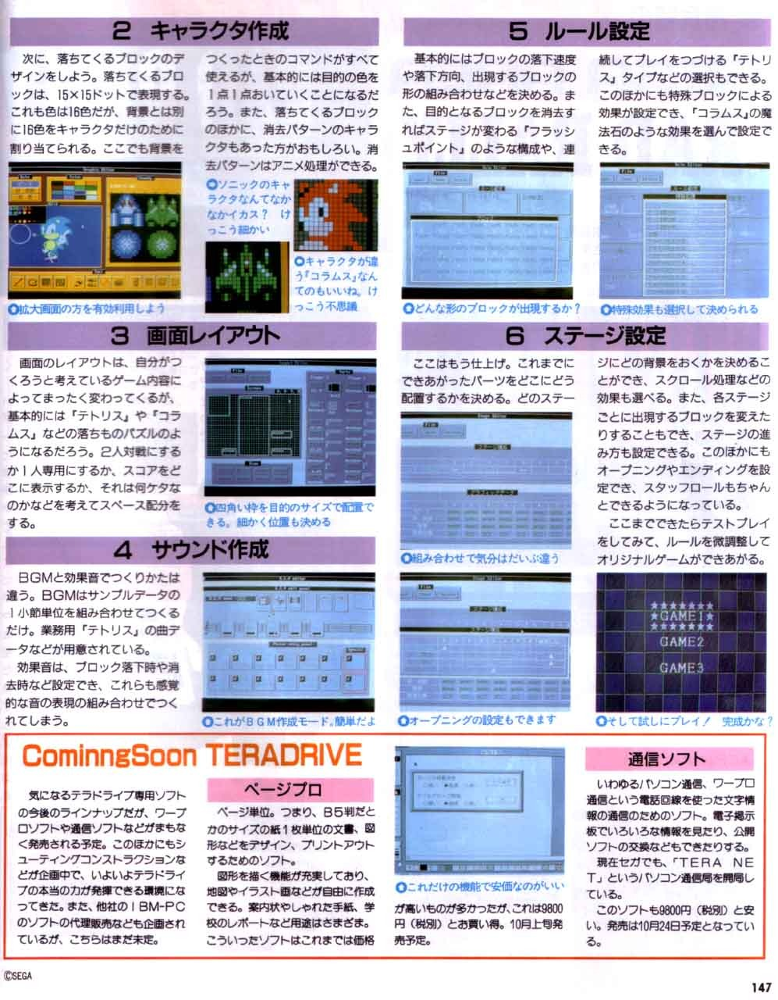

*While I wait for the TeraDrive Model 2 to arrive from Japan, here's TeraDrive Fan showing off some rather ambitious puzzle-game-making software.*
{: .media-caption }

I have picked up a Sega TeraDrive Model 2 and it is on the way to me from Japan. It should still be a few weeks before it arrives.

Sega offered three TeraDrive configurations. The Model 2 sits in the middle of the range with 1 MB of RAM and two 3.5-inch floppy drives, but no internal hard drive. Exactly the sort of strange Sega and IBM hybrid I need occupying more space. I am also still waiting on my Sega Genesis Nomad to arrive from the United States.

*More from the TeraDrive Fan spread, including graphics, music, stage design and a sneak peek at future software. Quite the little ecosystem!*
{: .media-caption }

I now have my new Canon EOS 600D for photos, so I should be updating the [galleries](/goodies/) later on. In the next few days I also hope to complete another Sega Game Gear repair attempt and get one functioning properly.

### Sources

- [Sega Hardware Archive: TeraDrive](https://www.sega.jp/fb/segahard/md/tera.html)

### Related Posts

- [Sega TeraDrive Model 2, Genesis Nomad and Mega Drive 2](/sega-teradrive-model-2-genesis-nomad-and-mega-drive-2/)
- [Sega TeraDrive Demo - Sonic 1 and Sega Menu](/sega-teradrive-demo-sonic-1-and-sega-menu/)
