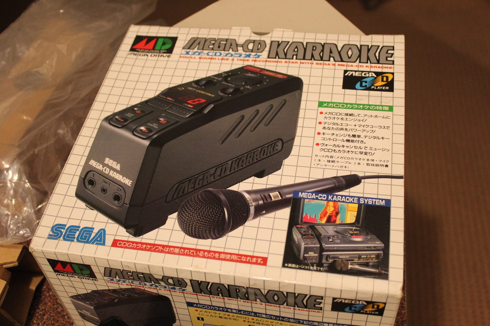
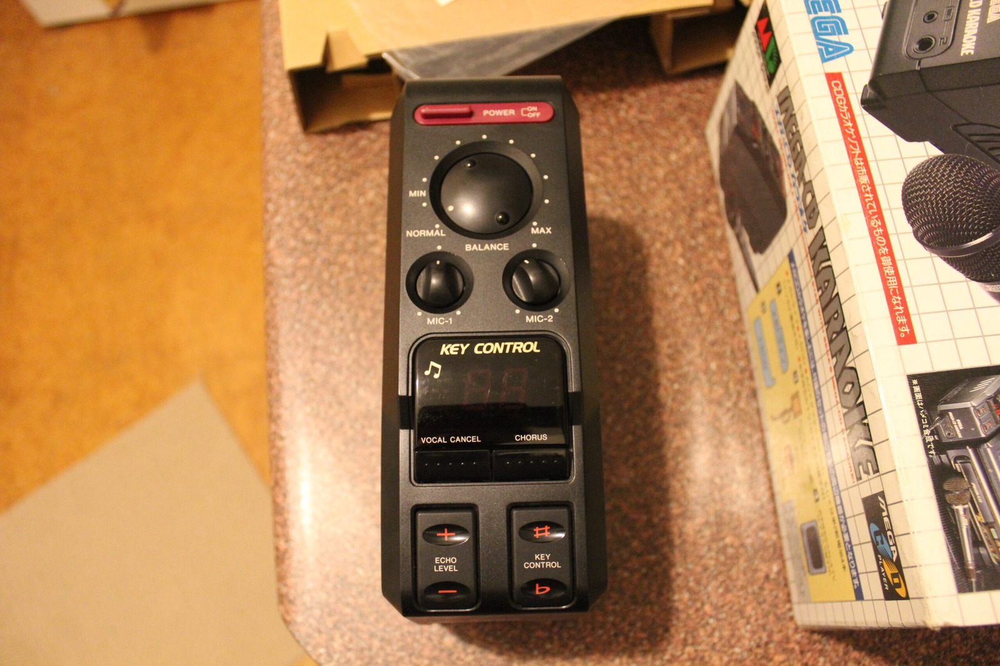
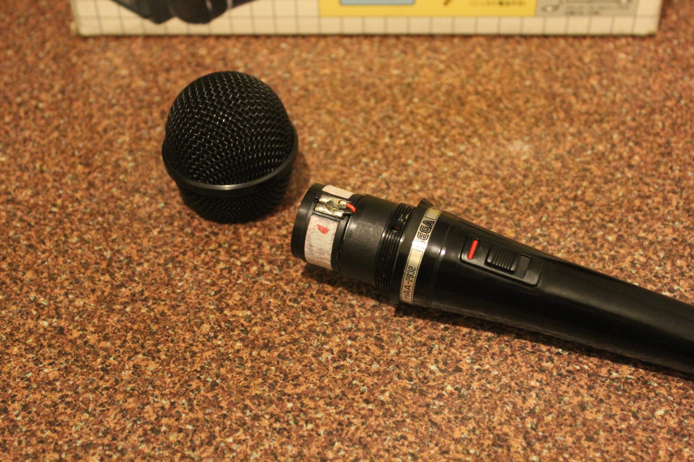
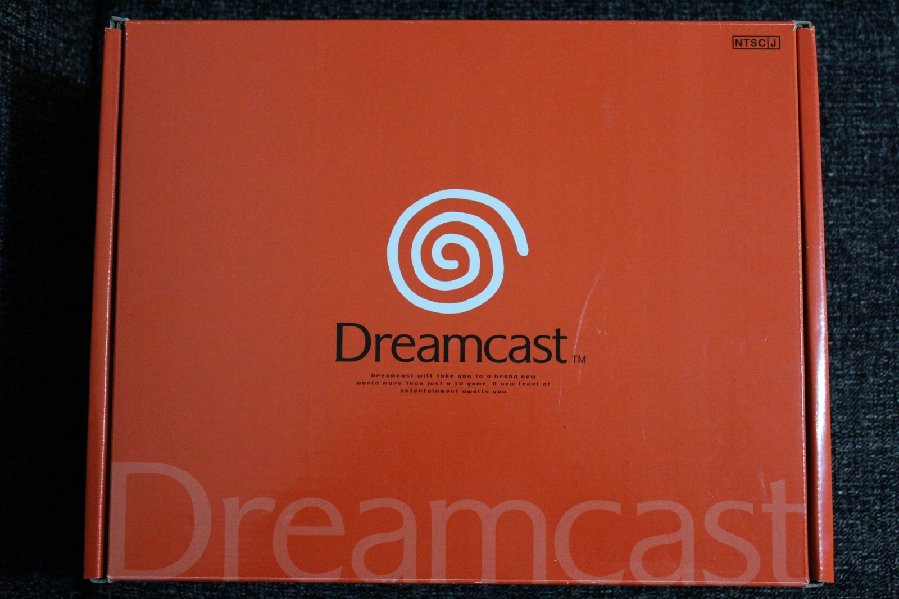
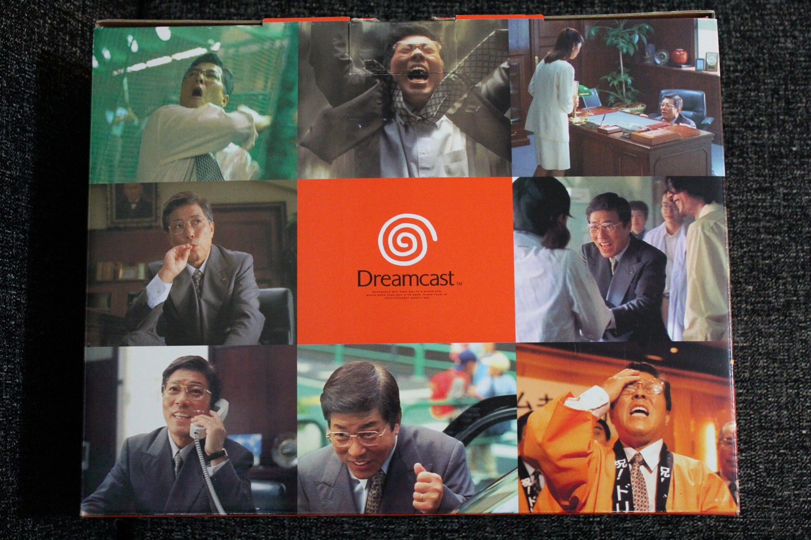
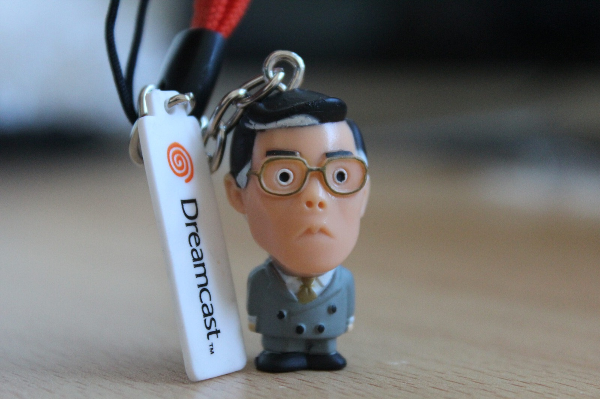

*The Mega-CD Karaoke box. Apparently I can become a recording star, provided I can persuade the microphone to work!*
{: .media-caption }

*Plenty of knobs and buttons on the karaoke unit. Shame about the buzzing and that dead microphone.*
{: .media-caption }

*Off comes the microphone grille. The cartridge appears to be dead, so I've ordered a replacement to experiment with.*
{: .media-caption }

Just a quick update. I received the Sega Mega-CD Karaoke add-on today, gave it a test and found that there is a buzzing noise from the unit while it is powered up. More annoyingly, the microphone does not work. I pulled it apart, with more photos in the [photo gallery](/goodies/), and the microphone cartridge appears to be dead.

I've gone ahead and bought a $10 600-ohm BG-58 microphone cartridge from eBay to try as a replacement. It'll be a few weeks before it arrives, so whether it'll actually fit and work in this thing is still anyone's guess.

*My first NTSC-J Dreamcast is on the way. I do love that bright orange Japanese packaging!*
{: .media-caption }

*The Yukawa Dreamcast packaging really went all in on the advertising campaign. Subtle it is not!*
{: .media-caption }

*And a tiny suited Dreamcast keyring to complete the corporate chaos. I couldn't make this stuff up!*
{: .media-caption }

In the meantime, I've purchased a very nice-looking boxed Yukawa Dreamcast, my first NTSC-J Dreamcast.

The Yukawa packaging is one of those oddities of the early Japanese Dreamcast launch. It's still the familiar Dreamcast hardware underneath, but Sega executive Hidekazu Yukawa appeared all over the Japanese launch advertising and even on the packaging.

I am still waiting on the Genesis Nomad from the US. The good news is that it has reached Australia, so it shouldn't be more than a few days before I am gaming on the go!

Regular visitors might also have noticed that the menu bar has slipped up to the very top of the page. I'm still tweaking the banner and alignment, but it is good enough for now. Here's to the week ahead!

### Sources

- [Sega Retro: Dreamcast Models (Hidekazu Yukawa Packaging)](https://segaretro.org/Dreamcast_models)

### Related Posts

- [Sega Mega-CD Karaoke Microphone - Faulty](/sega-mega-cd-karaoke-microphone-faulty/)
- [Sega Mega-CD Karaoke Microphone Repaired](/sega-mega-cd-karaoke-microphone-repaired/)
