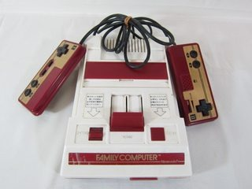

I have just purchased a boxed Famicom from Japan. A rather nice and very white one for under $100, along with a couple of games: Hoshi no Kirby and Spelunker.

This will be my first classic console and my first attempt at modding. The plan is an AV mod so I can bypass the Japanese RF output and feed the Famicom's native NTSC composite signal directly into a television. Plenty of PAL-region TVs can display NTSC over composite, so hopefully I can get a decent picture without too much trouble. It won't magically turn the Famicom into a PAL console, of course!

I'll be documenting my progress as best I can and hopefully come up with a definitive method for doing this type of mod. After some research, I've found plenty of different approaches to Famicom AV modifications, mostly from people in NTSC regions. I'm looking forward to giving it a go and sharing whatever I discover along the way.

_Originally posted by SuperNick (Nick) many eons ago._

### Related posts

- [Nintendo Famicom Composite AV Mod](/nintendo-famicom-composite-av-mod/)
- [Nintendo Famicom AV Mod Complete](/nintendo-famicom-av-mod-complete/)

### Sources

- [8Bitplus - Nintendo Famicom AV Mod](https://8bitplus.co.uk/projects/famicom-av-mod-nintendo/) - documents composite AV modification of the original Famicom and the console's native NTSC video output.
