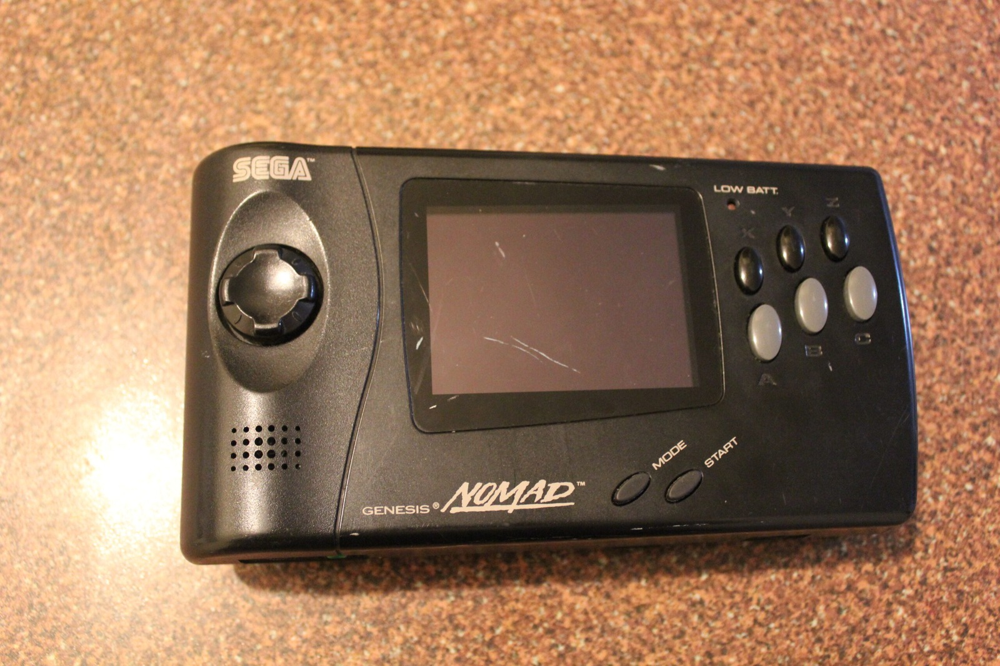
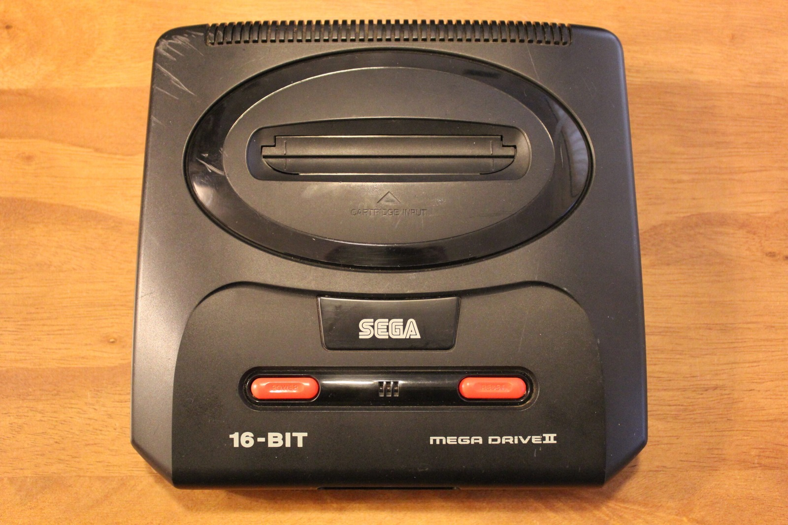
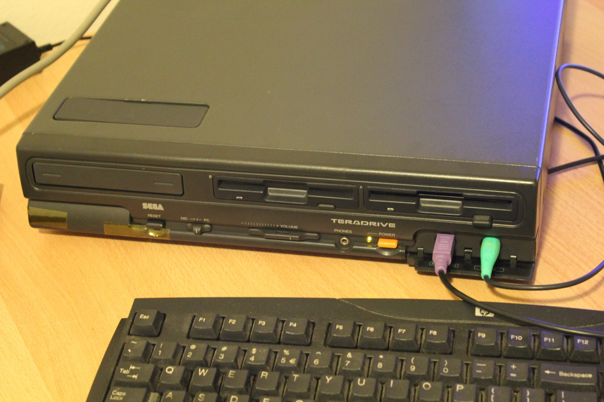
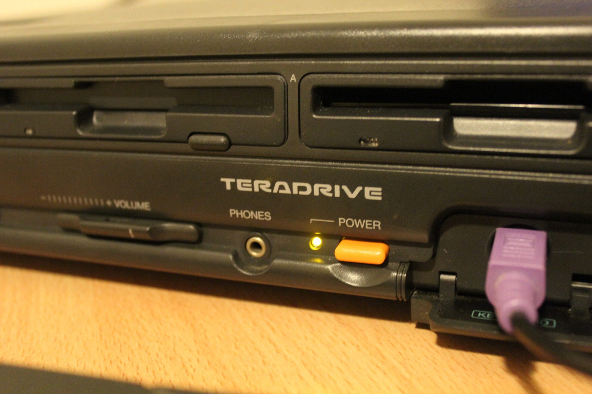
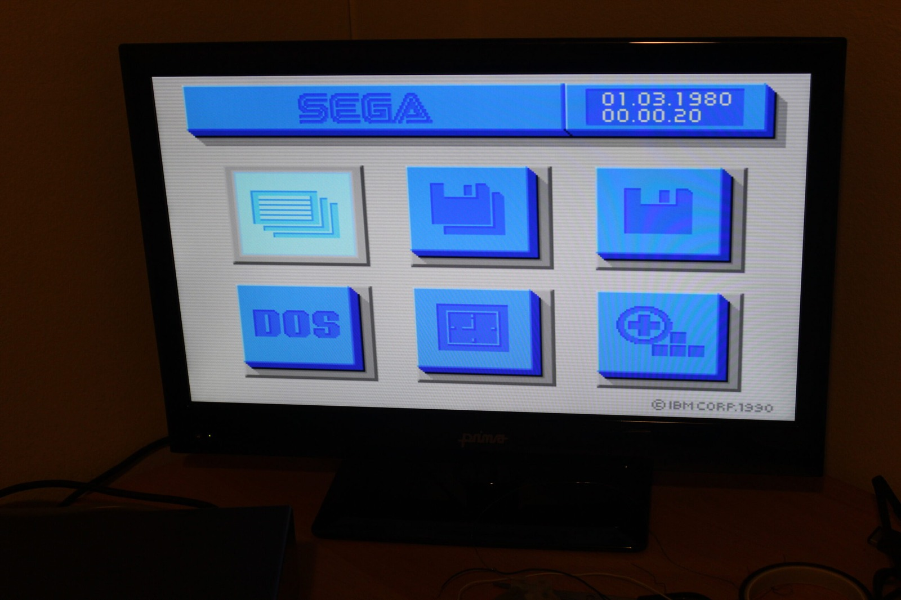
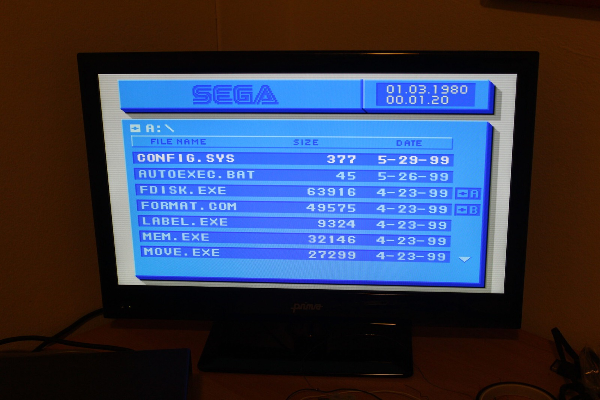



Some great news, some even better news, and then some unreal news. I've got three Sega machines to play with: a TeraDrive Model 2, a Mega Drive 2, and a Genesis Nomad. Not all of them are working, naturally, but that just gives me something to investigate.

The TeraDrive is already looking particularly promising. In the video I'm playing Scorched Earth on the PC side and exploring the built-in Sega file manager. Silent Nick even discovered that I could launch the game directly through the menu without having to boot from the game disk. The red floppy-drive lights are rather spectacular too!

We've also got a new editor joining McRetro, focusing mainly on the Nintendo Famicom. Please welcome SuperNick (Nick) to the scene. He's relatively new to soldering and tinkering, and he has a Famicom on the way.

He was also voted the most silent person in our two top-ranking LED counter videos:





### Sega Genesis Nomad

The Nomad is broken. It won't power on using either the AC adapter or the battery pack, and I haven't got a GameBit screwdriver handy to open it yet. That's reasonably good news, really, because it means I get to attempt a repair. Will victory be mine?

*The Nomad has arrived, but it refuses to power on with the battery pack or AC adapter. Time to find a GameBit screwdriver!*
{: .media-caption }

### Mega Drive 2

I'd actually bought a broken Mega Drive Model 1 to use with the Mega-CD and TeraDrive expansion connection, and to salvage parts for my more prized High Definition Model 1. The seller had other ideas and sent me a Model 2 instead.

I contacted them about the mistake, and they've agreed to send the Model 1 while letting me keep or dispose of the Model 2. I think I'll keep it. Small victories!

*I ordered a broken Model 1 and got a Mega Drive 2 instead. The seller's sending the right one and letting me keep this one. Bonus!*
{: .media-caption }

### TeraDrive Model 2

The TeraDrive has arrived from Japan in working condition, which is fantastic news. The PC side boots properly, and both floppy drives are functioning. I've already had Scorched Earth running, although my attempt to finish off the green tank in the video didn't go quite as planned!

*The TeraDrive Model 2 has made it over from Japan. Both floppy drives work and the PC side boots!*
{: .media-caption }

The Model 2 has two floppy drives and no internal hard drive, with Sega's original specifications listing 1 MB of RAM. The machine also has both 15 kHz and 31 kHz analogue RGB outputs, along with composite video.

*Two floppy drives, a glowing power light and that wonderful TeraDrive badge. Very pleased it's working!*
{: .media-caption }

At the moment I haven't got a display suitable for the Mega Drive's 15 kHz RGB output, so that part will need to wait. The built-in Sega menu and file manager have already been interesting to explore, particularly the way the machine switches between its PC and Mega Drive functions.

*Sega's wonderfully blue built-in menu. A friendlier place to start than a bare DOS prompt!*
{: .media-caption }

*Even the file manager gets the TeraDrive blue-box treatment. There's CONFIG.SYS and AUTOEXEC.BAT, right where they should be.*
{: .media-caption }

I've also uploaded some of the original flyers and quick-reference material that accompanied the TeraDrive. They're in the [photo gallery](/goodies/) if you'd like a closer look at the machine and its paperwork. There'll be plenty more testing once I get the video side sorted out.

**Sources**

- [Sega Hardware Archive: TeraDrive (Model 2 Specifications)](https://www.sega.jp/fb/segahard/md/tera.html)

**Related Posts**

- [Humble Beginnings: Nintendo Famicom Incoming](/humble-beginnings-nintendo-famicom-incoming/)
- [Sega TeraDrive Demo - Sonic 1 and Sega Menu](/sega-teradrive-demo-sonic-1-and-sega-menu/)
- [Sega Genesis Nomad DC-in Jack Repair](/sega-genesis-nomad-dc-in-jack-repair/)
