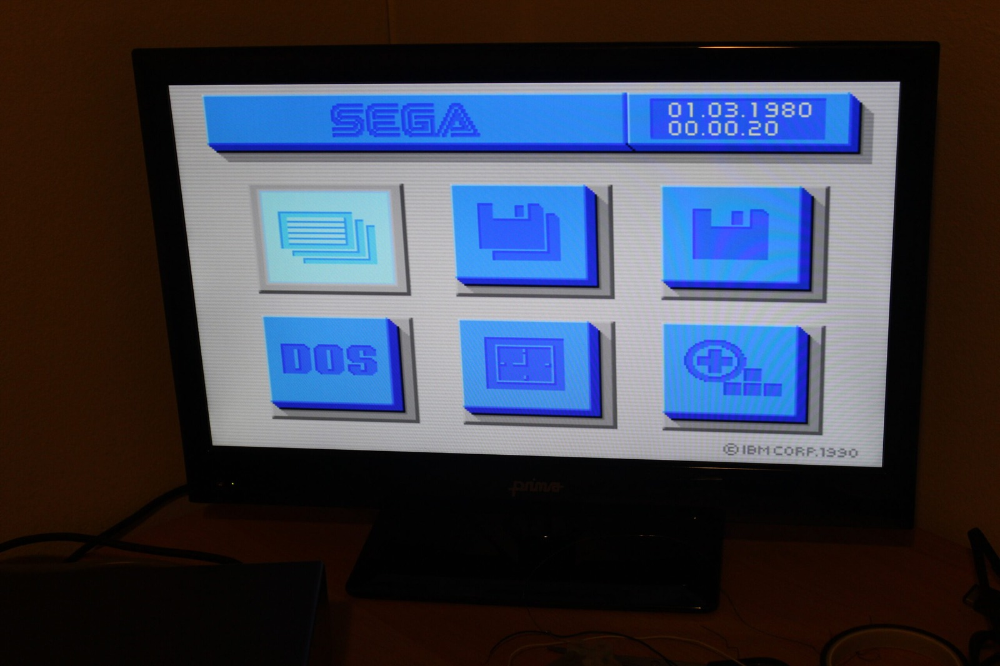

Figured I should hit the Sega TeraDrive up with some diagnostics and found out some things I didn't know.

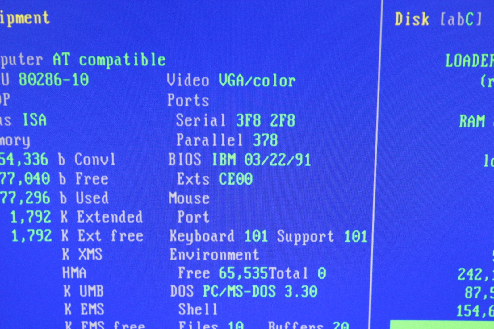

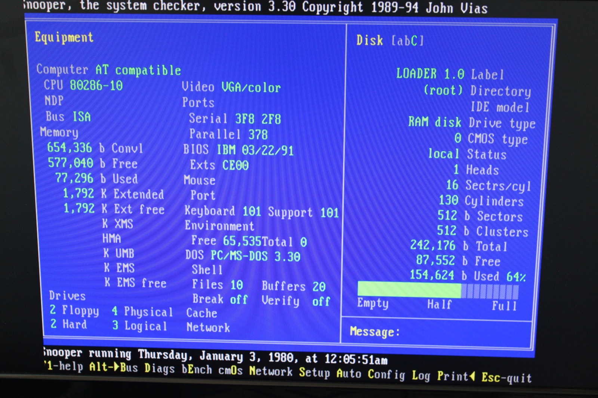

**1.** The embedded SEGA startup environment appears to be based on PC DOS 3.x, and this one reports PC DOS 3.30. That's separate from the IBM DOS J4.0/V software Sega supplied with the TeraDrive.

PC DOS 3.30 dates back to 2 April 1987 and added support for 1.44 MB 3.5-inch floppy disks. My TeraDrive Model 2 has two of those drives, so that all fits rather nicely.

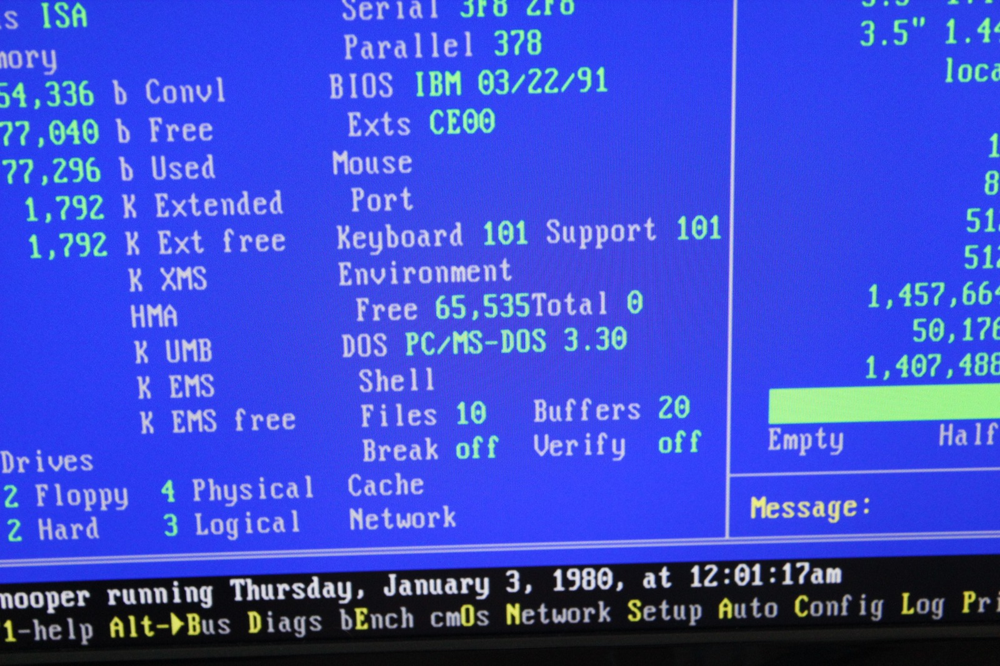

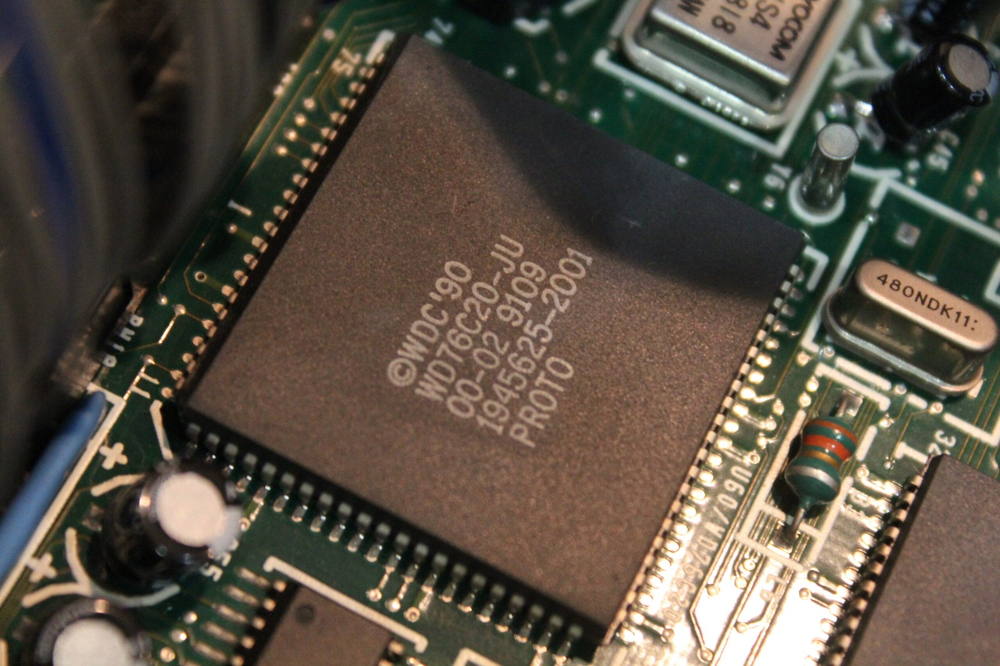

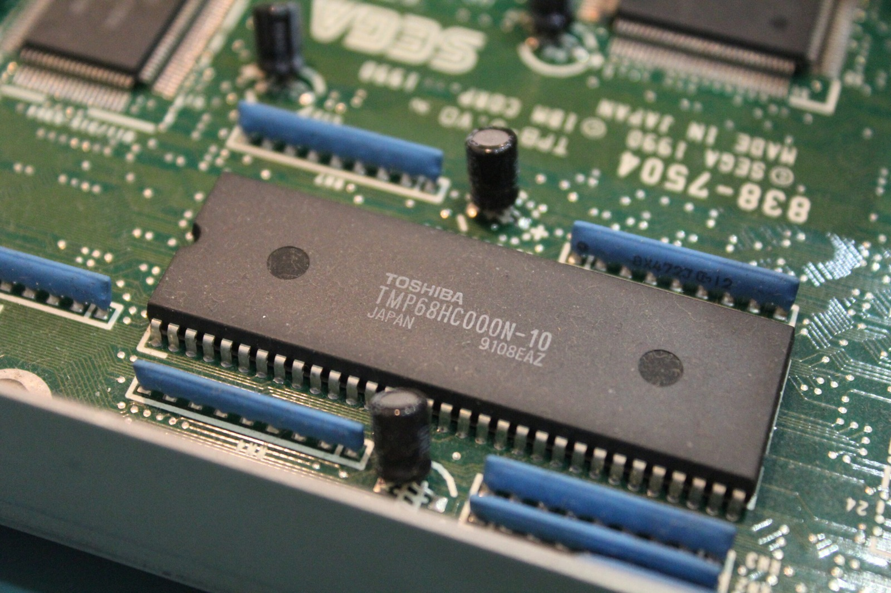

**2.** There's a May 1991 date inside the cover of both TeraDrive manuals. The chips I've checked are marked week 09 1991, week 48 1990, week 06 1991 and week 08 1991, while the IBM-branded BIOS is dated 22 March 1991. Everything points towards a machine built around the TeraDrive's launch period, although I can't pin down its exact assembly date from those markings.

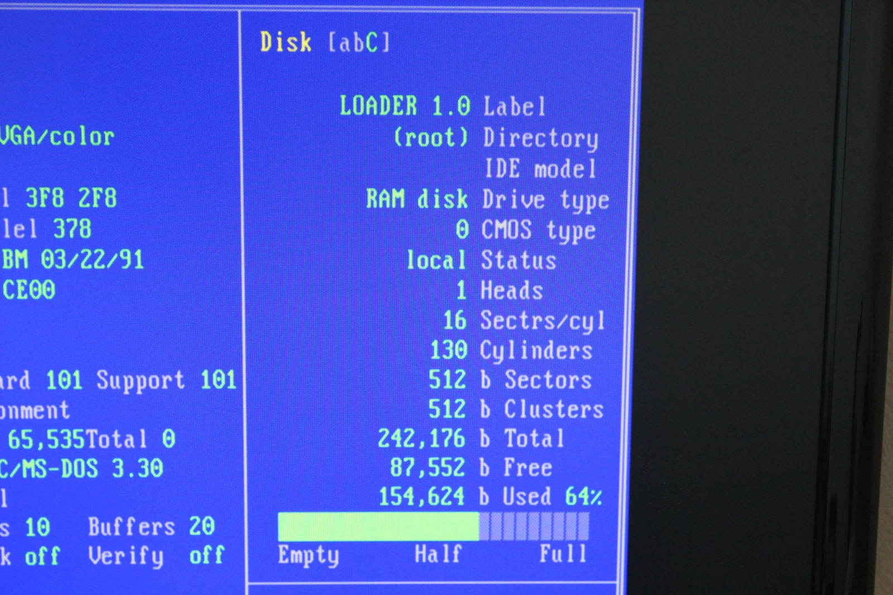

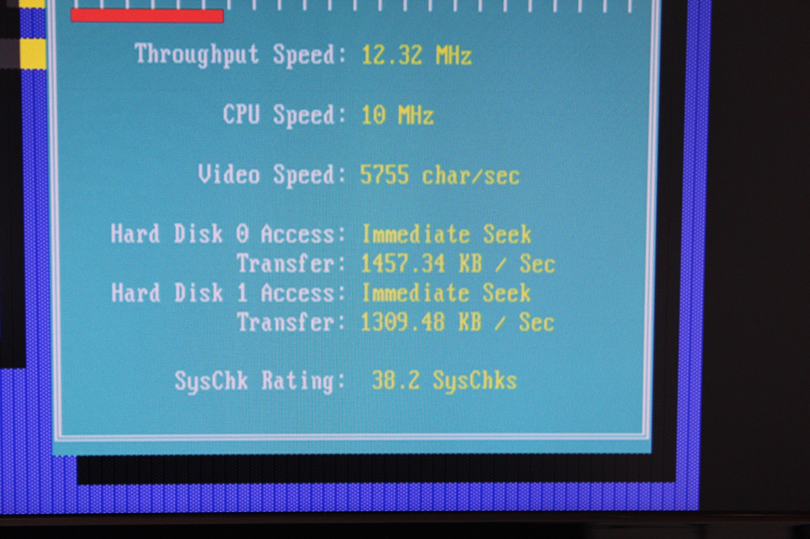

**3.** Here's something rather neat. The SEGA startup environment exposes a small RAM disk or virtual drive labelled LOADER 1.0. It's 242,176 bytes in size, with 87,552 bytes still free, and reports 1 head, 16 sectors and 130 cylinders. Read speed seems to be somewhere around 1300 KB to 1400 KB/sec.

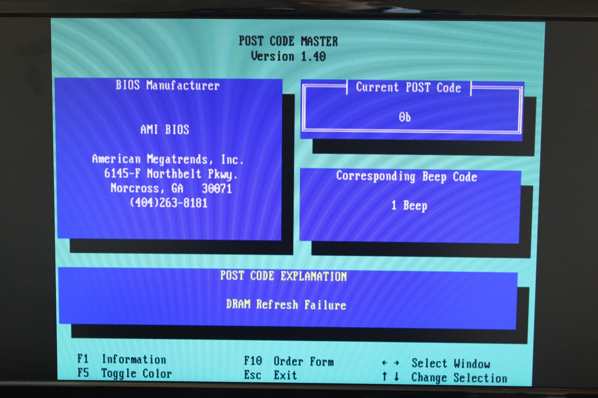

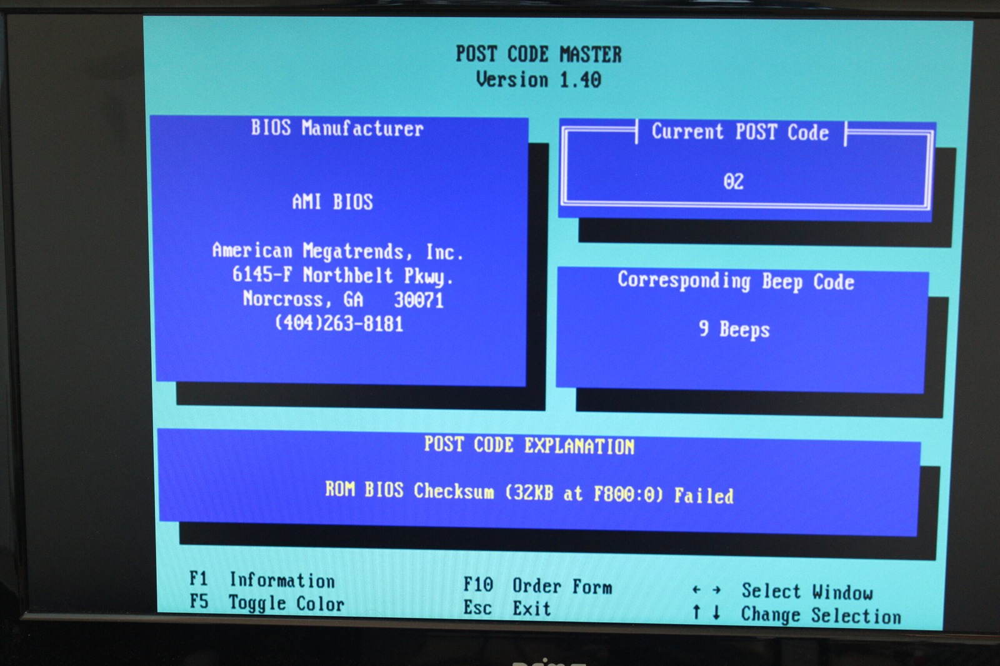

**4.** The diagnostic reference I was looking at associates one beep with a DRAM refresh failure and nine beeps with a ROM BIOS checksum failure. Those are familiar AMI BIOS beep codes, but whether the IBM-branded TeraDrive BIOS uses the same meanings is another question. I'll need something more specific to this machine before trusting that list.

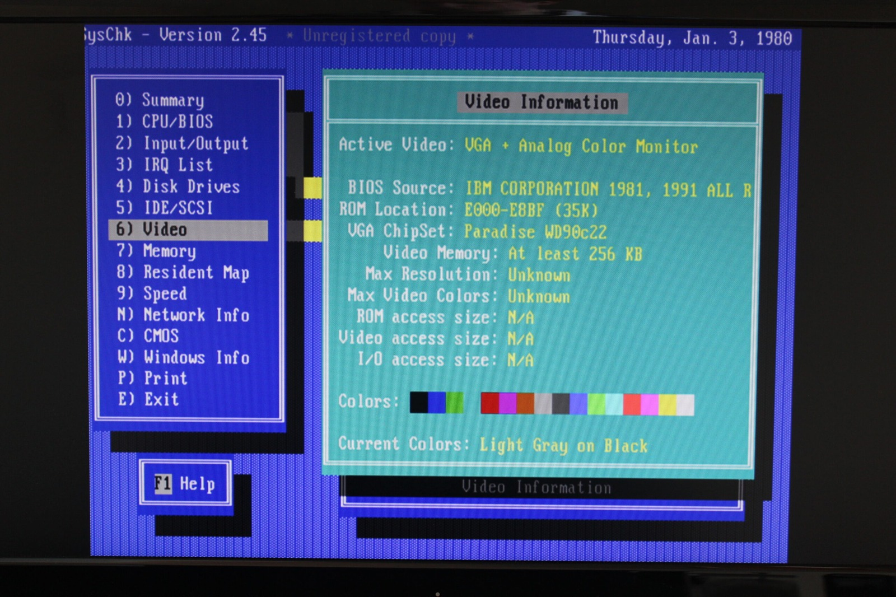

**5.** The diagnostics identify the VGA controller as a Paradise/Western Digital WD90C22, which is interesting because the TeraDrive hardware is documented as using a Western Digital WD90C10-LR. Perhaps the software is recognising the general graphics-controller family rather than the exact chip.

Sega specifies 256 KB of VGA VRAM for the TeraDrive. That's another useful detail to keep in mind while I'm poking around in there. The full set of Sega TeraDrive Model 2 and Model 3 photos can be found in the [photo gallery](/goodies/).

### Sources

- [PCjs: IBM PC DOS 3.30 (2 April 1987; 1.44 MB Floppies)](https://www.pcjs.org/software/pcx86/sys/dos/ibm/3.30/)
- [Sega Hardware Archive: TeraDrive (31 May 1991; IBM DOS J4.0/V)](https://www.sega.jp/fb/segahard/md/tera.html)
- [MAME: Sega TeraDrive Driver (Western Digital WD90C10)](https://github.com/mamedev/mame/blob/master/src/mame/pc/teradrive.cpp)
- [Microsoft KB Archive: AMI BIOS Beep Codes](https://www.betaarchive.com/wiki/index.php/Microsoft_KB_Archive/85636)

### Related Posts

- [Sega TeraDrive Demo: Sonic 1 and Sega Menu](/sega-teradrive-demo-sonic-1-and-sega-menu/)
