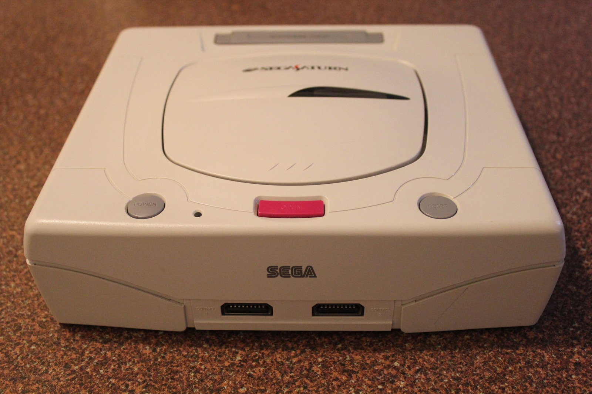
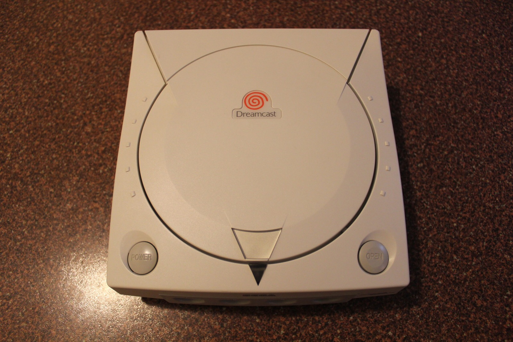
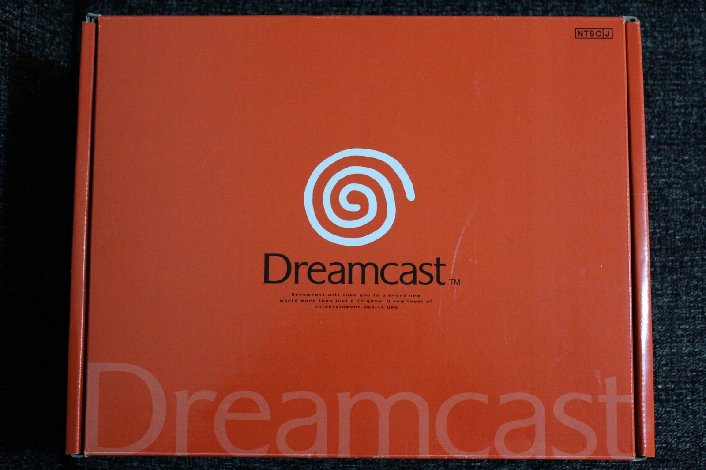
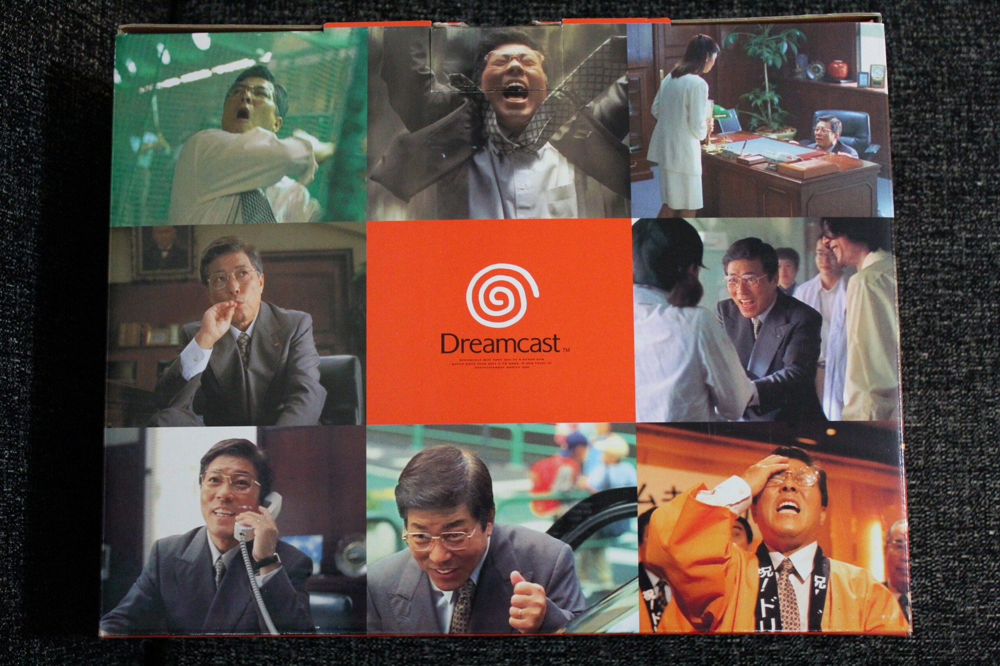
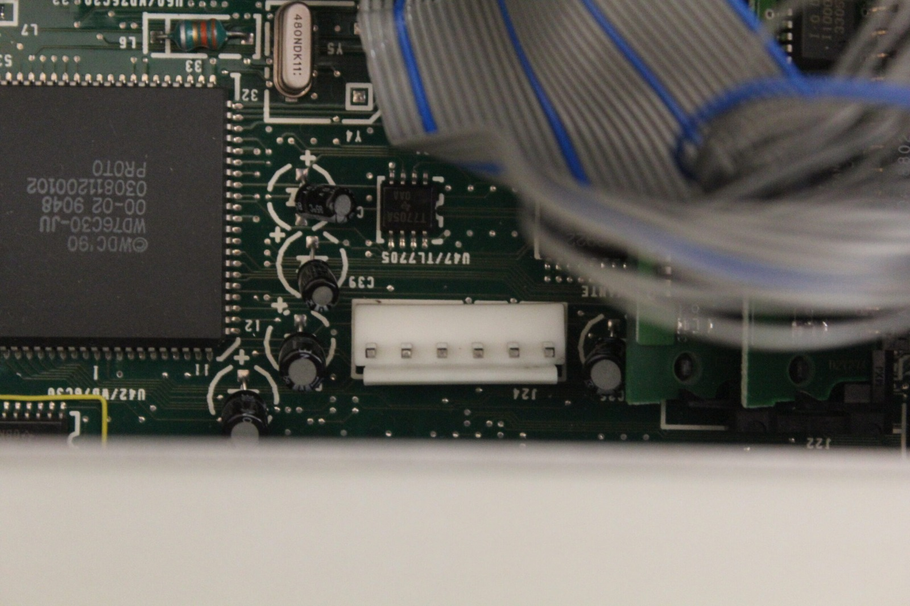
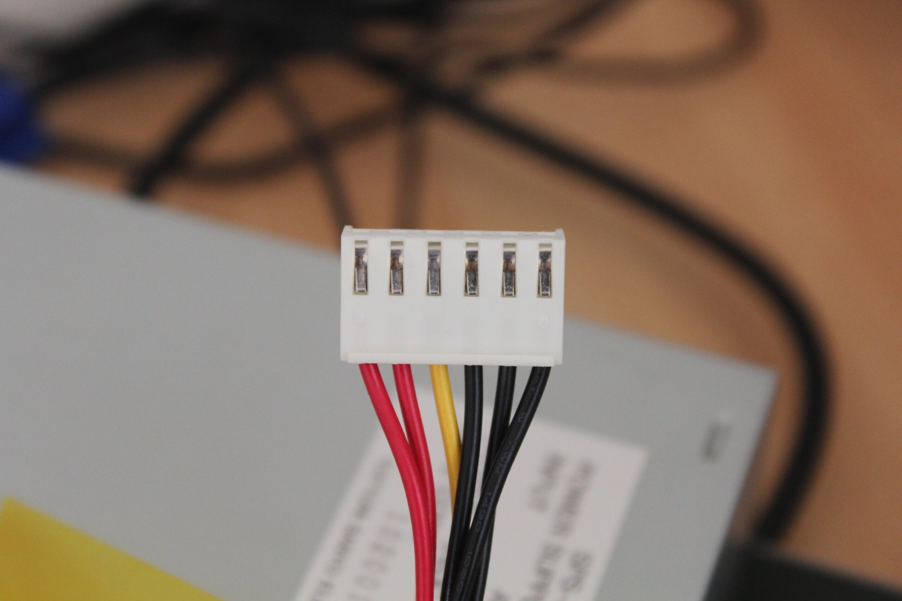
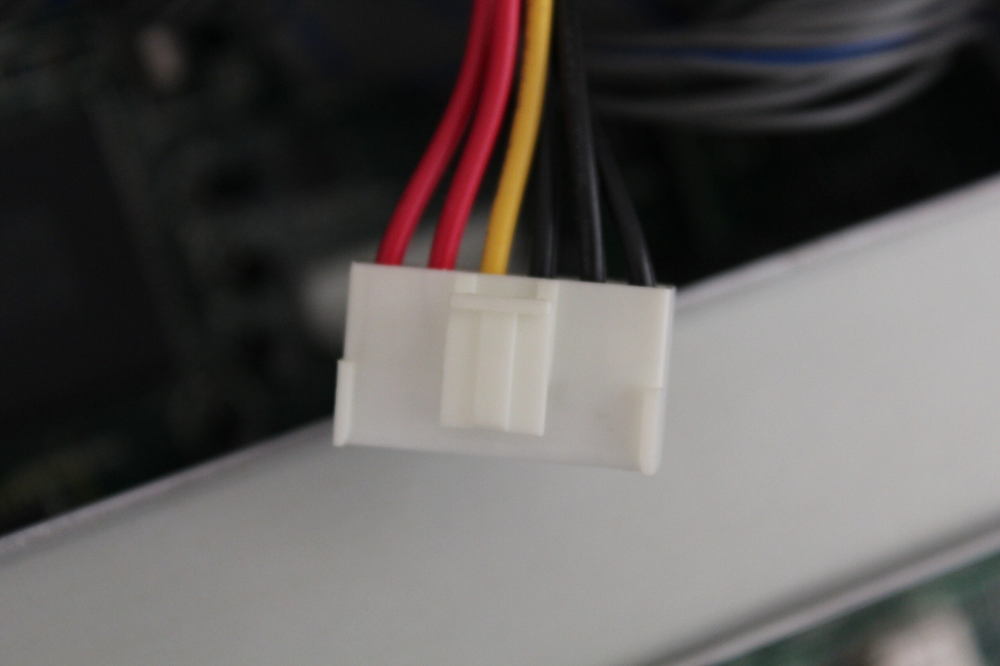

*The white Japanese Model 2 Saturn has finally arrived. I still reckon it's one of Sega's cleanest-looking consoles.*
{: .media-caption }

#### Japanese Sega Saturn

Today I received my white Japanese Model 2 Sega Saturn from Japan. Look at it. Isn't it just the cleanest-looking Saturn design you have seen? Well, compared with PAL Saturns at least. I've added it to the [photo gallery](/goodies) too.

It powers on without issue through the step-down converter, but the CD mechanism is very unhappy. It seems to have trouble working out where it is supposed to rest and makes some truly horrible clicking noises. I bought it mainly for the case, but perhaps there is still hope of repairing it...



*And another white Sega console: my early Dreamcast, looking remarkably tidy.*
{: .media-caption }



*The Dreamcast's Japanese NTSC-J box. The orange spiral certainly doesn't go unnoticed.*
{: .media-caption }



*The reverse of the Dreamcast packaging is a wonderful collage of photographs and the orange logo. A very 1990s way to sell a console.*
{: .media-caption }

#### VA0 Dreamcast

And here is the Dreamcast I received. It appears to be a VA0 revision, complete with the metal fan and heatpipe cooling arrangement found in those early machines. What are the chances? Very unreal, and the box was in immaculate condition. Lots of paperwork and documents as well. I've added a new gallery for it under Sega Dreamcast 058007003298.



*Inside the TeraDrive, here's the motherboard power header beside a Western Digital chip and a bundle of ribbon cables. Time to get the multimeter out.*
{: .media-caption }



*The six-pin power plug from the contact side: two red wires, one yellow, and three black.*
{: .media-caption }



*The same plug from the latch side. The colours look familiar, but I checked them with a multimeter rather than guessing.*
{: .media-caption }

#### TeraDrive power checks

This morning I also checked the TeraDrive's power rails with a multimeter and measured:

```
Red - 5V
Red - 5V
Yellow - 12V
Black - Ground
Black - Ground
Black - Ground
```

Perfect. The readings match the familiar PC wiring colours, with red for +5 V, yellow for +12 V and black for ground. Nice to know, although I certainly wouldn't trust wire colours alone on something as unusual as the TeraDrive. That's why the multimeter came out in the first place!

This makes life a little easier if I eventually investigate replacing the internal PSU with something like a picoPSU.

I've been messaging back and forth with Nemesis via the [ASSEMblergames.com](https://web.archive.org/web/20170919030325/https://www.assemblergames.com/) forums and comparing his photos with my Sega TeraDrive Model 2 and Model 3. They use the same controller chips. [Hacking-Cult.org](http://nemesis.hacking-cult.org/MegaDrive/TeraDrive/Pictures/) is where his photos are hosted, and there is an active thread on [SpritesMind.net](http://gendev.spritesmind.net/forum/viewtopic.php?p=15182).

### Sources

- [ConsoleMods: Dreamcast Model Differences (VA0 Cooling)](https://consolemods.org/wiki/Dreamcast:Dreamcast_Model_Differences)

### Related Posts

- [Faulty Japanese Sega Saturn: CD Drive Problems](/faulty-japanese-sega-saturn-cd-drive-problems/)
