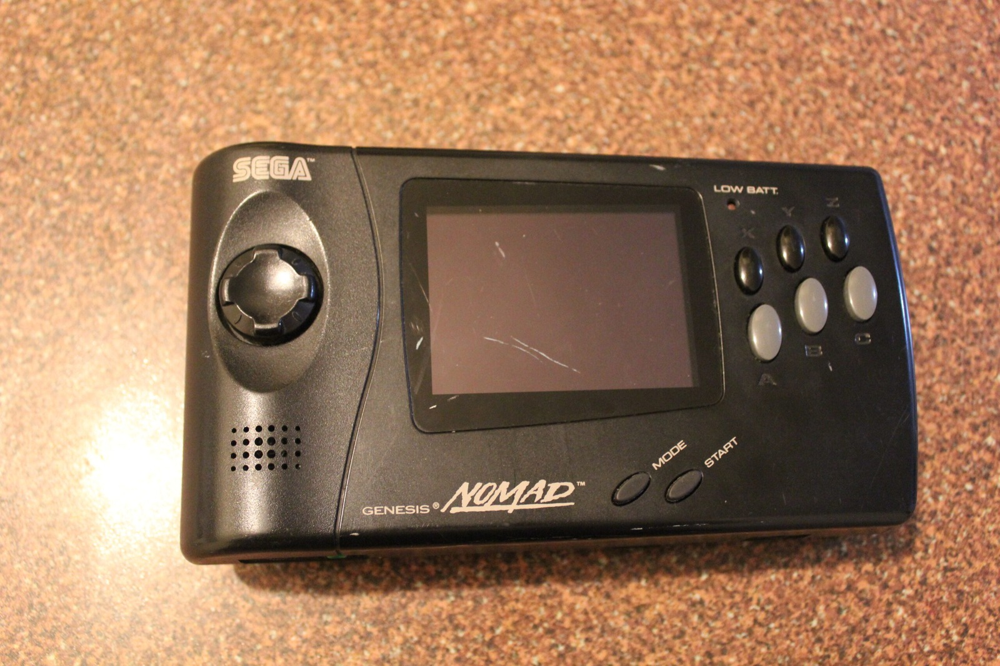

*Here's the Nomad as it arrived, complete with a scratched screen. That loose DC-in jack was the next problem to tackle.*
{: .media-caption }

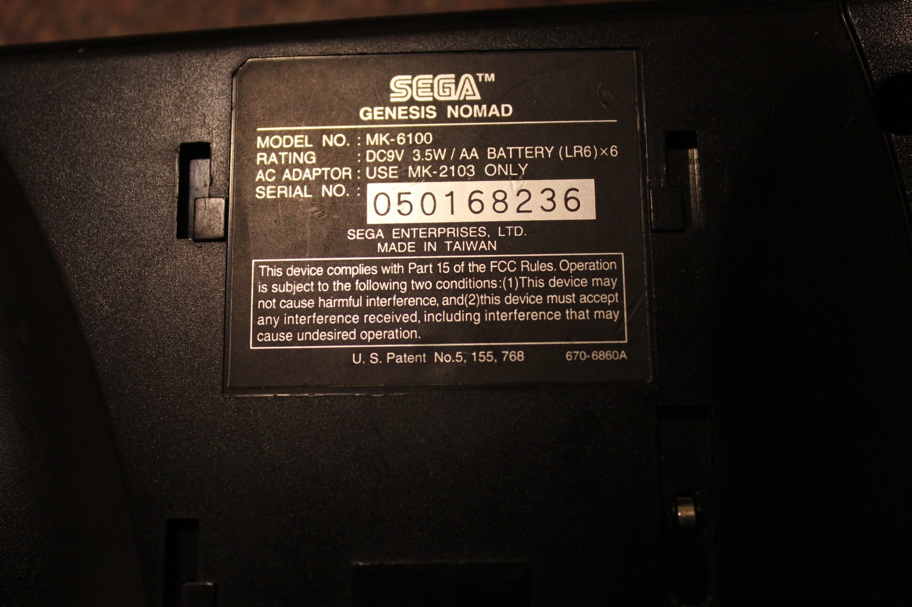

*Even the back label gets a photo. It's a Genesis Nomad MK-6100, and the power specifications are worth keeping in mind.*
{: .media-caption }

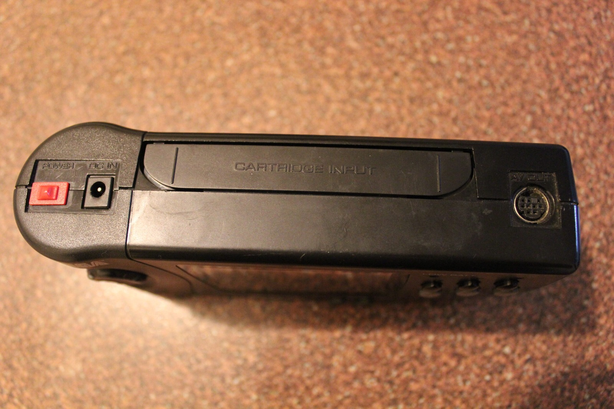

*Here's the top of the Nomad, including the troublesome DC-in socket. A tiny connector was enough to stop the whole machine.*
{: .media-caption }

The Sega Genesis Nomad. What an amazing beast. It didn't work up until today, and the seller had kindly offered me a full refund if I returned it. Not while I have an empty weekend to do some repairing! I already knew there was a problem with the DC-in jack because it was loose as a goose.

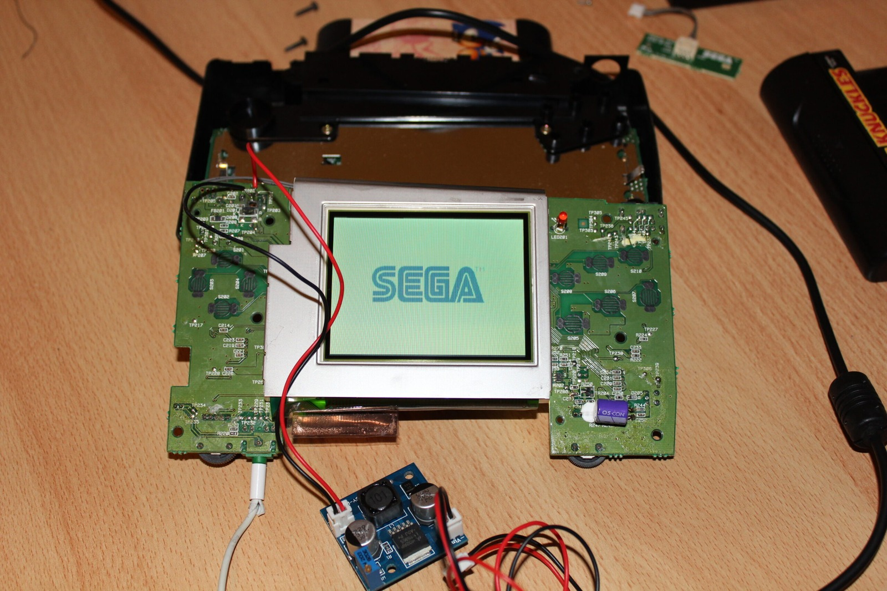

*With the Nomad spread across the desk and a temporary 9 V supply attached, the SEGA logo appears. That's a good sign!*
{: .media-caption }

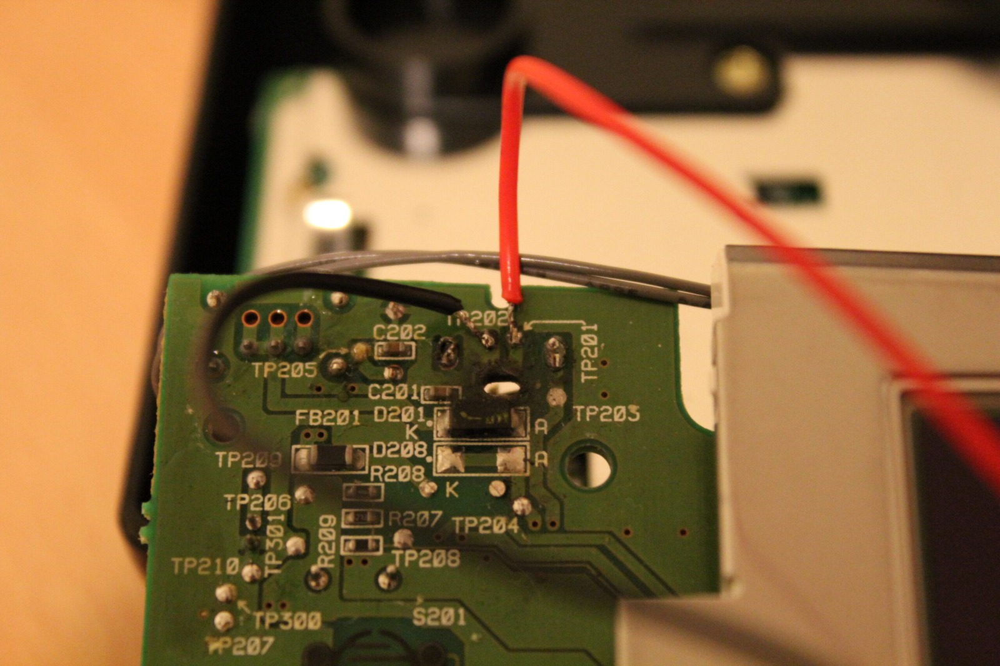

*My temporary power leads on the Nomad board. I initially got the wiring backwards, which wasn't terribly helpful!*
{: .media-caption }

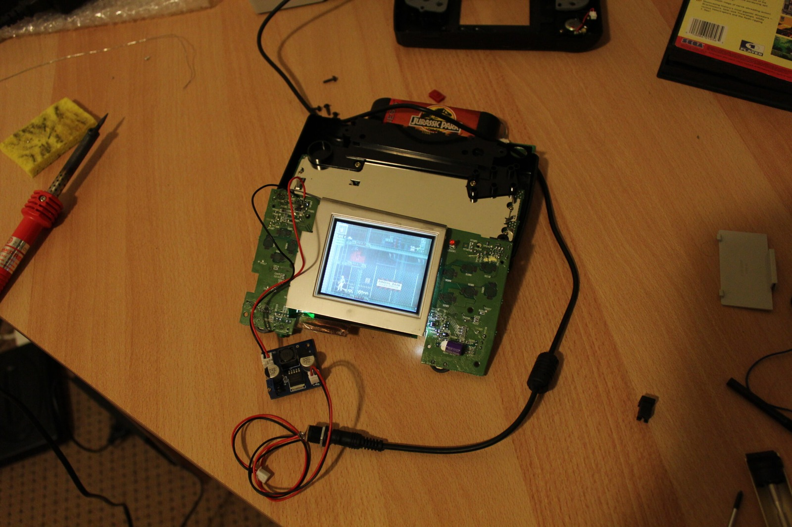

*It's alive on the bench, running from the temporary step-down converter. Not glamorous, but at least the Nomad can power up.*
{: .media-caption }

Apart came the Nomad, and the problem became much clearer. The damaged DC-in jack was allowing positive and ground to short together. That also gave me a plausible explanation for why the machine would not run from the external battery pack.

For diagnosis, I traced the power input and temporarily connected one of the DC-DC step-down converters from my Saturn PSU project, adjusted to 9 V. Positive on red, ground on black and... bingo! Life! I had initially wired the DC-DC converter the wrong way around and got absolutely nowhere, although thankfully nothing appeared to have been damaged. In the recording, red runs to TP201 and black to TP202.

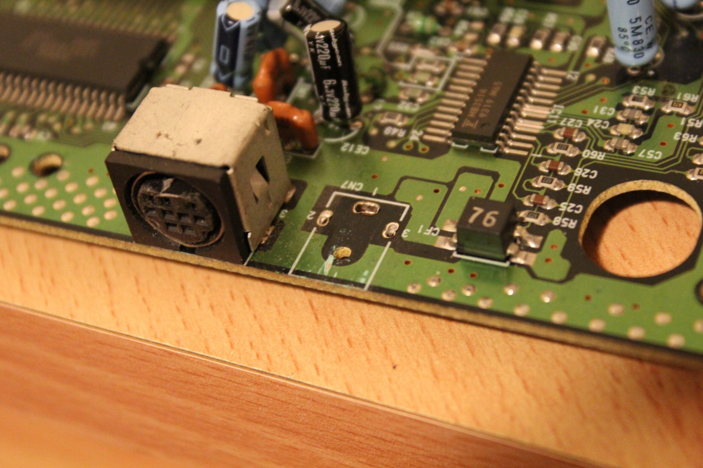

*A close look at the original DC jack on the board. It looked innocent enough until the electrical testing.*
{: .media-caption }

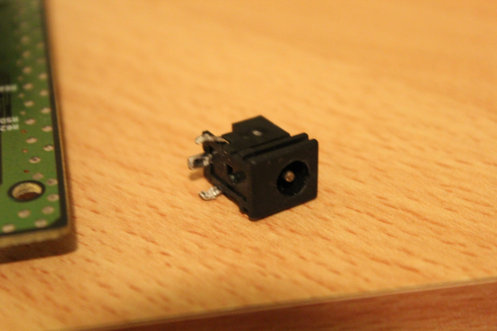

*Out comes the troublesome DC-in jack. Not much to look at, but it's enough to bring an entire handheld to a halt.*
{: .media-caption }

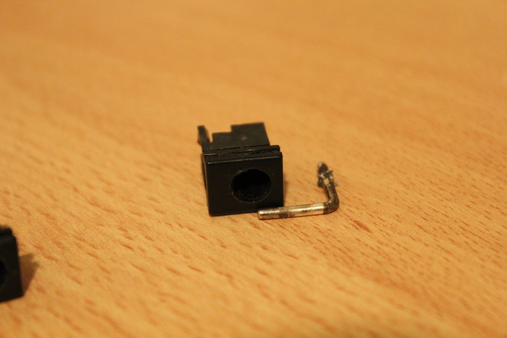

*Here's the replacement power jack borrowed from my Mega Drive 2. Thankfully, it was compatible with the Nomad.*
{: .media-caption }

On closer inspection I found that the DC-in jack from my Mega Drive 2 was compatible with the Nomad. Both machines use the same tip-positive power arrangement. So I removed the jack from one of my working Mega Drive 2 consoles and fitted it to the Nomad.

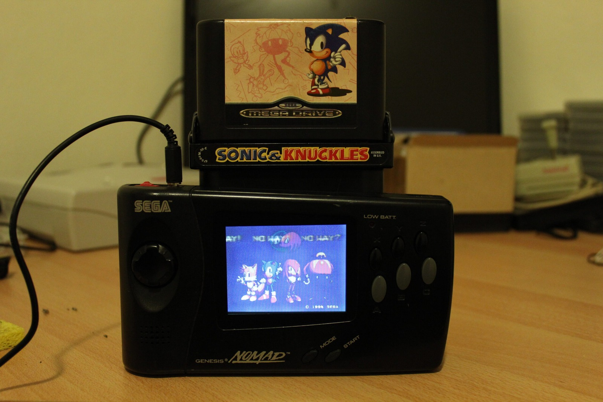

*The Nomad lives! Sonic & Knuckles is in, and I've finally got a working handheld instead of a repair project.*
{: .media-caption }

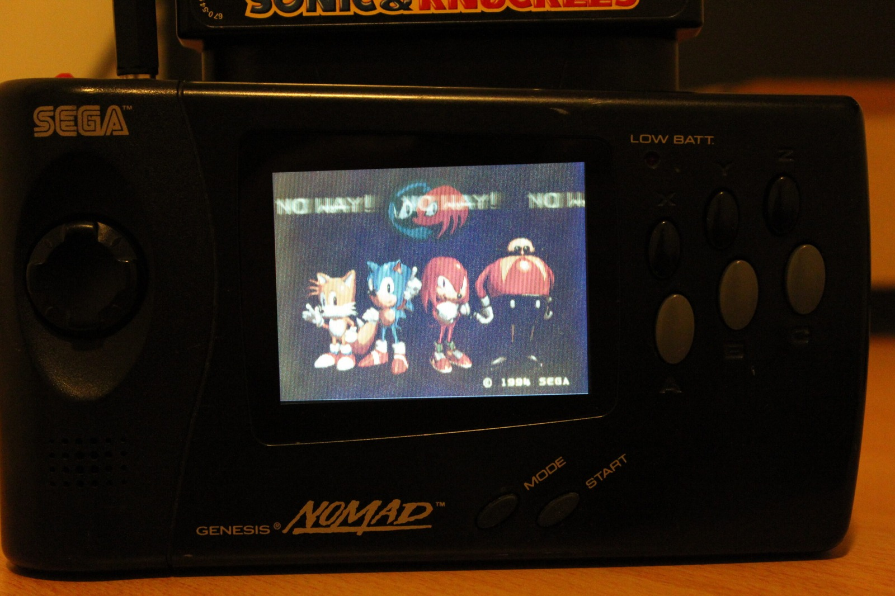

*Sonic, Tails, Knuckles, and Robotnik have appeared on the screen. Much more fun than looking at a dead Nomad.*
{: .media-caption }

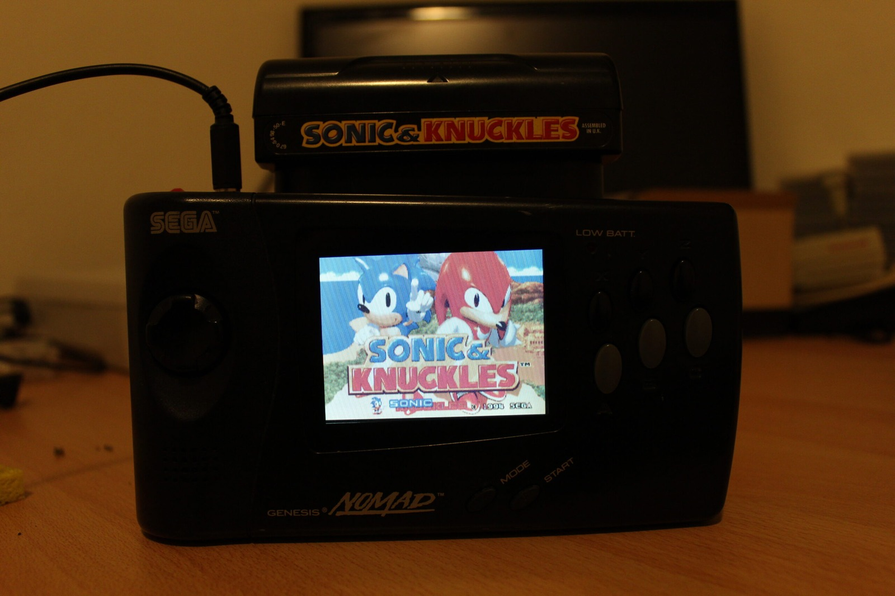

*There's the Sonic & Knuckles title screen. New screen cover, clean buttons, repaired power socket, and a working Nomad at last.*
{: .media-caption }

I replaced the scratched front screen, cleaned the controller buttons, put everything back together and plonked in the nearest cartridge I could find. It works from the external battery pack as well.



So overall... success! The video above shows the Nomad during the initial tests.

### Sources

- [Sega Genesis Nomad Instruction Manual](https://manualzilla.com/doc/6982054/sega-genesis-nomad-instruction-manual)

### Related Posts

- [Sega TeraDrive Model 2, Genesis Nomad and Mega Drive 2](/sega-teradrive-model-2-genesis-nomad-and-mega-drive-2/)
