

Does this Sega TeraDrive work never end? Will I never be content? I've been trying to get Windows 3.11 running on the Model 2, which is rather ambitious considering the machine has just 2.5 MB of RAM and no hard drive. Still, I've managed to squeeze it down onto a bootable floppy, with a second disk for the applications.

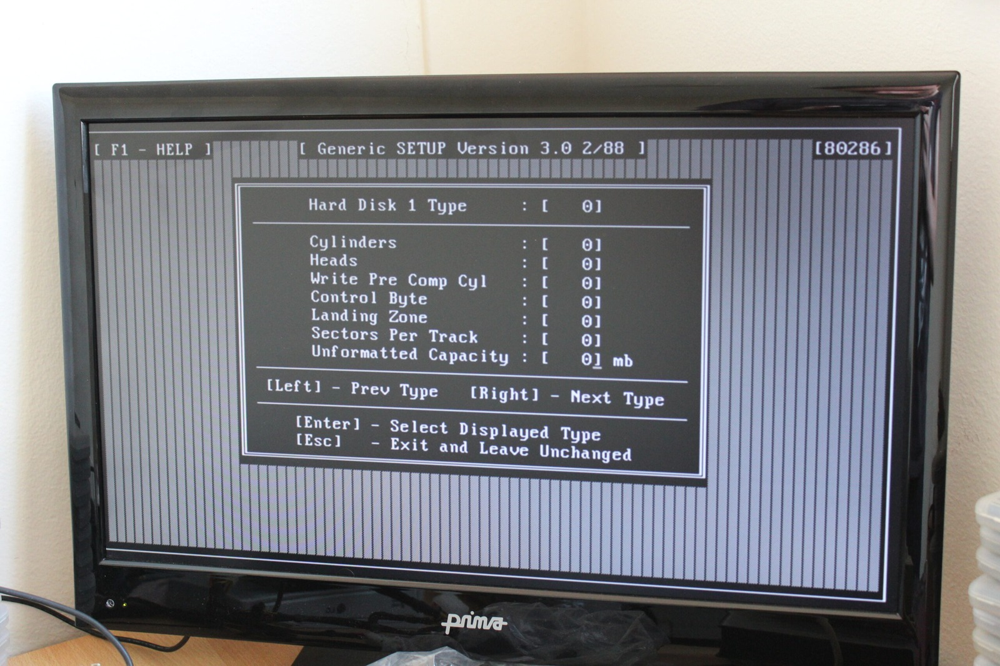

*The TeraDrive's BIOS setup is giving me hard disk options, but finding a controller that actually works is another matter.*
{: .media-caption }

Before getting to Windows, I've also been experimenting with some cheap ISA IDE controllers from eBay. So far they haven't been particularly cooperative with the TeraDrive, although one managed to access the floppy controller well enough to light up the drive. Unfortunately it couldn't actually read anything.

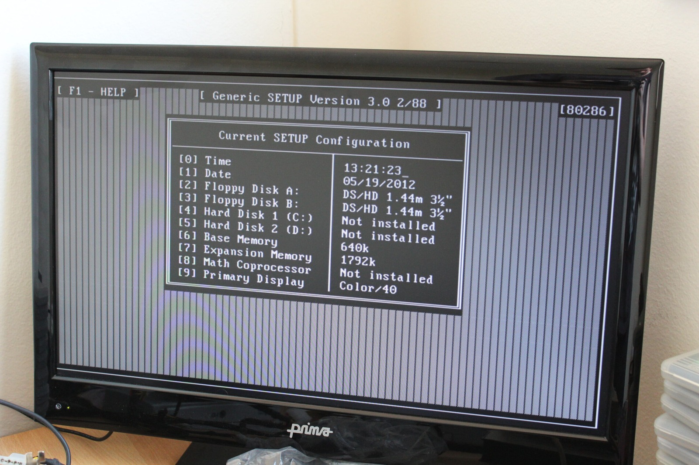

*The configuration disk can at least show the floppy settings. Hard Disk 1 and Hard Disk 2 are still listed as not installed.*
{: .media-caption }

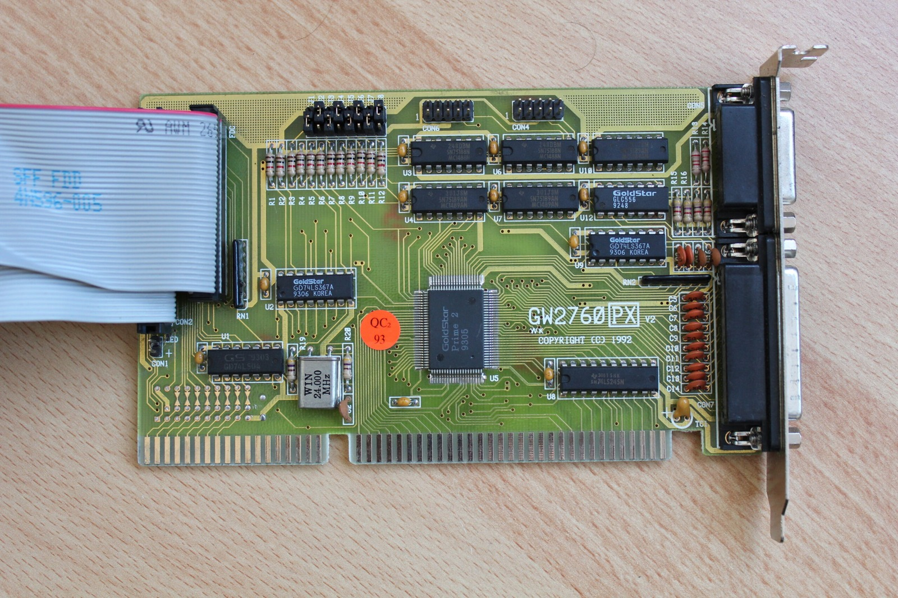

*One of the cheap ISA controller cards I was testing. Getting the floppy drive light to come on wasn't the same as reading a disk!*
{: .media-caption }

I've ordered a Promise controller from the UK with its own BIOS, hoping that might provide a way around the storage problems. I also found a BIOS configuration disk, which at least gives me access to more of the TeraDrive's setup options. We'll see whether any of this eventually leads to a proper hard drive.

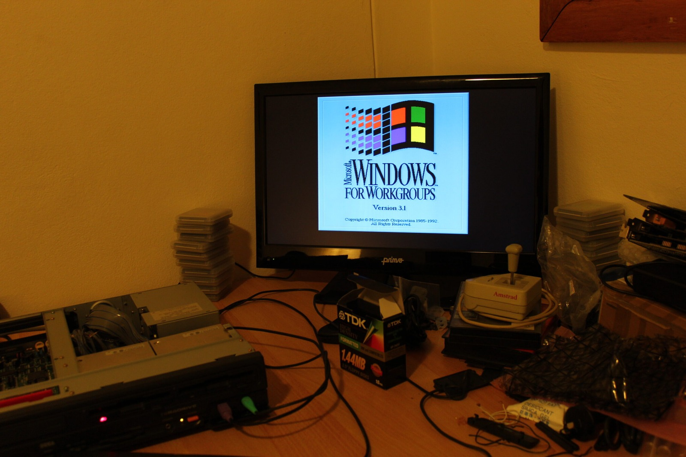

*Windows for Workgroups 3.1 makes an appearance. That's a separate experiment from the standalone Windows 3.11 build.*
{: .media-caption }

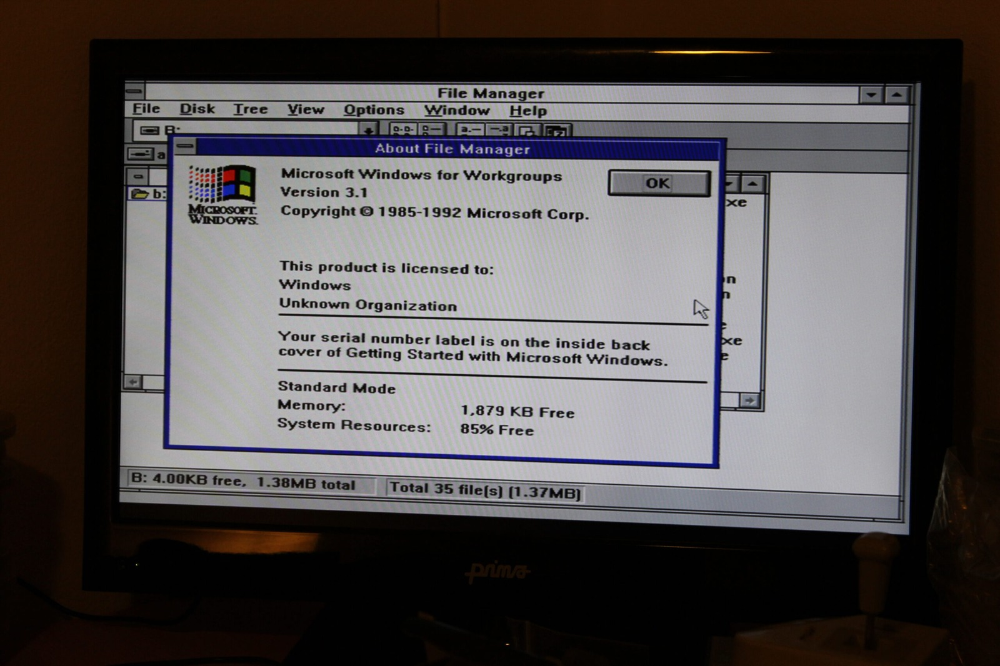

*File Manager confirms Windows for Workgroups 3.1 in Standard Mode. I wanted to try standalone Windows 3.11 as well.*
{: .media-caption }

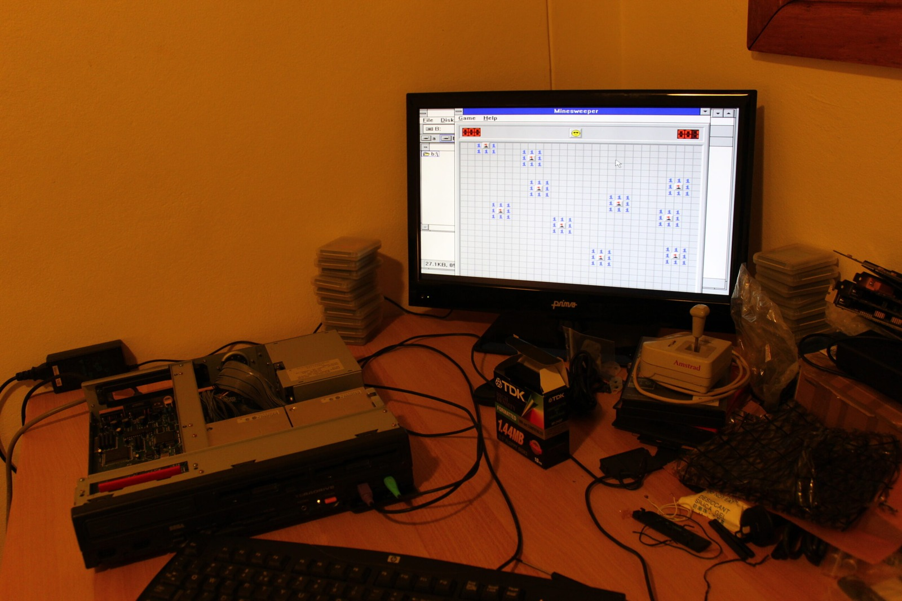

*Solitaire on the TeraDrive! It runs, although 'blisteringly fast' isn't a phrase I'd use about this setup.*
{: .media-caption }

#### Back to Windows

Rather than spend the entire weekend fighting storage controllers, I returned to my earlier experiment with Windows 3.00a running from a RAM Disk. This time I wanted Windows 3.11. Importantly, I'm talking about standalone Windows 3.11, not Windows for Workgroups 3.11, which requires a 386SX or better.

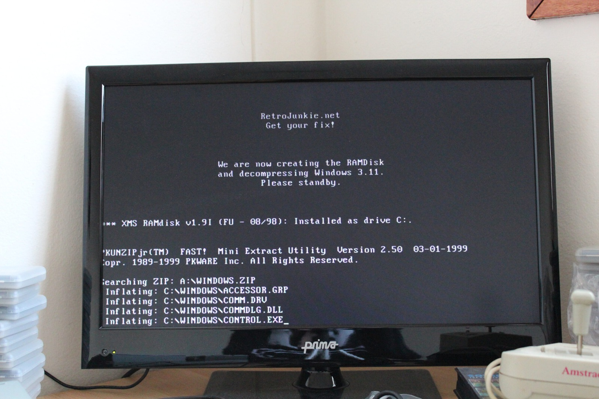

*Here's my homemade boot disk making a RAM disk and unpacking Windows. The poor 286 has to work for every kilobyte.*
{: .media-caption }

Windows for Workgroups 3.1 can run on a 286, but I don't particularly care about Workgroups networking here. I'm just interested in seeing how far this old Sega and IBM machine can be pushed. A stripped-down copy of standalone Windows 3.11 seemed like a much better candidate.

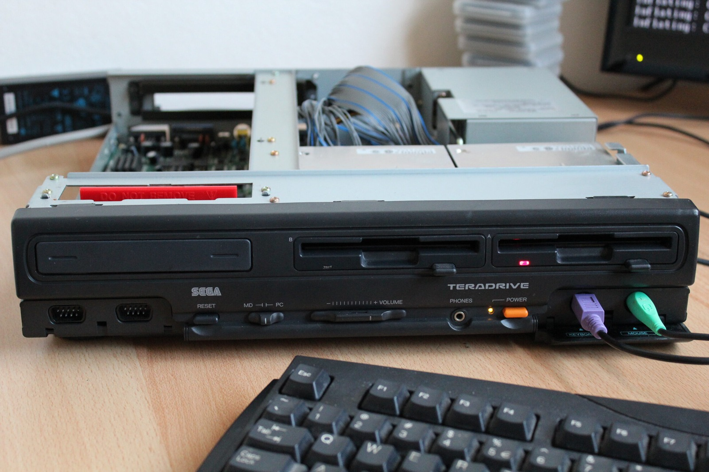

*The Model 2 with its lid off, floppy drives at the ready, and cables everywhere. A pretty typical weekend experiment!*
{: .media-caption }

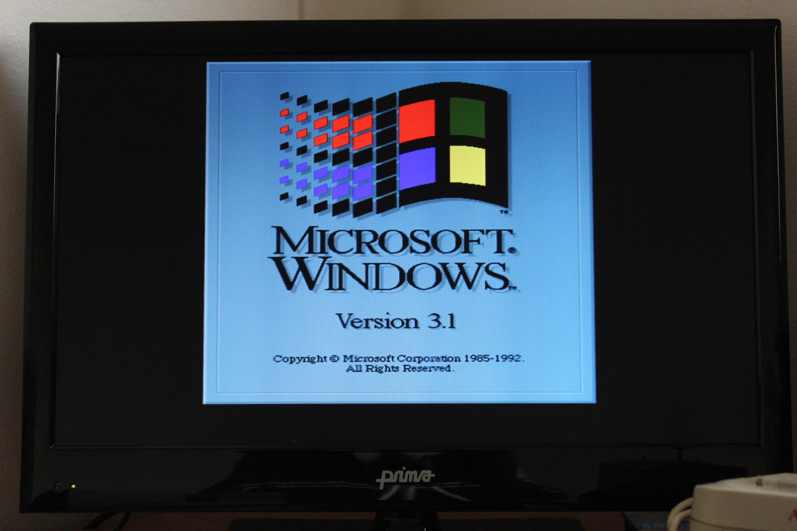

*The Windows startup screen still says Version 3.1, even as I experiment with the standalone 3.11 release.*
{: .media-caption }

The boot disk works much like my Windows 3.00a version. It creates a RAM Disk and uses PKUNZIP Junior to extract roughly 700 KB of compressed Windows files into about 1.4 to 1.5 MB of memory. That takes a fair while on a 286, and there's not much room left for anything else.

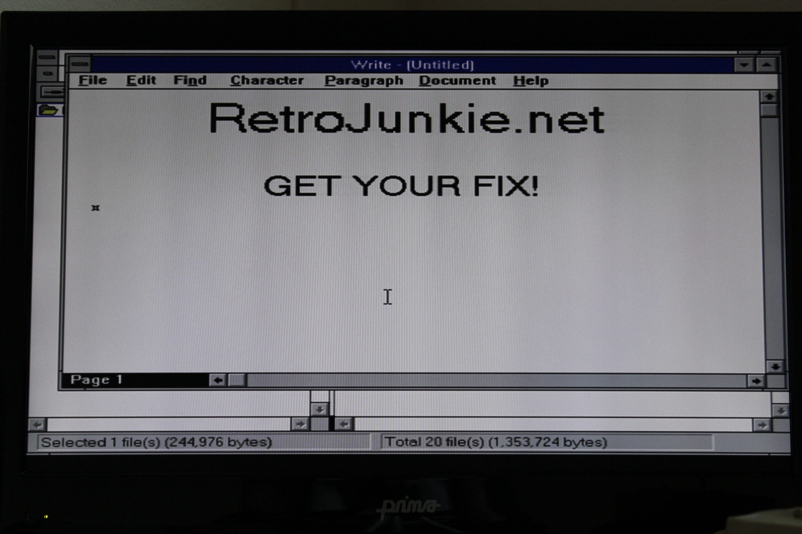

*Naturally, I fired up Write and typed RetroJunkie.net. A few precious kilobytes put to excellent use.*
{: .media-caption }

Windows 3.11 also wanted more memory than 3.00a. I initially tried giving it almost everything for the RAM Disk, but eventually discovered that leaving another 64 KB of extended memory available was enough to get it started. A fair bit of trial and error went into that little discovery.

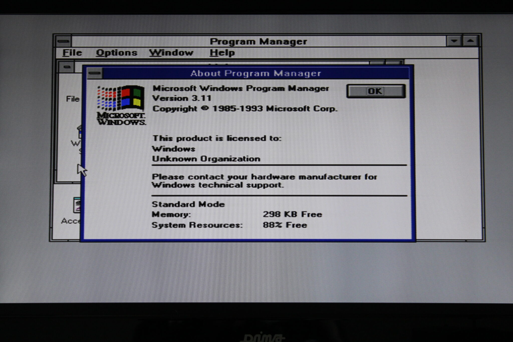

*And there's the proof: Windows 3.11 in Standard Mode, with about 298 KB free. Roomy it isn't!*
{: .media-caption }

And there it is, Windows 3.11 running on the Sega TeraDrive Model 2! The Program Manager looks familiar enough, although the whole thing is blisteringly slow. I was seeing around 295 KB of free memory, compared with roughly 400 KB in my earlier Windows 3.00a experiment.

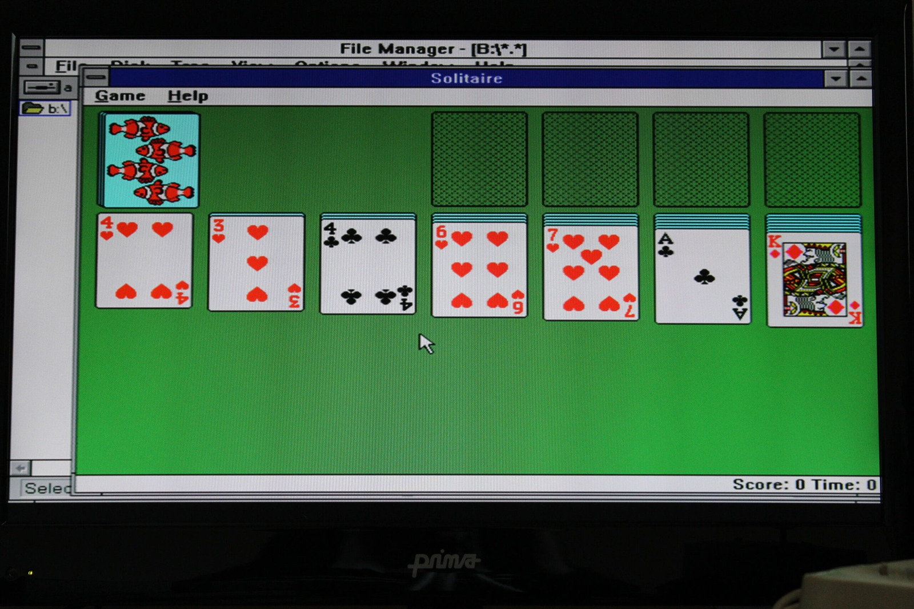

*I couldn't resist a game of Solitaire. Every move seems to involve another trip to the floppy drive.*
{: .media-caption }

I included File Manager and Control Panel on the boot disk, but there wasn't enough space for many useful applications. Those live on the second floppy, which means Windows has to keep going back to the drive whenever it needs something. Saving changes to the Windows configuration wasn't something I'd implemented either.

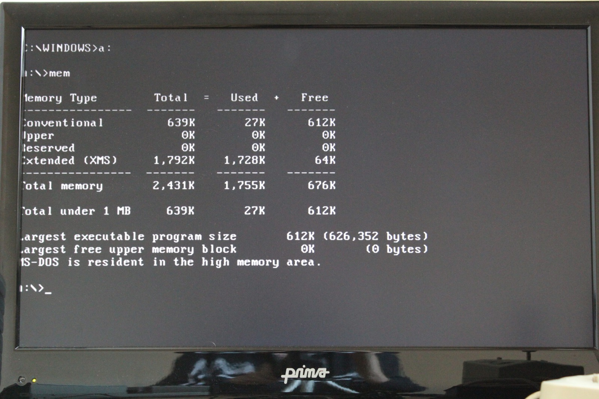

*The MEM command tells the story: 612 KB of conventional memory free, but just 64 KB of extended memory left to play with.*
{: .media-caption }

Of course, I had to try Solitaire. If you're a professional Solitaire player, I would not recommend this particular machine. Everything seems to involve another trip to the floppy drive, and even moving cards around is painfully slow. Windows 3.00a was considerably better suited to that sort of thing.

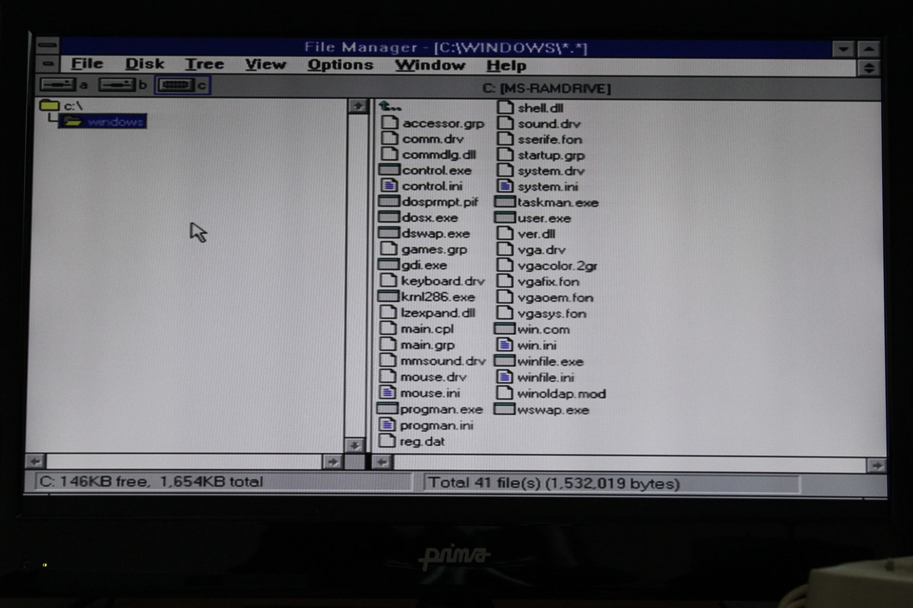

*File Manager browsing the Windows directory on the RAM disk. It works, as long as I don't expect the changes to survive a reboot.*
{: .media-caption }

Still, it boots and runs, which was the whole point of the experiment. With 612 KB of conventional memory reported and only 64 KB of extended memory left free, there isn't a great deal more I can squeeze out of this configuration. Anyone with another 286 and a bit more RAM might have better luck.

The storage problem eventually had a much better solution. Later that year I got an XTIDE card working in the TeraDrive Model 2 and finally booted the machine from proper storage. You can find all the files in the [file server](/goodies/) and photos in the [photo gallery](/goodies/).

**Sources**

- [Microsoft KB Archive: Windows for Workgroups 3.1 Minimum Requirements (80286)](https://jeffpar.github.io/kbarchive/kb/089/Q89333/)
- [Microsoft KB Archive: Windows Problems on AST Premium/286 (Standalone Windows 3.11)](https://jeffpar.github.io/kbarchive/kb/081/Q81855/)

**Related Posts**

- [Sega TeraDrive with Windows 2.1, Windows 3.00a and Game Boy](/sega-teradrive-with-windows-21-windows-300a-and-game-boy/)
- [Sega TeraDrive Model 2 XTIDE Boot Success](/sega-teradrive-model-2-xtide-boot-success/)
