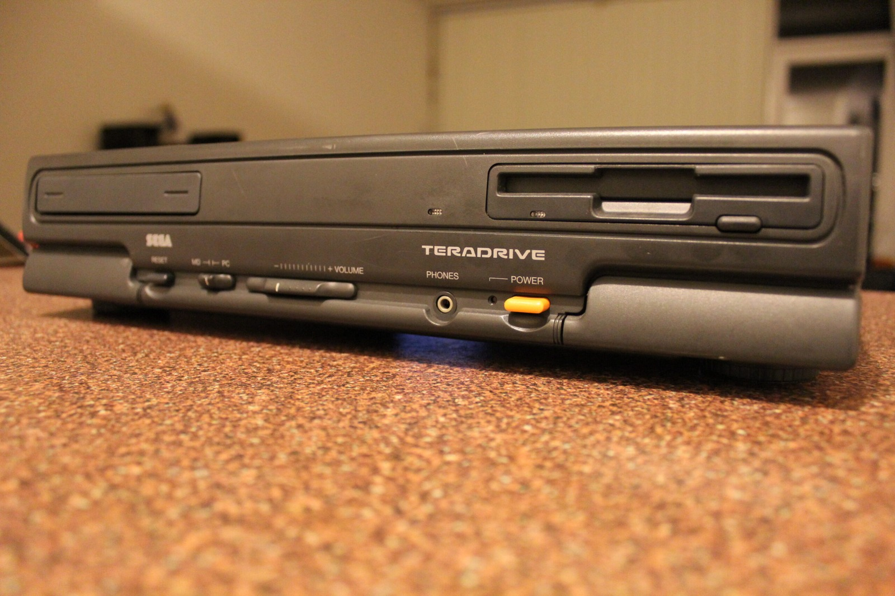
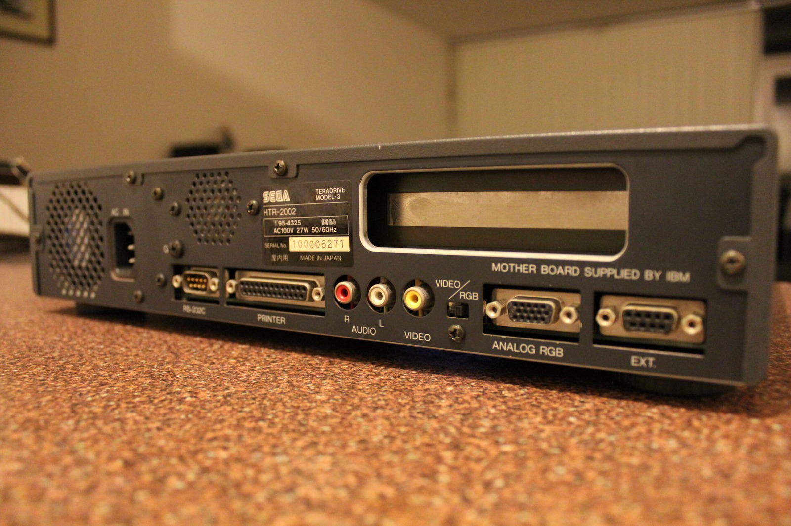
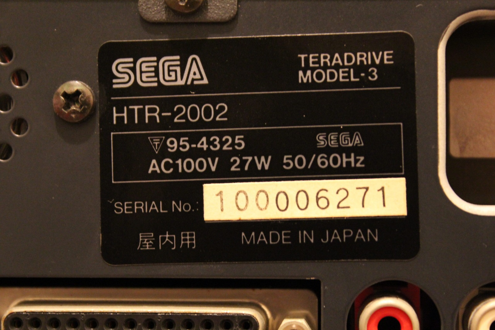
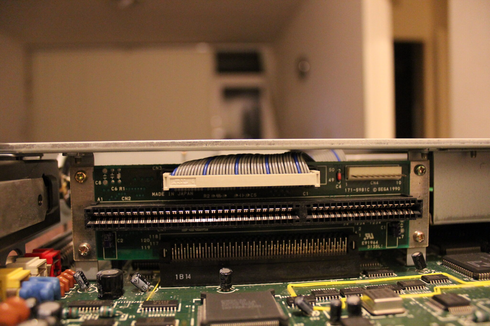
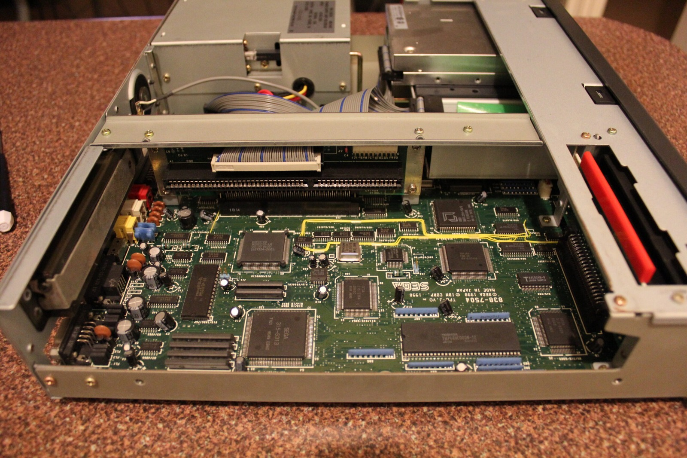
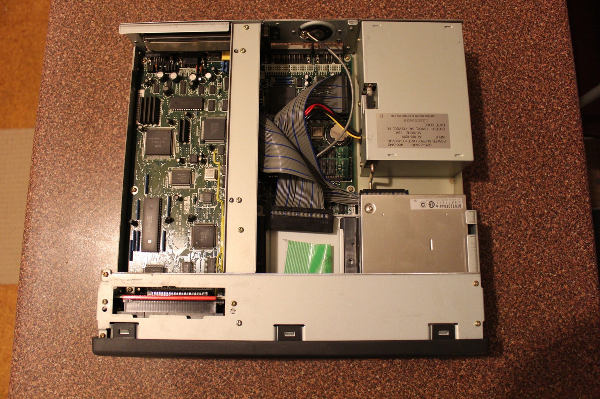
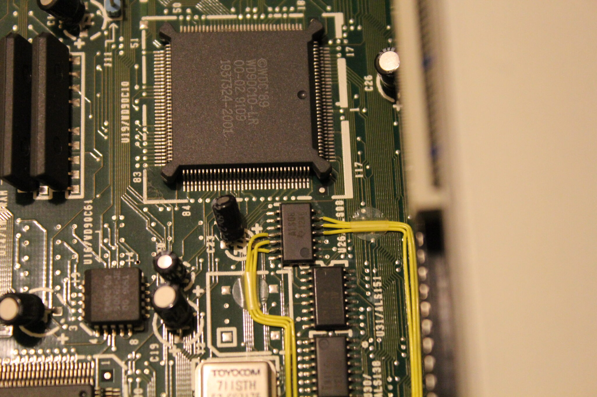
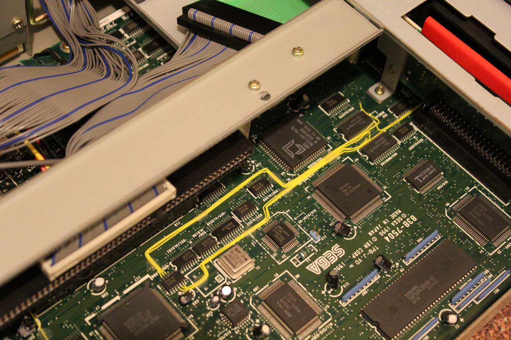
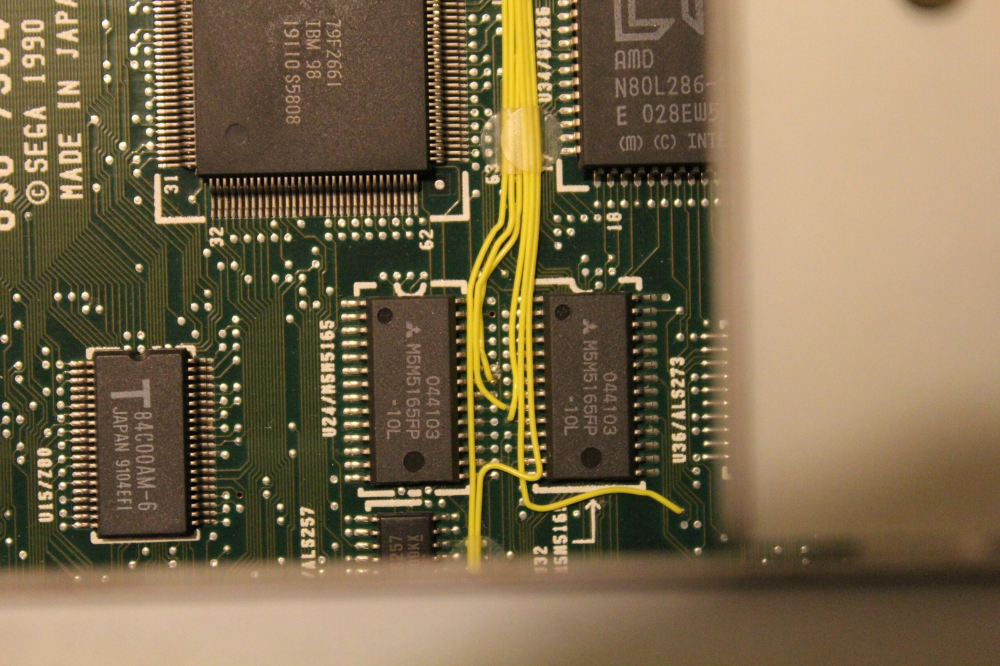

*The Model 3 finally gets its turn on the bench. Floppy drive up front, but the missing hard drive is another matter.*
{: .media-caption }

*Around the back are the composite video, stereo audio, and RGB connections. Plenty of sockets, but still no hard drive.*
{: .media-caption }

*The HTR-2002 label confirms the Model 3 and its 100 V power rating. A handy reminder that this is Japanese hardware.*
{: .media-caption }

Finally got a chance to test the Sega TeraDrive Model 3 that arrived a few days ago. Sega sold the Model 3 as the top configuration, with 2.5 MB of RAM, one 3.5-inch floppy drive and a 30 MB internal hard drive. Mine arrived without its hard drive, but thankfully the original cable, screws and hard-drive sled are still present. It boots Windows 3.11 from floppy just like my Model 2.

*Under the lid are the expansion connectors and ribbon cable. The next job is figuring out what hard drive this machine actually wants.*
{: .media-caption }

*Here's the mainboard with the lid off. The yellow wiring is definitely easier on the eyes than the green stuff in my Model 2.*
{: .media-caption }

*The entire interior of the Model 3, minus its original hard drive. At least the cables and mounting pieces are still here.*
{: .media-caption }

The next problem is working out exactly what sort of replacement hard drive the TeraDrive wants. The connector has 44 pins, but it isn't standard laptop IDE. I've been digging through information on early IBM PS/2 Model 25 and Model 30 hard drives, which use a similarly unusual arrangement. Some older references call these drives XT IDE or XTA, while the storage design is more accurately described as a proprietary direct-bus-attachment interface.

*A closer look at one of the Model 3's chips and that bright yellow wiring. Not a hard-drive breakthrough, but it caught my eye.*
{: .media-caption }

*The yellow wiring winds all over the board. Apparently even trace routing can have a cosmetic upgrade!*
{: .media-caption }

*More yellow wires running between the chips, beside the AMD 286. The Model 3 wins my entirely unofficial wiring beauty contest.*
{: .media-caption }

I'm still waiting on the ISA IDE controller card from the UK for the Model 2. In the meantime, I need to find a compatible drive to get the Model 3 back to its proper configuration.

Another thing I noticed is that the trace wiring on the Model 3 travels to slightly different locations from my Model 2. The Model 3 also has much nicer-looking yellow wiring, while the Model 2 uses mostly green. Not exactly the most important engineering discovery of the century, but there it is!

Time to get a hard drive installed and see how far this one can go. Many more images can be found in the [photo gallery](/goodies) filed under Sega TeraDrive Model 2 and Model 3.

### Sources

- [Sega Hardware Archive: TeraDrive (Model 3 Specifications)](https://www.sega.jp/fb/segahard/md/tera.html)
- [IBM Files: PS/2 Model 25/30 (Proprietary Hard Drive Interface)](https://www.ibmfiles.com/pages/ps2model25.htm)

### Related Posts

- [Sega TeraDrive Model 3 Hard Drive Replacement](/sega-teradrive-model-3-hard-drive-replacement/)
- [Sega TeraDrive Hard Drive Interface Investigation](/sega-teradrive-hard-drive-interface-investigation/)
