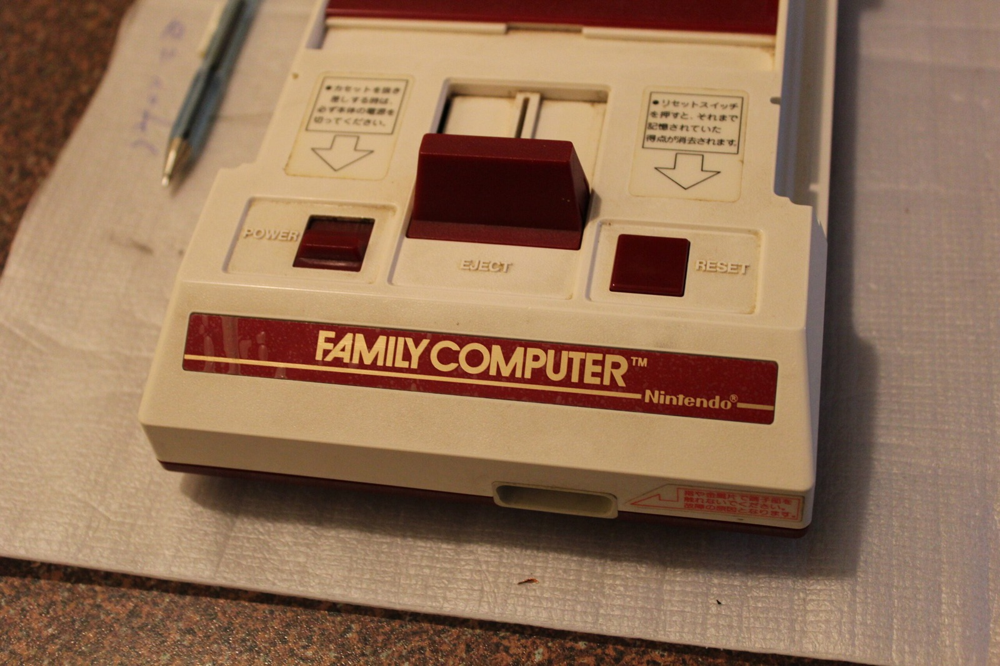

*The Nintendo Family Computer. Ohhhh yeahhhh! Time to give this one composite video and audio.*
{: .media-caption }

The Nintendo Family Computer. Ohhhh yeahhhh! I've been experimenting with a composite AV modification for this Famicom, and after three revisions I've managed to get it working. This particular console actually belongs to somebody else, so the aim is to give its owner a usable video and audio output rather than relying on Japanese RF television reception.

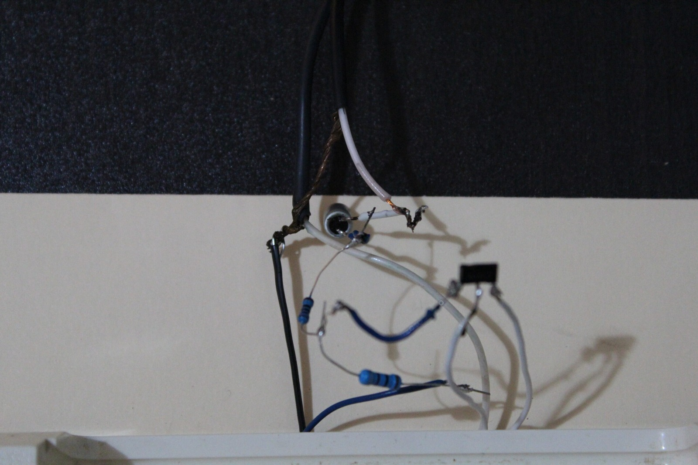

*Revision one: loose wires, resistors, and a healthy amount of optimism. Functional, but hideous!*
{: .media-caption }

The first attempt was a proof of concept, hence the mess of cables. Functional yet hideous, but at least it gave me something to work from.

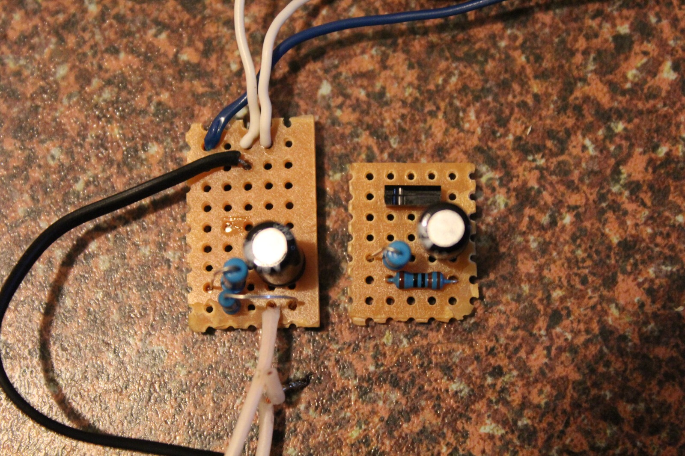

*Two attempts at the composite board, side by side. The smaller layout was promising, but I still had some tidying up to do.*
{: .media-caption }

The second attempt used a slightly longer piece of prototyping board. I was building it with some fairly questionable parts, including a cable tie pressed into service as a wire for ground. It worked, but I still wasn't happy with the arrangement.

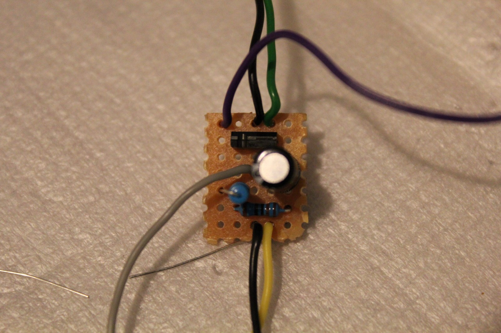

*Third attempt, and the circuit finally fits onto a compact little board. Much less spaghetti!*
{: .media-caption }

By the third revision I'd managed to shrink everything onto a much smaller piece of prototyping board. Much better! Now the modification is compact enough to tuck into the Famicom without leaving quite such a spectacular collection of wires hanging everywhere.

### Parts used

This is the circuit that worked on this particular Famicom motherboard. Board revisions differ, so the photographs and component values are a record of my build rather than a universal recipe for every Famicom.

- 1 x 110 ohm resistor, 0.25 W, 1% tolerance
- 1 x 300 ohm resistor, 0.5 W, 5% tolerance
- 2 x 220 uF, 16 V, 105°C electrolytic capacitors
- 1 x PNP transistor, reused from the Famicom mainboard in this build
- Flexible light-duty hookup wire or Kynar wire
- 7 x 5-hole prototyping board or stripboard
- 25 to 40 W soldering iron and solder
- RCA cables, plugs and sockets

To make it all come together and actually give us composite AV, read on!

### Removing the video transistor

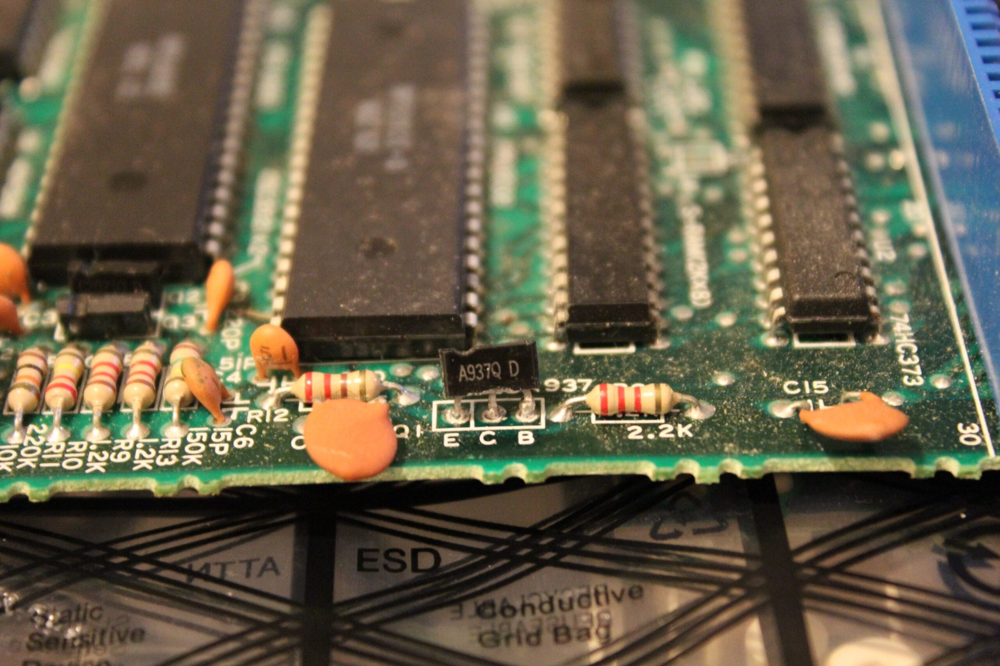

*The A937Q D transistor is half-desoldered and still hanging on. The PCB helpfully labels E, C, and B for its three legs.*
{: .media-caption } Half-desoldered A937Q D PNP transistor on the Famicom mainboard. Note the ECB on the mainboard. Emitter, Collector and Base.

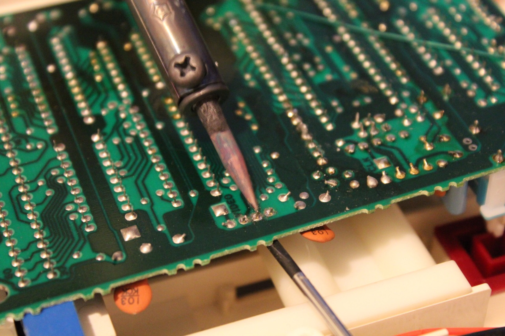

*Heating the joints from underneath to free that transistor. A proper desoldering tool would have been kinder to the board.*
{: .media-caption } Desoldering the A937Q D PNP transistor from the Famicom mainboard.

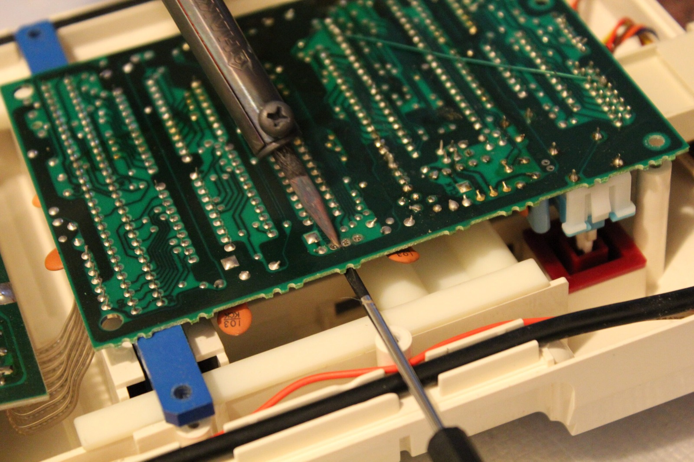

*Another look at the soldering iron on the transistor's joints. This wasn't exactly the most delicate operation!*
{: .media-caption } Desoldering the A937Q D PNP transistor from the Famicom mainboard.

*The A937Q D transistor is finally out of the board. Now to reuse it in the composite circuit.*
{: .media-caption } A937Q D PNP transistor desoldered from the Famicom mainboard.

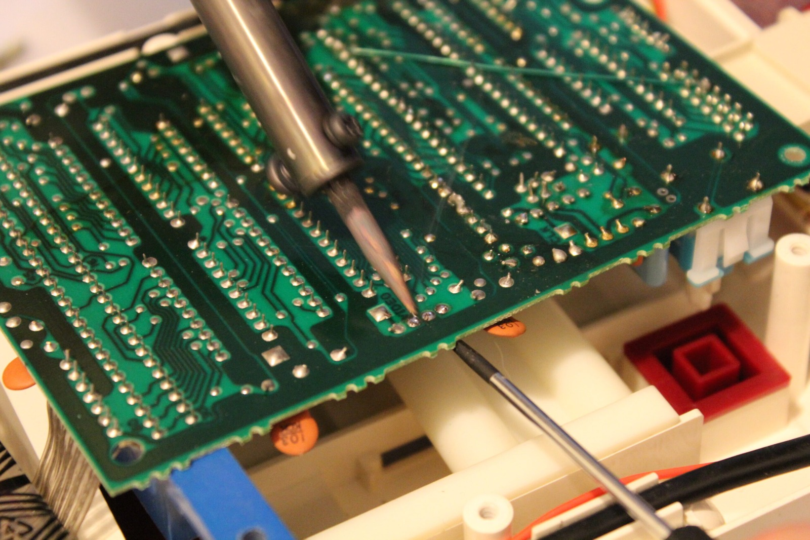

*Yes, more soldering. I was determined to get this tiny transistor out without wrecking the board.*
{: .media-caption } Desoldering the A937Q D PNP transistor from the Famicom mainboard.

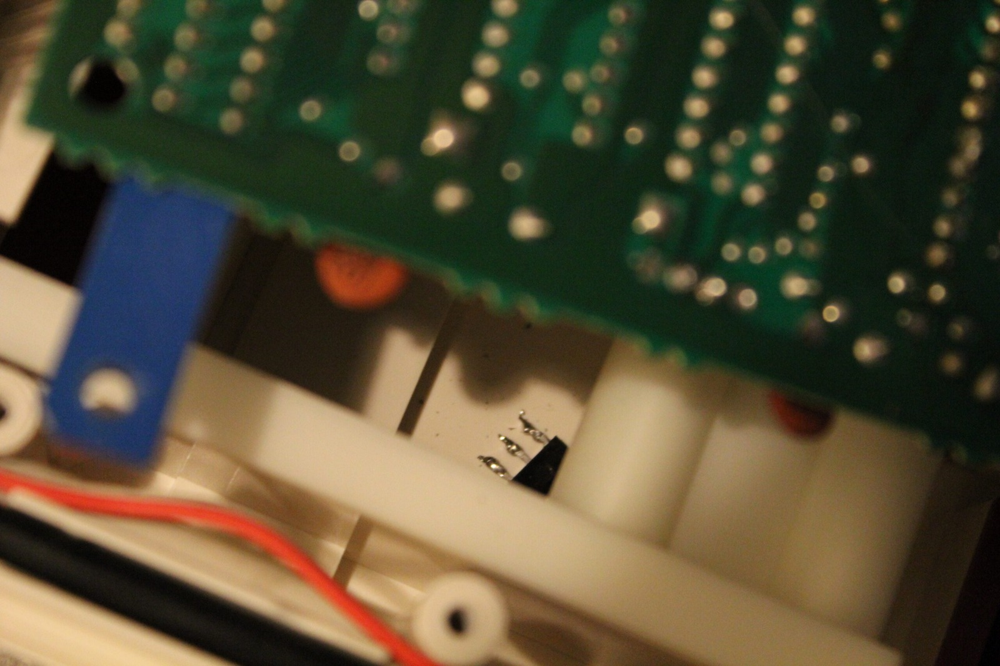

*And there it goes - the transistor dropped straight into the Famicom case. Helpful!*
{: .media-caption } A937Q D PNP transistor desoldered from the Famicom mainboard. It fell into the Famicom...

First, the PNP transistor needs to come off the mainboard so it can be reused in the composite circuit. I originally used a small flatblade screwdriver to help lift it while heating the solder joints. The component eventually came free, although as you can see from the photographs, it even managed to fall inside the console at one point.

I'd be gentler doing this now. A desoldering pump, braid or proper desoldering tool places much less mechanical stress on an ageing PCB, and the last thing you want is a lifted pad or a damaged transistor before you've even built the new circuit.

### Wiring the Famicom

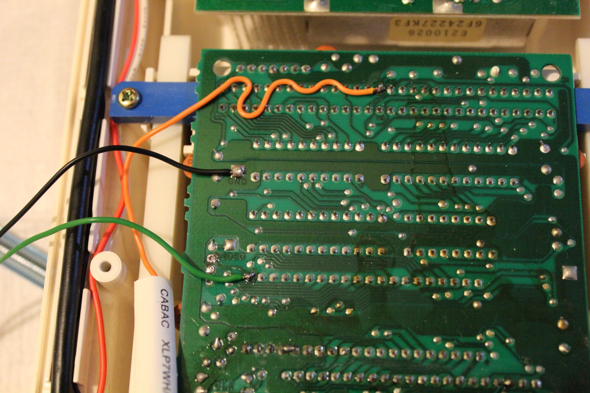

*The first motherboard connections in place: orange for sound, black for ground, and green for composite video.*
{: .media-caption }

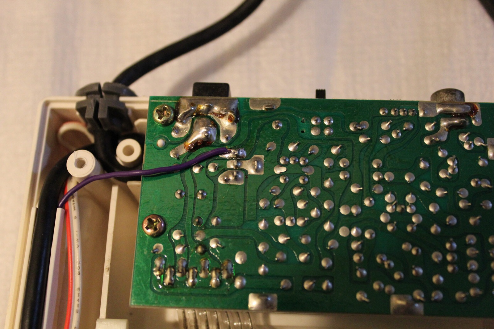

*The purple wire is attached on the power side of the Famicom. That's the +5 V feed for my little AV circuit.*
{: .media-caption }

*The underside of the mainboard shows where the green, black, and orange leads are attached.*
{: .media-caption }

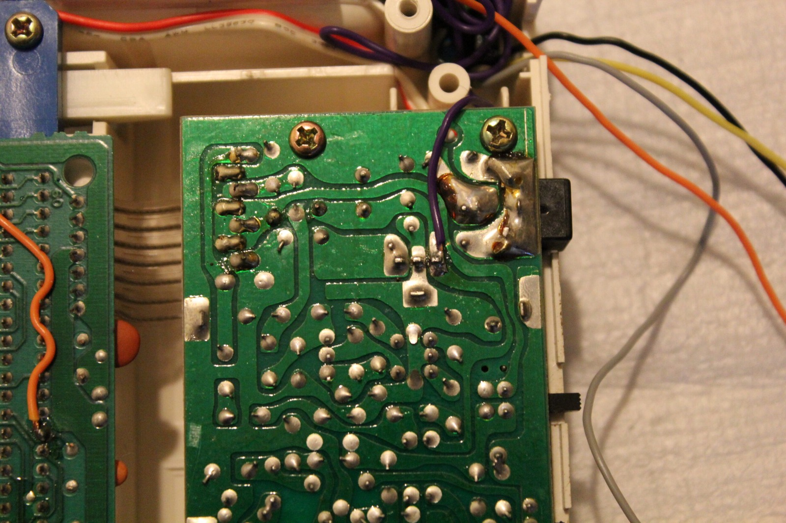

*The purple power wire on the smaller board, close to the Famicom's power-input area. One more connection for the AV mod.*
{: .media-caption }

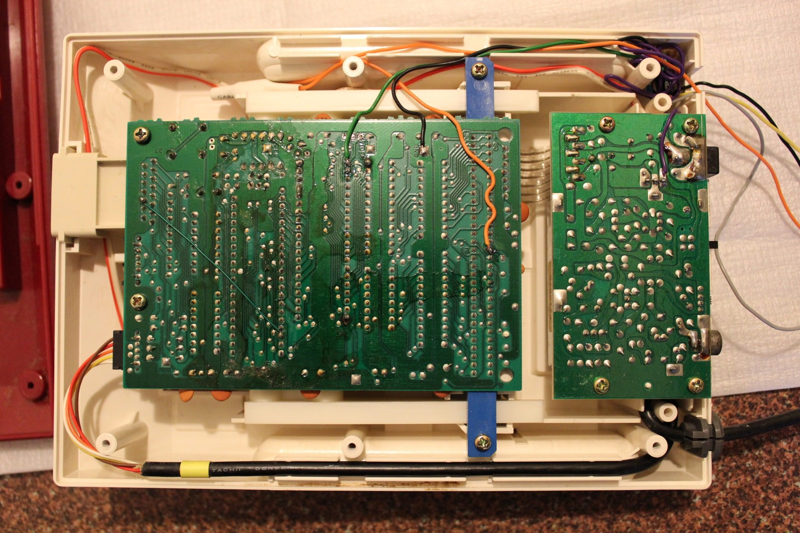

*The Famicom opened up, with wiring criss-crossing between its boards. Not pretty yet, but at least I can keep track of the connections.*
{: .media-caption }

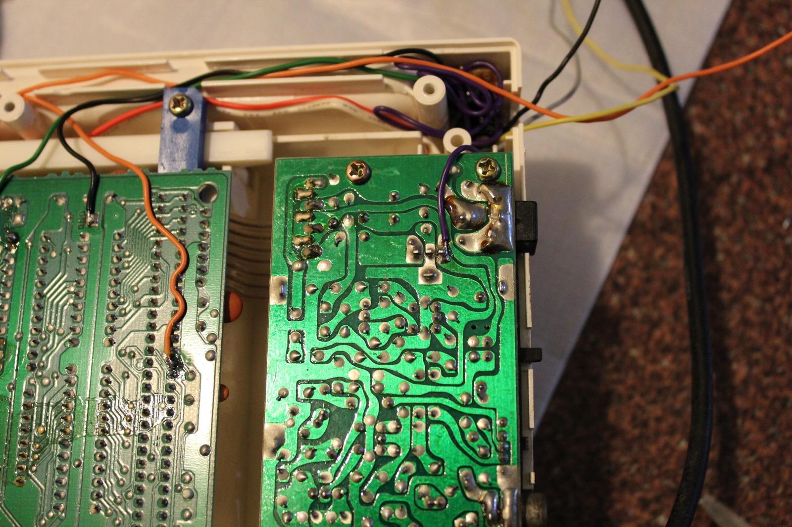

*A closer look at the power-side connections and the wires heading out of the console. Keeping all this neat is another challenge.*
{: .media-caption }

Next, identify the four solder points shown above. These are the connections I used on this board revision, so if yours looks different, don't assume the same points will apply. Sadly, I can't help much with a different motherboard from these photographs alone.

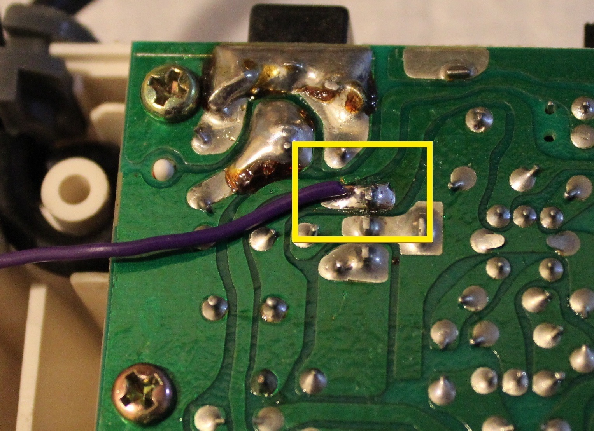

*Here's the +5 V connection for my AV board, with the purple wire and its solder point highlighted.*
{: .media-caption } +5 V source

The purple cable taps into the LM7805 voltage regulator and supplies +5 V to the modification. From there, the power goes into the resistor and transistor circuit on my little prototyping board.

*The orange wire picks up sound from this mainboard. I've boxed the solder point so it's a little easier to find.*
{: .media-caption } Sound

The orange cable carries the audio signal from the Famicom mainboard. It also needs a ground connection to complete the audio output, which brings us to the next wire.

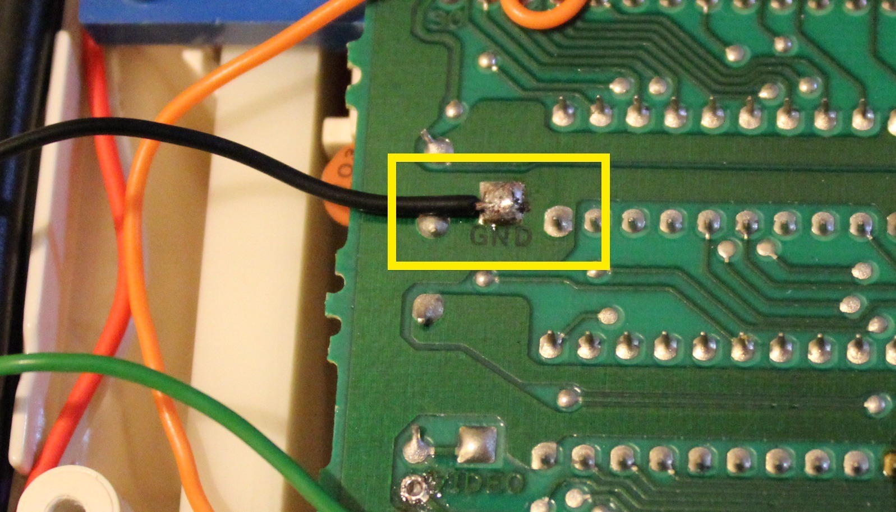

*There's the ground connection for the black lead, helpfully marked GND on the board. One less point to guess at!*
{: .media-caption } Ground

The black cable is the ground point. I ran a wire from there to the prototyping board, where it branches out for the other ground connections. It's a bit easier to deal with everything in one place instead of trying to attach half a dozen wires directly to the Famicom.

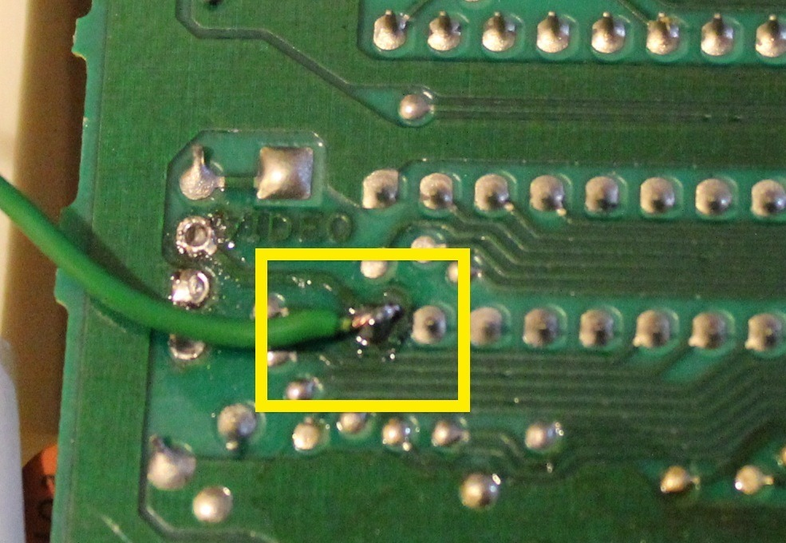

*And here's where I took composite video from this mainboard using the green lead. Your board revision may be different.*
{: .media-caption } Composite video

The green cable carries the composite-video signal from the mainboard into the amplifier circuit. The yellow output wire from the finished board goes to the centre pin of the video RCA connection, while the outer connection is grounded.

Adding a little fresh solder and flux can make an old joint easier to rework because it helps the solder flow properly. Melt the existing joint and add just enough fresh solder to make a clean connection. I usually add enough that I don't bother tinning the wires separately. Yes... I know... lazy, isn't it!

### Building the composite board

Once the four wires are installed, grab the prototyping board. I cut mine down to size with whatever seemed appropriate at the time, including a knife, a flatblade screwdriver and, on one occasion, a hacksaw. A fine collection of precision engineering instruments, wouldn't you say?

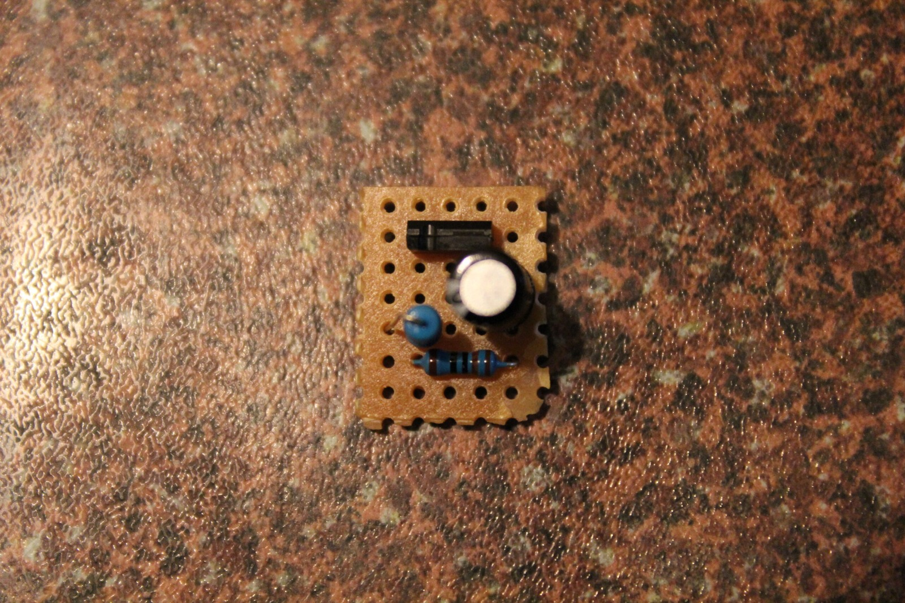

*The compact 5 x 7-hole board is starting to look like a proper circuit. A lot tidier than the first tangle of wires!*
{: .media-caption }

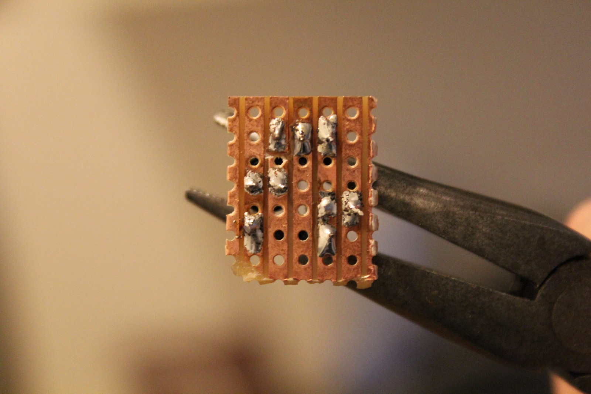

*A look at the copper side of my little board. Not much room for the soldering iron, but it'll do the job.*
{: .media-caption }

*All the coloured leads are finally on the compact board. Purple brings in power, green brings in video, and yellow heads to the output.*
{: .media-caption }

The finished board uses a 5 x 7-hole layout, as shown in the photographs. The resistors aren't polarised, but the electrolytic capacitors are, so their orientation matters. The original transistor also needs to go back into the circuit with the correct emitter, collector and base connections.

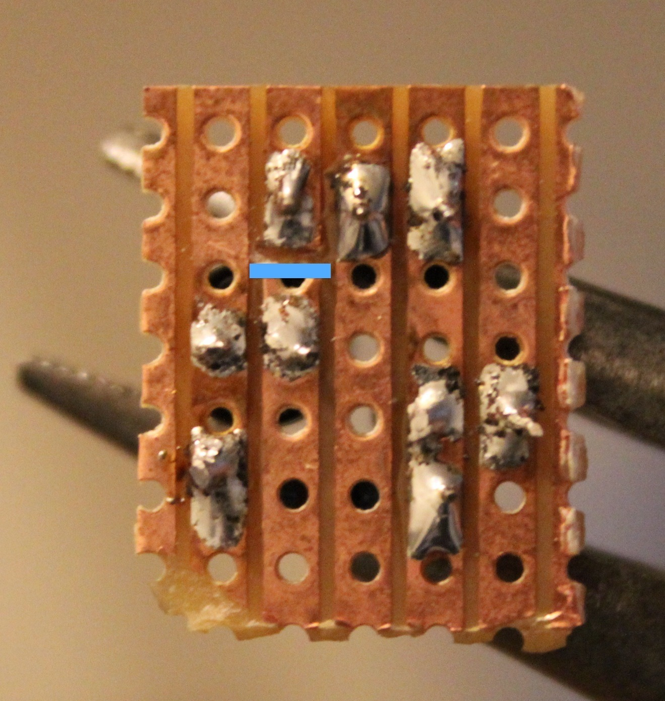

*The blue mark shows which copper track I cut to separate the circuit sections. A flatblade screwdriver did the honours.*
{: .media-caption } Cut this track on your prototyping board

There's also a copper track on the underside that needs to be cut so the circuit sections are properly isolated. I scraped through it with a flatblade screwdriver. Check the break with a multimeter to make sure there is no continuity before applying power, because discovering a short circuit the exciting way is not particularly desirable.

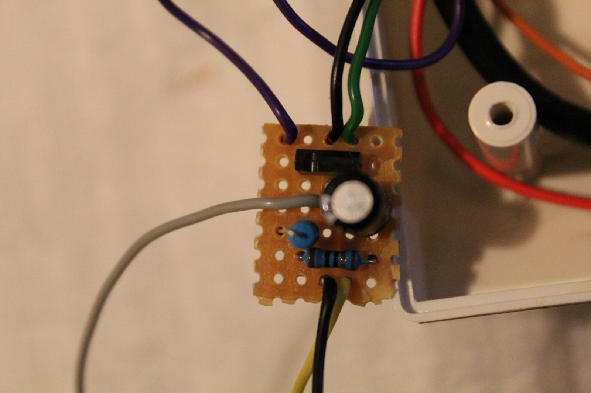

*The little composite board tucked inside the Famicom. There's still an impressive amount of wiring for something so small!*
{: .media-caption }

*Another look at the finished little board. Black and grey are ground, and the yellow lead carries composite video out to the RCA socket.*
{: .media-caption }

For reference, these are the cable colours I used:

- Purple: +5 V from the LM7805
- Green: composite video from the mainboard
- Black and grey: ground
- Yellow: composite video output to the RCA centre pin

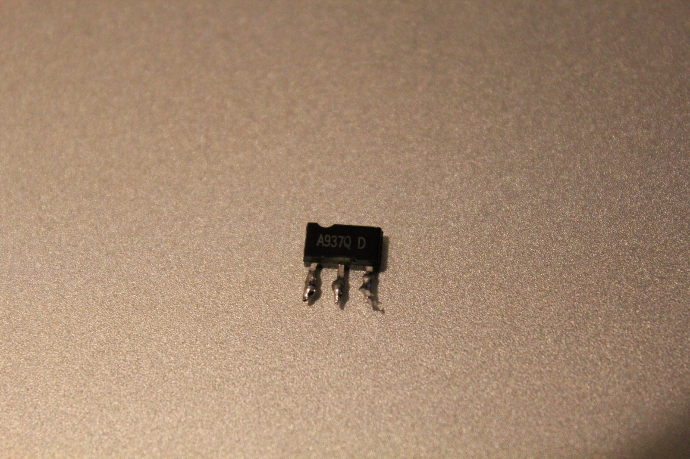

*Here's the original Famicom transistor I reused in my composite circuit. Same tiny part, now doing a different job.*
{: .media-caption }

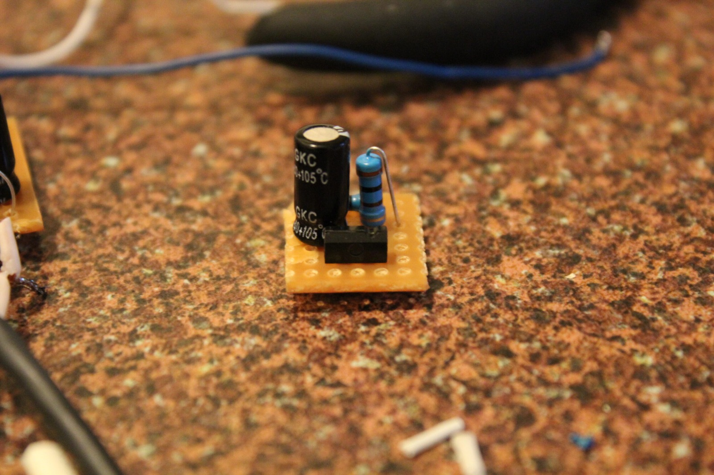

*The components all fit on a tiny piece of stripboard. A much more civilised arrangement than my first attempt!*
{: .media-caption }

*One more view of the compact board before hooking everything up. Revision three was finally small enough to fit inside the case.*
{: .media-caption }

With the components in place, the little board is ready to connect to the Famicom. Take particular care with the transistor orientation and capacitor polarity. If the modification doesn't work as expected, switch everything off and disconnect the power adapter before checking the wiring.

### Audio output

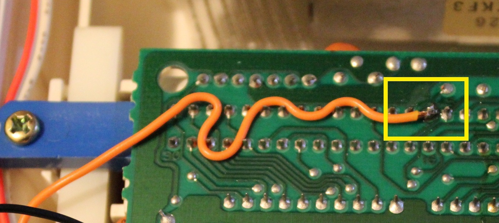

*Back to the audio pickup: this orange lead is the sound connection on the Famicom mainboard in my build.*
{: .media-caption }

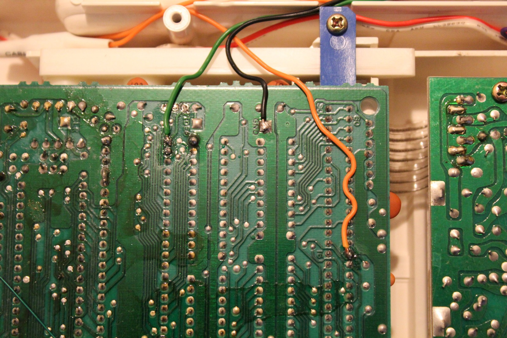

*A wider view of the wiring, including the orange sound lead and black ground wire. Almost ready to hear something!*
{: .media-caption }

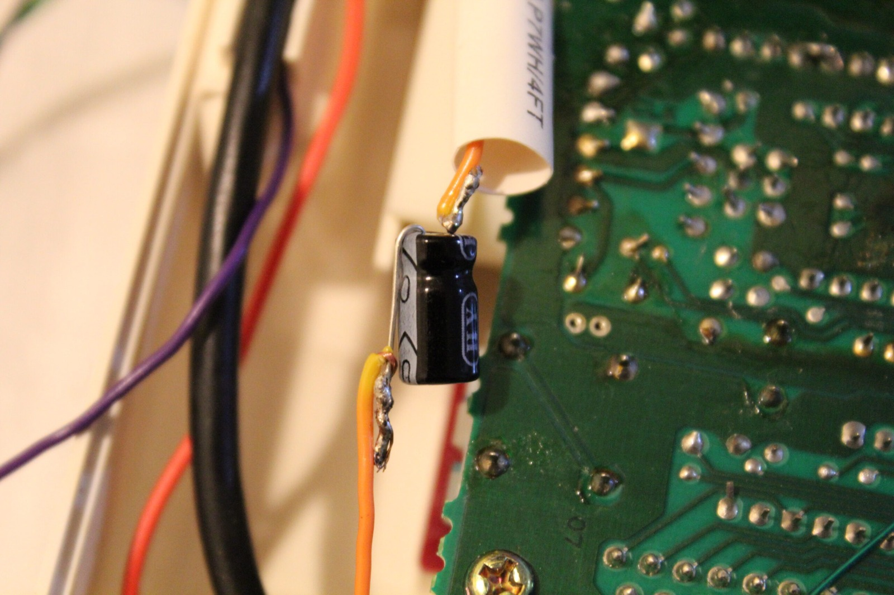

*The orange audio lead goes through a 220 uF capacitor on its way to the RCA connector. Best keep the polarity the right way around!*
{: .media-caption }

The orange audio wire runs into a 220 uF, 16 V electrolytic capacitor. In this build, the positive side faces the Famicom mainboard and the negative side runs towards the centre pin of the audio RCA connection. Add the ground connection and that's the sound output taken care of.

The owner decided to remove the second-player controller because the games being used were single-player. That also gave me a convenient route for the audio and video cables to leave the rear of the console. The modification board fits inside with enough cable slack to rearrange things later if necessary.

### Finished result

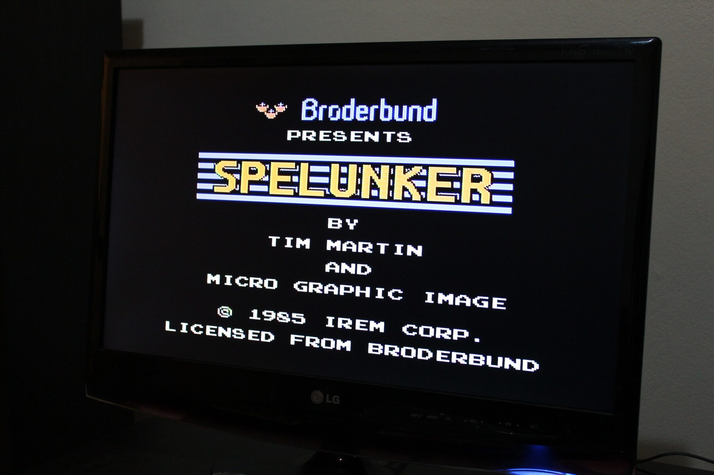

*Spelunker on the screen through my new composite output! After all that soldering, it's lovely to see a proper picture.*
{: .media-caption }

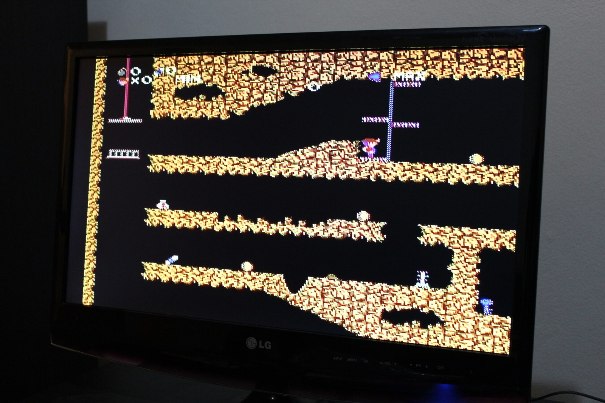

*Into the caves of Spelunker. The video output works, even if I haven't managed to make the picture completely spotless.*
{: .media-caption }

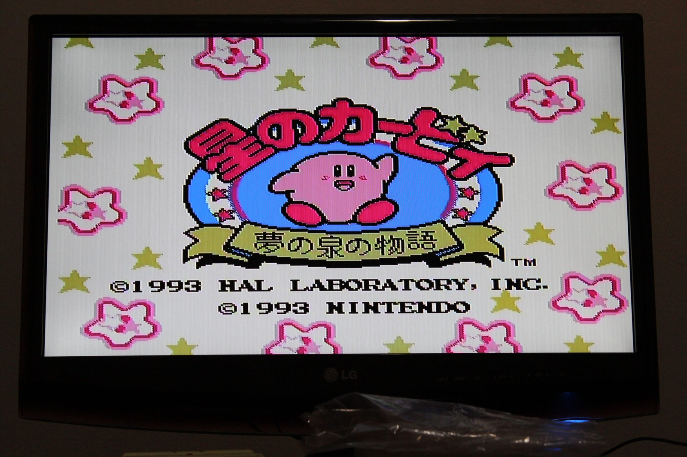

*And Kirby's Adventure makes a very pink finale! The composite picture works, but those annoying jailbars aren't completely gone.*
{: .media-caption }

Now all that's left is to enjoy Kirby and Spelunker! Composite video and audio are both working, although I haven't completely escaped the infamous jailbars. They're particularly noticeable in Kirby, and nobody likes jailbars. Not even people who are behind them!

I tried two ways of reducing them: connecting PPU pins 20 and 22, and adding connections to the PPU's +5 V and ground. Neither method helped on this machine, so for now the owner will have to live with the remaining interference. At least the Famicom itself is working through the new AV output.

Below are three videos showing the board, its wiring and the finished result.







**Update 2016:** A later guide covering improved Famicom AV modification and jailbar-reduction techniques can be found in [JPX72 - Famicom AV mod - NEW!](http://jpx72web.blogspot.com/2016/11/famicom-av-mod-new.html). It includes useful schematics and a related approach, although the jailbar-reduction methods I tried didn't work for me. Your luck may vary. Good luck!

### Resources

- [McRetro Photo Gallery](/goodies)

### Sources

- [JPX72: Famicom AV Mod - NEW! (2016)](http://jpx72web.blogspot.com/2016/11/famicom-av-mod-new.html)
- [ConsoleMods: NES Top Loader AV Mod (PNP Amplifier)](https://consolemods.org/wiki/NES:Top_Loader_AV_Mod)
- [Ctrl-Alt-Rees: Nintendo Famicom Composite Video Output Mod (Board Revisions)](https://ctrl-alt-rees.com/2019-01-26-nintendo-famicom-composite-video-output-mod.html)

### Related Posts

- [Humble Beginnings: Nintendo Famicom Incoming](/humble-beginnings-nintendo-famicom-incoming/)
- [Nintendo Famicom AV Mod Complete](/nintendo-famicom-av-mod-complete/)
