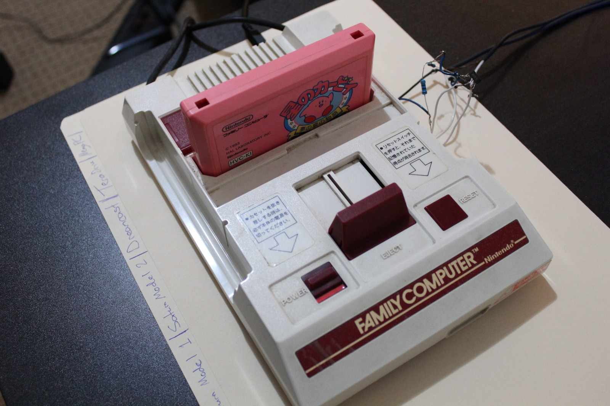
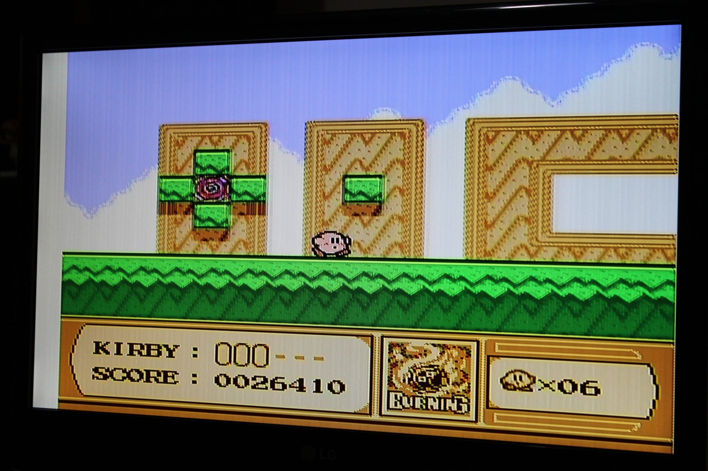
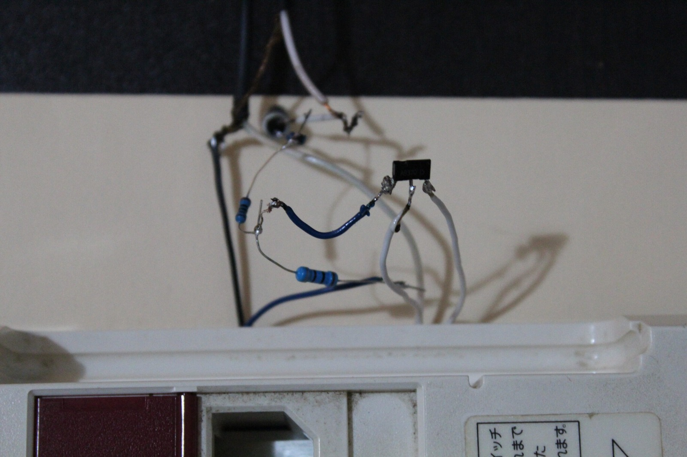

*The Famicom is back on the bench, Kirby cartridge and all. There's still some fiddling to do with the picture.*
{: .media-caption }

Some good news, and some more good news. It looks like I am going to have Thursday through Monday (inclusive!) off work. This means nothing but organising and sorting through my console collection.

I have also received some boxed Japanese Saturn accessories, including a floppy drive, keyboard, mouse, modem and RF cable. There may be more, but that's everything that comes to mind at the moment. It appears I will now need to find a boxed Japanese Model 2 Saturn to match all these cool accessories!

*Kirby is up and running on the modded Famicom. Now, if only the jailbars would take a holiday too!*
{: .media-caption }

*One of my rather improvised wiring experiments for the Famicom. It's certainly not the tidiest little arrangement!*
{: .media-caption }

In other news, the Nintendo Famicom has been successfully AV modded. The jailbars are still present, though, and I've been trying a few capacitor-based fixes, including a large decoupling capacitor. Unfortunately, there doesn't seem to be one magic capacitor value that fixes every Famicom. The motherboard layout, routing and interference all have something to do with it.

I'll report back on how it all goes. In the meantime, the photos are in the [photo gallery](/goodies/) under Nintendo Famicom H10865915.

Oh, and I zapped myself on the Sega TeraDrive. Well, technically it was the open AT power supply I was using while trying to power a hard drive through an ISA controller card. Not exactly a brilliant experiment to be doing around exposed mains-voltage circuitry, and certainly not one to repeat with the PSU energised!

Since the ISA experiment was getting nowhere, I picked up a few IBM WDL-330P 30 MB hard drives and an IBM WDI-325Q 20 MB drive. The WDL-330P drives should fit nicely into the Model 3 TeraDrive that arrived without its hard drive. I also picked up some matching cables.

I was hoping I might be able to adapt an ordinary IDE drive with enough rewiring, but the TeraDrive's storage interface is proving to be rather stranger than ordinary IDE. I've got a 40 MB Conner Peripherals drive around for more experiments too, so there's still plenty to play with.

Stay tuned for some great pictures and video of retro goodies late this week and early next!

### Sources

- [NESdev Forums: Famicom Jailbar Discussion (Board Revisions and Decoupling)](https://forums.nesdev.org/viewtopic.php?t=18508)

### Related Posts

- [Nintendo Famicom Composite AV Mod](/nintendo-famicom-composite-av-mod/)
- [Sega TeraDrive Model 3 Hard Drive Replacement](/sega-teradrive-model-3-hard-drive-replacement/)
- [Sega TeraDrive Hard Drive Interface Investigation](/sega-teradrive-hard-drive-interface-investigation/)
