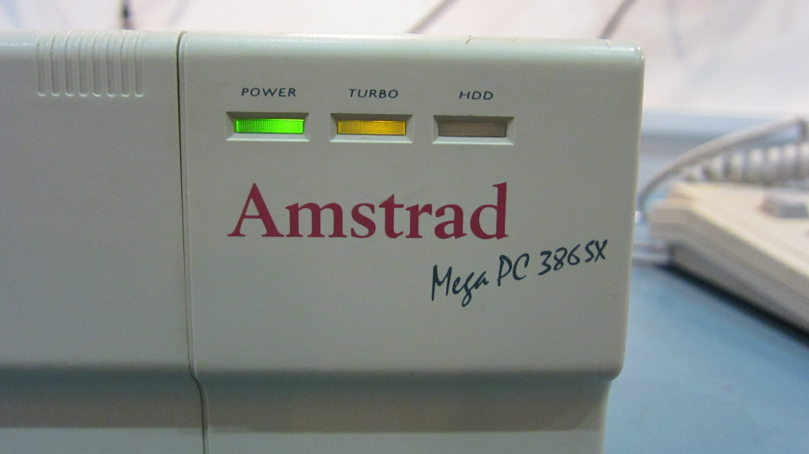
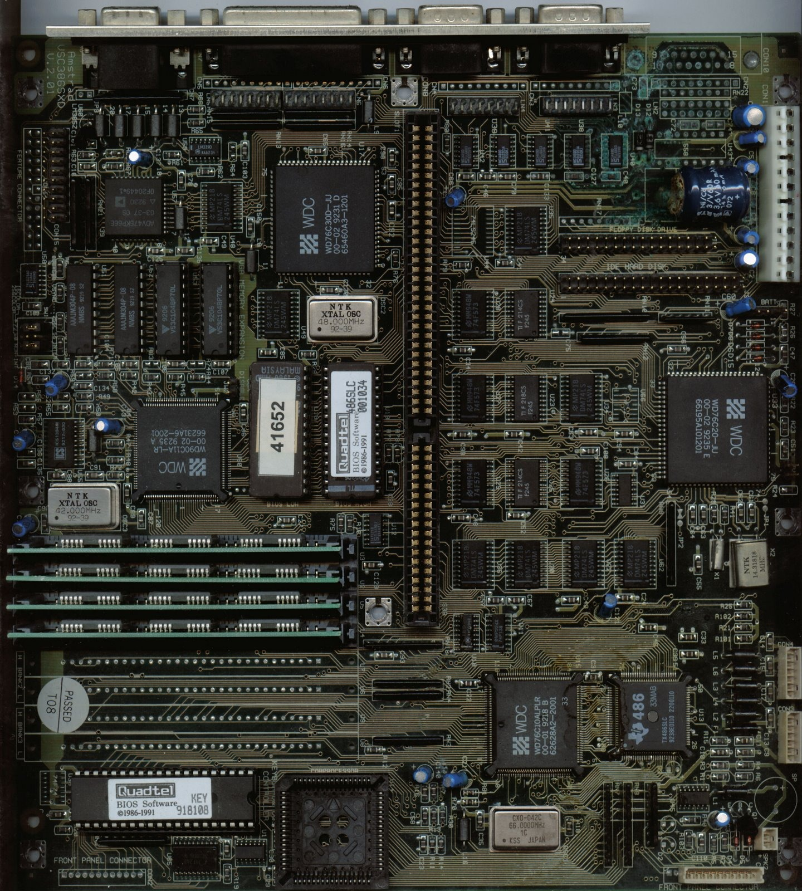
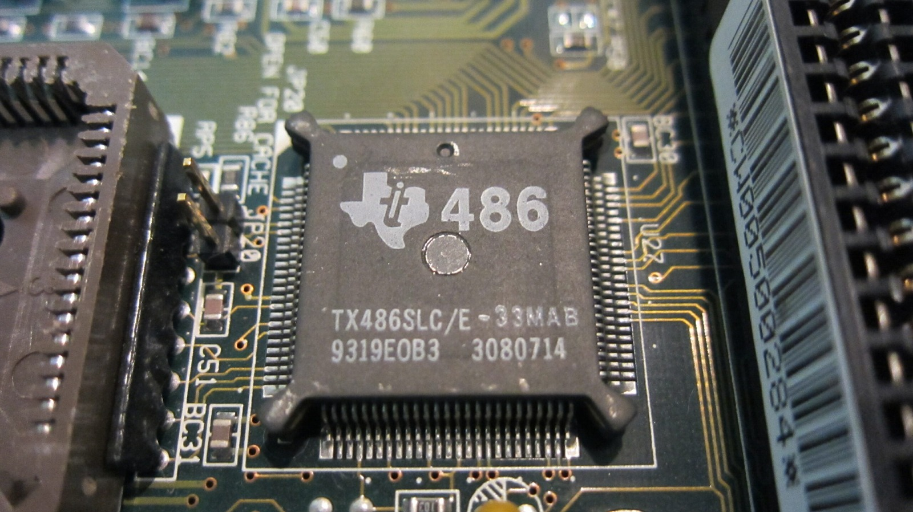
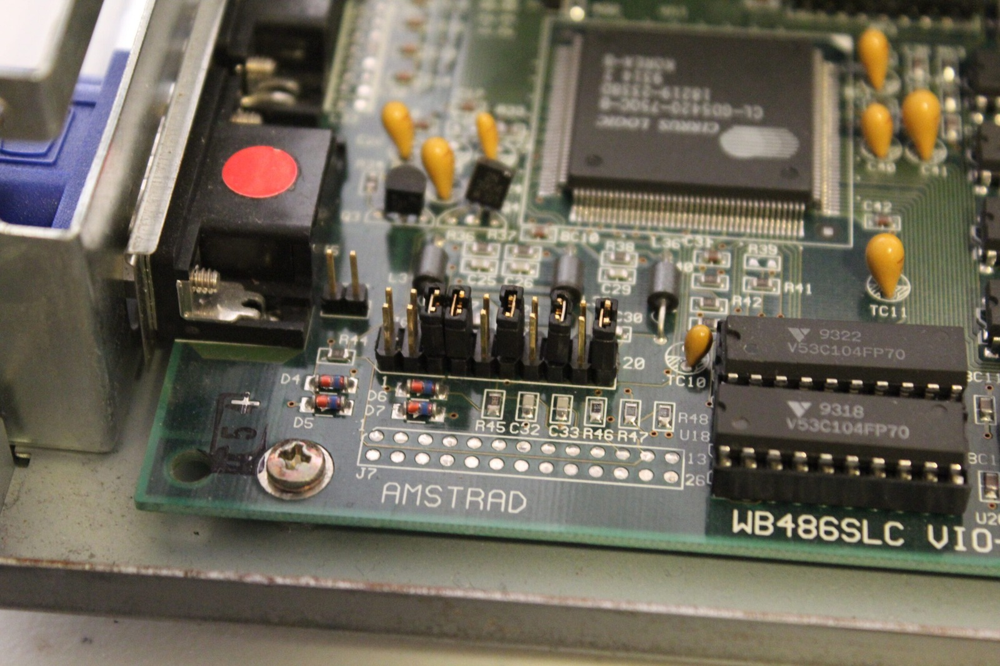

Wow! My mind has been racing at 1000 miles an hour. I can barely keep up with all the ideas for future mods. I have more tabs open than a Firefox enthusiast right now! This is basically the notebook beside my computer turned into a blog post. These are ideas and experiments, not finished upgrade instructions.

### 1. Socketed CPUs for everyone

One idea is to convert both the Sega TeraDrive CPU and Amstrad Mega PC CPU to socketed arrangements. That would make experimenting with compatible processors much easier without repeatedly attacking the motherboard with a soldering iron.

### 2. Socketed clock oscillators

Another idea is to fit socketed clock oscillators, so I can experiment with different frequencies without having to desolder them every time. Of course, simply replacing a CPU doesn't automatically mean I need to change its clock. A compatible replacement could run at the existing speed, but if I want to go faster, the motherboard, memory and other components will have to keep up. The Mega PC's math coprocessor would need some attention too.

What appears to be a 386SX-derived Amstrad motherboard fitted with a 486SLC CPU and BIOS.

### The Mega PC Plus mystery

This idea came back to me when I looked again at a photograph I had saved of what appeared to be a 386SX-derived Amstrad motherboard fitted with a 486SLC CPU and matching BIOS. The silkscreen still refers to VSC386SXD, yet there is a TX486SLC fitted. Very interesting when you consider the Amstrad Mega PC Plus, although the photograph alone isn't enough to identify it as genuine factory Mega PC Plus hardware.

My replacement PC7486SLC board uses a TI486SLC/E. Texas Instruments made 25 MHz and 33 MHz versions, while AMD offered several Am386SX variants at different speeds. There are also voltage and clock differences between some of these processors, so I can't just assume they'll all swap around happily.

If I manage to find a faster compatible CPU, changing the clock oscillator could let it run closer to its intended speed. Leaving the original clock in place might simply leave the new processor running slower than expected. That would be a rather disappointing overclock!

### Finding the CPU clocks

The TeraDrive has a 10 MHz 80286, and I found a 20 MHz clock source nearby. That makes sense, since the 80286 takes a clock at twice the processor's internal frequency.

There's also a 14.31818 MHz reference clock, a frequency that has been around since the original IBM PC. It gets divided down for various timing functions, so it isn't the direct 10 MHz CPU clock I'm looking for.

On the Mega PC boards, the likely CPU clock sources line up rather nicely: 50 MHz for the 25 MHz 386SX and 66 MHz for the 33 MHz 486SLC. And while I'm thinking about components, those little DIP-4 metal cans are oscillator modules, not bare crystals.

### So, what do I actually want to do?

Socketed CPUs and clock oscillators would make future experimenting much easier. The TeraDrive's 286 still looks tempting, but I don't want to forget about chipset timing, memory, expansion buses and coprocessors simply because I've managed to change the CPU clock.

The Mega PC needs a little more thought because I've already got processors and boards I'd like to preserve. For now I'll start collecting the parts and eventually put some of these ideas into action. You'll know when it happens because I'll almost certainly write far too much about it here.

### Sources

- [AMD: Am80286 Datasheet (2× Clock Input)](https://www.bitsavers.org/components/amd/x86/_dataSheets/1985_80286.pdf)
- [AMD: Am386SX/SXL/SXLV Datasheet (CLK2 and Voltage Variants)](https://www.amd.com/content/dam/amd/en/documents/archived-tech-docs/datasheets/21020.pdf)
- [Texas Instruments: TI486 Reference Guide (SLC/E Clocking and Voltage)](https://www.bitsavers.org/components/ti/TI486/1993_TI486_Microprocessor_Reference_Guide.pdf)
- [PCjs: IBM PC Technical References (14.31818 MHz Timing)](https://www.pcjs.org/documents/manuals/ibm/)
- [Sega Hardware Archive: TeraDrive (IBM Japan Collaboration)](https://www.sega.jp/fb/segahard/md/tera.html)
