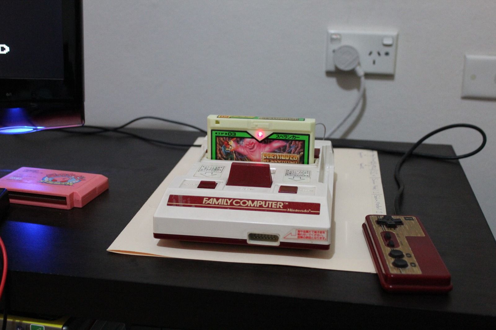
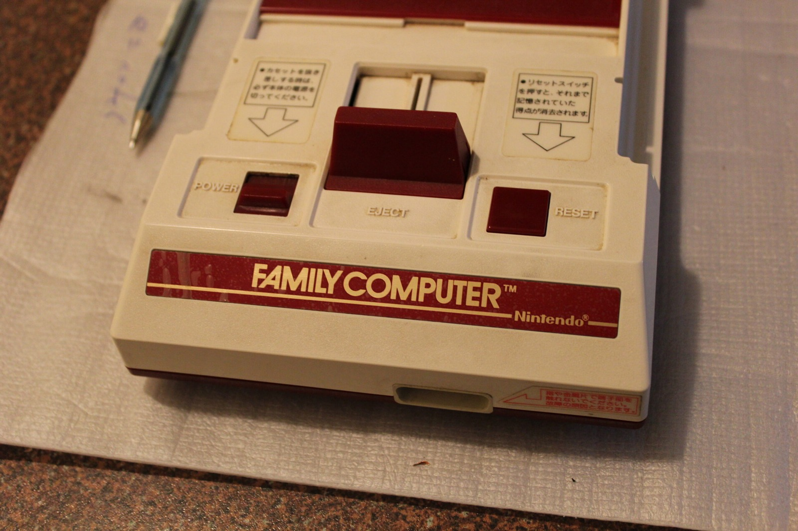
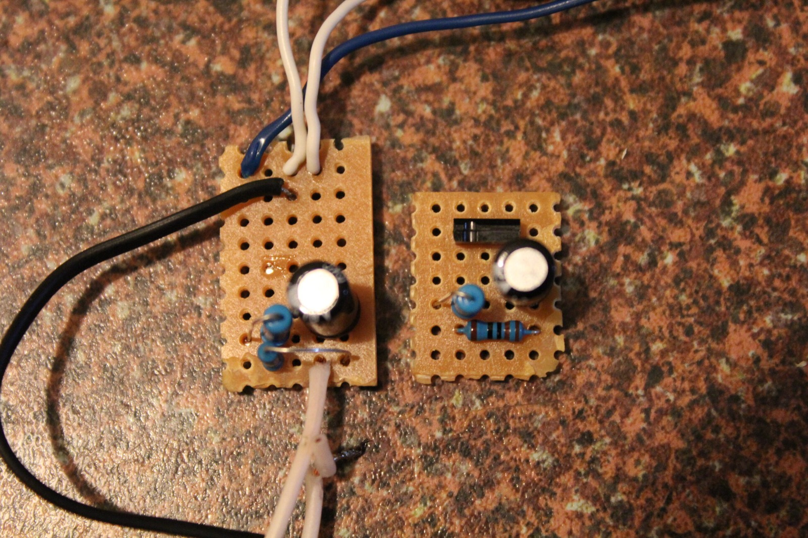
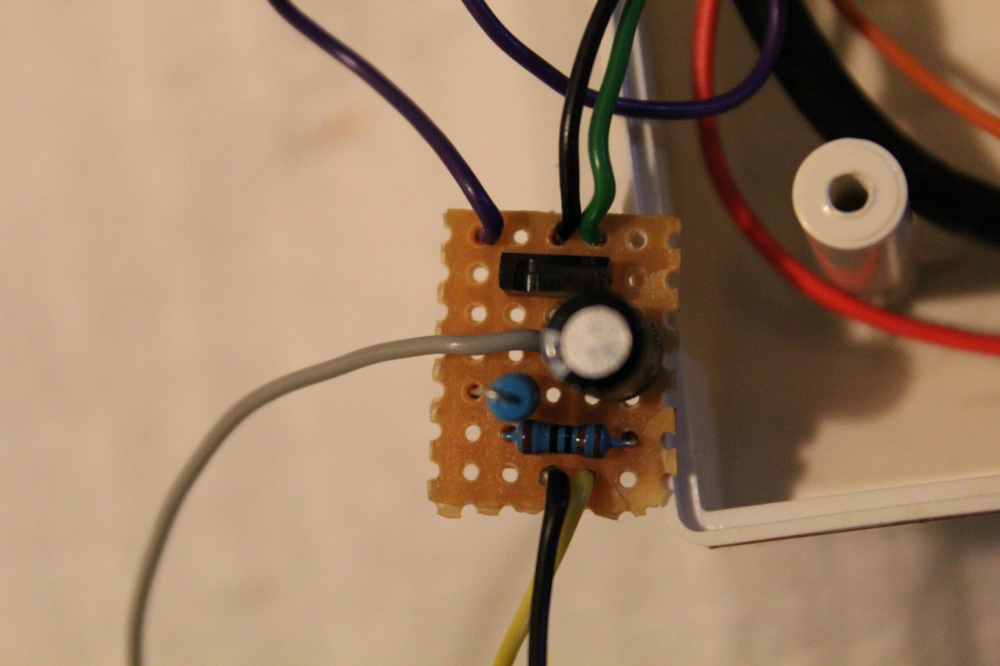
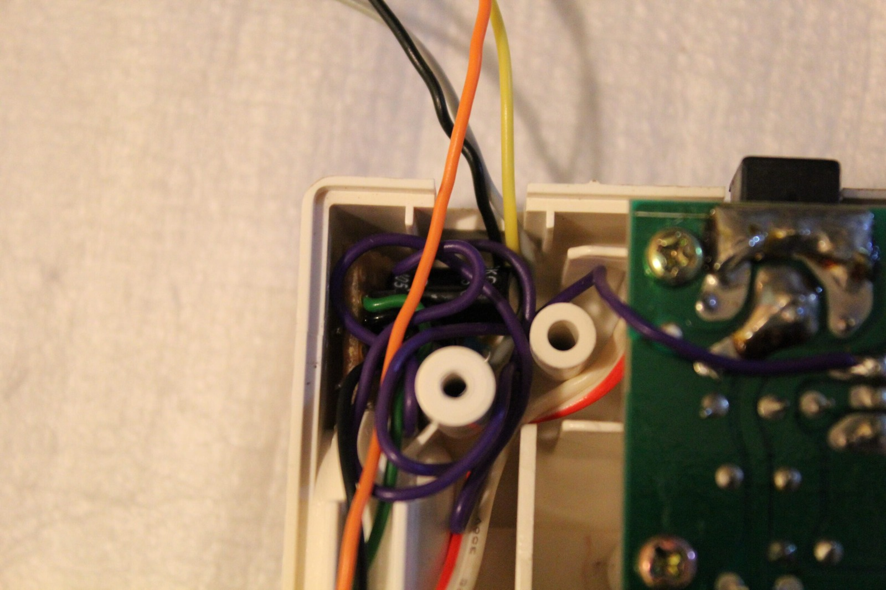
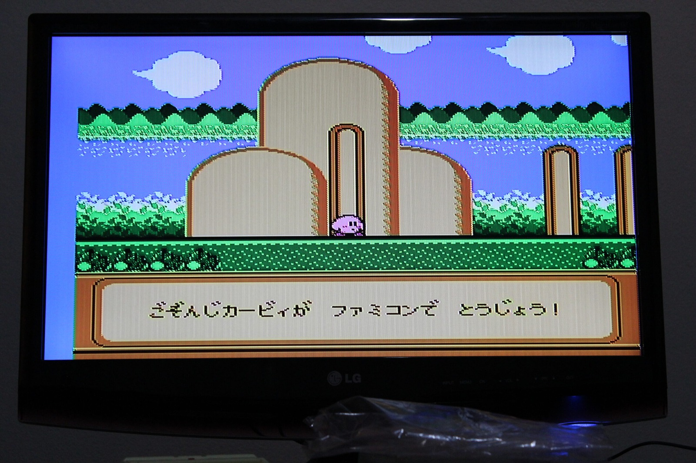



The Famicom AV mod is complete.

The first video shows how the composite-video modification works and why I wired it the way I did. I've been through three versions of the circuit so far, starting with wires joined together, moving onto a piece of prototyping board, and eventually shrinking the whole thing down to a rather compact little board. Much better than having bits of wire floating around inside the Famicom!

The circuit uses a transistor removed from the Famicom itself, along with resistors and a capacitor, to get composite video out to the television. I've also walked through the connections in the video for anyone interested in giving it a go.



Next is an overview of the completed modification inside the console. We've got both picture and sound, which is excellent, although the jailbars are still hanging around. They aren't noticeable in every game, but they're definitely there in Kirby. Jailbars. Nobody likes them, not even people behind them!

I tried a couple of things to get rid of them, including connections involving PPU pins 20 and 22, and another attempt using the PPU's 5 V and ground connections. Neither fixed the problem, unfortunately, so the jailbars will have to stay for now.

This particular Famicom belongs to SuperNick (Nick), and he decided to remove the second-player controller because all his games are single-player. That gave me a handy place to route the AV and sound cables out of the case. The little circuit board fits inside fairly well, and I've insulated the sound-line capacitor so it doesn't short against anything. There's enough slack in the wiring if the owner wants to change the arrangement later.



And finally, some Spelunker. What an enjoyable game it can be when you put your mind to it. Really put your mind to it. Meld it. Meld your mind with it. Naturally, I still managed to run into a ghost. I'm terrible!

*The Famicom back together for testing, with Spelunker ready to go and the second controller removed to make room for the AV leads.*
{: .media-caption }

*A closer look at the front of the Famicom after the controller arrangement was changed.*
{: .media-caption }

*The earlier bit of wiring beside the neater little board. Much better than leaving everything floating about inside the console!*
{: .media-caption }

I was able to shrink the first two versions of the circuit down onto a much smaller piece of prototyping board. That lets it tuck into the corner of the Famicom case instead of floating around inside like an electronics science experiment. Amazing what such a small piece of hardware can do.

This is the same composite modification documented in the full guide, although different Famicom motherboard revisions may need different connection points or component values. Best to check which board you've got before copying everything exactly!

*The compact AV board sitting neatly in the Famicom case. At least the wiring has somewhere sensible to live now.*
{: .media-caption }

*The AV wiring tucked into the corner of the case, with a little slack left if anything needs moving later.*
{: .media-caption }

*Kirby's on the screen again. The composite output works, even if those pesky jailbars haven't entirely disappeared.*
{: .media-caption }

There's more photos in the [photo gallery](/goodies/).

### Related Posts

- [Humble Beginnings: Nintendo Famicom Incoming](/humble-beginnings-nintendo-famicom-incoming/)
- [Nintendo Famicom Composite AV Mod](/nintendo-famicom-composite-av-mod/)
