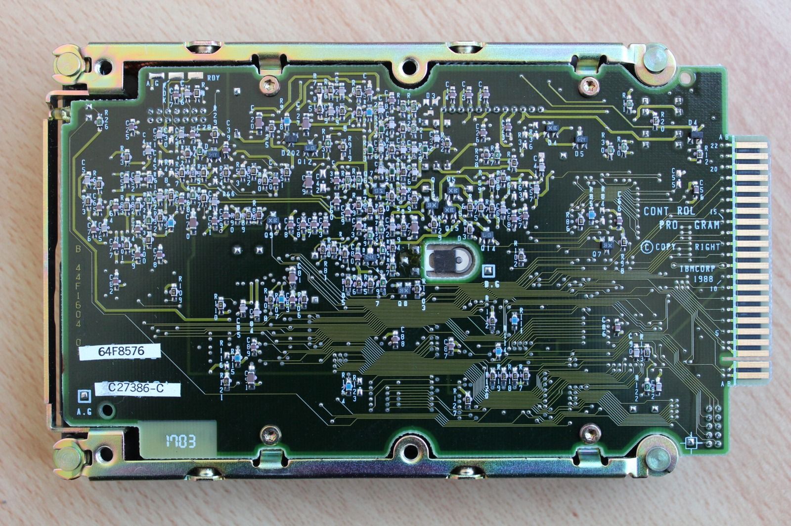
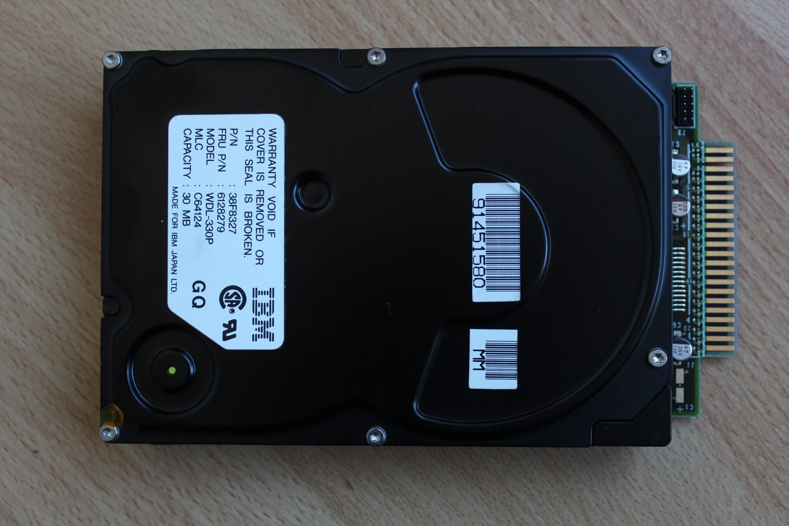
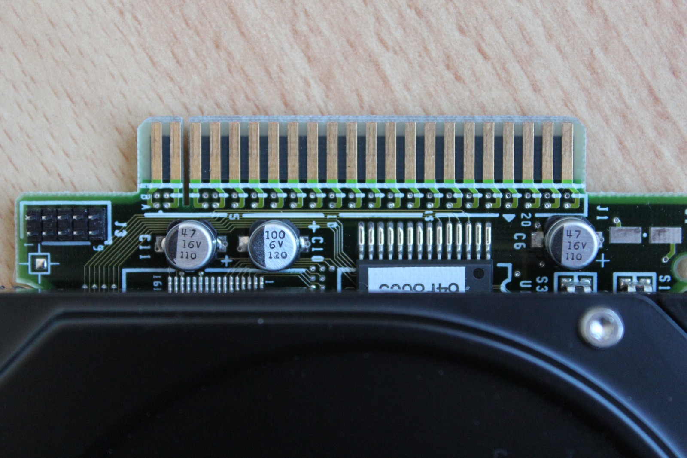
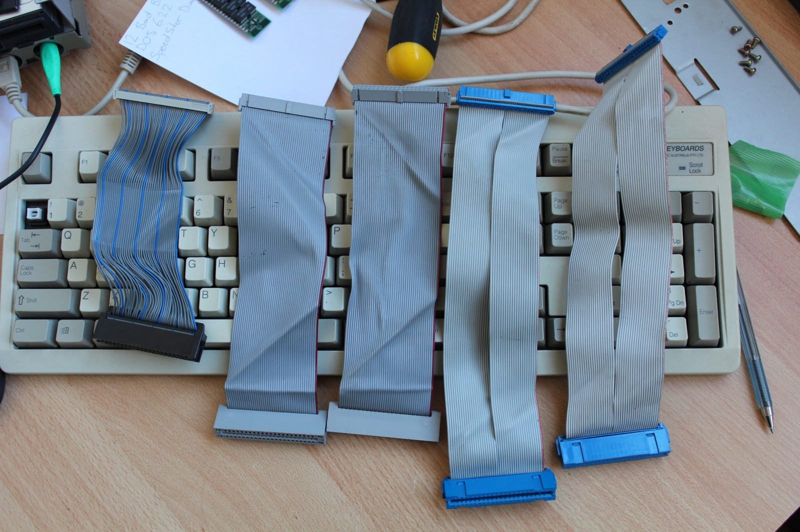
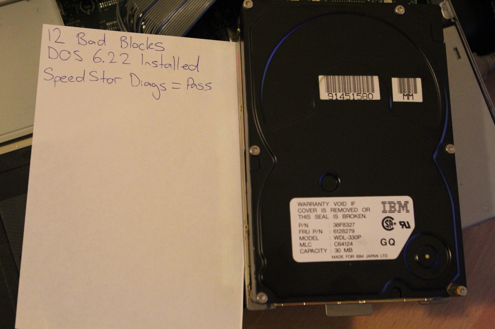
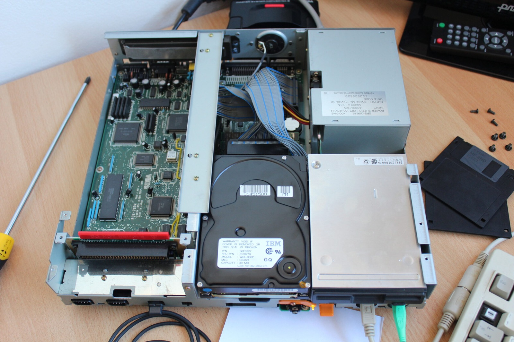

Above are some photos of a Sega TeraDrive hard drive. I've been trying to work out exactly what sort of interface this thing uses. IDE? ESDI? XTA? Something else entirely?

The connector has 44 pins and carries both data and power, but the pinout doesn't match standard ATA/IDE. I was originally wondering whether the number of signal lines might point towards an 8-bit or 16-bit interface, although that alone doesn't tell me much about what is actually going on.

Sure, I could install an ISA hard-drive controller. But where is the fun in that? The motherboard connector is sitting there waiting to be understood!

I've also been talking with [Nemesis](https://www.exodusemulator.com), author of the Exodus Emulation Platform, who reckons there's more to uncover here. Several controller chips in the TeraDrive are closely related to hardware found in IBM-derived systems, so I've been looking through old XTA references and Vintage Computer Forum discussions and comparing pinouts.

An earlier version of this article also linked to my TeraDrive HD pinout spreadsheet on the [file server](/goodies). If anyone else has been investigating this peculiar interface, I'd be very interested to hear what you've found.

### What the interface actually appears to be

The early IBM PS/2 Model 25 and Model 30 systems used some rather unusual hard drives. The interface is generally described in preservation documentation as a proprietary direct-bus-attachment arrangement, rather than standard ESDI or ATA/IDE.

That fits rather nicely with the Sega TeraDrive. I've successfully tested several IBM WDL-330P drives, which gives me a solid reason to investigate this particular IBM storage family. Older references sometimes call these drives XTA or XT IDE, but those names can be confusing when you're trying to work out what will actually plug in and operate.

The 44-pin connector carries both data and power, including 5 V and 12 V rails. At least I've got some clues now. Time to see what other drives might be compatible.

### Drives tested or investigated

**20 MB WDL-320**
- Candidate only. Likely used in Model 30, physical size unknown.

**20 MB WDI-325Q**
- Compatibility remains unconfirmed. The unit I bought was faulty and physically too large for the intended TeraDrive mounting arrangement, so its failure does not prove the interface itself was incompatible.

**20 MB WD-325N**
- Candidate only.
- Appears to use the same style of 44-pin connection.
- Physically similar in size to the WDI-325Q.

**20 MB ST-125L**
- Candidate only.
- Used in the IBM PS/2 Model 30, physical size unknown.
- IBM P/N: 6373538.
- Drive Type 36.

**30 MB WDL-330PS**
- Historically reported candidate. I cannot confirm it firsthand.

**30 MB WDL-330P**
- Confirmed working firsthand. I tested several of these successfully in the TeraDrive.

**40 MB ST-151L**
- Candidate only. Reported as a 40 MB relative of the ST-125L.

### Sources

- [IBM Files: PS/2 Model 25/30 (Direct-Bus HDD, Not IDE/ESDI)](https://www.ibmfiles.com/pages/ps2model25.htm)

### Related Posts

- [The Sega TeraDrive Model 3](/the-sega-teradrive-model-3/)
- [Sega TeraDrive Model 3 Hard Drive Replacement](/sega-teradrive-model-3-hard-drive-replacement/)
