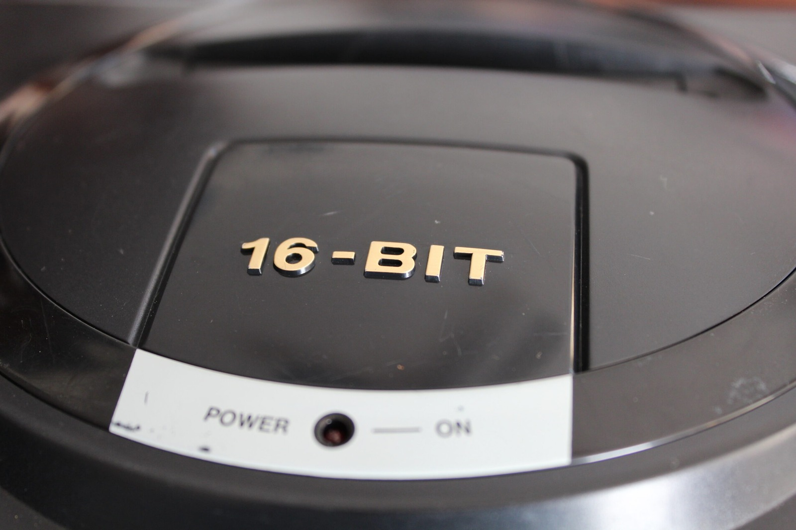
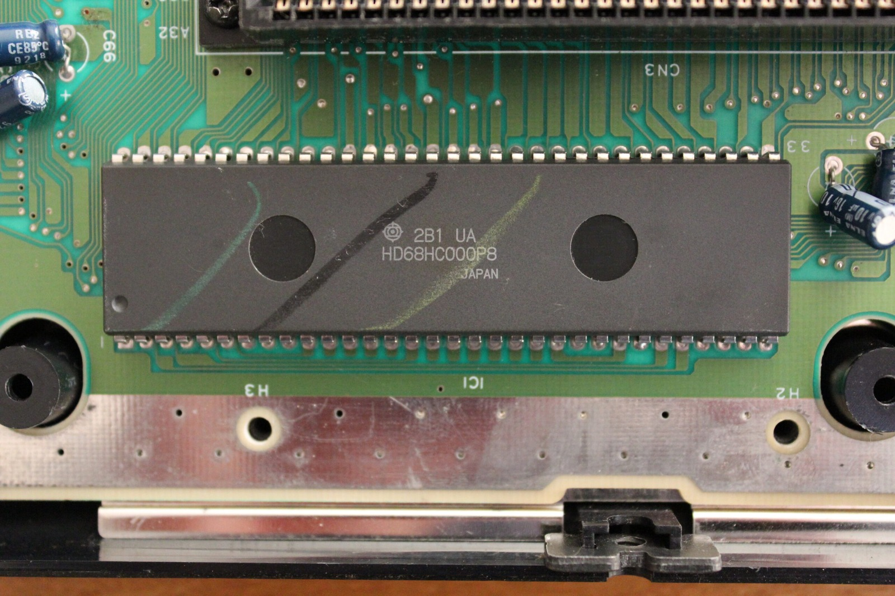
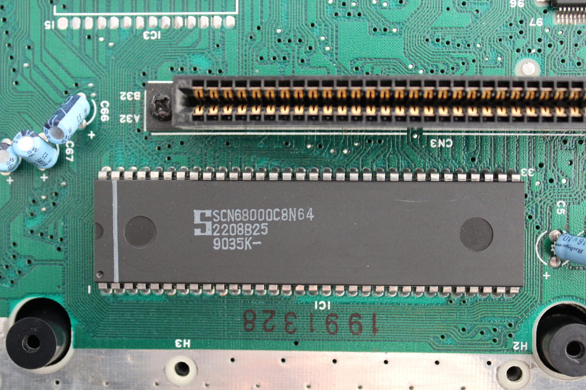
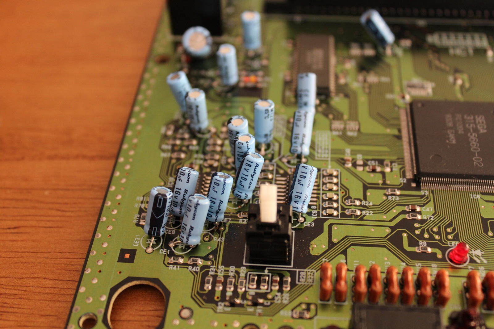

*Seven Mega Drives on the bench and apparently I still wanted to take them apart. Here's the familiar 16-BIT badge before the internals.*
{: .media-caption }

I do not think I could take apart another Mega Drive... at least not for a few days. I've gone ahead and taken some great quality pictures of the innards of five of my functioning Mega Drive Model 1s and two of my non-functioning Mega Drive Model 2s.

*The Hitachi 68000-family CPU I found in one of the Mega Drives. An interesting change from the other boards in my little sample.*
{: .media-caption }

I found that one of the Mega Drive Model 1s was made in Thailand instead of the usual China and did have some differences more significant than minor changes between the China-built Model 1s. In the units I opened, the Thailand-built Model 1 used a Hitachi 68000-compatible CPU, while all of the China-built Model 1s in this particular sample used Motorola CPUs.

*Another 68000-family chip, this one marked SCN68000C8N64. These boards certainly aren't all identical.*
{: .media-caption }

Other differences include the screws! They were silver instead of black to secure the case together and to hold the EMI shielding down. Furthermore, the screws were longer. It also appears that I have Mega Drives from a whole range of places. I'll need to sit down and work out which ones are keepers, which ones are to be modded and which are to be released back into the wild (marketplace).

*And a pleasant surprise inside the Model 1s: plenty of Rubycon capacitors. Lovely to see!*
{: .media-caption }

I was very pleased to see that most of the Mega Drive Model 1s have Rubycon capacitors in them. What a delight! Check out the whole range of pictures over in the [photo gallery](/goodies/).

### Sources

- [Sega Retro: Mega Drive PCB Revisions (Model 1)](https://segaretro.org/Sega_Mega_Drive_PCB_revisions)
