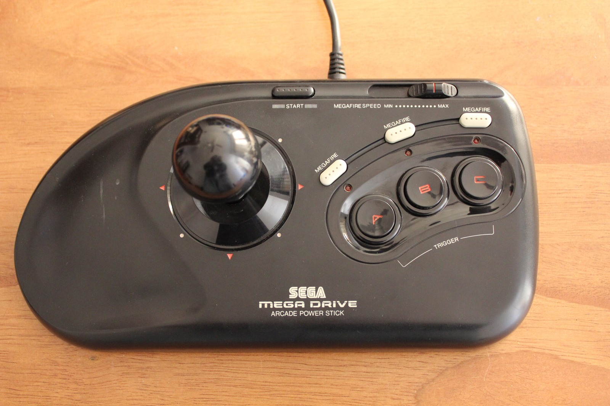
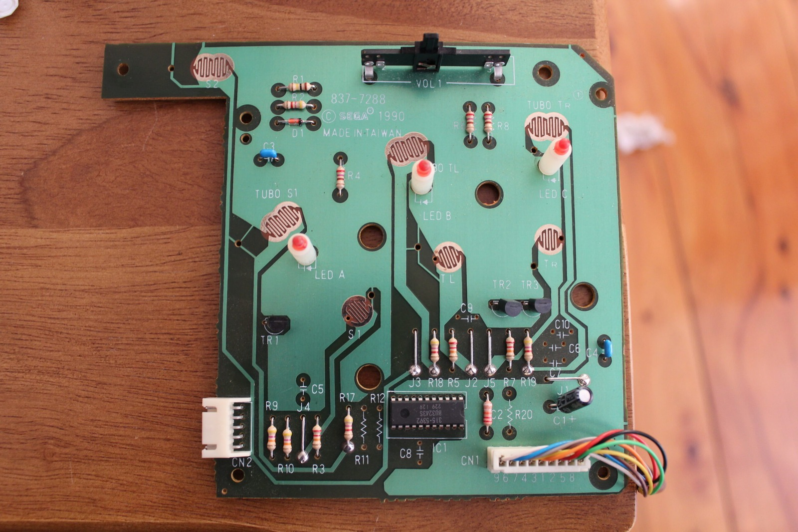
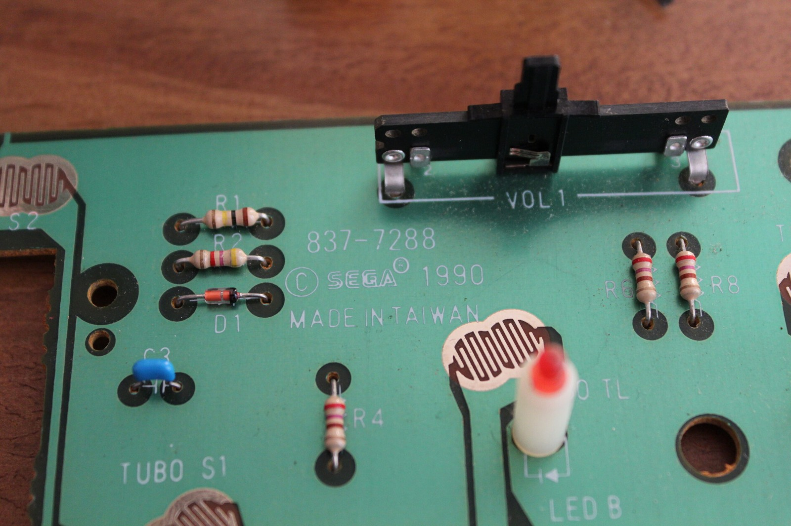

*One freshly cleaned Arcade Power Stick, complete with its nice big buttons and adjustable Megafire controls.*
{: .media-caption }

A rather slow weekend. Most of it was spent looking through what I have and trying to decide what I am willing to part with. I cleaned out a Sega Mega Drive Arcade Power Stick ready to sell.

*Under the lid of the Arcade Power Stick, where the switches, contacts and wiring are much more interesting than the dust.*
{: .media-caption }

*A closer look at the original Sega board markings and the little slider. Much simpler than it looks from outside.*
{: .media-caption }

Cleaned up pretty well! Next came a Mega Drive Arcade Power Stick II. Personally, I still prefer the original version. None of these fancy wigwams and levers, just simple big buttons. I've got another Sega-licensed arcade stick here as well, but that can wait for another weekend.

#### Green-screen mystery

I also ran into a green screen and rolling horizontal lines on one of my Mega Drive Model 1 consoles. This was the machine I had planned to mod, overclock and generally hack to pieces. What confused me was that it had worked fine for hours the day before.

I removed all the EMI shielding, connected power and video, and suddenly it worked perfectly again. A short? Something touching the shielding? A bad connection disturbed while I pulled it apart? Who knows!

I couldn't reproduce the problem after reassembly, so I let it run for the rest of the day without issue. Ys III: Wanderers from Ys has some damn catchy tunes. I kept getting killed by bats though...

