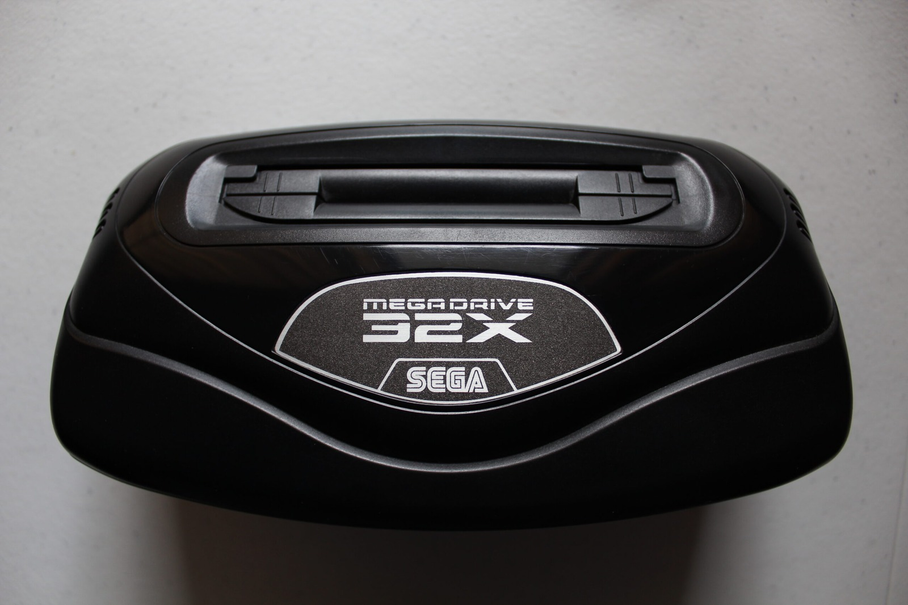
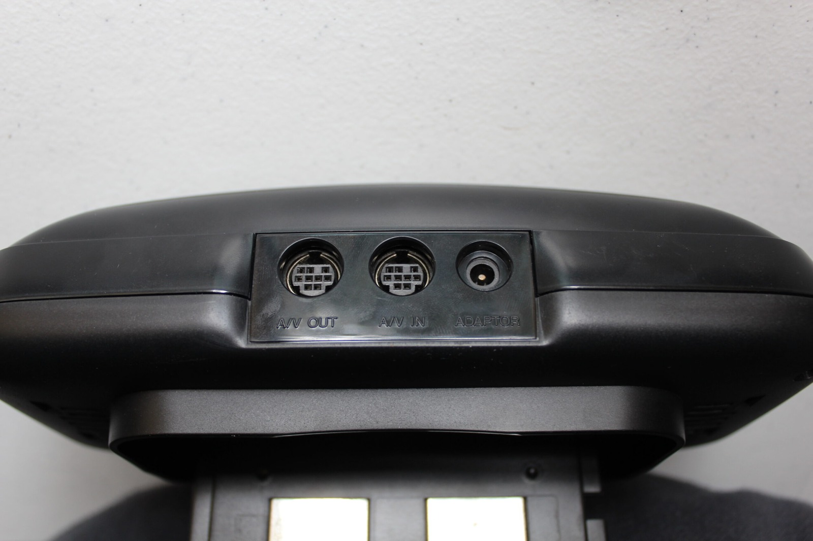
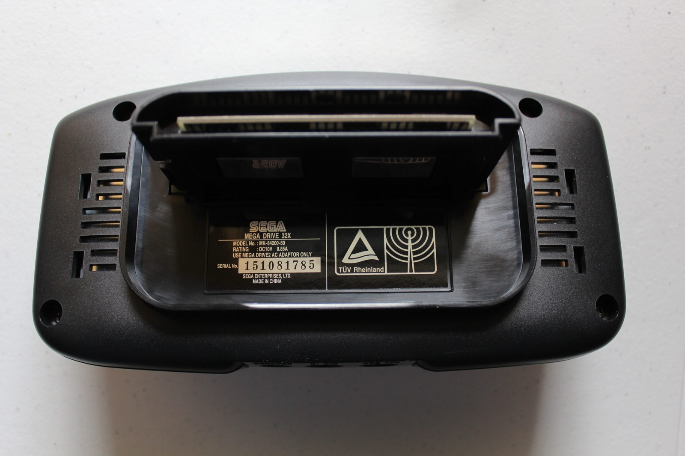
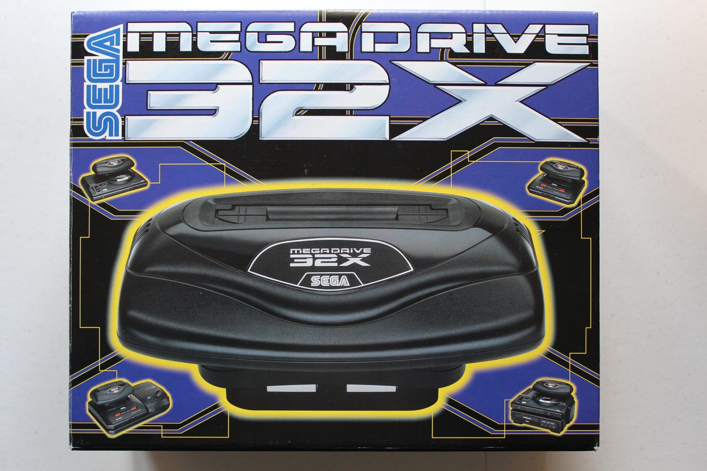
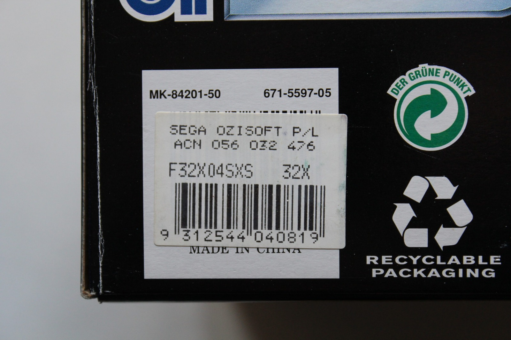
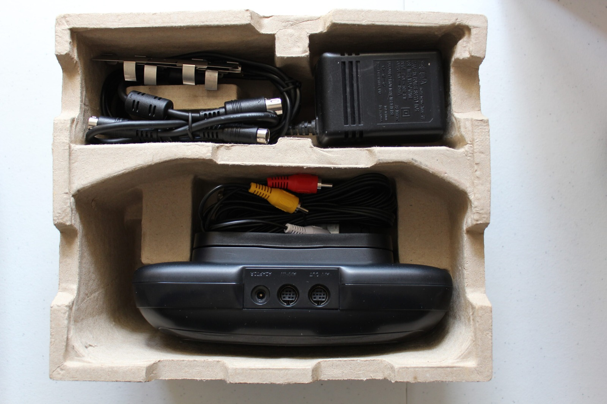
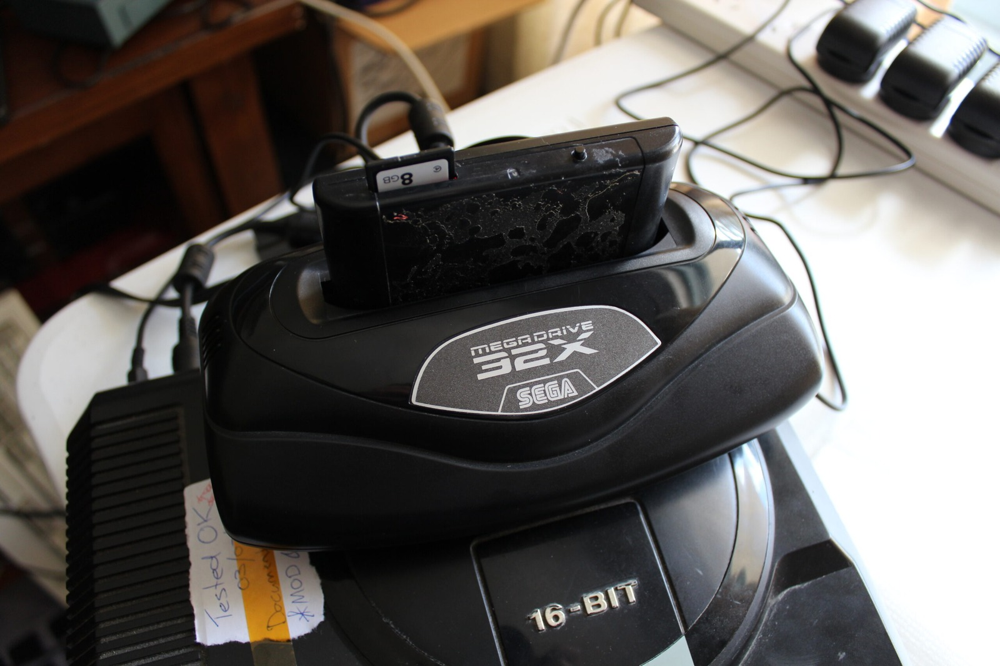
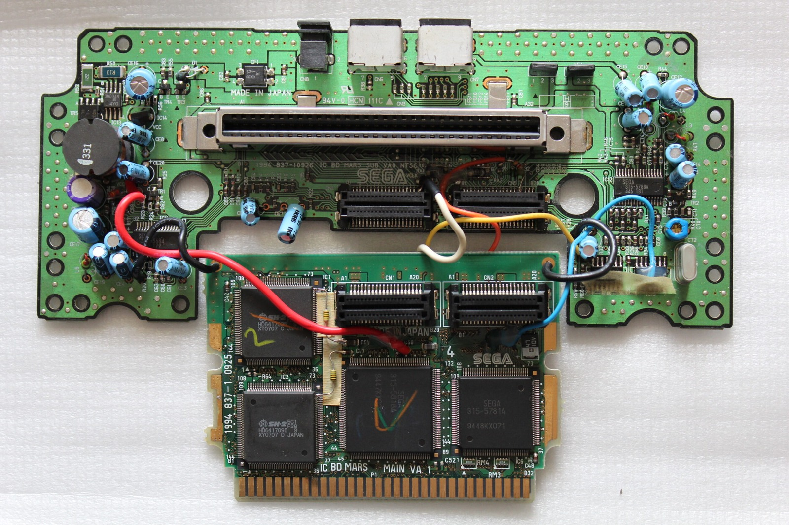
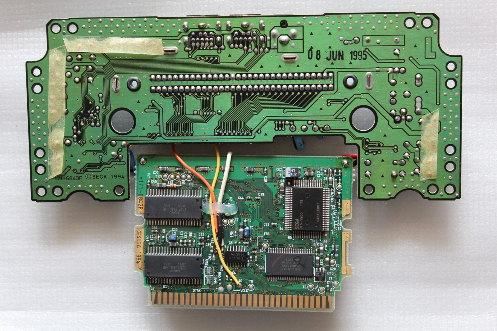

The Mega Drive 32X. One small step for man. 50,000 polygons for mankind! Sega claimed around 50,000 texture-mapped polygons per second. A rather impressive marketing number, even if that doesn't mean every game will actually be throwing that many polygons around.

Nice rear.

AV in, AV out. What a meddlesome middleman!

Good old Sega Ozisoft, weren't they a bunch of jolly jokers!

My 32X thankfully came with the box and is in very good shape. A fine specimen indeed!

Stacks up pretty well on top of a Mega Drive and Mega CD Model 1. While this particular 32X will likely stay boxed up for a bit longer, I do hope to come by another one to fit on top of my display Mega CD / Mega Drive unit. Alongside the Mega CD karaoke machine, it will make the Mega Drive look like an unstoppable killing machine.

I wouldn't mind combining a spare 32X with a Mega Drive 2 to make my own Neptune-style machine. Sega had planned to combine the Genesis and 32X into a single console with the Neptune, but it never went into production. I'd rather sacrifice an American 32X for that experiment than this seemingly much harder-to-find European one.

I've updated a chunk of the [photo gallery](/goodies/) as well and added a few more tear downs of the Mega Drive 2s. I had to repair the DC-in jack on one of them as the solder had cracked from physical stress. A few hundred degrees later and it is back up and running.

Played a bit of Pier Solar, but was unable to get to the caves! Where are the damn caves! Love the in-game jokes too. Very well done WaterMelon!

### Sources

- [GameFAQs: Sega 32X FAQ (Quoted 50,000 Polygons/s Figure)](https://gamefaqs.gamespot.com/sega32x/916394-sega-32x/faqs/2755)
- [Sega Retro: Sega Neptune (Unreleased Mega Drive/32X)](https://segaretro.org/Sega_Neptune)
