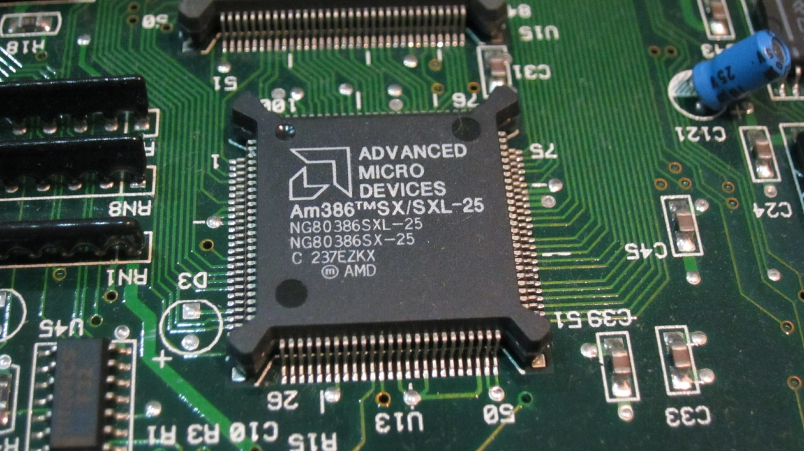

The time has come. We wish you a safe journey, AMD 386SX CPU. You have served us well. Armed with a heat gun and flux, work begins on my attempt to create a 50 MHz Amstrad Mega PC.

Now, that 50 MHz target needs a little explaining. The original Am386SX runs its core at half the CLK2 input frequency, so a 50 MHz CLK2 signal gives it a 25 MHz core speed. The replacement TI486SXLC2-G50-PQ, shown in the repair photographs, is a clock-doubled processor designed for a 50 MHz internal core with a 25 MHz external bus. I'm not trying to make the entire Mega PC motherboard run at a 50 MHz external bus frequency!

Of course, there is more to a CPU swap than getting the old chip off and soldering another one in its place. The SXLC2-G needs a 3.3 V core supply, even though its I/O can tolerate 5 V, and the chipset, BIOS, cache-control signals and surrounding circuitry all need to cooperate. Similar-looking processors with similar clocks aren't necessarily interchangeable. Plenty of opportunity for things to go horribly wrong, then!

I'm using a general-purpose heat gun for the removal, which is hardly the ideal tool for a soldered QFP processor on a vintage multilayer motherboard. Proper temperature-controlled hot-air rework equipment would be a much better choice. Still, this is very much an experiment, and the AMD 386SX's journey is about to begin.

**Edit:** Everything is on fire! What have I done! Flames everywhere!

### Related posts

- [286, 386SX and 486SLC Overclocking and Upgrade Ideas](/286-386sx-and-486slc-overclocking-and-upgrade-ideas/)
- [Amstrad Sega Mega PC 486SXLC CPU Upgrade Failure](/amstrad-sega-mega-pc-486sxlc-cpu-upgrade-failure/)

### Sources

- [AMD Am386SX/SXL/SXLV datasheet](https://www.amd.com/content/dam/amd/en/documents/archived-tech-docs/datasheets/21020.pdf) - documents the Am386SX operating frequency as half the CLK2 input frequency.
- [Texas Instruments TI486SXLC and TI486SXL Microprocessors Reference Guide](https://www.bitsavers.org/components/ti/TI486/1994_TI486SXLC_and_TI486SXL_Microprocessors_Reference_Guide.pdf) - documents SXLC2 clock doubling and the distinction between core and bus frequencies.
- [Texas Instruments - Designing With the TI486SXL2-G: Converting Existing 486-Based Microprocessor Designs](https://www.bitsavers.org/components/ti/TI486/SRZA004_Designing_With_The_TI486SCL2-G_199502.pdf) - explains the SXLC2-G family's 3.3 V core supply, 5 V-tolerant I/O and required hardware changes.
