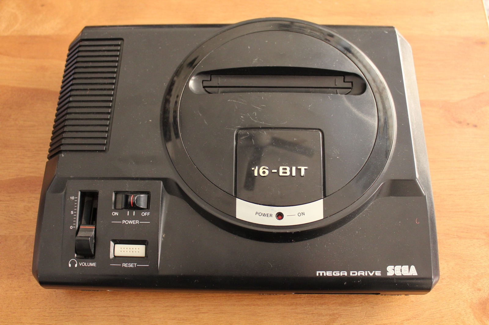
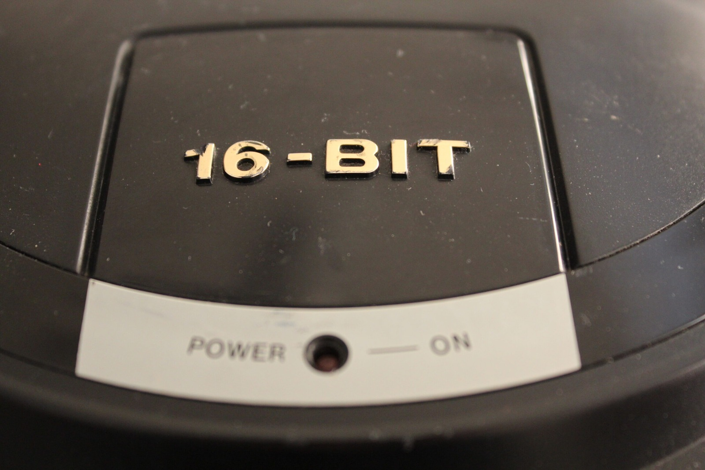
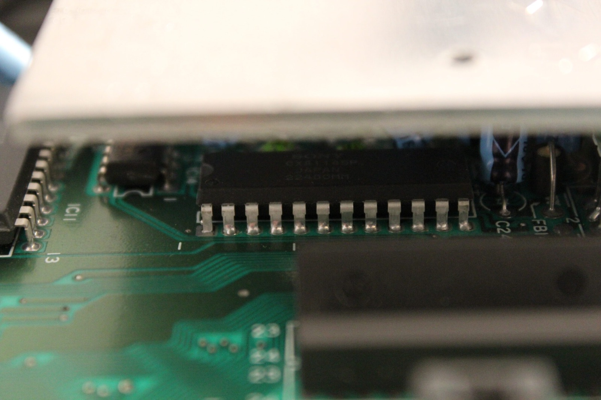

*Here's the Mega Drive that was giving me green and yellow flickering from a cold boot. Looks perfectly innocent sitting on the bench!*
{: .media-caption }

*A closer look at the Mega Drive's 16-BIT badge. Nice and ordinary outside, decidedly less ordinary on the television!*
{: .media-caption }

*A look inside the suspect video circuitry. I had my eye on the CXA1145P, but only a replacement test would tell the tale.*
{: .media-caption }

I was going to sell this Mega Drive for scrap, but some more testing made the fault considerably more interesting. The yellow and green video flicker only happens from a cold boot. After the console has been running for around thirty minutes, the picture settles down and the flickering disappears.

One suspect is the Sony CXA1145P video encoder. It takes the console's analogue RGB signals and produces composite video, so it could certainly have something to do with the strange colours. I won't know for sure until I try replacing it.

I've ordered a couple of replacement CXA1145Ps to find out. Are they a good investment? Who cares? They're about $3 each!

The other Mega Drive I was planning to sell had a dodgy power connection. I scraped back the corrosion around the power plug and got a solid connection again. It still needs the broken volume slider and power LED repaired. This is the Thailand-made unit with the particularly brittle internal wiring. Some of the wires practically fell out when I removed the case.

Aaaand the volume slider that fell off... I thought I'd lost it! Turns out I knew I'd have to repair the LED, so I had put the volume slider safely in a bag inside the Mega Drive. So efficiently inefficient! At least it should be working properly once I'm finished with it. Stay tuned!

**Edit:** The replacement Sony CXA1145P fixed the flickering green and yellow!

### Sources

- [Sony: CXA1145P Datasheet (RGB-to-Composite Encoder)](https://datasheet4u.com/datasheet-pdf/Sony-Corporation/CXA1145P/pdf.php?id=199042)

### Related Posts

- [Sega Mega Drive Model 1 CXA1145P Video Repair](/sega-mega-drive-model-1-cxa1145p-video-repair/)
