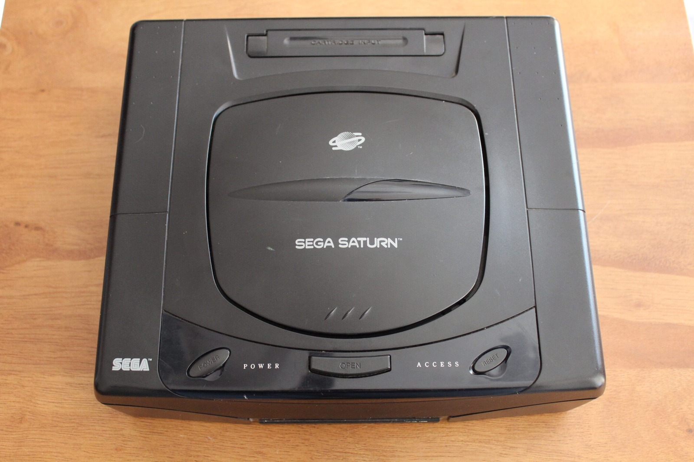

*One of the Saturns on the bench while I chased those rolling horizontal lines. The strange behaviour was in the picture, not the case!*
{: .media-caption }

Two Sega Saturns. Two copies of the same game. Two power supplies that produce rolling horizontal lines.

The best clues always seem to arrive by accident.

I had been testing my Japanese Saturn through a 240 V to 120 V step-down transformer. That particular project failed, more on that later, so afterwards I started going through my other Saturns to document their CD decks and power supplies.

Something didn't make sense. The Saturns with the supposedly bad PSUs were no longer showing the rolling-line problem, even after being left running for quite a while.

I packed everything away and went to bed with an uneasy feeling. Turned off the light and then a giant light bulb activated inside my big fat head.

I had forgotten to unplug the step-down transformer. In other words, I'd accidentally been feeding my PAL Saturn power supplies roughly half their intended mains voltage!

These power supplies are designed for roughly 220 to 240 V AC, not 120 V. Severe undervoltage certainly isn't a safe or sensible way to run them, but it does leave me with a rather interesting clue about those rolling lines.

I connected a power meter and recorded the following:

```text
PAL Saturn through step-down transformer
Voltage:      124 V
Power factor: 0.68
Frequency:    50 Hz
Apparent:     17 VA
Power:        12 W
Current:      0.14 A

PAL Saturn on normal mains
Voltage:      251 V
Power factor: 0.67
Frequency:    50 Hz
Apparent:     21 VA
Power:        14 W
Current:      0.08 A
```

The Saturn actually ran at the lower input voltage, which surprised me. That doesn't mean it was operating properly, and I certainly wouldn't call this a fix!

What interests me is that changing the input voltage also changed the interference. Perhaps there's something going on with the regulation or filtering inside these PSUs. I haven't isolated the faulty component, but at least I've got somewhere to investigate next.

More testing required.

### Sources

- [ConsoleMods: Comparison of Power Supplies (Regional Saturn PSU)](https://consolemods.org/wiki/Comparison_of_Power_Supplies)

### Related Posts

- [Sega Saturn Model 1 Power Supply Issues](/sega-saturn-model-1-power-supply-issues/)
