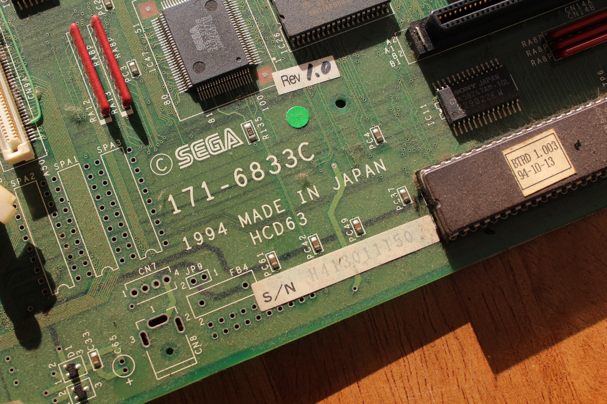
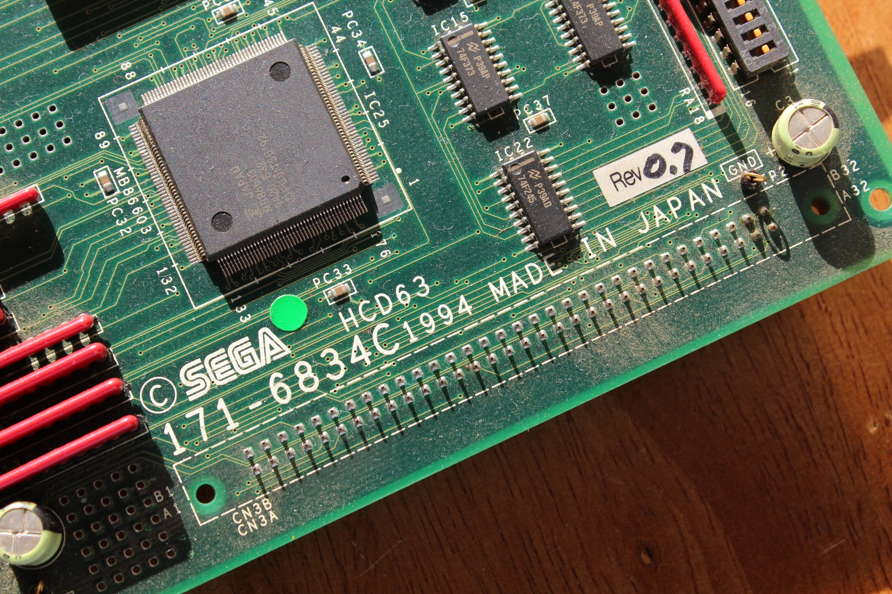
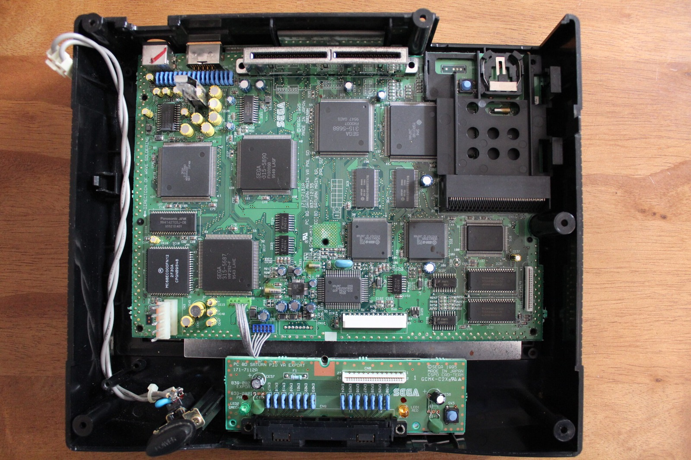
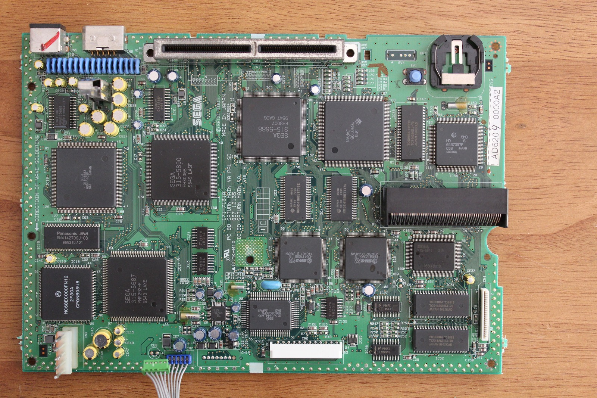
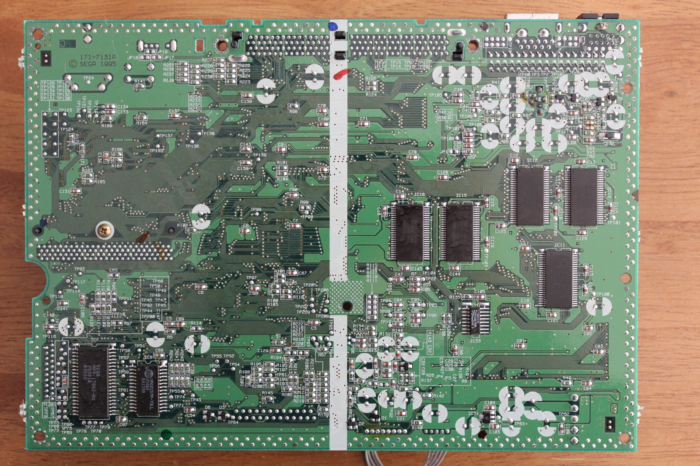
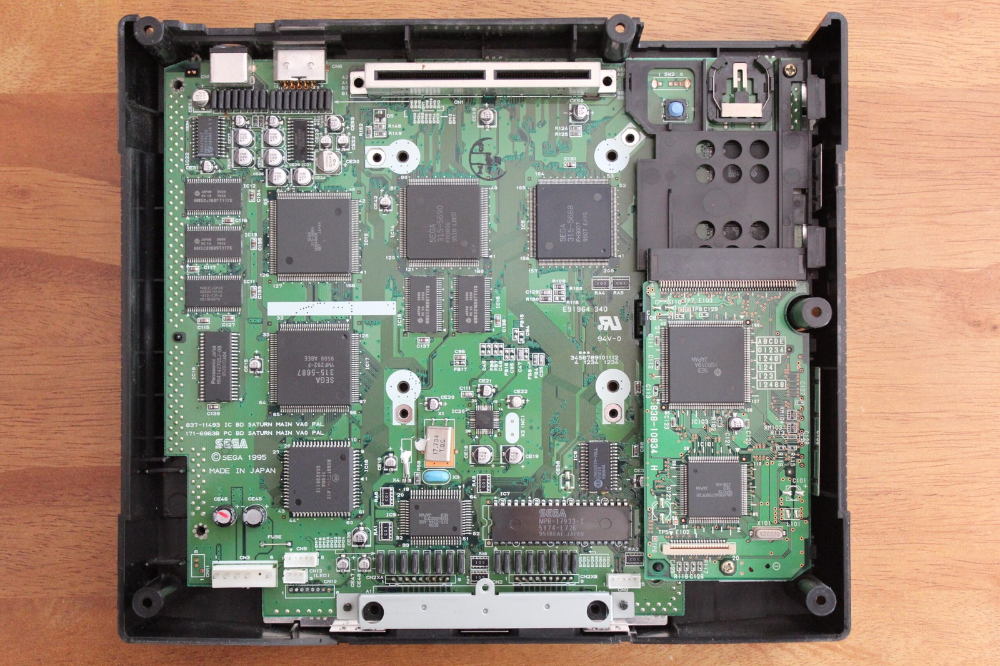
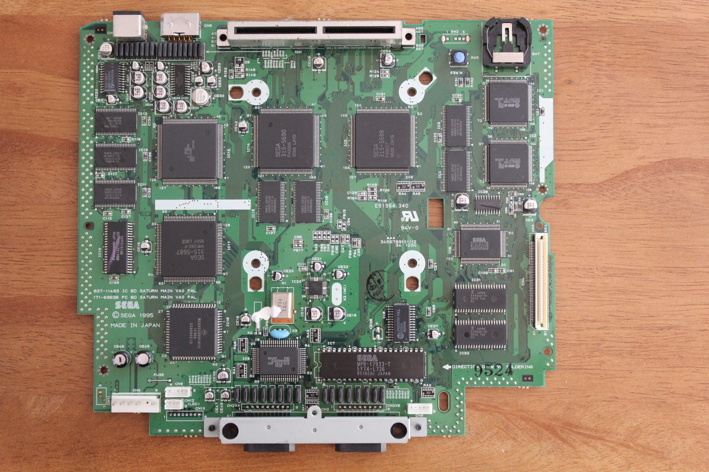
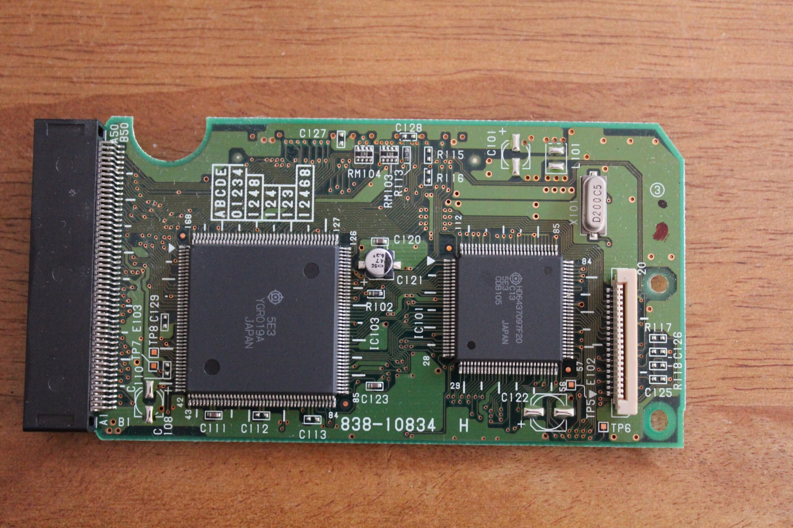
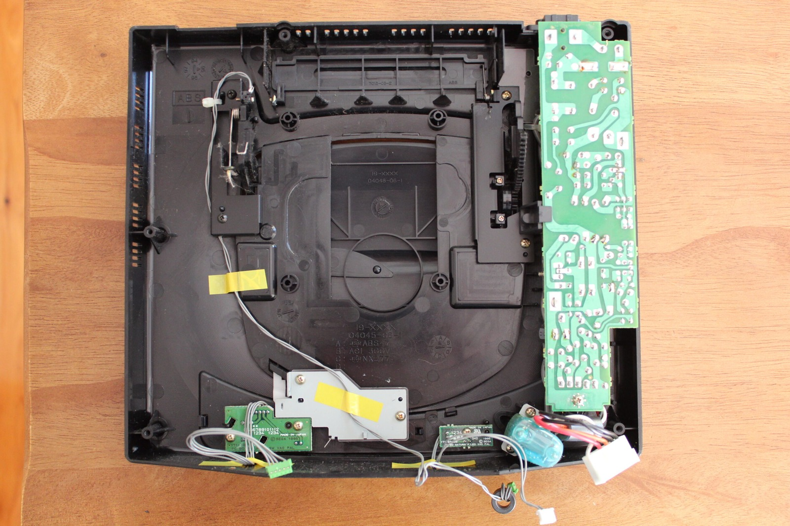

*A much better look at Sophia's board markings, including revision 1.0. There are plenty of little details worth documenting.*
{: .media-caption }

*Another Sophia board, this one marked revision 0.7. I'm trying to get proper readable photographs instead of strange side angles.*
{: .media-caption }

Sophia is still out and about! I've been giving her a bit of attention today, starting with a careful dusting using a paintbrush to get rid of the top layer of smokey dust. She looks considerably cleaner now, although you won't see that in the photographs above. I took those before doing the cleaning.

*One of the early VA0 Saturns opened up for the camera. Now that's a board worth photographing from above!*
{: .media-caption }

*The VA0 motherboard laid out on the bench. Much easier to read the chip markings without the case in the way!*
{: .media-caption }

*And around to the back of the Saturn board. There's plenty of circuitry on this side too!*
{: .media-caption }

I've also started retaking photographs of my Sega Saturn hardware. Looking through some of my earlier pictures, I realised I'd photographed far too many chips from strange side angles. Clearly the best way to photograph a microchip is from above! At least that way I can actually read what's written on the thing without twisting my head around.

While everything was out, I managed to document both of my Model 1 Saturns with VA0 mainboards. There are plenty more photographs in the [photo gallery](/goodies/), but I've included a few of the more interesting ones here.

*Another look at the early Saturn's enormous mainboard, with the familiar big Sega chips all lined up.*
{: .media-caption }

*The '9524' marking caught my eye. I took it to mean the 24th week of 1995, although it's just a clue from the board.*
{: .media-caption }

*That separate SH-1 CD board looked remarkably familiar from Sophia. Similar-looking parts are tempting, but I've not tested swapping them.*
{: .media-caption }

*With the board out, here's the Saturn shell and the remaining wires. I really did have the whole thing spread across the bench!*
{: .media-caption }

One thing that really stands out with the VA0 is the size of the mainboard. It's a fairly substantial piece of hardware, and the controller ports are integrated directly onto it rather than being part of a separate assembly. I also spotted a `9524` marking, which I interpreted as a date code for the 24th week of 1995.

But while I had one of the Saturns apart, I noticed something extremely familiar. The separate SH-1 CD-processing board looked remarkably like the one inside my Sega Saturn Sophia development unit. Considering how little documentation there is for the Sophia, that was too interesting to ignore. Time for a side-by-side comparison!



At first glance, the two SH-1 boards looked identical. Same general layout, same components and practically nothing to distinguish one from the other. I was beginning to think they might be exactly the same board.

Then I spotted a difference. Hitachi had moved its logo on one of the chips! Well, there goes my claim that they're completely identical. The Sophia board also has a serial-number marking on the back, which provides another way of telling them apart.

The similarities are still rather encouraging, though. The connecting cable looks promising, and the CD mechanisms themselves appear to be much the same. It makes me wonder whether parts from an early VA0 Saturn could be used with the Sophia, particularly if I ever need to replace something in its CD hardware.

I even started explaining how the cable runs through the Sophia's other boards, including its SCSI-related hardware and the BCD board. Then I completely forgot what I was talking about. Excellent technical commentary on my part! Clearly I should have made a few notes before turning the camera on.

Of course, looking alike doesn't necessarily mean the boards are electrically interchangeable. I haven't tested swapping the SH-1 boards or CD mechanisms at this stage, and Sophia is still missing her two SH-2 processor cards. That's a fairly significant obstacle to doing much more with her.

Still, with so little documentation available for these development units, I thought the comparison was worth recording. At least we've got another useful clue about how closely related the early Saturn hardware is to Sophia. And if nothing else, I've finally got some decent photographs of the collection!

### Sources

- [ConsoleMods: Saturn Model Differences (VA0 CD Daughterboard)](https://consolemods.org/wiki/Saturn:Saturn_Model_Differences)

### Related Posts

- [Sega Saturn Sophia Development Kit: Internal View](/sega-saturn-sophia-development-kit-internal-view/)
- [Sega Saturn Sophia and VA0 Parts Compatibility Test](/sega-saturn-sophia-and-va0-parts-compatibility-test/)
