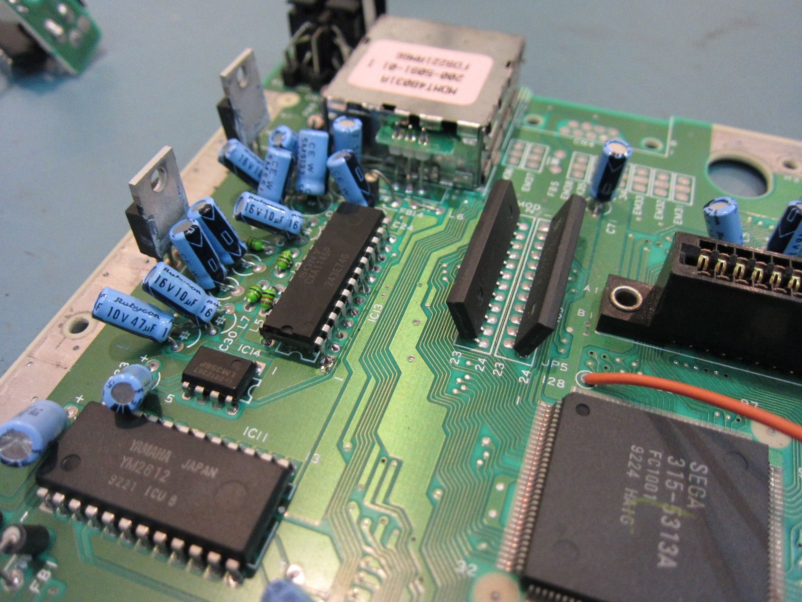
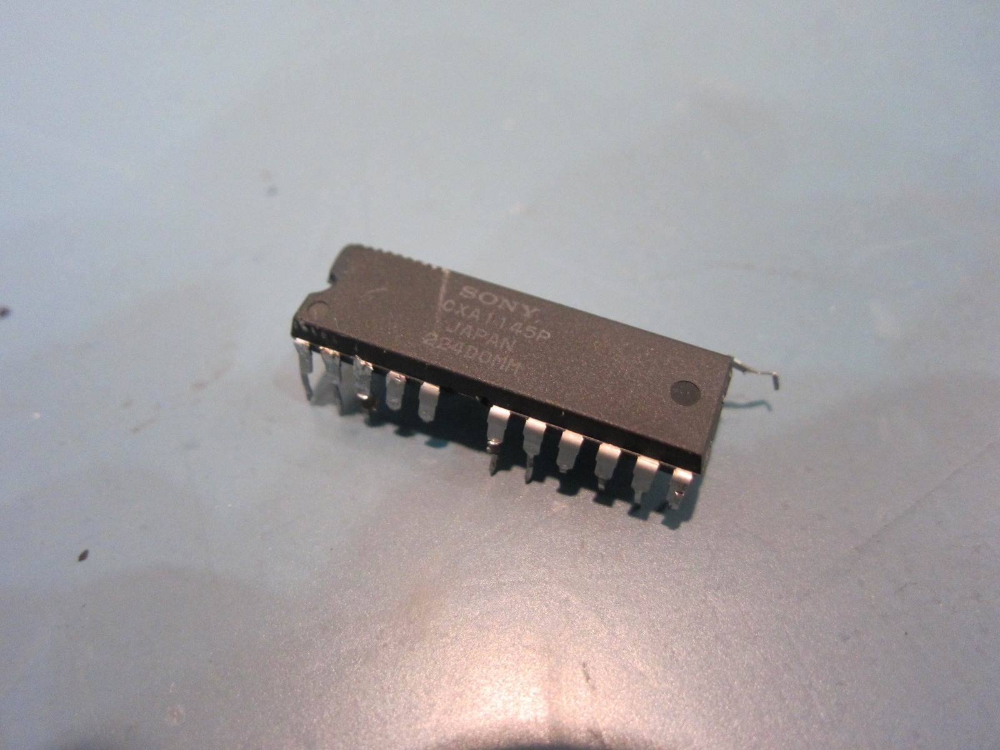
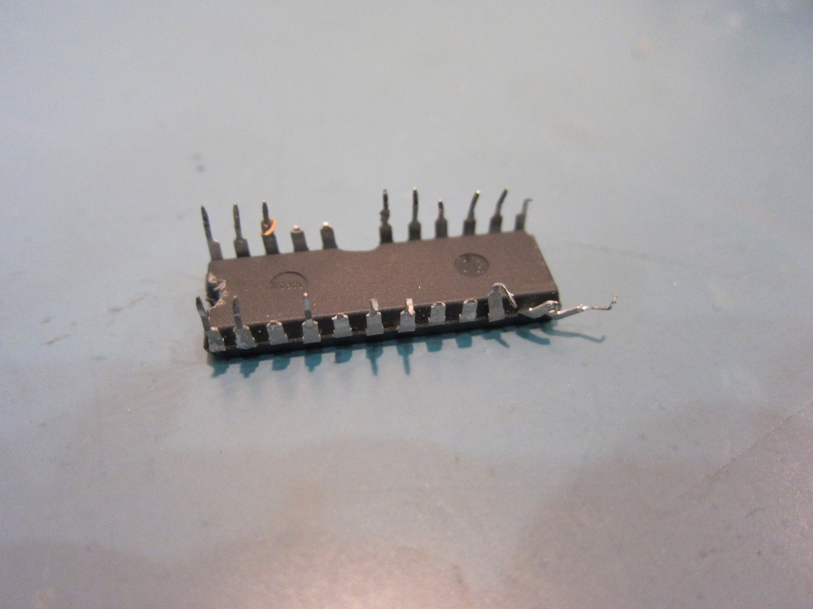
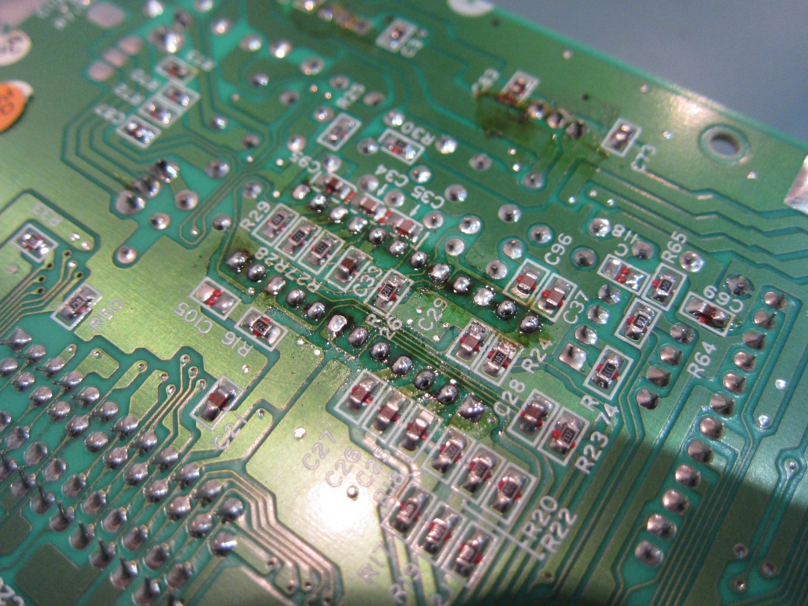
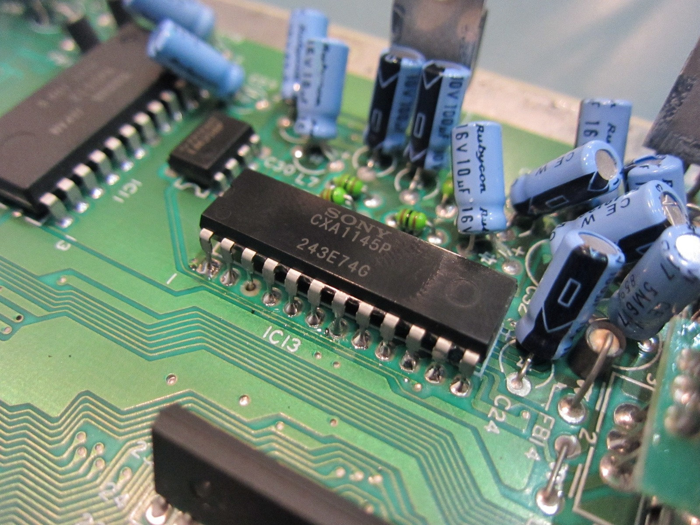



Success! Replacing the Sony CXA1145P video encoder fixed the yellow and green flickering completely. This was the Mega Drive that behaved badly from a cold start and gradually settled down after warming up. As you can see in the original footage, Knuckles was having something of a disco party before I started pulling the machine apart.

I'd ordered a couple of replacement CXA1145P chips, hoping the video encoder might be responsible for the problem. It's the Sony chip that handles the Mega Drive's RGB-to-composite video encoding, so it seemed like a reasonable place to start. Of course, having a replacement chip and actually getting the old one off the motherboard are two very different things!

Unfortunately, I was working away from home and didn't have my usual collection of tools with me. The soldering iron I was using had a cracked neck and looked as though the end might fall off at any moment. I was also short on desoldering braid, and I could really have used my Hakko 808 vacuum desoldering tool. Naturally, I carried on anyway.

Removing the old 24-pin DIP chip was an absolute monster. I ended up working a flat-blade tool underneath it, and several of the legs broke off and stayed behind in the motherboard. That made clearing the holes and installing the replacement considerably more entertaining than I'd hoped.

Eventually I managed to get the new chip into position, although some of the stubborn solder made the job difficult. The replacement looked a little different from the original Sony chip, with a different-looking finish and notch. I wondered whether it might be a counterfeit, but there was no way to tell from appearance alone. Better see whether it worked!

And just to make things even more exciting, I managed to lift the trace around the third pin. Marvellous! Fortunately, the connection continued through to the other side of the board, so I added some extra solder and worked around the damaged area. It wasn't the prettiest job, but at least the new chip was fitted.

With everything back together, it was time to give *Sonic & Knuckles* another go. Power on, fingers crossed, and would you believe it? No more flickering reds, no strange colour changes and Knuckles was finally behaving himself again. The picture looked absolutely lovely!

The replacement chip had cost around five dollars on eBay, which made it a rather satisfying experiment. I certainly spent more than five dollars' worth of time trying to fit the thing, but after seeing the flickering disappear, I wasn't going to complain too much.

I can't tell you what went wrong inside the old CXA1145P, but replacing it cured the problem on this Mega Drive. It was a good guess, especially given how little equipment I had available at the time.

I broke the repaired machine in with some Metallic Uniframe Super Hybrid Armor. I'd also noticed a few solder joints underneath that suggested somebody might have modified this particular Mega Drive before me. Nothing too surprising there, given the age of these machines.

*Back inside the troublesome Mega Drive, with the video circuitry and all those capacitors laid bare before the encoder swap.*
{: .media-caption }

*The old CXA1145P, finally freed from the board. Removing it was far more entertaining than I would have liked!*
{: .media-caption }

*Those poor chip legs. Desoldering the original encoder without my usual tools was not exactly graceful.*
{: .media-caption }

*The underside after my soldering adventures. It took quite a bit of fiddling to get the replacement fitted.*
{: .media-caption }

*The replacement CXA1145P finally in place. Best of all, the green and yellow flickering was gone!*
{: .media-caption }

As you can see, complete success, even with the rather limited tools I had on hand. My Hakko 808 would have made getting that old chip out a great deal easier, but at least I've managed to get this Mega Drive producing a beautiful picture again. If only my Sega Saturn repairs went this well!

**Sources**

- [Sony: CXA1145P Datasheet (RGB-to-Composite Encoder)](https://datasheet4u.com/datasheet-pdf/Sony-Corporation/CXA1145P/pdf.php?id=199042)
- [Hakko: 808 Vacuum Desoldering Tool](https://www.hakko.com/english/products/hakko_808.html)

**Related Posts**

- [Sega Mega Drive Video Flicker and the Sony CXA1145P](/sega-mega-drive-video-flicker-and-the-sony-cxa1145p/)
