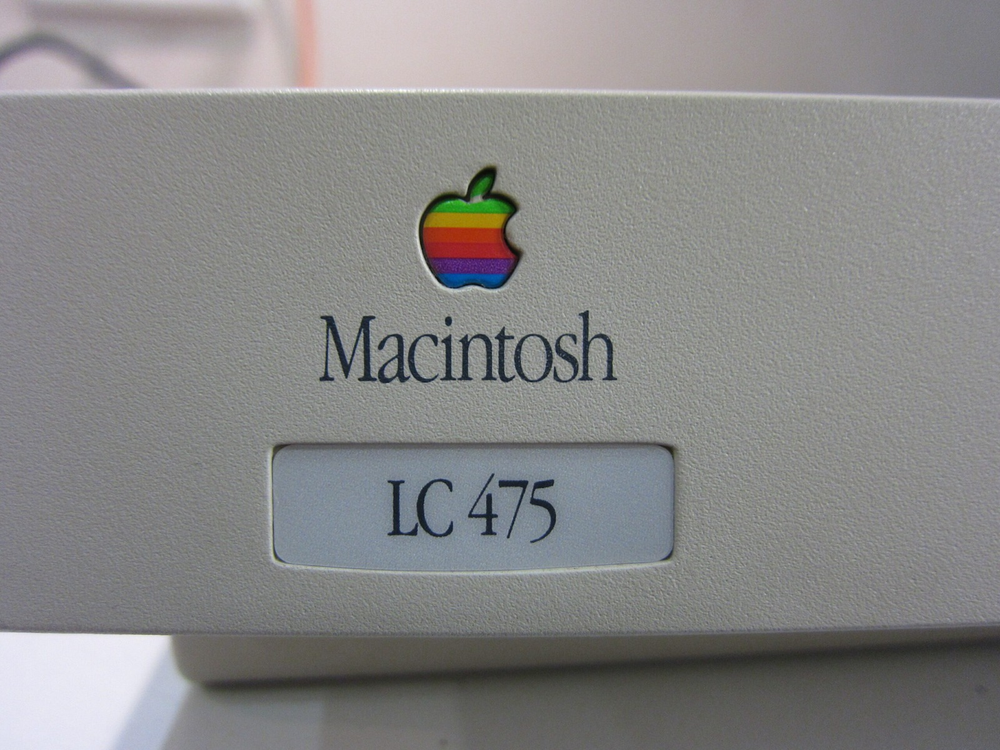
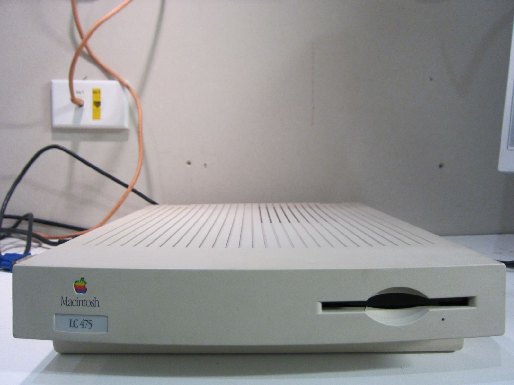
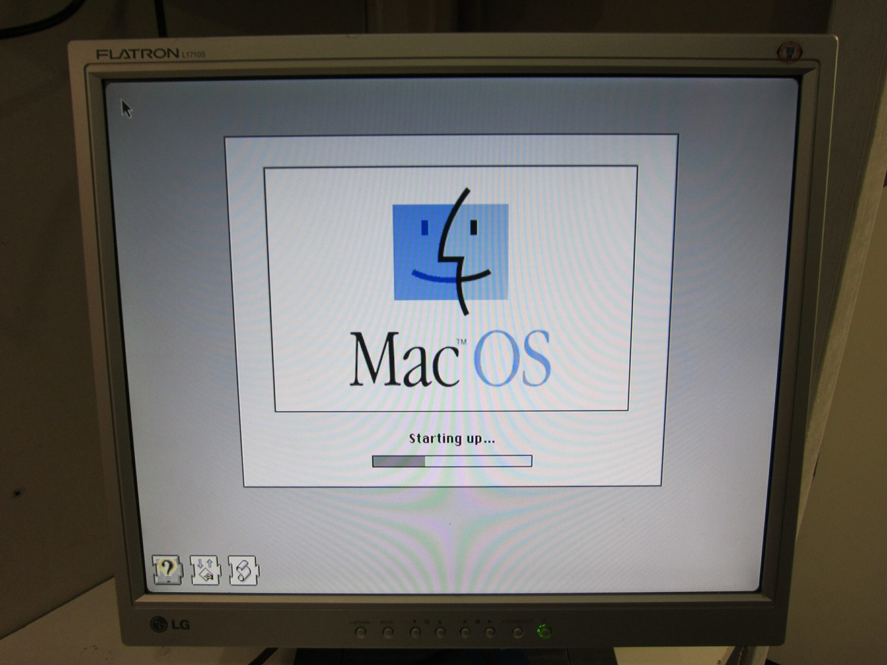
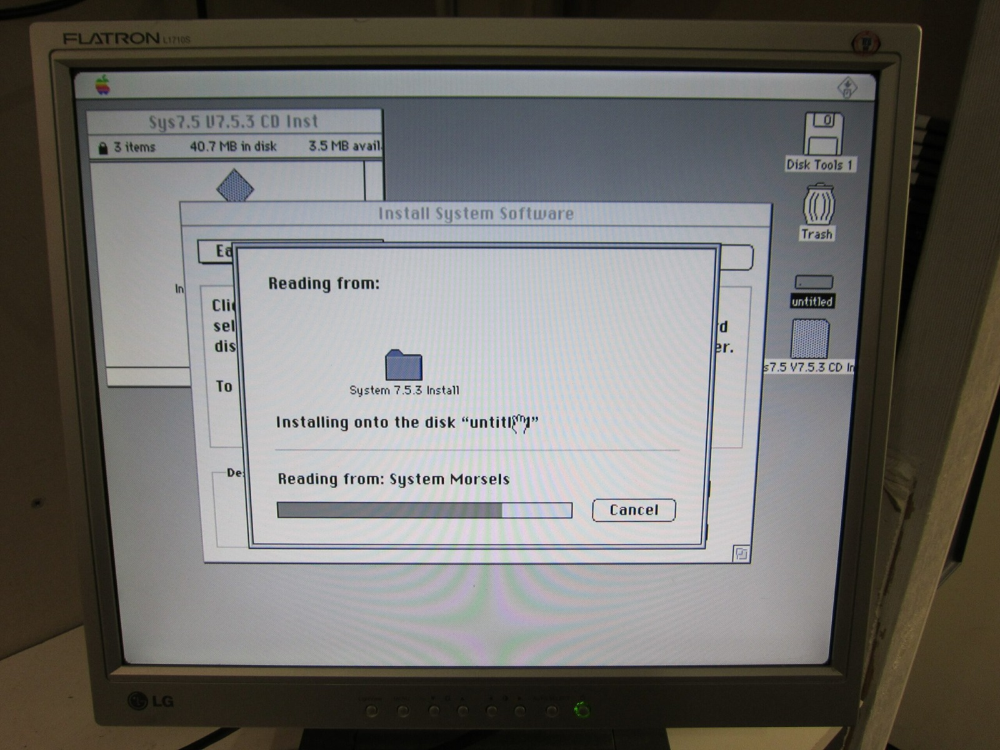
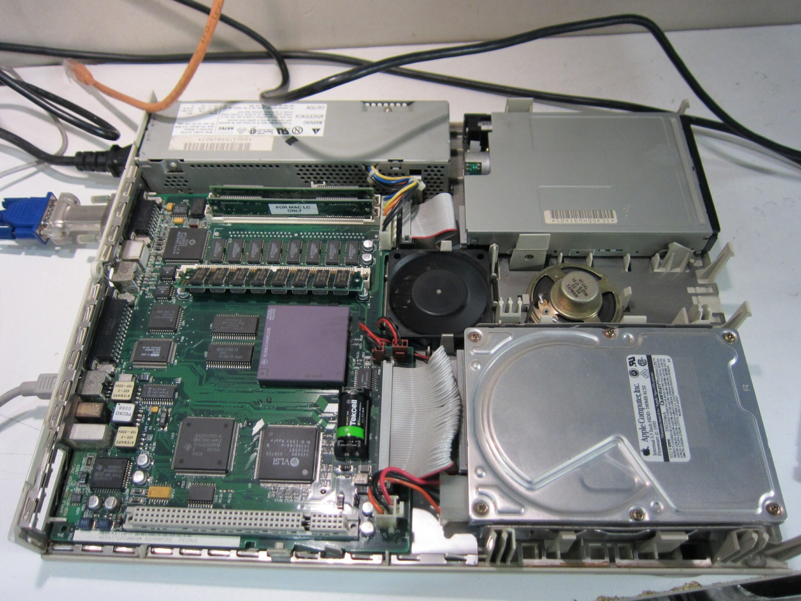
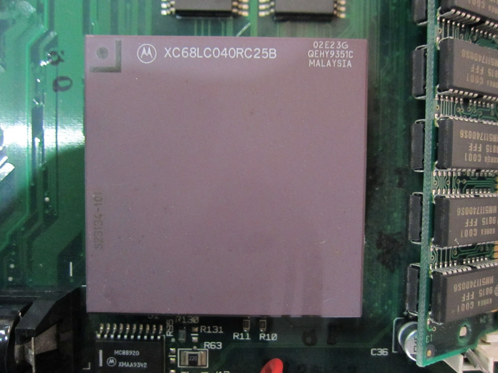

Finally got around to installing a clean system on the LC 475 I picked up a few weeks ago. I've recorded some video of the installation process. The hard drive sounds as though it is preparing to shatter into several thousand pieces, but for now it is still working.

The pizza-box design has always been a favourite of mine. Unfortunately, one of the lid clips is damaged on this machine. There's also rust underneath the power supply, and the clips that normally hold the PSU in place have snapped. Still, the machine itself is working well, which is the important part!

I loaded Maniac and Munchies, both great games on the 68K Macs. I've also added a small LC 475 album to the [photo gallery](/goodies/) if you want to see more of the machine.

Mmmm. No external L2 cache on this 68K... yay!

Apple shipped the LC 475 with a 25 MHz Motorola 68LC040, 8 KB of internal L1 cache and no external L2 cache. The LC version of the 68040 also lacks the full 68040's integrated floating-point unit. Mine is still stock CPU-wise at this point, but I've got a feeling there will be more experimenting with this little Macintosh.

### Sources

- [Apple: Macintosh LC 475 Technical Specifications (68LC040)](https://support.apple.com/en-la/112204)

### Related Posts

- [Apple Macintosh LC 475: System Setup Demo](/apple-macintosh-lc-475-system-setup-demo/)
- [Apple Macintosh LC 475: Overclocking to 33 MHz](/apple-macintosh-lc-475-overclocking-to-33-mhz/)
