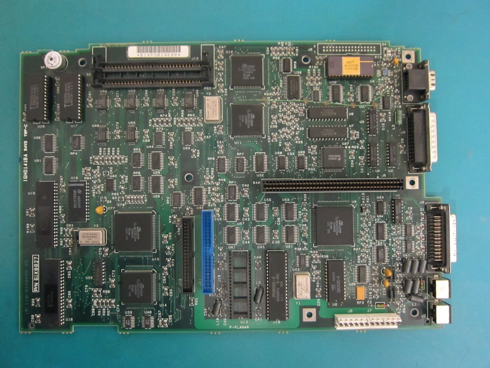
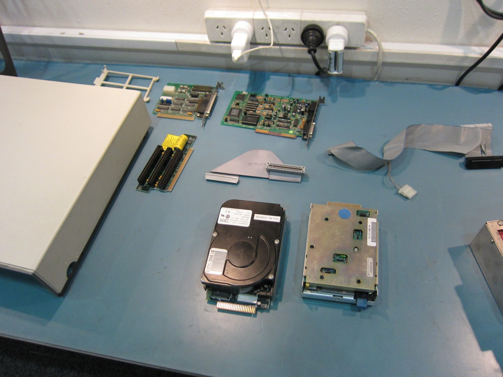
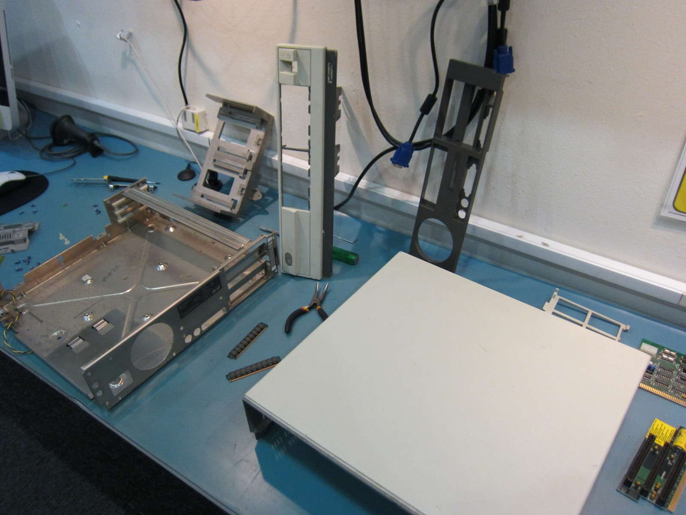
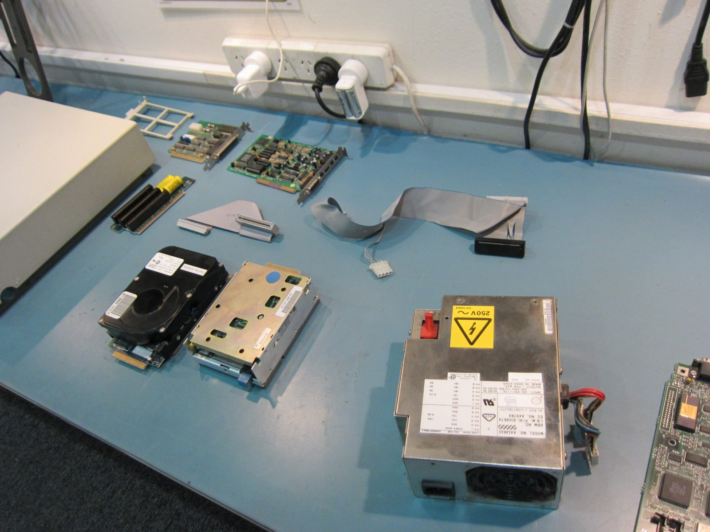
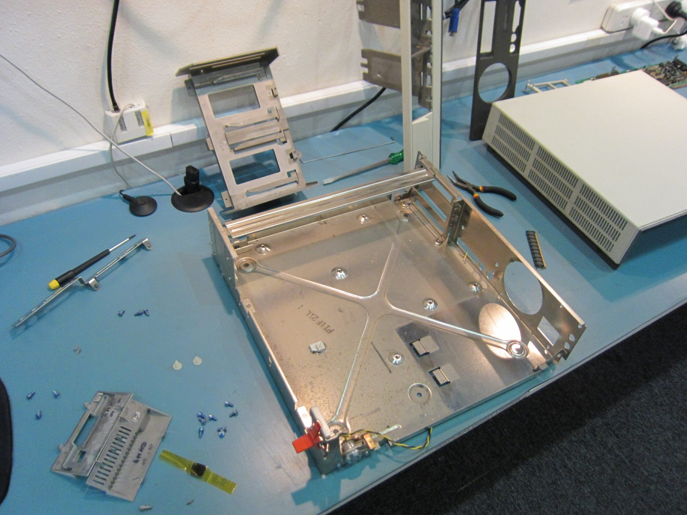
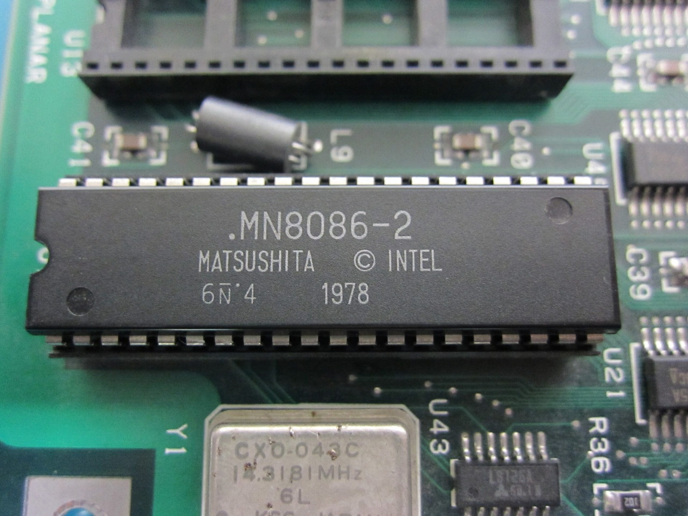



Forgot I uploaded this giant video... This IBM PS/2 Model 30 sure was a fun beast to disassemble and reassemble. Despite wearing the PS/2 badge, this original 8086-based Model 30 is a little unusual within the family because it uses an 8-bit ISA expansion bus rather than Micro Channel.

The video above is the complete disassembly and reassembly, so if you have an hour to spare you can watch the whole thing. Be sure to watch all sixty minutes! Ahhh... optional viewing, I guess. The photographs below show some of the more interesting parts of the machine without requiring quite that level of commitment.

I didn't have a camera stand for this one, so filming the disassembly was a bit of a juggling act. Taking the lid off was easy enough, though. It slid backwards and lifted away, provided I could find a spare hand to help. That would have been rather useful while holding the camera!

I started with the hard drive, which is around 20 MB or 21 MB and absolutely enormous for a 3.5-inch drive. I even found a more ordinary-sized drive to compare it against. After releasing the clips on the front and removing a plastic retaining pin, the whole thing slid out. Nearly into my face, but we're all good!

It has a rather peculiar 44-pin card-edge connector, with power carried through the same cable rather than a separate Molex plug. Unfortunately the hard drive itself is broken, and finding a suitable replacement isn't going to be easy. That's a problem for another day.

The 720 KB floppy drive was next, with 10 April 1987 printed on it. Naturally, the camera didn't want to focus on the date! A little piece of foam had also fallen out of the head assembly when I originally took the drive apart. It looks as though the glue has simply let go, so I'll have to stick that back in at some point. I've got a few other things to sort out first, though.

I also pulled out the Creative Sound Blaster CT1350B I'd added to the machine. When I bought it, several of the capacitors were dented, almost as though somebody had stepped on the card. I'd already ordered some replacements from Farnell and soldered them in, and the card worked! You could certainly tell where I'd been soldering, but I was very happy about that.

The Irwin tape-controller card was another interesting one, with two fuses, a collection of jumpers and some unusual connectors. While tracing the extra branch of the floppy-drive cable, it occurred to me that it might be supplying power to an external tape drive through the card. That would explain some of the strange connectors I'd seen on those drives. There we go, I'd actually worked something out!

After removing the ISA riser, I had a look at the old Panasonic lithium backup battery. I wondered whether it had anything left in it after all those years, so out came the meter. No way! It was still showing 3 V. I should probably remove or replace it anyway, but I wasn't expecting that!

Getting the power supply and motherboard out was less straightforward. The power supply was enormous, and the big red mechanical power switch looked as though it ought to launch nuclear missiles. There were also dust bunnies, dead bugs and far too many flat-blade screws. I still don't understand why anyone would use those things. They slip, you lose the screw, you lose a limb, you lose everything!

Eventually I removed the rear bracket and managed to slide the motherboard out of the case. It's a very large, rather tidy-looking board, IBM part number 61X8827. I spotted an unused 34-pin connector and a few chips I couldn't identify, so if anyone knows what they're for, feel free to leave a comment.

One part of the front panel had me convinced it simply wouldn't come off. I'd already said thanks for watching a few times by then, but of course I couldn't leave it alone. A little more investigation revealed how the plastic clips worked, and off it came! That's the problem with me. I never give up. At least I finally had an empty case to clean.

Once everything was apart, I put the machine back together and moved the Sound Blaster into the lower slot so I could see the other cards more easily. With no bootable disk, the computer dropped into BASIC. It looked pretty basic. Pun! I'm not much of a programmer, so that was about as much use as I could make of it.

Getting DOS 3.3 to boot was another matter. I kept getting disk boot failures and wondered whether the floppy drive or one of the cards was playing up. It turned out that the broken hard drive was interfering with the boot process. Once I disconnected it from the motherboard, I could boot from floppy again. I really do need to find a replacement hard drive!

With the machine back in one piece, I gave the Sound Blaster a workout with Prince of Persia and had a go at Monkey Island. Monkey Island ran, although all those animations could make the poor 8086 struggle a little. By this point I'd said thanks for watching more times than I could count and even promised that one cut would be the last. Famous last words! The machine was back together and working from floppy, and I'd learnt a few things along the way. Now I just need a camera that knows how to focus.

### Sources

- [IBM Files: PS/2 Models 25 and 30 (8-bit ISA)](https://www.ibmfiles.com/pages/ps2model25.htm)

### Related Posts

- [IBM PS/2 Model 30 8086: External Overview](/the-ibm-ps2-model-30-8086-external-overview/)
