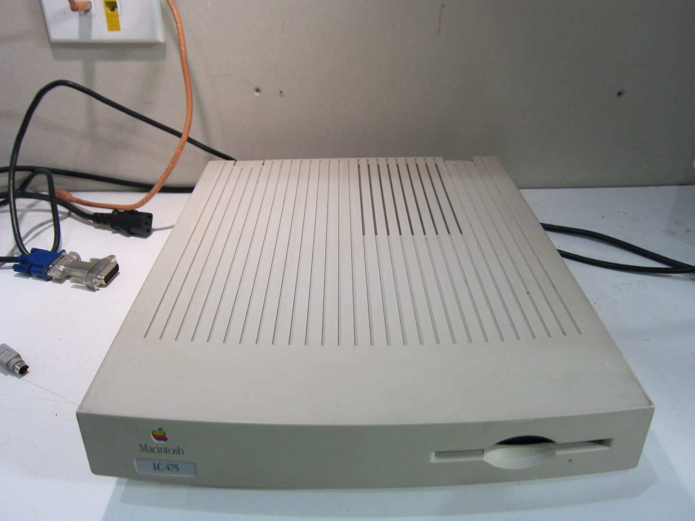

I found out that this LC 475 was still running in 24-bit addressing mode. That explains the rather ridiculous memory display! In that mode, System 7 can only make 8 MB of physical RAM available for normal use. Anything installed above that gets accounted for as though it belongs to the System heap, even though applications can't actually use it.

With 36 MB installed, it looked as though System 7 had developed an absolutely enormous appetite for RAM. I turned on 32-bit addressing in the Memory control panel, restarted, and suddenly all that extra memory became usable normally. The reported System footprint dropped back to around 2 MB. I knew System 7 wasn't **THAT** hungry for RAM! Thanks to [MicroMac](https://www.micromac.com/FAQ/faq_lc475_upgrade.html) for pointing me in the right direction.

In other news, my copy of Geist Force for the Dreamcast arrived today. Thanks to the [ASSEMblergames.com](https://web.archive.org/web/20170919030325/https://www.assemblergames.com/) community and everyone who helped make that prototype release happen. Here's to many more preserved releases in the future!

### Sources

- [Apple: Macintosh LC 475 Specifications (24/32-bit, 36 MB)](https://support.apple.com/en-ca/112204)
- [MicroMac: LC475 Logic Board Upgrade FAQ (32-bit Addressing)](https://www.micromac.com/FAQ/faq_lc475_upgrade.html)

### Related Posts

- [The Apple Macintosh LC 475](/the-apple-macintosh-lc-475/)
- [Geist Force Prototype Reproduction for Sega Dreamcast](/geist-force-prototype-reproduction-for-sega-dreamcast/)
