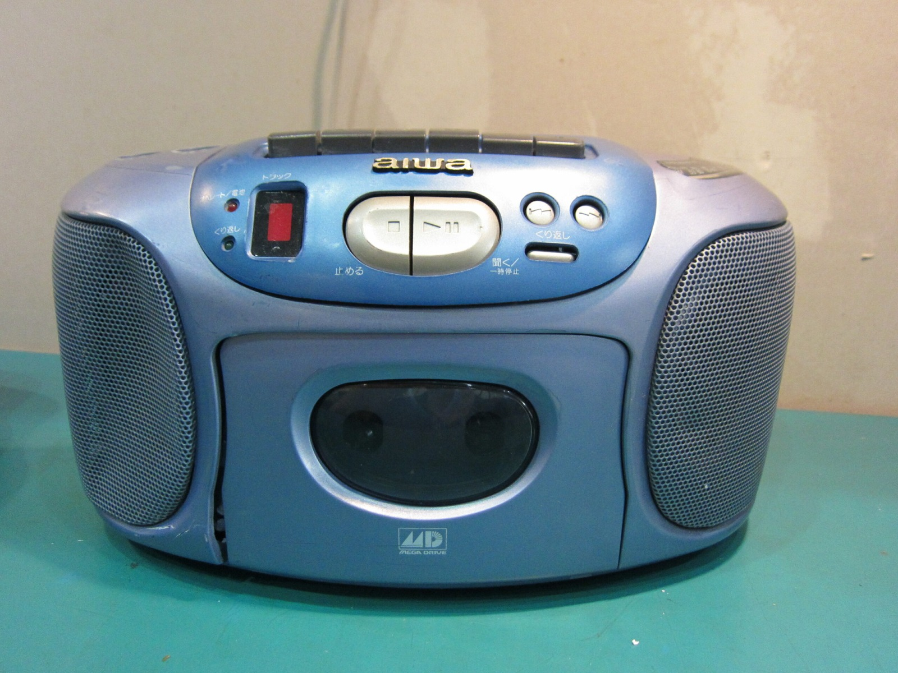

### Aiwa Mega-CD CSD-GM1

I picked up two Aiwa CSD-GM1 units for quite a pretty penny. I don't mind though. Restoration and preservation of all things old is the goal.

The machine pictured above is the worse of the two. It had no power at all, so naturally I pulled it apart. The damage inside is fairly spectacular. There are two large cracks through one PCB, and several other boards also appear to have suffered damage.

No biggie, right?

The first job is simply finding out whether I can make the thing power on again.

The other CSD-GM1 is considerably more functional, but it has horizontal video flicker and awful sound from the Aiwa itself. Audio through the AV connection is also very quiet. Those symptoms reminded me of the capacitor problems I'd already encountered in Game Gears, so capacitors seemed like an obvious avenue to investigate, although they were only a suspect at this stage.

### Mega Drive 32X video problems



I was also still chasing the strange 32X flickering problem on my Model 1 Mega Drives. Doom was a particularly good demonstration of what was going wrong. The menu stayed perfectly steady, but once the game started, the graphics shifted backwards and forwards across the screen. Occasionally the colour even dropped out on the CRT, and the whole thing got worse after the hardware had been running for a while.

I wondered whether this was another capacitor problem, or perhaps something related to a particular production range. I even had a few ideas about the video hardware, although I wasn't exactly certain whether I should be blaming a VDP or VDU. Whatever it wanted to call itself, how was I supposed to shoot anything with the screen jumping around like that? I was even starting to miss the terrible Doom music!

Testing several completely different 32X units against the same affected Mega Drive was the important clue. The common factor was increasingly looking like the host console rather than the 32X itself.

**Update 6th February 2018:** I later learned that Sega had already documented this problem on PAL and Asian Model 1 VA4 boards in its 1994 and 1995 service bulletins. Poor EDCLK and VCLK signal quality in the Mega Drive itself can cause 32X-generated video to jitter and the system to lock up as it warms. Sega's repair modifies the Mega Drive motherboard rather than the 32X. That fits my symptoms much better than the capacitor theory I was exploring here.

I've also started a thread on the [ASSEMbler Games forum](https://web.archive.org/web/20121127045759/http://www.assemblergames.com/forums/showthread.php?41947-Sega-Mega-32X-Video-Flickering-Distortion) for anyone interested in the investigation.

### Related posts

- [Aiwa Sega Mega-CD CSD-GM1 Initial Damage Report](/aiwa-sega-mega-cd-csd-gm1-initial-damage-report/)
- [Sega Mega Drive 32X Jittery Video: Initial Investigation](/sega-mega-drive-32x-jittery-video-initial-investigation/)

### Sources

- [ConsoleMods - 32X Service Bulletin Fixes](https://consolemods.org/wiki/Genesis:32X_Service_Bulletin_Fixes) - summarises Sega service bulletins for PAL and Asian VA4 Mega Drive clock-signal instability when used with 32X hardware.
- [Sega - Service Bulletin 008: Mega Drive 1 VA4 PAL, 13th December 1994](https://drive.google.com/file/d/1gUPVeXch-TWNjwld4bYFWFZG23_RJ9Be/view) - documents the EDCLK modification for screen shake, slowing sound and lockups as the hardware warms.
- [Sega - Service Bulletin 012: MD 32X / MD 1 (VA4), 28th March 1995](https://drive.google.com/file/d/1sOElKt5W6S89mjgpqdoGD3c4R3beXH_q/view) - documents the VCLK modification on the Mega Drive motherboard.
