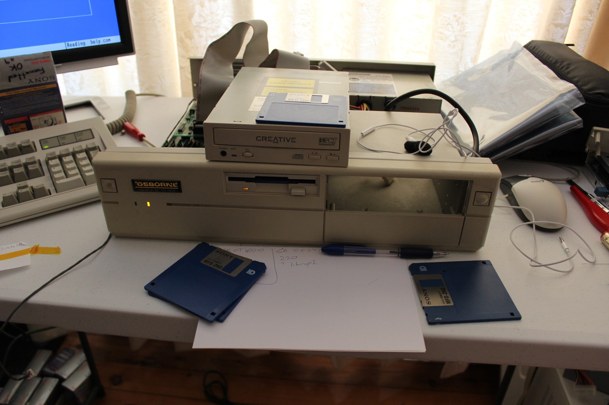
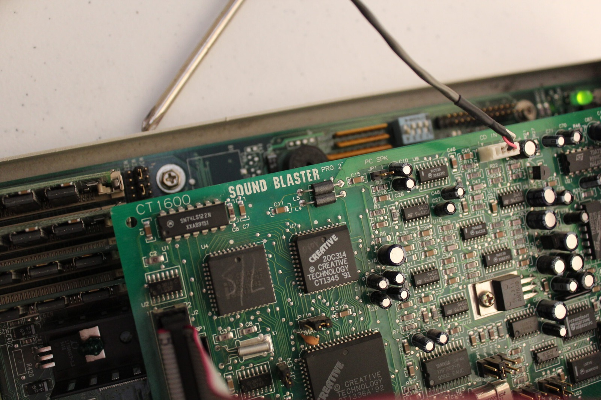
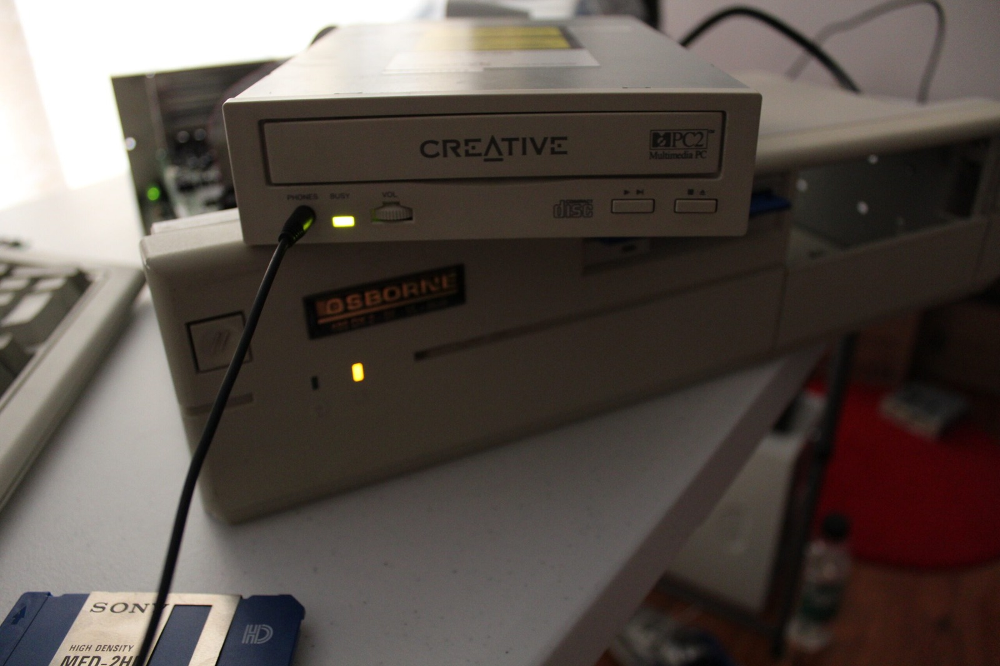



So little information seems to exist about this particular Creative Labs CD-200 that I figured I'd better document the struggle. At this point I had a desktop absolutely covered in driver files and still hadn't found the magic combination. The first video shows where the investigation had reached.

This machine holds a bit of nostalgia for me, since it's the same sort of computer I used when I was a child. I've been trying to get its double-speed CD-ROM drive working properly, and it's been causing me all sorts of trouble. You know that feeling when you're so close to getting something going but can't quite work out what you've missed? That's where I've been for the last day!

*The Creative CD-200 sitting on the Osborne while I work through yet another pile of driver files. So close, yet so far!*
{: .media-caption }

The CD-200 is a two-speed drive that uses a proprietary Panasonic-style interface rather than the ordinary IDE connection found on later CD-ROM drives. The annoying part is that it uses a 40-pin cable, so at a glance it looks rather similar to an IDE arrangement. I've got several sound cards on hand, including a few with the Creative/Panasonic CD-ROM interface, but persuading everything to communicate is another matter.

*A look at the Sound Blaster Pro 2 and its connectors. Finding the right driver for the CD-200 was still the hard part.*
{: .media-caption }

Interestingly, the drive could still play ordinary audio CDs. I had a Taiyo Yuden disc in there and it was happily playing music through the sound card, complete with the usual distractions while I tried to demonstrate what was happening. That tells me the audio playback side is doing something useful, although it doesn't establish that the computer can communicate with the CD-ROM controller.

I've tried a whole collection of drivers, with varying degrees of disappointment. One Panasonic driver got far enough to start looking for the drive, and I even saw the activity light respond briefly. Unfortunately, it eventually reported a communication problem and refused to go any further. So close!

*At least the CD-200's activity light is doing something! That doesn't mean DOS is actually talking to it yet.*
{: .media-caption }

One possibility I was wondering about was whether somebody had connected the drive to an IDE interface in the past and damaged its electronics. That's only a theory at this stage, though. It could still be a driver, sound-card interface or configuration problem, and I'd rather not condemn an otherwise lovely old drive without finding out.



And the search continues... The second recording follows the same ongoing investigation, with the computer still refusing to cooperate. I've tried enough different combinations to make a respectable mess of the workbench, but haven't yet found the one that gets this drive reading data properly.

Once I get this beast working, let's have a BBQ party. It will be a lovely day!

**Sources**

- [Creative: CRCCD/CCD Driver README (DriverZone Mirror; MSCDEX)](https://driverzone.com/drivers/creative/cdrom/crccd.htm)

**Related Posts**

- [Creative Labs CD-200 2x CD-ROM Driver Success](/creative-labs-cd-200-2x-cd-rom-driver-success/)
