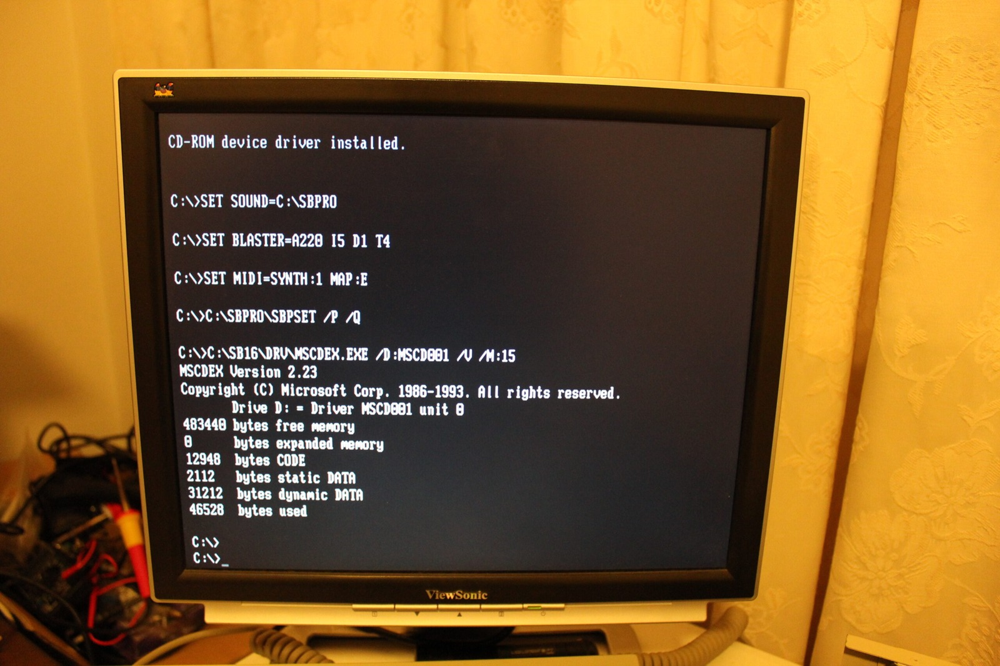
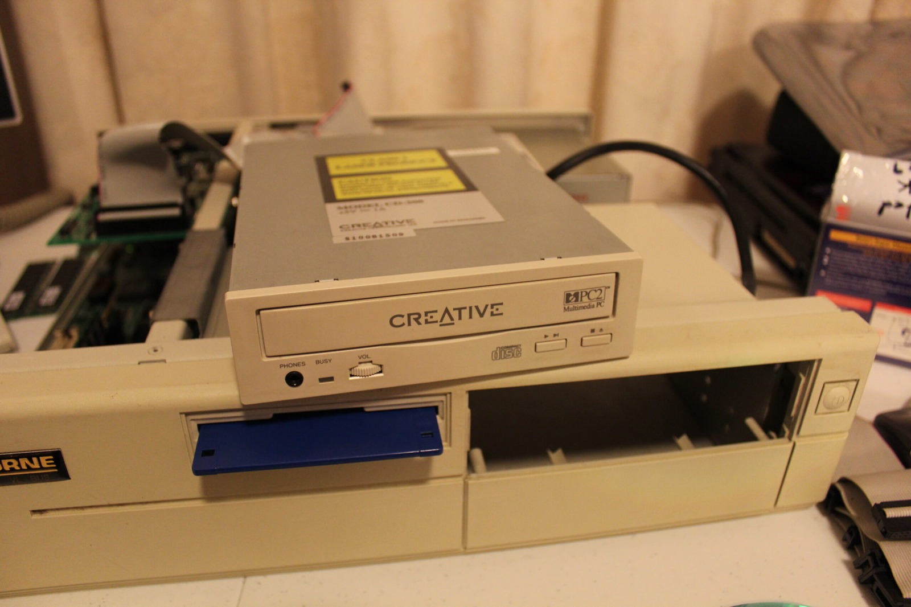
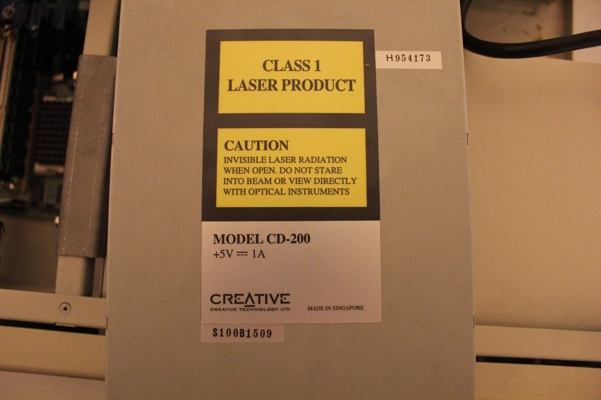
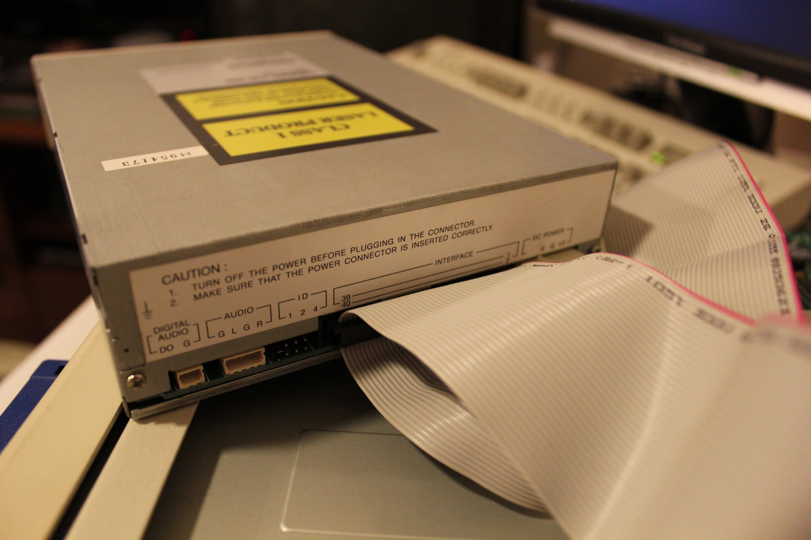
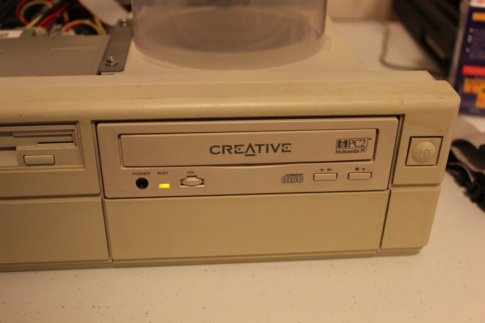



We did it! After a couple of days of messing around with drivers, I've finally managed to get my Creative Labs CD-200 double-speed CD-ROM drive working under DOS. Something that ought to have been relatively straightforward turned into a surprisingly stubborn little project, mostly because finding useful information about this particular drive was a nightmare.

The breakthrough came while I was downloading and trying assorted Creative drivers. I happened to notice a reference to the CD-200 in one of the packages and thought that was a rather promising coincidence. Sure enough, `CCD.SYS` turned out to be the driver that worked in my setup. Once that loads, MSCDEX gives DOS a drive letter and we can finally start accessing discs.

There was another trick hiding on the back of the drive. I'd fitted a jumper on one of the identifier positions, and MSCDEX kept freezing during startup. Removing that jumper got me past the problem, although I wouldn't assume the same configuration is right for every controller and drive combination. These are the settings that worked with my particular Sound Blaster and CD-200.

```
CONFIG.SYS
DEVICE=C:\SBPRO\DRV\CTSBPRO.SYS /UNIT=0 /BLASTER=A:220 I:5 D:1
DEVICE=C:\SBPRO\DRV\CTMMSYS.SYS
DEVICE=C:\CCD.SYS /D:MSCD001 /P:220 /S:D

AUTOEXEC.BAT
SET SOUND=C:\SBPRO
SET BLASTER=A220 I5 D1 T4
SET MIDI=SYNTH:1 MAP:E
C:\SBPRO\SBPSET /P /Q
C:\SB16\DRV\MSCDEX.EXE /D:MSCD001 /V /M:15
```

With that configuration loaded, DOS recognised the CD-ROM and I could finally get at the disc. I was almost expecting another problem to appear when I tried it for the first time, but no, it actually worked! After staring at a desktop full of random drivers and wondering what I'd missed, that's a pretty satisfying result.



*Success! MSCDEX has finally assigned drive D: to the Creative CD-ROM. After all that driver hunting, what a relief!*
{: .media-caption }



*The CD-200 back on the Osborne while I finish sorting the boot disks and drivers. I'm finally getting somewhere!*
{: .media-caption }



*The CD-200's own label, complete with its model number and laser warnings. At least we know exactly which drive we're dealing with!*
{: .media-caption }



*The connectors that caused so much head-scratching. That 40-pin ribbon cable looks deceptively familiar, but this isn't ordinary IDE.*
{: .media-caption }



*And now the CD-200 is actually in the Osborne's front bay. After all that trouble, it looks right at home!*
{: .media-caption }

Thanks to everyone who helped me track this one down. A functioning double-speed Creative CD-ROM drive is now sitting in the Osborne, and I think that earns us a BBQ party!

### Resources

- [VOGONS Vintage Driver Library](https://www.vogonsdrivers.com)
- [French Driver Website](https://web.archive.org/web/20100311235635/http://www.autourdupc.com:80/index.php?sPage=/Materiel/CDROM/CDROM_IDE.htm)
- [VirtualDr - Creative Labs 2X CD](https://discussions.virtualdr.com/showthread.php?69838-Creative-Labs-2X-CD&s=becdc9d2b2ab5d5832c8dc2c373a1be6)
- [Vintage Computer Federation - Sound Blaster IDE Cards Drivers Collection](https://forum.vcfed.org/index.php?threads/sound-blaster-ide-cards-drivers-collection.24571/)
- [Metropoli BBS - Creative Labs driver directory](https://files.mpoli.fi/hardware/SOUND/CLABS/)

### Sources

- [Creative: CD-ROM Driver README.TXT (CCD.SYS/CRCCD.SYS and MSCDEX)](https://driverzone.com/drivers/creative/cdrom/crccd.htm)

### Related Posts

- [Creative Labs CD-200 2x CD-ROM Driver Hunt](/creative-labs-cd-200-2x-cd-rom-driver-hunt/)
