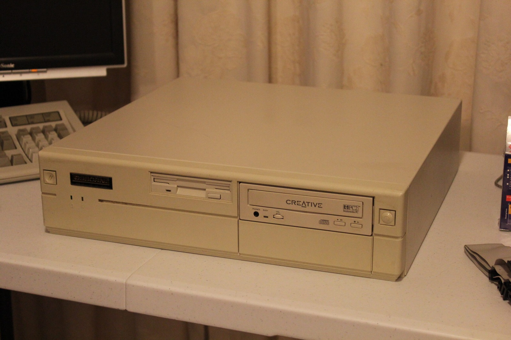
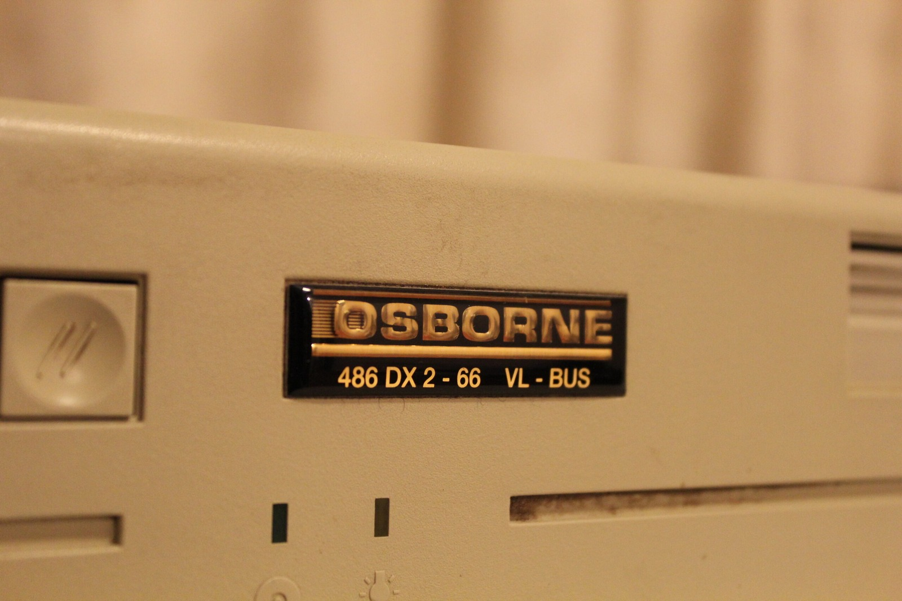
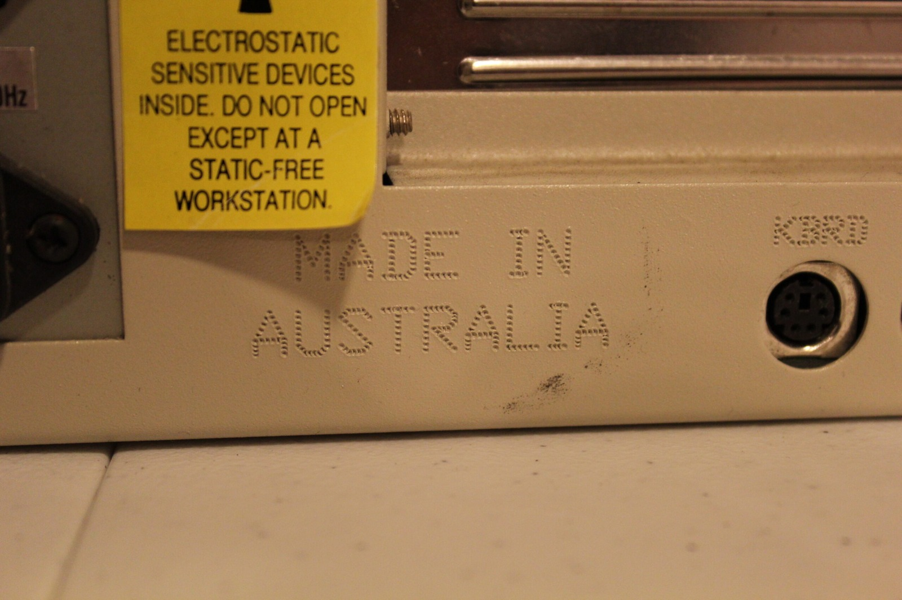
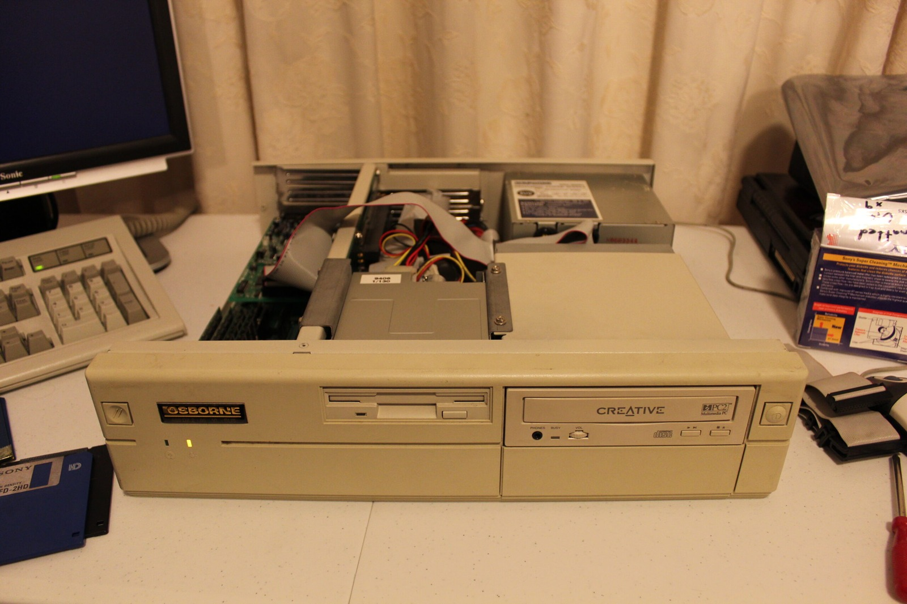
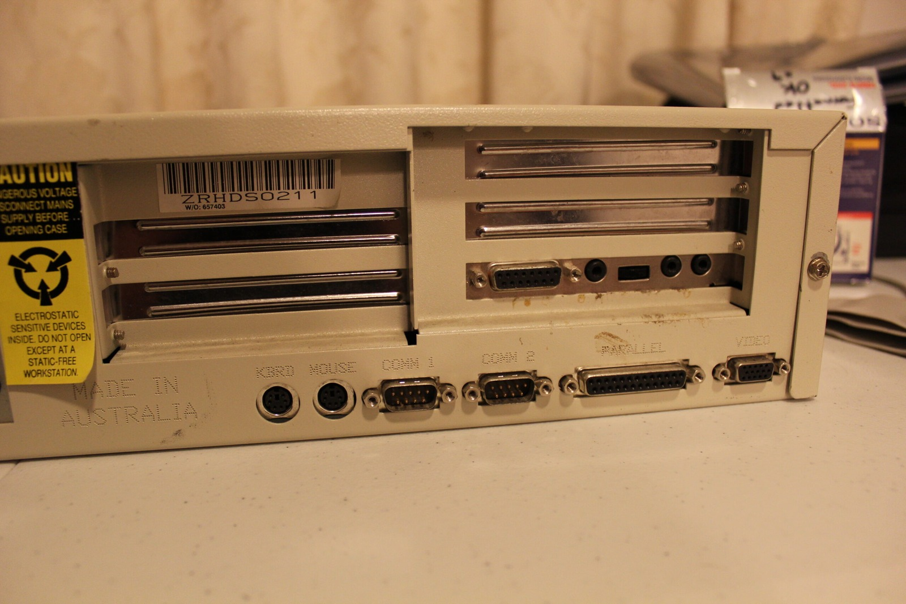
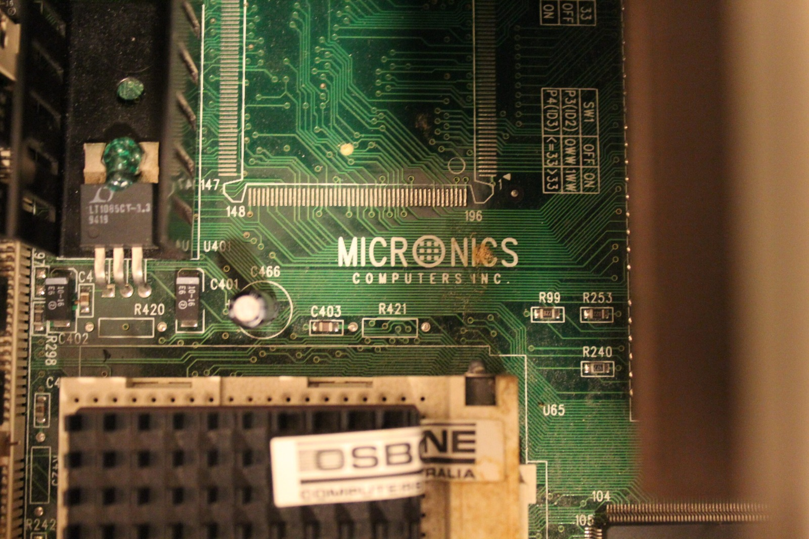



This is what it was all about. With the Creative CD-ROM finally working, I've now got a functional Osborne Australia 486DX2-66 in the household. This one is particularly special because it's the sort of computer I had as a child, and I've been trying to put together a setup that brings back some of those memories.

The Amstrad Mega PC doesn't count, of course. That's more of a 386SX on steroids, or in my highly scientific terminology, a crippled 486. Take your pick! This Osborne, on the other hand, is exactly the sort of big beige computer I remember.

*So very boxy. Just the way I remember a proper early-'90s Osborne computer!*
{: .media-caption }

So very... boxy. Just the way a proper beige PC should look! There's something rather comforting about a computer that makes absolutely no attempt to be sleek or fashionable. It's a big metal box, and I wouldn't have it any other way.

*Now that's how you make a logo sticker! An Osborne 486 DX2-66, and it looks every bit as beige as I remember.*
{: .media-caption }

Now that's how you make a logo sticker! I rather like the old Osborne branding, especially when it's attached to a machine built here in Australia. It's funny how something as simple as a badge can bring back memories of the computers I grew up with.

*Made in Australia! I love finding these little reminders that some of our computers were built locally.*
{: .media-caption }

Made in Australia. Those were the days! There's something nostalgic about seeing that on a big old computer, particularly one that's managed to survive this long. It's certainly got a bit more character than some of the machines I've been playing with recently.

*With the lid off, the Osborne is quite a sight. Plenty of room for all this lovely 486-era hardware!*
{: .media-caption }

Even with the guts out in the open, it still looks great. This machine has 64 MB of RAM, a 1.44 MB floppy drive and a Conner hard drive whose exact capacity I can't quite remember. The video suggests it's somewhere around the 300 MB mark, but I'll need to check the actual drive before I can be certain.

The Creative CD-200 is connected through a Sound Blaster Pro 2, which I particularly like because of the volume control on the back. It's a good little sound card, and seems quite appropriate for a machine like this.

The 486DX2-66 runs its processor core at 66 MHz while the external bus operates at 33 MHz. It also has the floating-point unit and 8 KB of on-chip cache you'd expect from the DX2 family. A proper early-'90s 486, complete with its little heatsink and warranty seal still attached.

*Try and fill all those sockets! The Osborne certainly isn't short of ways to connect things.*
{: .media-caption }

Try and fill all those ports! Onboard video and two serial ports, with plenty of room for the various bits and pieces I'd like to connect. These older computers certainly weren't shy about giving you a collection of sockets to play with.

*Ohhh, Micronics. There's something very satisfying about a neatly labelled old PC motherboard.*
{: .media-caption }

Ohhh Micronics. Now that's a trustworthy-looking brand name. I've always liked the look of these older boards, especially when everything is laid out where you can actually see what's going on.

I had to source the Creative CD-ROM drive separately, and that turned into its own little adventure. One thing I remembered very clearly from childhood was the activity light on the drive being orange. I was absolutely certain about it, but when I first powered this one up, the light wasn't the colour I expected.

It turns out the indicator changes colour depending on whether the drive is accessing data or playing audio. Mystery solved! No wonder I remembered it being orange, because back then I was far more interested in computer games than listening to music. I didn't really get into music until I was a teenager, so the other colour probably never registered.

I'm not entirely sure what I'll do with the Osborne next, but I definitely intend to hang onto it. It's lovely having something so familiar working again, even if I've had to spend a ridiculous amount of time tracking down a CD-ROM driver.

Uh ohhh... another trip down memory lane. Sure is crowded in here! ;)

### Sources

- [Intel: Microprocessor Quick Reference Guide (486 Family)](https://www.intel.com/pressroom/kits/quickreffam.htm)
- [Intel: 486DX2 Datasheet (February 1992; Core/Bus Clocking)](https://www.dosdays.co.uk/media/intel/486DX2_Data_Sheet_Feb92.pdf)

### Related Posts

- [Osborne 486 Windows 95 Installation Demo](/osborne-486-windows-95-installation-demo/)
