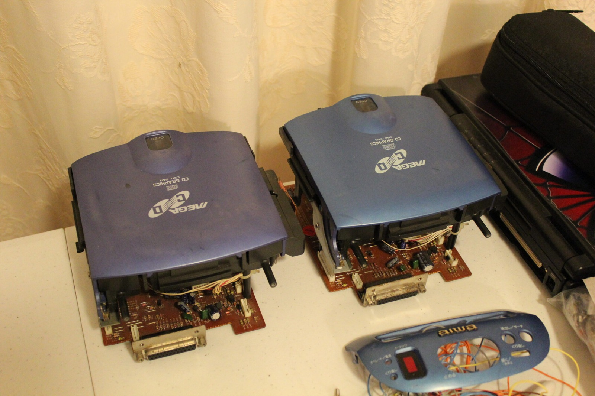
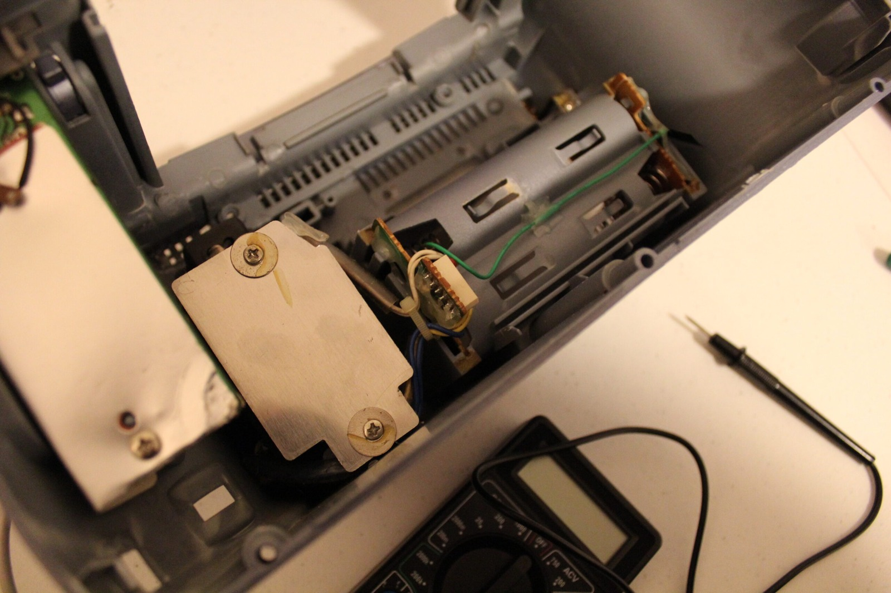
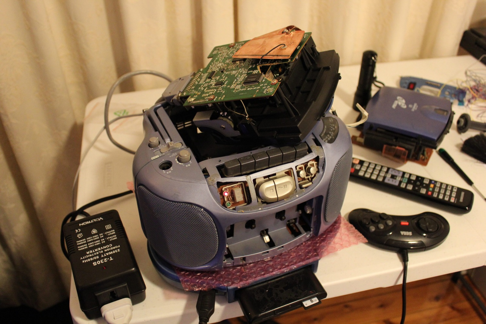
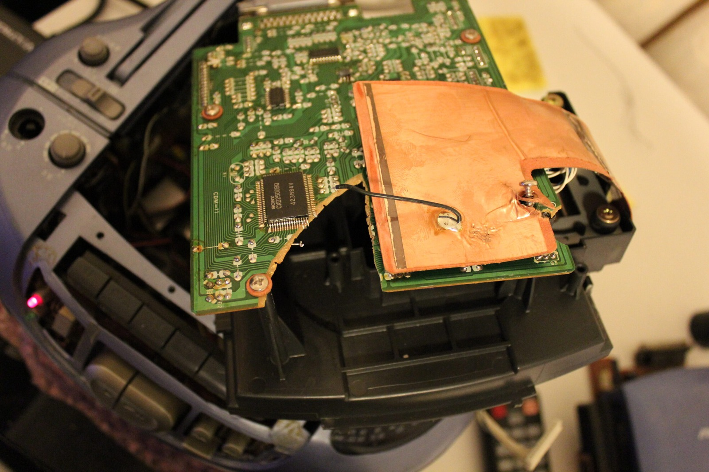
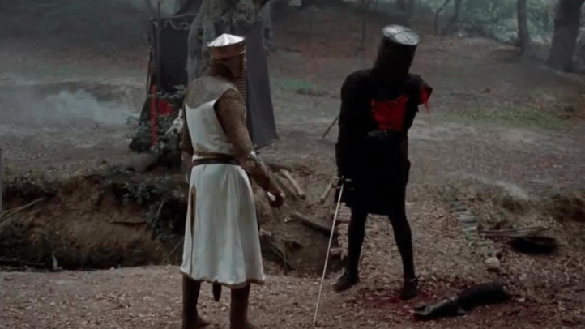





More progress with the Aiwa Mega-CD CSD-GM1! Although I'm beginning to think these machines are having a competition to see which one can give me the most trouble. I've managed to repair enough of the damaged mainboard to restore power, which is a fairly substantial improvement over the completely dead machine I started with. Unfortunately, getting proper sound from the speakers or headphone socket is proving to be another matter entirely.

I borrowed the Mega-CD mechanism from my other CSD-GM1 to see whether the repaired machine could actually power the game hardware. Much to my surprise, the Mega Drive section came to life! Even more interestingly, the picture looked better than the one produced by my other unit. I don't know exactly what's wrong with either machine yet, but at least the repaired mainboard is doing something useful again.

The radio and cassette sections still need some attention. The machine responds to some of the controls, and even recognises when I press play while it's switched off, but the sound circuitry isn't behaving properly. I'm not sure whether I've missed something during the repairs or whether there's another failed component hiding somewhere on the board.

The transformer is also causing me grief. I've been getting rather different voltage readings between the two units, so I'll need to work out exactly what's going where before I start connecting anything else. I certainly don't fancy repairing a whole new collection of damaged components!

In the second video, I decided I didn't have much left to lose and connected the Mega Drive hardware through the damaged Mega-CD board. This is the board with an enormous chunk missing from its PCB, so I wasn't expecting miracles. Amazingly, it worked well enough to run *Mega Turrican*! That's a rather nice result, considering what the board looked like when I first got my hands on it.

Only the connection needed for the game section was attached during that experiment. I haven't magically repaired the whole Mega-CD mechanism, and the CD side is still going to need plenty of work. But it does suggest there's hope for getting Mega Drive cartridges running even if I can't completely restore the damaged CD board.

Naturally, while one Aiwa is beginning to recover, the other CSD-GM1 has decided to stop powering on altogether. Yes, the one that was supposed to be working! How ironic is that? I'm starting to suspect its transformer arrangement, although I'll need to measure the supply rails properly before deciding what needs replacing.

One possibility is to experiment with power through the C-cell battery connection, or perhaps use a DC-DC supply arrangement. I'll need to establish the required voltages first, because the battery connection doesn't necessarily replace every output supplied by the original transformer. Still, it might give me another way of testing the machine without relying entirely on the troublesome power supply.

More details as they happen can be found over at the [ASSEMbler Games forums](https://web.archive.org/web/20130920141927/http://www.assemblergames.com/forums/showthread.php?42186-Aiwa-Mega-CD-CSD-GM1-Mainboard-Repair).

There are some definite cosmetic differences between the two units as well. I've been comparing them quite closely while trying to work out which parts can be borrowed from one machine to test the other.

The transformer sits behind that metal plate, and it's becoming one of the more interesting parts of this investigation. Not necessarily interesting in a good way, mind you!

Tis but a scratch... or maybe it's just a flesh wound! :D There's still an awful lot of damage to sort out, but at least the Mega Drive section has given me a reason to keep going.

Next on the list is working out the power supply arrangement and finding out why the audio circuitry is being so uncooperative. If I can manage that without another machine deciding to die in the meantime, I'll be quite happy!

### Related posts

- [Aiwa Sega Mega-CD CSD-GM1 Initial Damage Report](/aiwa-sega-mega-cd-csd-gm1-initial-damage-report/)
- [Aiwa Sega Mega-CD CSD-GM1 Repairs Part 1: Power Restored](/aiwa-sega-mega-cd-csd-gm1-repairs-part-1-power-restored/)
- [Aiwa Mega-CD CSD-GM1 Repairs Part 2: Power Rail Testing](/aiwa-mega-cd-csd-gm1-repairs-part-2-power-rail-testing/)
