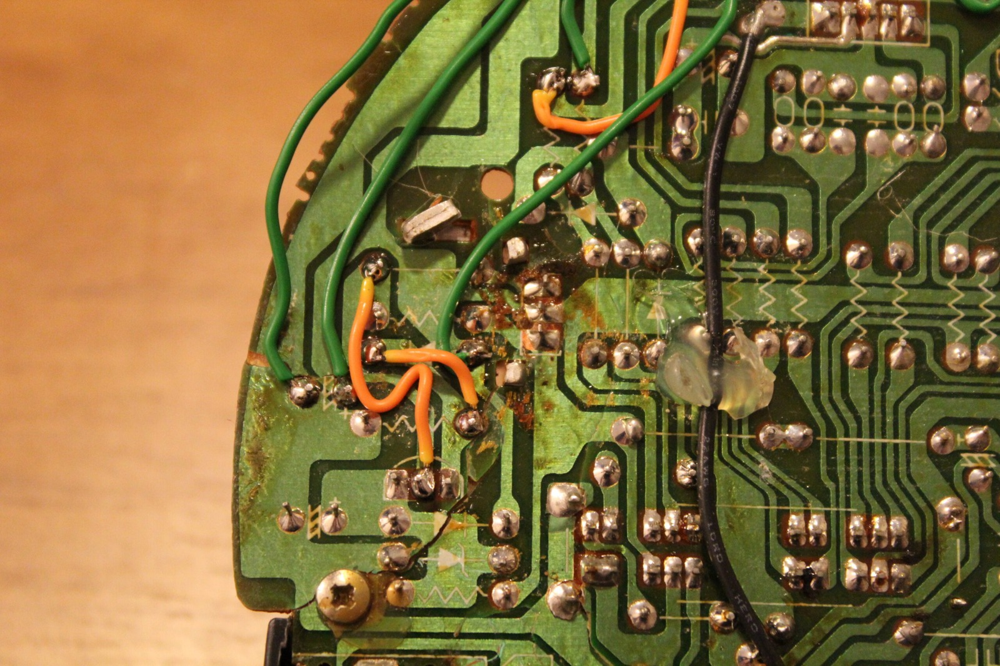
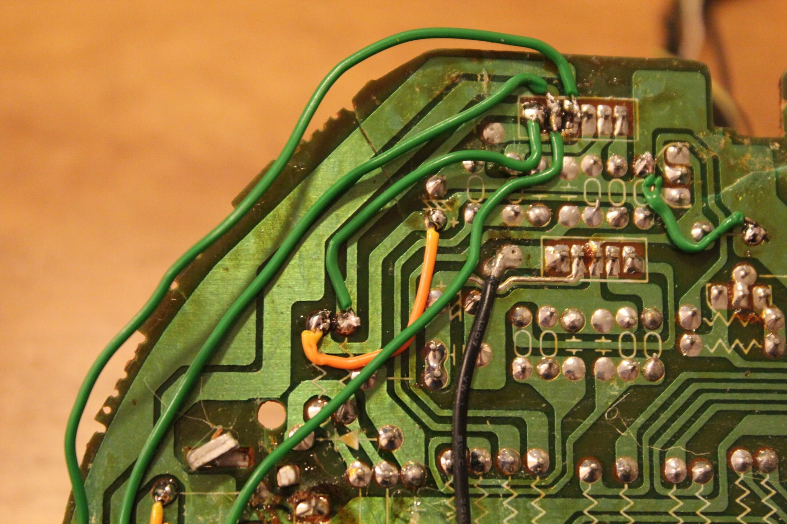
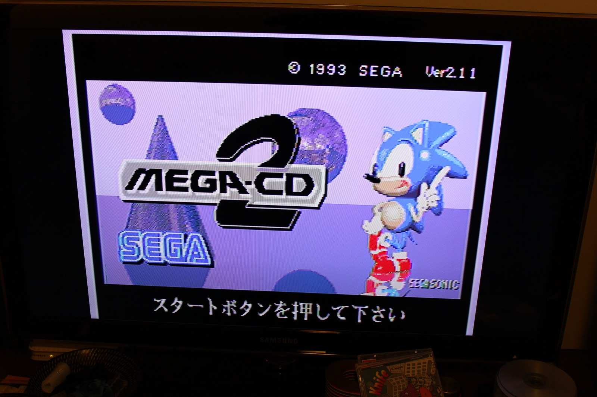
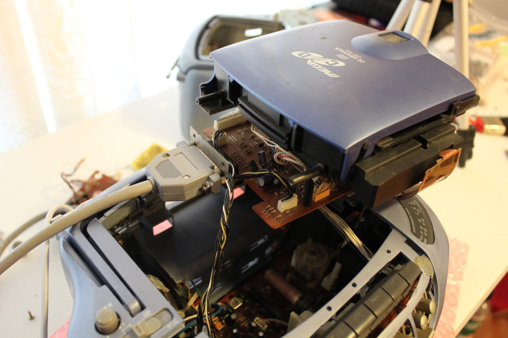



Progress was her middle name. Success was her first. Not too sure what her last name was at this point. Still unwritten perhaps! As you can see from the video, repairs on the Aiwa Mega-CD CSD-GM1 are progressing in the usual fashion. I fix one problem, and another three appear to take its place.

The biggest success so far is getting power back into the damaged machine. I've been repairing the broken tracks on the mainboard with wires and solder, and things are finally starting to come together. It's a considerable improvement over having a completely dead Aiwa sitting on the workbench.

To test the game hardware, I borrowed the Mega-CD mechanism from my other CSD-GM1. That board doesn't have a massive chunk missing from it, unlike the one I've been attempting to repair! With the good mechanism connected, the damaged machine reached the Sega Mega-CD startup screen and could run Mega Drive cartridges. That's a very encouraging result, considering how much damage there was to begin with.

One interesting discovery is that the video quality actually looks better than the picture coming from the other, supposedly working machine. I'm not quite sure what that tells me yet, but it does make me wonder whether something on the other mainboard is beginning to fail. At least the repairs on this one appear to be doing their job.

The little front indicator is lighting up too. It's red, by the way, not pink! Don't let the camera fool you. Unfortunately, I still can't get proper sound through the speakers or headphone socket, so the audio circuitry is another mystery waiting to be solved.

The original CD mechanism is going to be another adventure entirely. I suspect the KSS-210B optical pickup may be faulty and I've already ordered a replacement, although I haven't proved that's the only problem. There's also a triangular piece of PCB physically broken off the CD board, which I managed to find underneath the mainboard when I dismantled the machine.

Now I just need to reconnect all those broken tracks, including the ones running towards the tiny pins on the damaged chip. Simple! Well, perhaps not quite as simple as I'd like, but at least I've got the missing piece and something to work with.

Power is still the bigger mystery. I've been comparing the regulator outputs between my two CSD-GM1 units and finding differences of as much as 14 V at some of the points I've measured. That's not something I want to start connecting blindly, especially when I've only just managed to revive the damaged mainboard.

I'll need to map those power rails properly before going much further. I certainly don't want to fry any microchips after all this work! Still, the Mega Drive section has power, the picture is working, and even the damaged board is beginning to show signs of life. That's progress as far as I'm concerned.

### Related Posts

- [Aiwa Sega Mega-CD CSD-GM1 Initial Damage Report](/aiwa-sega-mega-cd-csd-gm1-initial-damage-report/)
- [Aiwa Sega Mega-CD CSD-GM1 Repairs Intermission](/aiwa-sega-mega-cd-csd-gm1-repairs-intermission/)
- [Aiwa Mega-CD CSD-GM1 Repairs Part 2: Power Rail Testing](/aiwa-mega-cd-csd-gm1-repairs-part-2-power-rail-testing/)
- [Aiwa Sega Mega-CD CSD-GM1 KSS-210B Laser Replacement](/aiwa-sega-mega-cd-csd-gm1-kss-210b-laser-replacement/)
