

The video above isn't actually the one I originally intended to upload. YouTube messed up the upload, and while trying to recover it, I accidentally deleted the original. Gone! Never mind, enjoy some transformer rantings instead. At least I've got something to show for the weekend.

I've pulled the transformer out of the Aiwa Mega-CD CSD-GM1 and started tracing where all the wires go. This video is partly for my own reference, because after spending enough time looking at white, blue, red, black and yellow wires, I'm beginning to forget which ones belong where.

One thing that caught my attention was the little switch associated with the power socket. It changes state when the power cable is inserted, and it appears somebody had previously installed part of the arrangement facing the wrong way. Whoever was inside this machine before me wasn't paying much attention! I'm still working out exactly which supplies run to which sections of the Aiwa, but at least the transformer is starting to make a little more sense.

### Reconnecting the power wiring

I started the weekend by reconnecting the two blue wires to each other and the two white wires to each other. They'd been separated for reasons unknown, so I compared the wiring with my other CSD-GM1 and followed what appeared to be the original routing. These are notes from my own repair experiments rather than instructions for working on live mains circuitry, which is something to take very seriously.

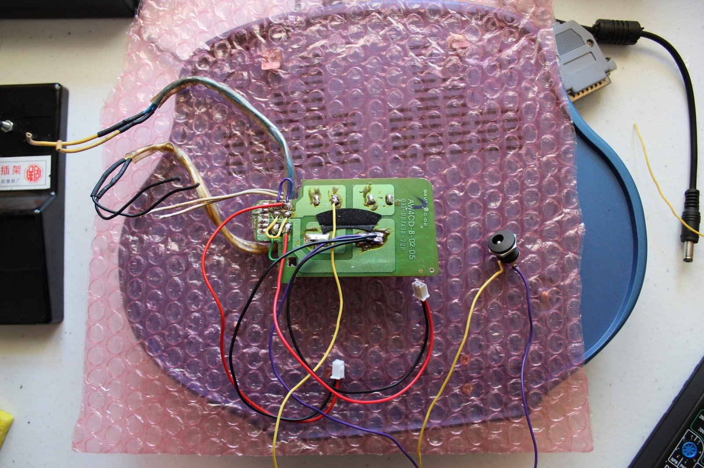

Next came the DC-DC step-down converters. I initially set one to 6.3 V and the other to 9.75 V, with their ground connection running to the same point on the battery PCB that feeds into the transformer wiring. The idea was to find out whether I could get the various sections of the machine running without relying on the troublesome original transformer.

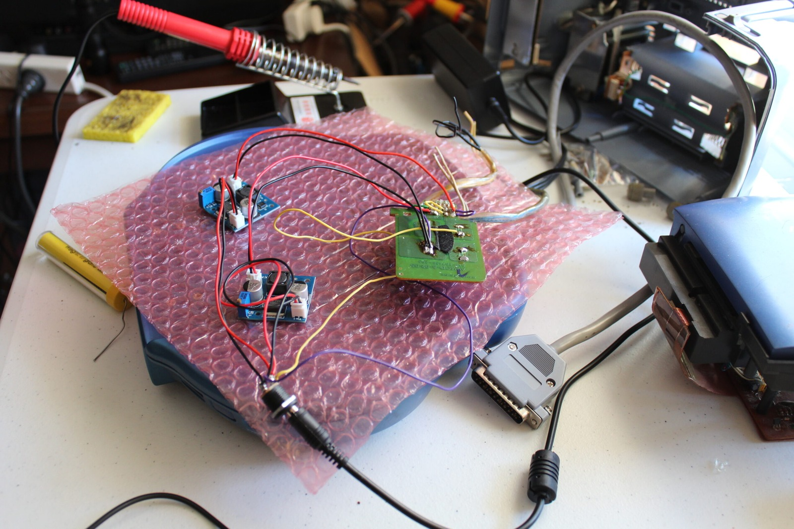

### Following the rails

The Mega-CD mechanism connects to the rest of the machine through several wiring harnesses, and I've been trying to work out what each one does. From the testing so far, here's what I've established:

1. The long connector on the right powers the CD mechanism and front control buttons.
2. The medium connector on the left carries an approximately 8 V supply on one pin.
3. The short connector on the right provides the supply feeding the Mega Drive section.

That last connection is particularly important because the game hardware ultimately needs a regulated 5 V supply. Unfortunately, I was only measuring around 3.3 V, and the resulting picture looked absolutely terrible. Clearly something wasn't quite right.

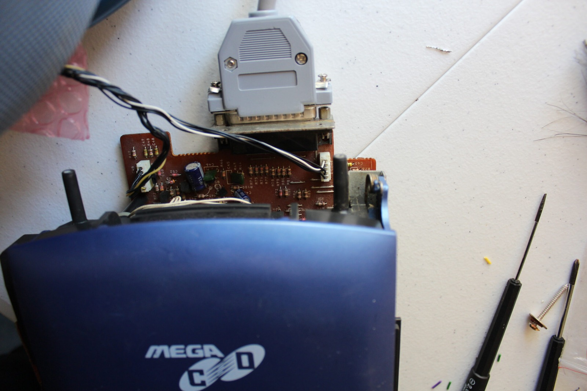

To keep everything connected during testing, I've had to sit the machine upside down and backwards on the workbench. An excellent recipe for sanity! It isn't the most convenient arrangement in the world, but it lets me reach the boards and check the voltages without constantly dismantling everything.

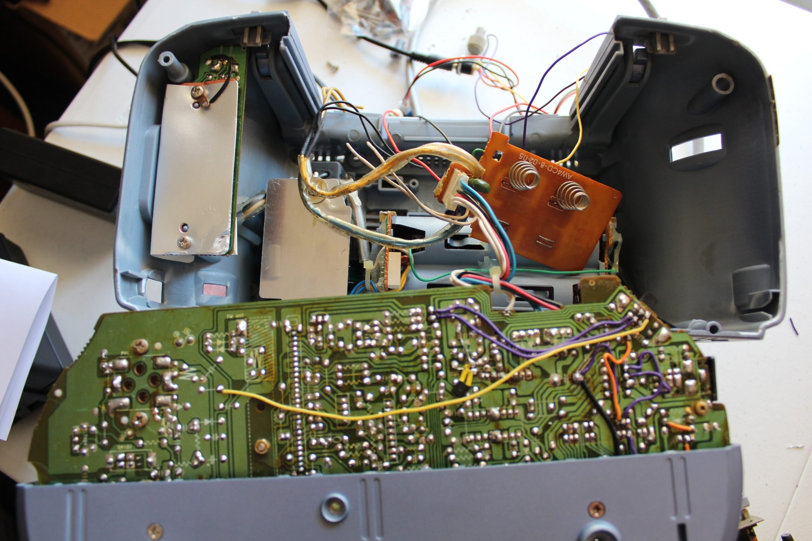

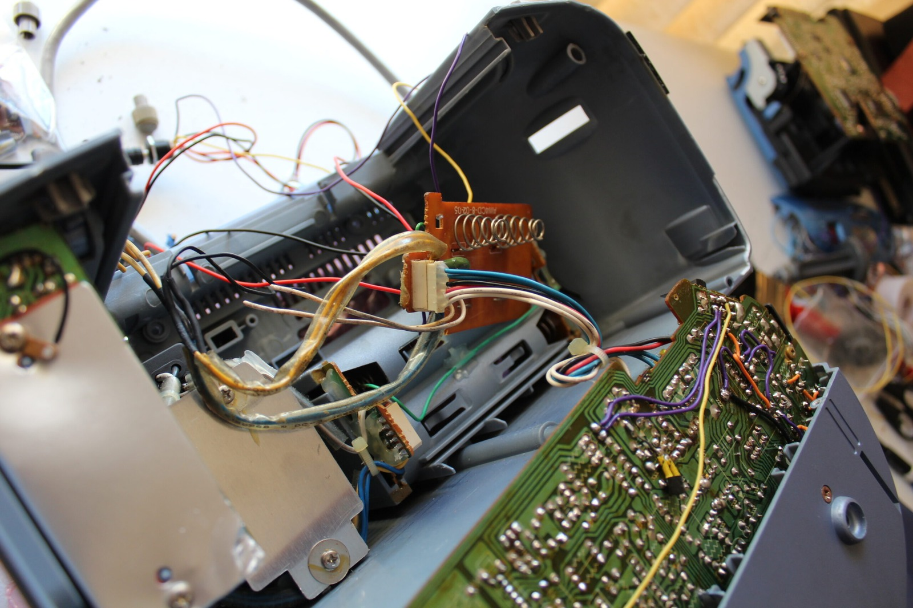

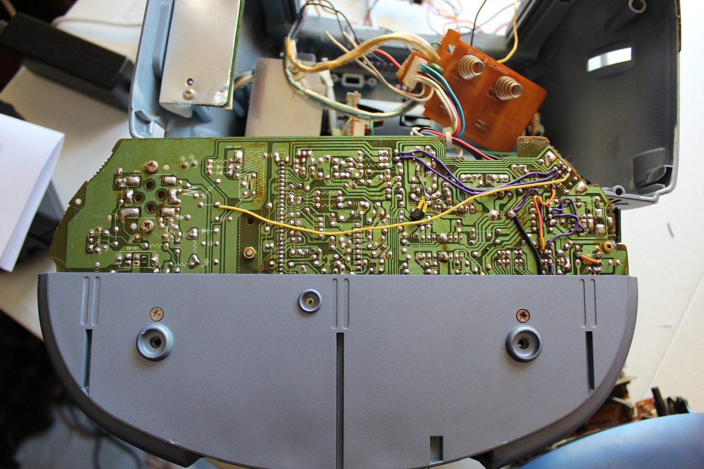

Here's the back of the Aiwa with both DC-DC converters connected. It looks a little ridiculous with all the extra wiring hanging out, but at least I can start testing the different supplies independently.

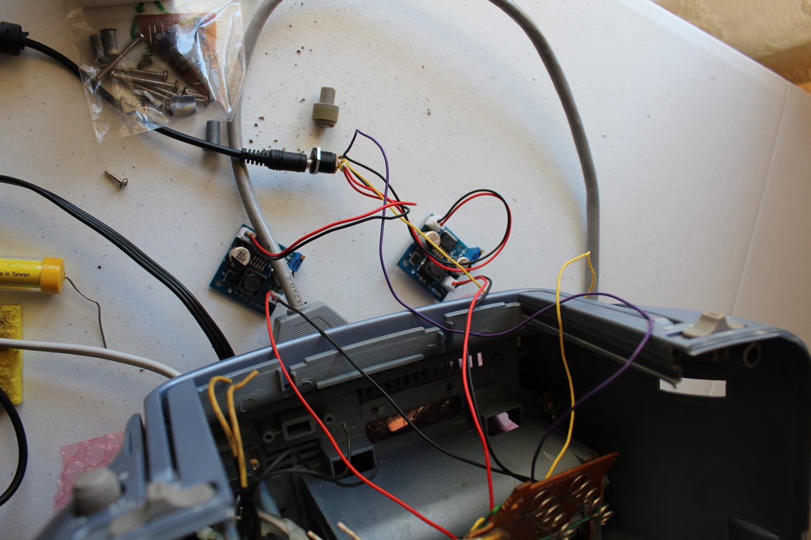

Blue, white, red and black are the colours of the day. By this point I've become rather familiar with where the wires run around the mainboard, although I'm still not entirely certain which circuits some of them supply.

Now to power it on and see what happens. Errr... that's not looking quite right!

### Finding the regulator problem

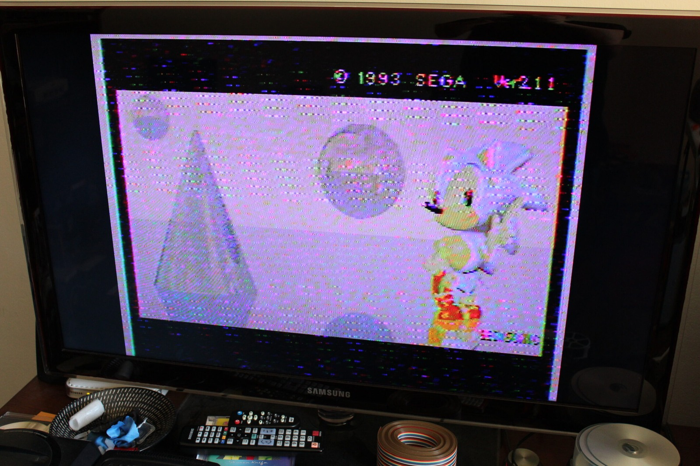

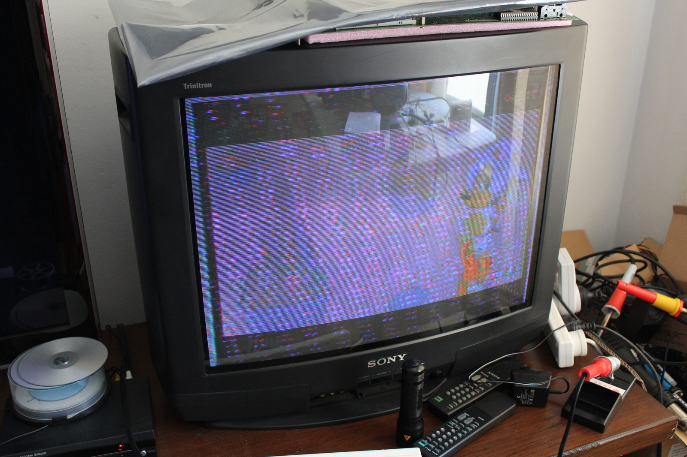

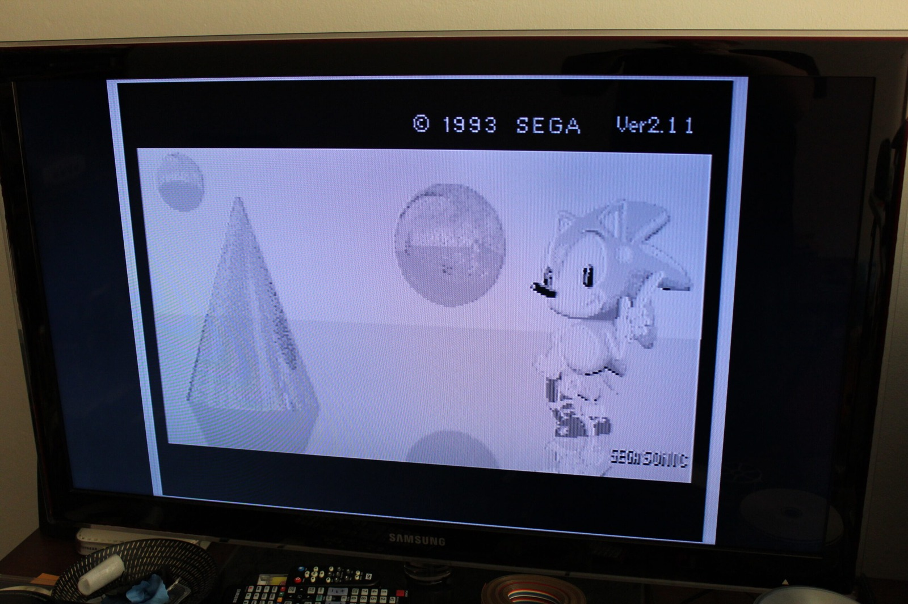

I've been measuring the voltages at several points around the machine. One of the CD-deck supplies looked reasonably close to what I expected, but another was almost 2 V too low. More importantly, a regulator that should have been producing around 6 V was only giving me about 4 V. That might explain why the Mega Drive section was behaving so badly.

Disconnecting one of the converters also established that the white-wire supply was feeding the Mega Drive hardware. I still hadn't worked out exactly what the blue-wire supply was responsible for, but at least I was beginning to narrow things down.

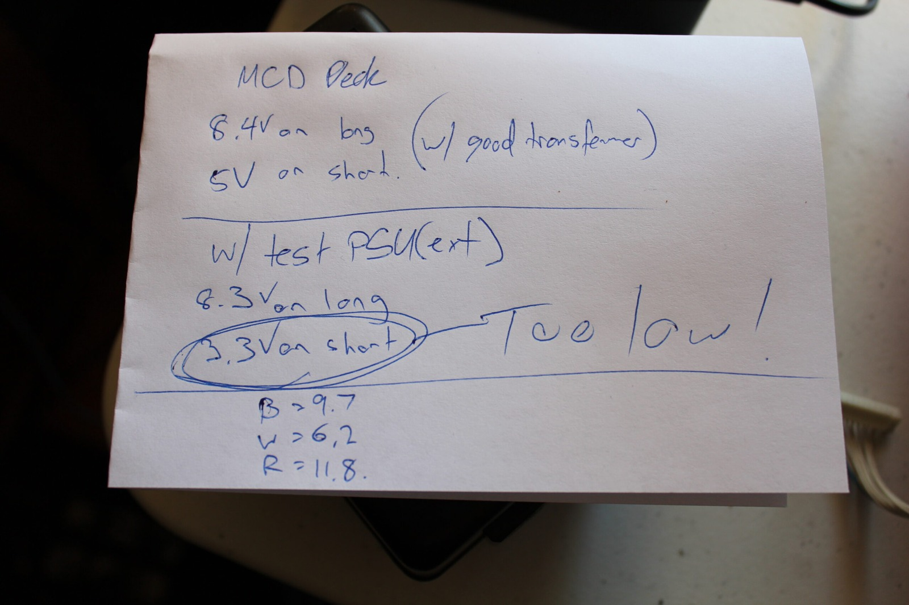

Then I realised what I'd done. I'd been feeding just 6.3 V into a regulator that was supposed to produce approximately 6 V. If it's behaving like a conventional 7806, it needs some extra voltage at the input to regulate properly, typically around another 2 V under load. No wonder the output was struggling!

I increased the test input to 8 V and gave it another go. Now we're getting somewhere!

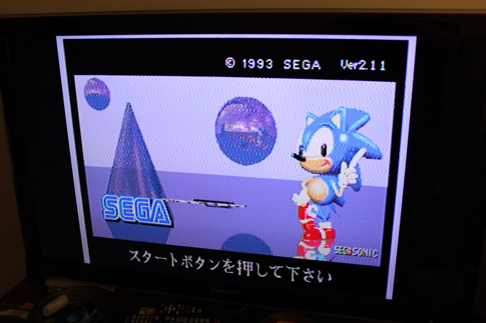

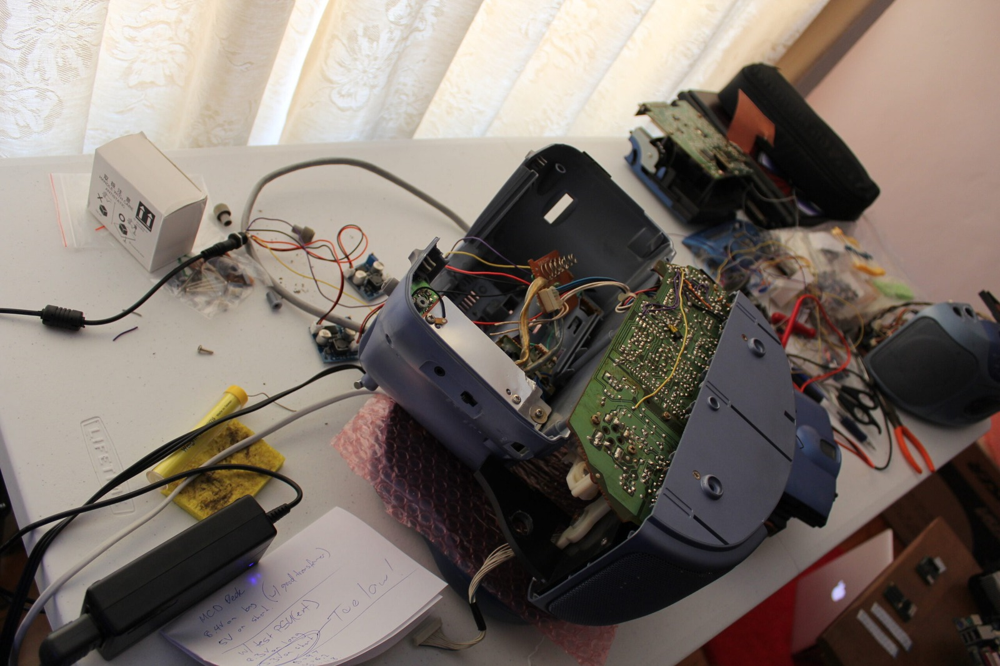

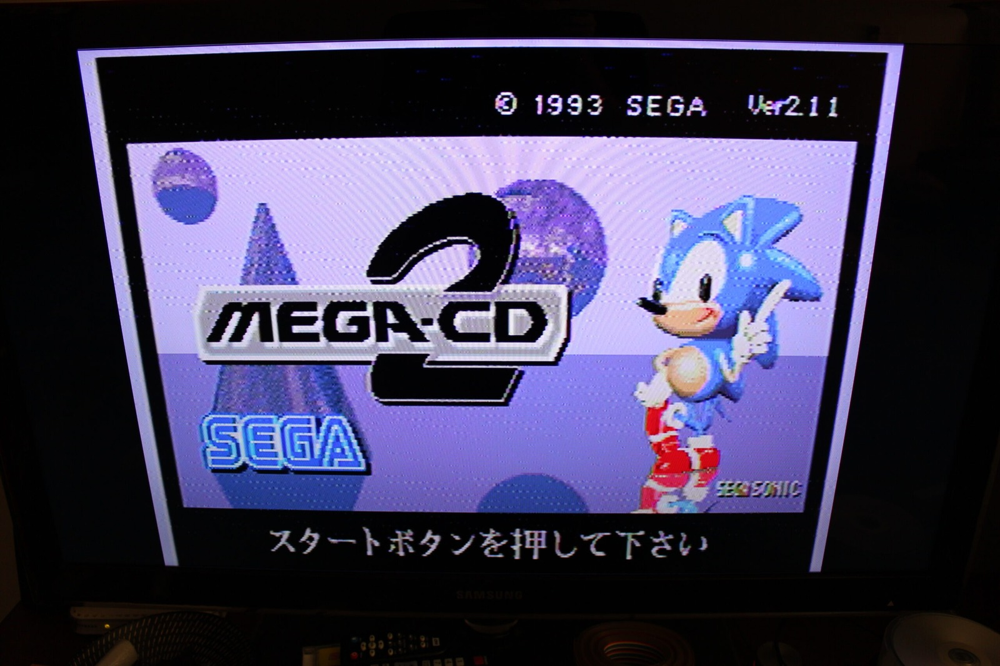

Not only did the picture improve enormously, but **there was sound coming from the damaged mainboard as well!** Victory! After all the broken tracks, damaged circuitry and fiddling around with power supplies, it's rather satisfying to see this thing producing a proper picture and audio again.

That also tells me that the 6 V regulator wasn't getting enough input voltage during my earlier tests. I'll still need to investigate the original transformer and the surrounding circuitry before deciding exactly what's wrong with the power supply. The rectification, filter capacitors, wiring and whatever load is attached could all be contributing to the problem.

More importantly, the mainboard repairs I've been working on are doing their job well enough for the Aiwa to produce both video and sound. That's a very welcome result, considering the state this machine was in when I started.

I've also got a replacement optical pickup for the CD mechanism, so perhaps I'll even get to play a Mega-CD game on this thing eventually. There's still plenty to do, but for once the repairs appear to be heading in the right direction.

Thanks again to Dutchy over on the [ASSEMbler Games forum](https://web.archive.org/web/20130920141927/http://www.assemblergames.com/forums/showthread.php?42186-Aiwa-Mega-CD-CSD-GM1-Mainboard-Repair) for reminding me that voltage regulators need some headroom above their regulated output. That little reminder may have saved the day!

### Related posts

- [Aiwa Sega Mega-CD CSD-GM1 Repairs Part 1: Power Restored](/aiwa-sega-mega-cd-csd-gm1-repairs-part-1-power-restored/)
- [Aiwa Sega Mega-CD CSD-GM1 KSS-210B Laser Replacement](/aiwa-sega-mega-cd-csd-gm1-kss-210b-laser-replacement/)

### Sources

- [STMicroelectronics - L78: Positive voltage regulator ICs](https://www.st.com/resource/en/datasheet/l78.pdf) - the L7806A electrical-characteristics table gives a typical 2 V dropout at 1 A and 25 °C; actual headroom depends on the part and operating conditions.
- [HSE - Electrical safety: Frequently asked questions](https://www.hse.gov.uk/electricity/faq.htm) - explains the hazards of live electrical work and the need to isolate supplies and release stored energy.
