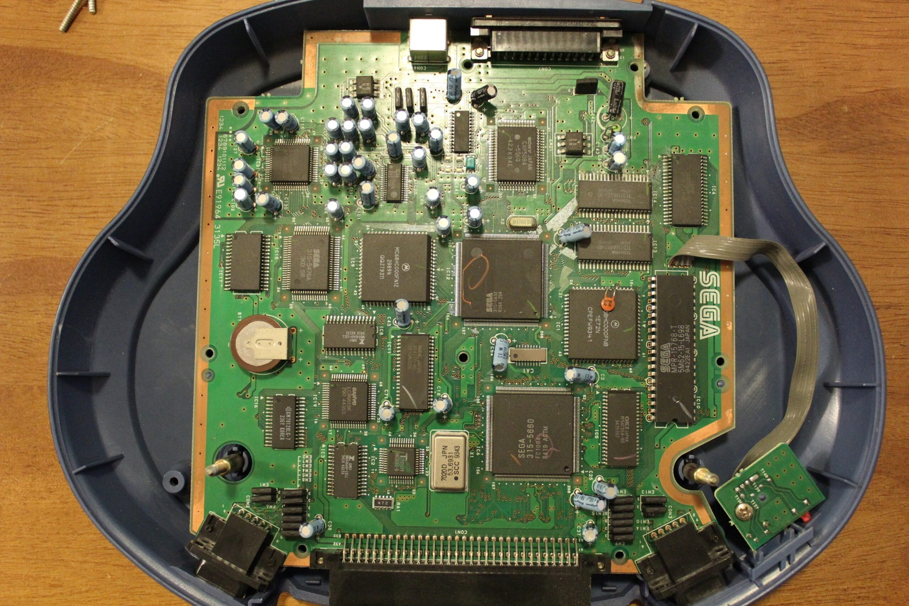
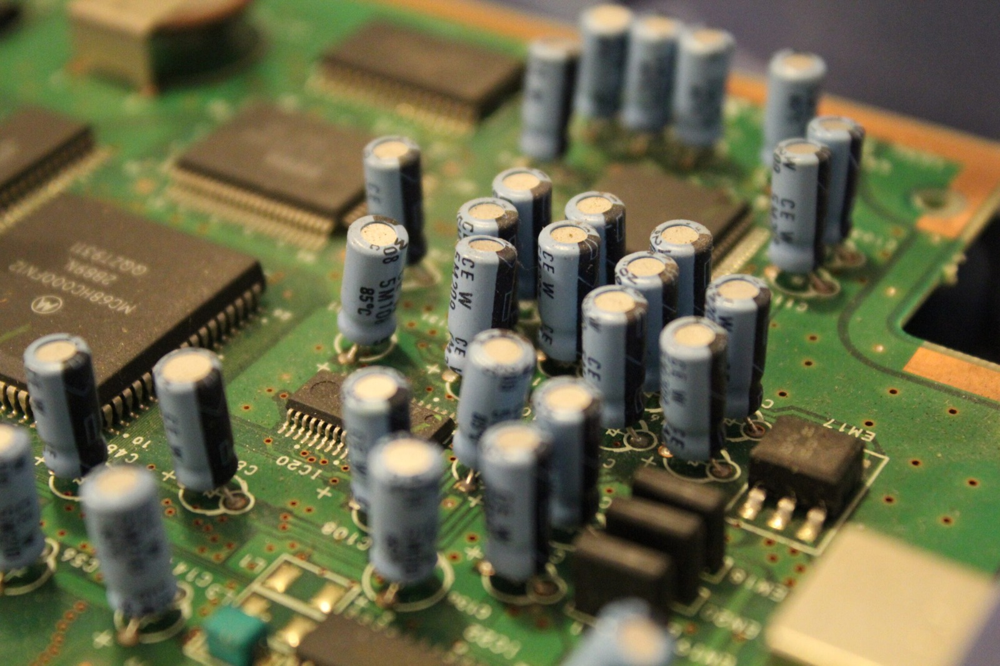
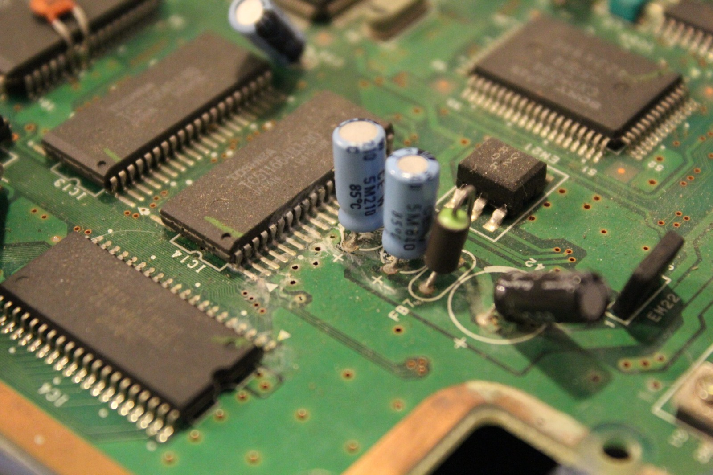



Here's a quick look inside the Mega Drive and Mega-CD Game Unit that attaches underneath the Aiwa CSD-GM1. It's a rather unusual little piece of hardware, and at first glance I wasn't sure what I'd be able to do with it away from the rest of the stereo. Pretty useless by itself, unless you want a lead-weighted frisbee! Or so I thought.

The Game Unit contains the Mega Drive and Mega-CD hardware, while the upper section of the Aiwa supplies power, the CD mechanism and the rest of the audio-system connections. That makes the detachable unit interesting, but it also means there's rather more involved than simply plugging in a power adapter and expecting the whole thing to work.

Later testing showed that the Mega Drive section of this particular Game Unit could actually run independently. On the unit I tested, a suitable regulated 5 V supply connected to pin 24, with ground on pin 12, was enough to boot Mega Drive cartridges without the boombox attached. Quite a nice surprise, considering I'd originally been joking about using the thing as a frisbee!

Those are the connections I found on my own hardware, so they shouldn't be treated as a universal pinout without checking the individual unit first. The last thing anyone wants to do is accidentally feed the wrong voltage into one of these rare machines. There's enough broken Sega hardware in my collection already!

The Mega-CD side is another story because it still depends on the CD mechanism in the Aiwa's upper section. Without that connected, the Mega-CD BIOS can begin starting up, but it can't proceed normally. So the Game Unit is capable of more on its own than I'd first expected, just not everything.

As always, there are more photos in the [galleries or file server](/goodies/). At least we can cross the lead-weighted frisbee idea off the list for now!

### Sources

- [Mega-CD.de: Aiwa CSD-GM1 (Detachable Game Unit)](https://www.mega-cd.de/japmcd2.htm)

### Related Posts

- [Aiwa Sega Mega-CD CSD-GM1 Game Unit in Standalone Mode](/aiwa-sega-mega-cd-csd-gm1-game-unit-in-standalone-mode/)
