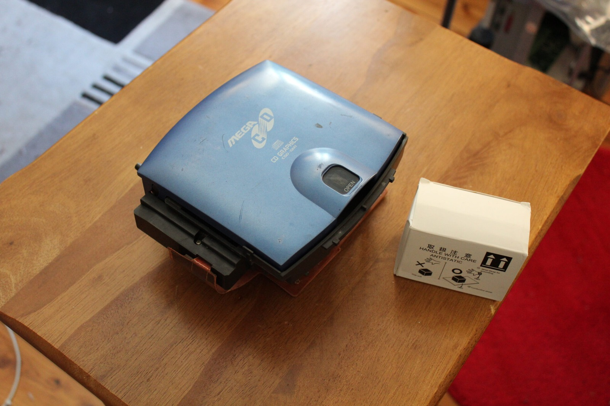
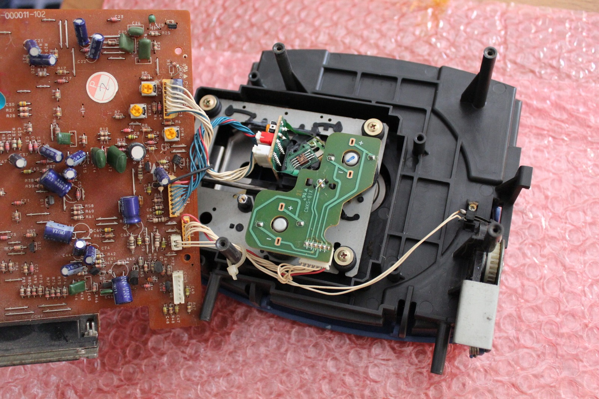
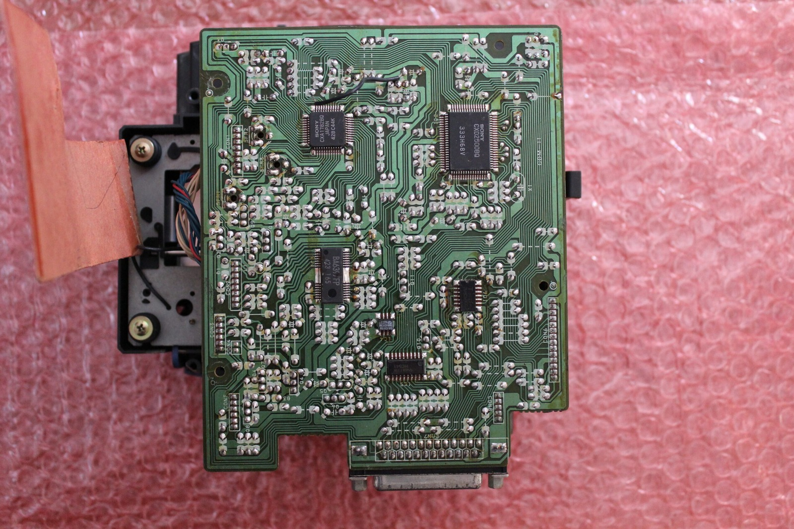
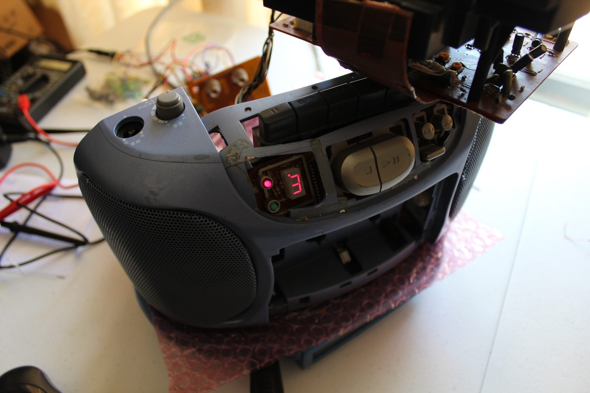
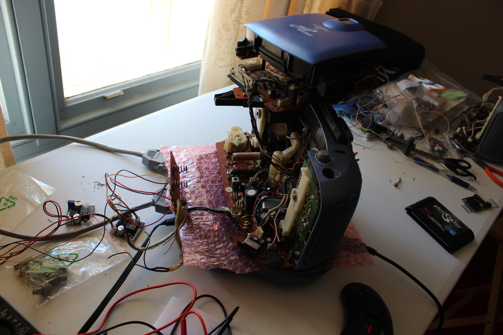



Compared with everything else this Aiwa has thrown at me, this was almost a straightforward repair. The video above covers replacing the Sony KSS-210B optical pickup in the CSD-GM1 CD mechanism, although getting to the laser turned out to involve rather more screws than I'd originally anticipated.

I had suspected the pickup earlier because the drive was struggling to read discs, although I hadn't wanted to call it dead until I'd done more testing. After all the problems with the transformer and mainboards, it would have been rather nice if this was the final repair.

The replacement KSS-210B was still available, which was excellent news considering how uncommon the Aiwa Mega-CD itself has become. The new pickup arrived with an anti-static solder bridge protecting the laser assembly during transport. That needed to be removed before the unit could be used.

*The game module and the replacement laser's anti-static packaging. I was very keen for this bit to work!*
{: .media-caption }

The Aiwa mechanism is arranged a little differently from the Mega-CD II drives I'd worked on previously. The motor circuitry is on a separate PCB from the board carrying the main CD-control electronics, and there are several screws, connectors and grounding points that need attention before the optical assembly can be removed.

Once I finally had access to the pickup, the familiar guide rail and sled arrangement came into view. Removing the rail allowed the original laser to come free, although naturally it took a little persuasion. I gave the mechanism a clean and applied some ceramic grease to the moving parts before installing the replacement.

*The CD mechanism opened up, with the guide assembly and electronics laid bare for the laser swap.*
{: .media-caption }

I left the new laser's power adjustment alone. The original pickup had already been adjusted quite extensively during earlier troubleshooting, without producing the result I wanted. This time I'd rather start with the replacement as supplied than go fiddling with things unnecessarily.

Reassembly involved putting the guide rail, motor components and circuit boards back into place, along with their various screws and connectors. There's also a grounding connection that I'd desoldered during disassembly, which needed reconnecting. By the end of it I was rather glad I hadn't lost anything.

*The underside of the CD-control board. Plenty of tracks and solder joints to check while the mechanism is apart.*
{: .media-caption }

With everything back together, I tried an ordinary audio CD. The player detected all thirteen tracks, which was something it hadn't been doing properly before. Track 13! Yes! After everything this machine has put me through, seeing that display was absolutely wonderful.

*A number on the display again! The new pickup is at least recognising tracks, even if playback still needs work.*
{: .media-caption }

Unfortunately, the Aiwa still wasn't completely happy. Although the new laser could read the disc and start playback, the audio occasionally dropped out and the mechanism struggled to recover. I also had some remaining sound problems elsewhere in the machine, so there was clearly more work ahead.

I experimented with the external power arrangement to see whether the supply voltage was contributing to the playback trouble. Increasing it didn't resolve the skipping, and the CD section remained temperamental. At least the new pickup had made a considerable difference to its ability to recognise discs.

*The Aiwa still looks like a pile of spare parts, but the laser change has made a real difference. One problem less!*
{: .media-caption }

You wouldn't even know it had been repaired... ;)

Well, apart from the remaining faults, of course. But the laser replacement itself went rather well, and that's another problem crossed off the ever-growing Aiwa repair list.

**Related Posts**

- [Aiwa Sega Mega-CD CSD-GM1 Initial Damage Report](/aiwa-sega-mega-cd-csd-gm1-initial-damage-report/)
- [Aiwa Sega Mega-CD CSD-GM1 Repairs Part 1: Power Restored](/aiwa-sega-mega-cd-csd-gm1-repairs-part-1-power-restored/)
