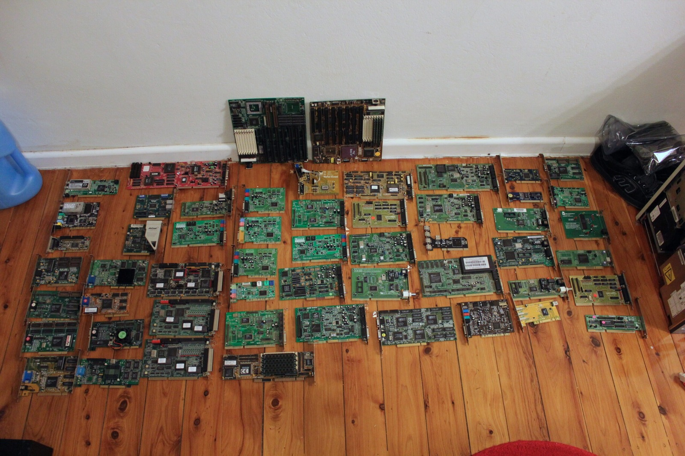



The 5.25-inch floppy drive now living in my Osborne 486 came from that Wyse 286 desktop I had a look at earlier. The Wyse has since gone to somebody else who wanted it, and that's fine by me. All I really needed was the floppy drive anyway, especially after some of the trouble I've had getting these old things to cooperate.

I gave it a proper test by copying the DOS system files onto a floppy and attempting to boot from it. And would you believe it? The drive actually works! There's something rather satisfying about watching an old PC start up from a 5.25-inch disk, even if I'm still recovering from what seems to be a never-ending bout of the flu. Such technology! I'm dying here!

I do get a little annoyed when eBay sellers describe untested drives as working, then cover themselves by saying they're sold as-is. If it hasn't been tested, just say so. But what can you do? At least I've finally got a functioning 5.25-inch drive in the Osborne.

Which reminds me, I've also picked up a huge pile of old PCI and ISA cards, floppy drives and assorted bits and pieces from someone south of the border. They've become a very good source of retro PC hardware, although I may eventually need another room just to store all this stuff.

One particularly useful discovery was a PDS ethernet card for the Macintosh LC 475. Precisely what I needed for the LC 475 I happen to own! Better still, it'll cover the gap where the missing expansion-slot cover should have been.

Now I just need to track down a less rusty power supply and repair those broken PSU retaining clips so the Macintosh stops rattling around. There's always something else to fix, isn't there?

### Related Posts

- [Osborne Australia 486DX2-66 Overview](/osborne-australia-486dx2-66-overview/)
- [Apple Macintosh LC 475 Online with PDS Ethernet](/apple-macintosh-lc-475-online-with-pds-ethernet/)
