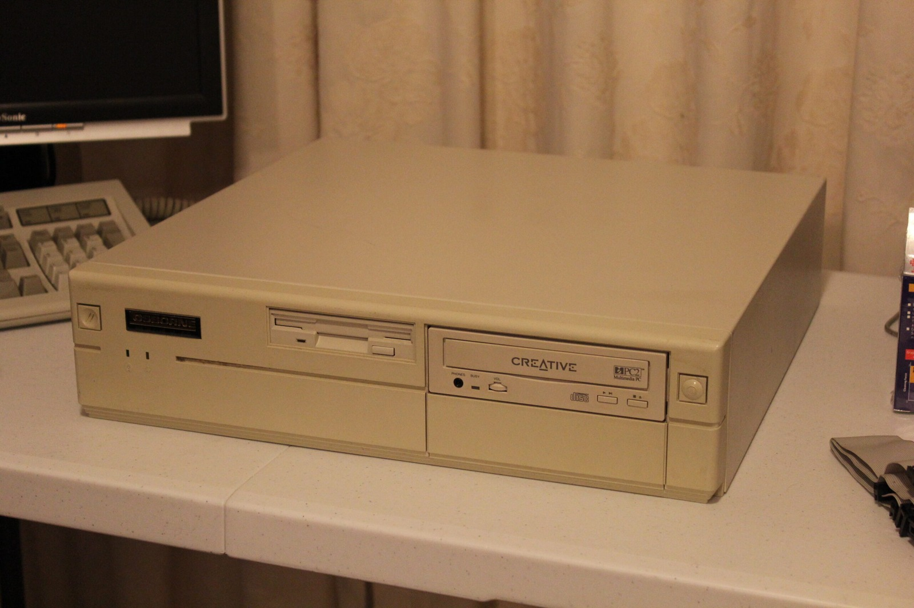
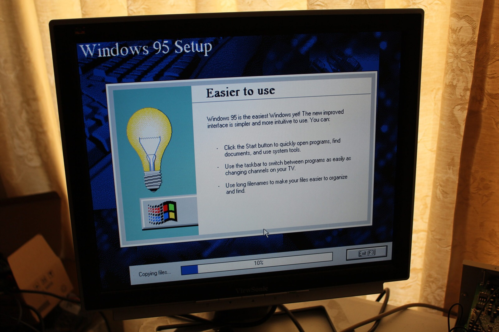
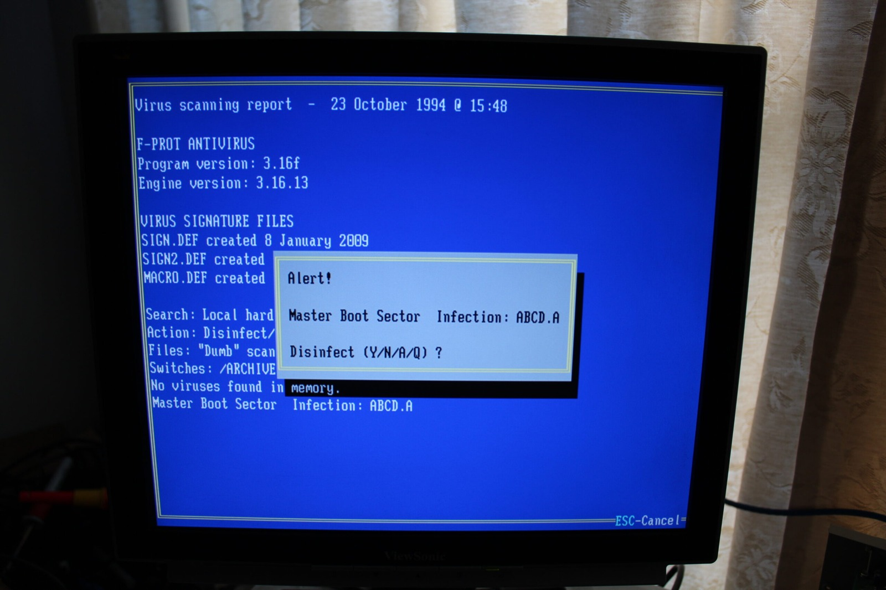

Looks like I'm not the only one who has a virus at the moment. The trusty old Osborne ended up with what appeared to be an MBR or boot-sector infection, and the Sound Blaster 16 installation disks I'd been using were also detected as infected. I originally assumed the disks had infected the PC, although without a known-clean copy from before they entered the Osborne, it's just as possible the machine infected the disks.

I only discovered the problem after using the disks in the Osborne and then bringing them back to another machine to reformat and re-image. So a big thanks to Avast under Windows XP for sounding the alarm, and to Caluser2000 over at the [Vintage Computer forums](https://forum.vcfed.org/index.php?threads/recommendations-on-antivirus-software-for-486-class-pcs.34252/#post419712) for pointing me towards a DOS-era cleanup tool.

F-PROT 3.16f saved the day. The scan report identified ABCD.A in the master boot sector. The archive I used was fprot_dos_316f.zip, with virus definitions dating into 2009. F-PROT 3.16f was the final DOS version and is perfectly at home on a 486.

For this sort of boot-sector cleanup, you really want to start the infected computer from known-clean media rather than letting the compromised hard disk boot. Ideally the rescue floppy should be write-protected too, so the infected machine can't modify it. Windows 95 is now installed as well, and the next challenge is getting this thing onto the internet to some degree.

### Sources

- [DOS Days: Anti-Virus Utilities (F-PROT 3.16f)](https://www.dosdays.co.uk/topics/antivirus_utilities.php)
- [FRISK Software: F-PROT 3.16f (316F.NEW, SCAN.TXT, VIRUS.TXT)](https://www.dosdays.co.uk/media/frisk/3.16f/f-prot.zip)

### Related Posts

- [Osborne Australia 486DX2-66 Overview](/osborne-australia-486dx2-66-overview/)
- [Osborne 486 Windows 95 Installation Demo](/osborne-486-windows-95-installation-demo/)
