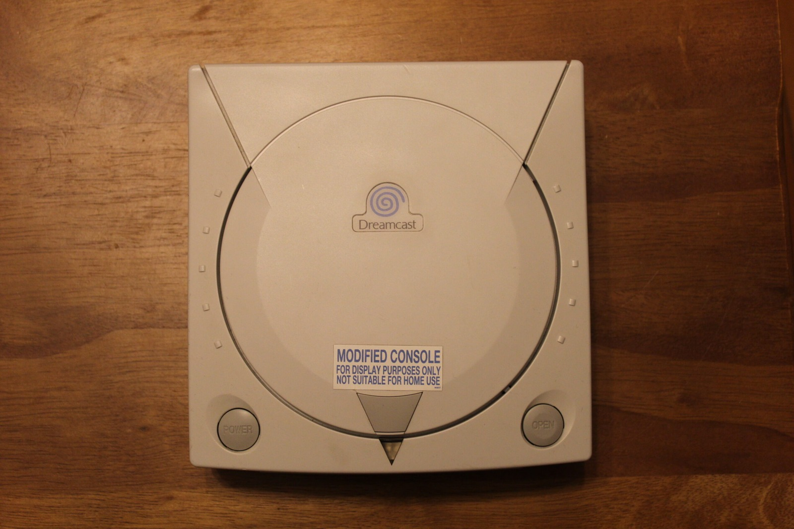
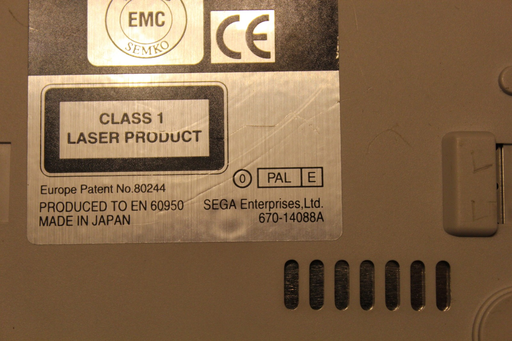
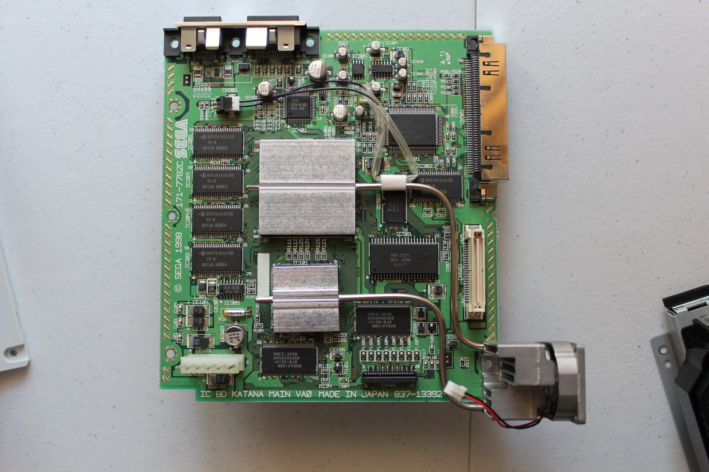
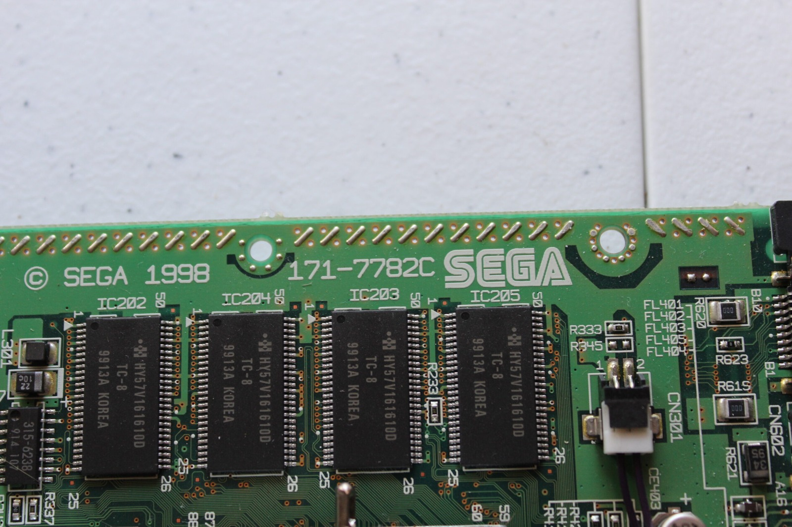

*That unusual display-only sticker is the first clue this PAL Dreamcast may have had an interesting past.*
{: .media-caption }

A Dreamcast post? It's been a while, hasn't it?

Here's a Dreamcast I picked up from the UK some time ago and somehow never properly wrote about after it arrived. It has shown a few problems, including occasional random restarts. That said, I've had it running Bomberman Online for about 45 minutes without a problem.

I am also getting disturbingly good at Bomberman.

*A closer look at the PAL identification on the bottom. At least this part of the mystery is written down!*
{: .media-caption }

The GD-ROM drive makes a little clicking noise and the bearings in the heatsink fan assembly sound crunchy at times. I really need to put it beside my Japanese VA0 and compare them properly.

What makes this unit especially interesting is the date stamp inside the top shell: April 1999. The Dreamcast did not launch commercially in Europe until 14th October 1999, so this shell predates the European launch by roughly six months.

The machine has the PAL blue-swirl startup and no functioning modem. It also carries the unusual "MODIFIED CONSOLE, FOR DISPLAY PURPOSES ONLY, NOT SUITABLE FOR HOME USE" label I mentioned when I first acquired it. All of that makes some sort of pre-launch display or demonstration use plausible. Plausible is as far as I am willing to go though. I do not have documentation establishing exactly who used this machine or what its original purpose was.

*With the lid off, the VA0 board marking is much more useful than guessing the console's original display role.*
{: .media-caption }

PAL VA0 hardware is real, but much less commonly documented than the later PAL VA1. Older discussion sometimes treated PAL VA0 machines as though they had never existed at retail at all. I don't have enough surviving evidence to make that broader claim either way. What I can establish is that this is a genuine PAL VA0 and that its shell was manufactured before the European Dreamcast launch.

*The 171-7782C board number and 1998 marking make this PAL VA0 easier to document.*
{: .media-caption }

Enjoy the photos and don't forget to check the [photo gallery](/goodies/).

Next up I'll pull it apart properly and compare the internals with my Japanese VA0 and ordinary PAL VA1 machines.

### Sources

- [ConsoleMods: Dreamcast Model Differences (PAL VA0; McRetro Photos)](https://consolemods.org/wiki/Dreamcast:Dreamcast_Model_Differences)
- [TSSZ News: Dreamcast European Launch Delay (14 October 1999)](https://lastminutecontinue.com/news/dreamcast-launch-in-europe-delayed/)

### Related Posts

- [Sega Dreamcast PAL VA0 Internal Update](/sega-dreamcast-pal-va0-internal-update/)
