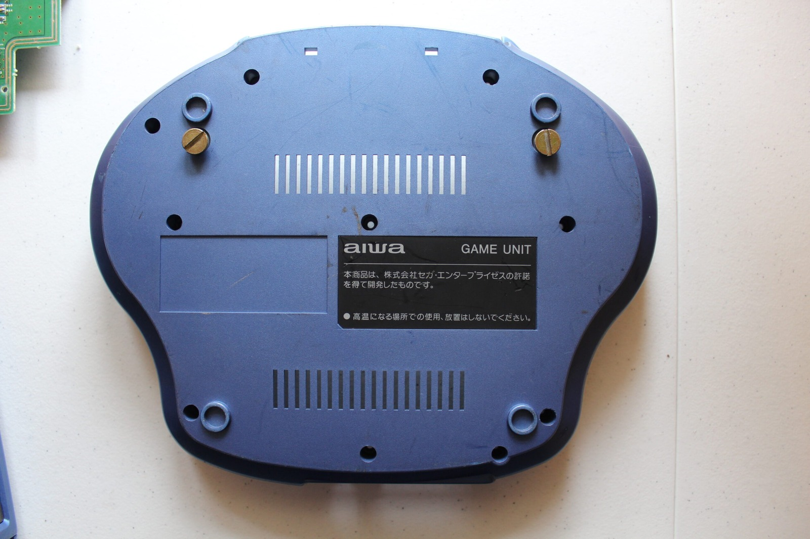
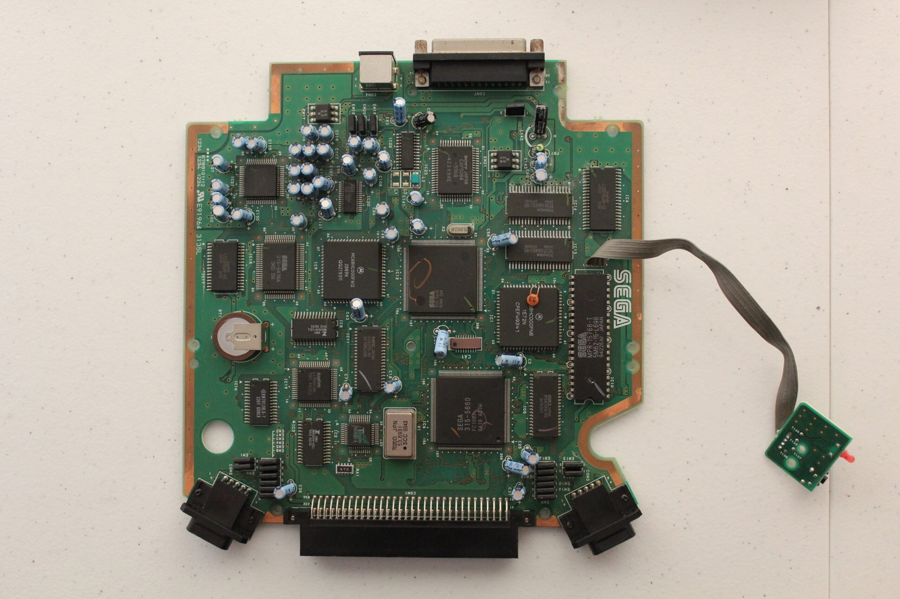



Here's a closer look inside the Aiwa Mega-CD CSD-GM1 Game Unit, complete with enough capacitors to keep me busy for quite some time. There appears to be some damage around the rear of the mainboard, although I'm not entirely sure whether it's leaking capacitors or something else that's made a mess of things. One of the capacitors looks a little suspicious too, so I'm planning to recap the board and see whether that helps with the troublesome Mega Drive audio.

There's some cosmetic damage to deal with as well. The little flap doesn't close properly, which appears to be another souvenir from whatever unfortunate adventure this machine had before I acquired it. There's a metal frame inside the blue plastic housing that's been bent out of shape, so hopefully I can straighten that up without too much difficulty. Compared with replacing all those capacitors, it might even be the easy job!

I've been comparing my two Game Units and reckon one was manufactured roughly 10 to 20 weeks after the other. To keep everything straight, I've labelled the older one 01-01 and the newer one 01-02.

One interesting difference is that two capacitors which are black on the 01-01 board are blue Rubycons on 01-02. My first thought was that somebody might have replaced them at some point, although there's nothing to say they weren't fitted like that at the factory. They could simply be ordinary production differences between the two boards. Have a look at the [photo gallery](/goodies/) or the video and be the judge.

I've also put the complete capacitor list on the [file server](/goodies/), because there's certainly no shortage of them. While I've got the board apart, I'd like to replace the backup battery as well.

The original cell is a VL2020 with three terminals. It's a rechargeable 3 V vanadium-lithium battery rated at 20 mAh, which makes finding a suitable replacement slightly more complicated than grabbing an ordinary CR2032. The charging arrangement and terminal layout both need to be compatible, and I'm having trouble finding exactly what I want.

So that's the plan: capacitors, battery, a little cosmetic repair and hopefully some improvement in the sound department. The search continues!

### Related posts

- [Inside the Aiwa Mega-CD CSD-GM1 Game Unit](/inside-the-aiwa-mega-cd-csd-gm1-game-unit/)
- [Aiwa Sega Mega-CD CSD-GM1 Game Unit in Standalone Mode](/aiwa-sega-mega-cd-csd-gm1-game-unit-in-standalone-mode/)

### Sources

- [Panasonic VL2020 rechargeable coin battery](https://energy.panasonic.com/jp/business/products/coin-rechargeable/vl/models/VL2020) - identifies the VL2020 as a rechargeable 3 V vanadium-lithium coin cell with a nominal 20 mAh capacity and provides charging specifications.
